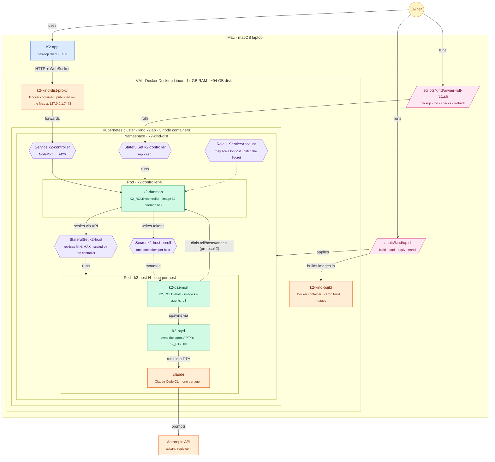
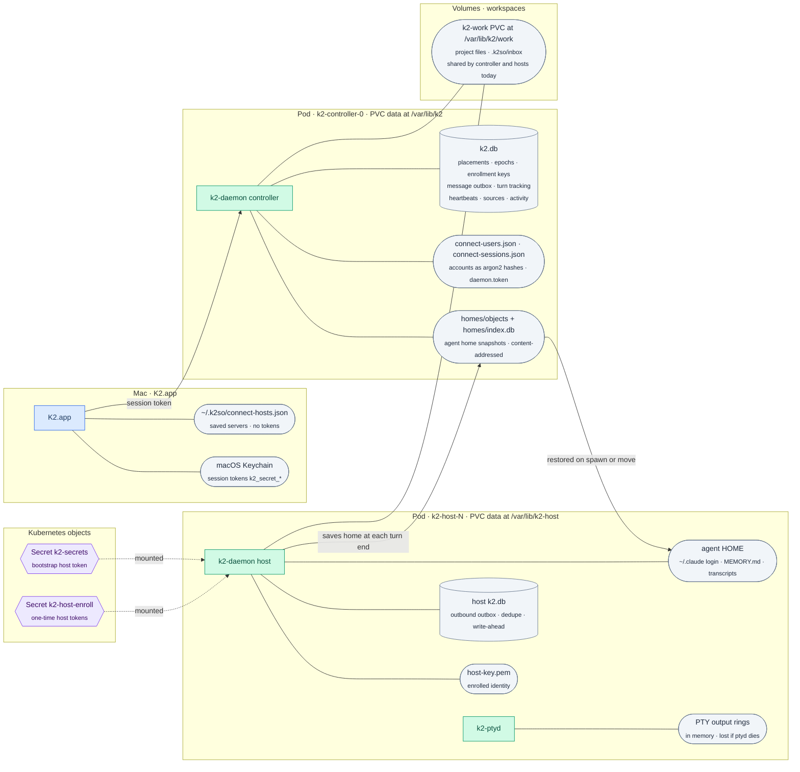
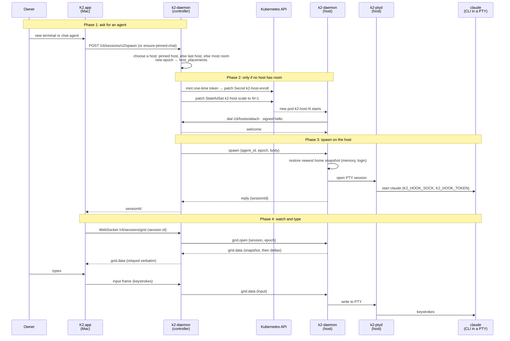
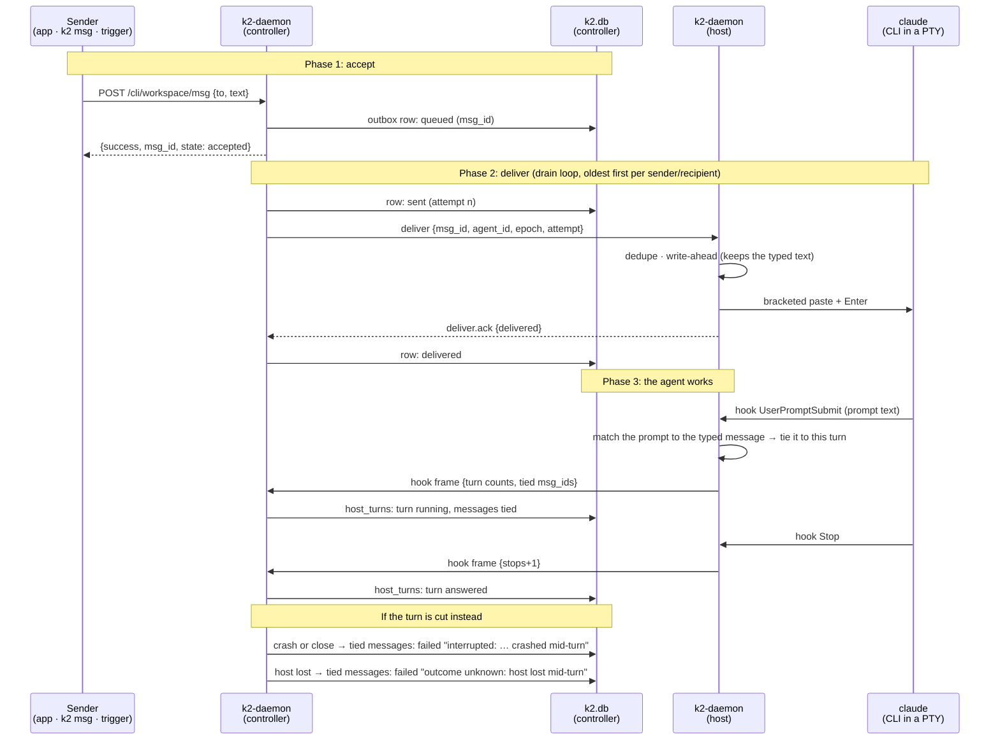
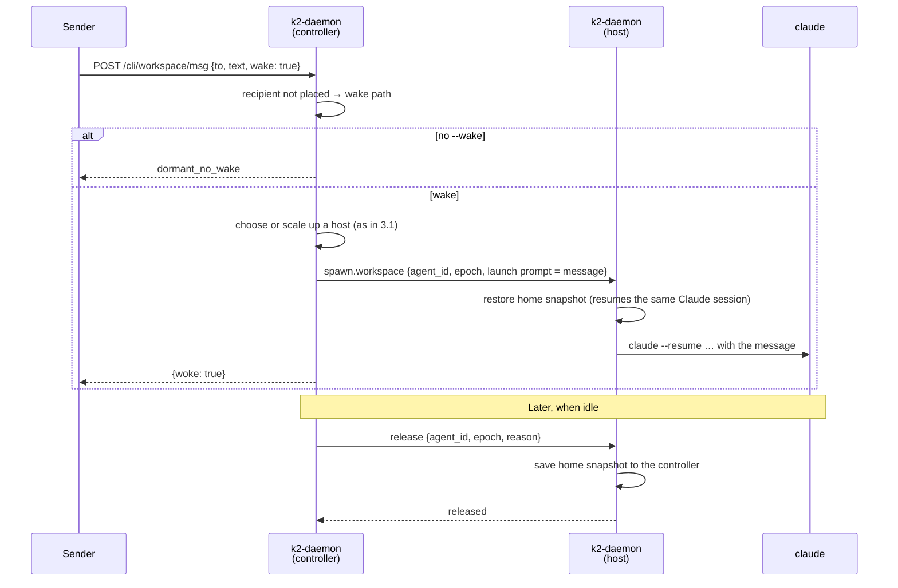
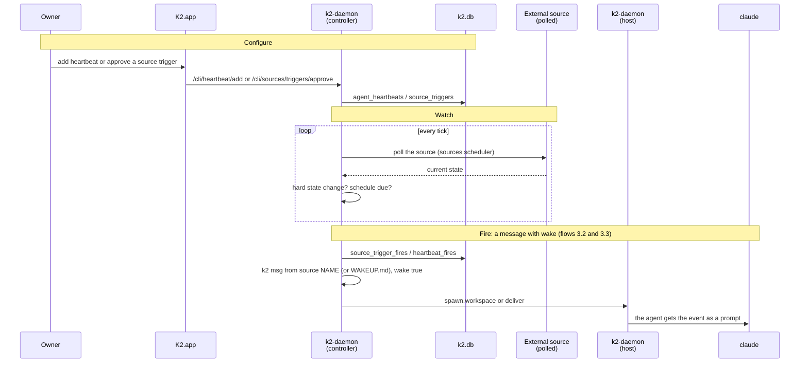

# K2 distributed runtime: architecture

How K2 runs as a distributed system on Kubernetes. One **controller** daemon
owns state and talks to the desktop app. **Host** daemons run the agents
(Claude Code and others) and dial the controller. The controller adds and
removes host pods as work comes and goes.

This describes `k2-dist/wave3` and release candidate 3 (tag `k2-dist-rc3`,
`b60a9fd80`), which is what the owner's cluster runs. The proven deployment is
**kind** (Kubernetes in Docker) on a Mac. The same manifests are meant for any
Kubernetes, such as k3s; see [What is proven](#what-is-proven-and-what-is-not).

Related docs: the PRD (`docs/prd/k2-distributed-runtime.html`), the per-feature
progress notes (`docs/prd/progress/*.md`), the kind runbook
(`docs/prd/progress/k3s-owner-steps.md`) and the roll history
(`docs/prd/progress/kind-enroll.md`).

## How to read the diagrams

Diagrams follow `docs/prd/diagram-style.md`, the same style as the homelab
cluster docs. In the flowcharts, **shape says what kind of thing a node is**:

| Shape | Kind | Example |
|---|---|---|
| `((circle))` | a person | the owner |
| `[/parallelogram/]` | a script you run | `scripts/kind/up.sh` |
| `[rectangle]` | a long-running process | `k2-daemon`, `claude` |
| `{{hexagon}}` | a Kubernetes object | StatefulSet, Service, Secret |
| `([stadium])` | files or a volume | a PVC, `~/.claude` |
| `[(cylinder)]` | a database | `k2.db` |

**Subgraphs are places**, nested the way they really are: machine → VM →
node container → namespace → pod → container. **Colour** says who owns it:
green is K2's distributed runtime, blue is existing K2, orange is outside
software (Docker, kind, Kubernetes, Claude, Anthropic), and slate is state.

## 1. Deployment: the Kubernetes cluster

Key points:

- **The app only ever talks to the controller.** It reaches it through a
  loopback port (`127.0.0.1:7443`) that a small proxy container forwards
  into the cluster. There is no TLS on that hop today, because it never
  leaves the Mac.
- **Hosts dial out to the controller**, never the reverse. A host proves who
  it is with a one-time enrollment token from the Secret, then a signed key.
- **The controller scales the host pool itself.** With
  `K2_PROVISIONER=kubernetes` it patches the `k2-host` StatefulSet's scale
  (bounded by `K2_PROVISIONER_MIN_HOSTS` / `_MAX_HOSTS`, idle hosts drained
  after `_IDLE_AFTER`), and mints the new host's token first.
- **k2-ptyd** owns each agent's terminal (PTY), so the daemon can restart
  without killing the agent. Adopting those sessions after a restart is the
  ptyd S3 work, on wave3 after rc3 and still under review.

## 2. Where state lives

What survives what:

| Event | What is kept | What is lost |
|---|---|---|
| Controller pod restarts | Everything in `k2.db` (outbox, placements, turn tracking), accounts, home snapshots | In-flight WebSocket streams; the app reconnects within seconds |
| Host daemon restarts | Agent HOME on the host's PVC; with ptyd S3 (post-rc3) the running agents | In rc3, the running agents' sessions; their in-progress turn |
| Host pod is lost (node dies) | The agent's home as of its last turn end, from the controller's snapshot store | The turn in progress (it ends `outcome unknown`), home changes since the last snapshot |
| Agent moves to another host | Memory and session id, restored from the snapshot | Nothing else, if its last turn had ended |

## 3. User flows

### 3.1 Starting an agent

### 3.2 Giving an agent an instruction by message

A message (from the app, another agent's `k2 msg`, a heartbeat or a source
trigger) goes through a durable outbox. It is delivered once. If the agent's
turn is cut off, the message ends with a clear reason rather than vanishing.

Notes:

- Resends back off from 2 s to 60 s. A row fails after 10 unacked sends
  (`no_ack`) or 7 days (`expired`). A recipient that isn't placed waits
  without using attempts.
- K2 records the **state** of a message, not the answer's text. The reply
  lives in the agent's terminal and transcript, or in a new `k2 msg` back.
- A message is only failed with evidence: the host must have matched the
  agent's actual prompt to the text it typed. Messages Claude folds into a
  running turn are never failed.

### 3.3 Waking a sleeping agent with a message

### 3.4 Events: schedules and data-source triggers

K2 has **no inbound webhook receiver** today: nothing accepts an external HTTP
POST and routes it to an agent. The event mechanisms that exist are:

- **Heartbeats**: scheduled wake-ups. Configured with `/cli/heartbeat/*`,
  stored in `agent_heartbeats` and `heartbeat_fires`; the prompt is the
  agent's `WAKEUP.md`. A 60-second tick in the daemon fires them.
- **Data-source triggers**: the daemon **polls** an external source (it is
  not pushed to) and wakes an agent when the source's state changes in a
  way the trigger cares about. An agent can only propose a trigger; a person
  approves it. Routes `/cli/sources/triggers/*`, tables `sources`,
  `source_triggers`, `source_trigger_fires`.
- **Mail** (Stalwart capability): agents long-poll `/cli/mail/wait`; mail
  arrival does not wake an agent by itself.
- **Outbound only**: notifications to Slack, ntfy and other webhook targets.

An external system that wants to prompt an agent, such as another app, can
call the message route directly (flow 3.2) with a K2 token.

## What is proven, and what is not

Proven on kind on a Mac, against rc3:

- The owner's K2 (`k2-kind-dist`) on rc3: a real Claude Code turn through
  `127.0.0.1:7443`, a turn-end memory save, sleep and wake into the same
  session, the app's login path, reconnect within seconds after both pods
  restart.
- The final Linux gate (9,413 tests passing), the G2 scenario suite including
  S10 under heavy chaos (10 of 10 rounds), and the G4 suite on kind.
- A fresh bring-up from the runbook alone.
- The fs/git relay (the app's file browser and git panel served from the
  agent's own host): 13 review rounds and K5 on kind, 45 of 45 checks.
  Shipped **off** by default; the migration to switch it on is scripted.

Not proven, or not built:

- **Kubernetes other than kind** (k3s, cloud). The scripts load images with
  `kind load` and reach the controller through a local proxy. A k3s variant
  needs a registry or `k3s ctr` import, images built for the cluster's CPU
  (Macs build ARM; most cloud VMs are x86), and a remote address.
- **Remote access over the internet**: no TLS ingress or Tailscale setup yet.
- **Phone and web clients** against the distributed controller: untested.
- **An external app holding its own K2 credential** to post messages: the
  route exists; the right token type has not been settled.
- **Inbound webhooks**: not built (see 3.4).
- **Agents surviving a host-daemon restart** (ptyd S3): on wave3 after rc3,
  with fixes on `k2-dist/ptyd-s3.1` awaiting review. Don't roll the wave3 tip
  until they are merged and gated.
