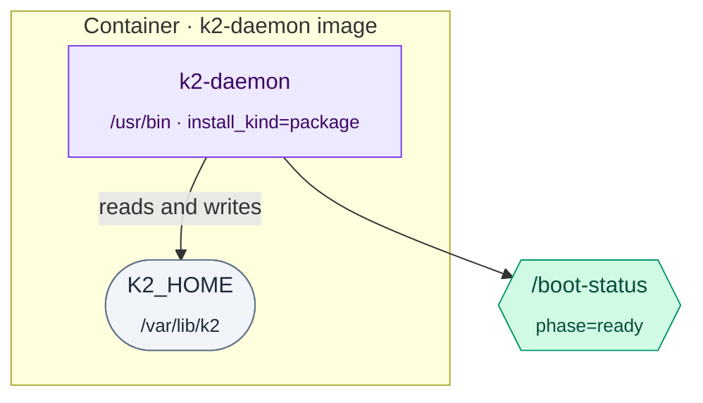

# Diagram style for K2 Distributed Runtime work

Every diagram in `docs/prd/progress/*.md` and on the coordinator page follows
this style, borrowed from the owner's homelab cluster docs
(`~/repos/homelab-cluster/README.md`). Diagrams are Mermaid, kept in the
markdown file they illustrate.

## Rules

1. **Legend first.** Start every flowchart with a `%%` comment block naming
   each colour and shape used.
2. **Section banners.** Group nodes with `%% ── NAME ─────` comment banners,
   one per subgraph.
3. **One subgraph per place.** A subgraph is a machine, container, pod,
   namespace or crate. Title it `Place · detail`, for example
   `subgraph ctl [Controller · k2-daemon]`.
4. **Two-line labels.** `Name<br/><sub>where · version or path</sub>`, for
   example `D[k2-daemon<br/><sub>crates/k2-daemon · daemon_main.rs</sub>]`.
5. **Shape is kind.**
   - `[ ]` rectangle: a process or program you run
   - `([ ])` stadium: a file, volume or on-disk state
   - `{{ }}` hexagon: something created or derived (a generated file, a CR, a report)
   - `[( )]` cylinder: a database
   - `>  ]` flag: an env var or setting
6. **Edges.** Solid `-->` for calls and data flow, labelled with the verb
   (`-- spawns -->`). Dotted `-.->` for soft or optional dependencies.
7. **Colour by class, never inline `style`.** Use the `classDef`s below,
   Tailwind 100/600/900 triples.
8. **Sequence diagrams** alias participants with a role line
   (`participant D as k2-daemon<br/>(controller)`), mark phases with
   `Note over A,B: Phase 1: …`, and use `-->>` for replies.

## Palette

```text
%% component kinds
classDef existing fill:#dbeafe,stroke:#2563eb,color:#1e3a5f   %% blue: exists today, unchanged
classDef changed  fill:#ede9fe,stroke:#7c3aed,color:#3b0764   %% violet: exists today, changed by this task
classDef new      fill:#d1fae5,stroke:#059669,color:#064e3b   %% green: new in this task
classDef external fill:#ffedd5,stroke:#ea580c,color:#7c2d12   %% orange: outside K2 (docker, kind, kubectl, claude)
classDef state    fill:#f1f5f9,stroke:#64748b,color:#1e293b   %% slate: files, volumes, env

%% task status (coordinator DAG)
classDef pending  fill:#f1f5f9,stroke:#64748b,color:#1e293b
classDef running  fill:#dbeafe,stroke:#2563eb,color:#1e3a5f
classDef done     fill:#d1fae5,stroke:#059669,color:#064e3b
classDef blocked  fill:#fef3c7,stroke:#d97706,color:#78350f
classDef failed   fill:#fee2e2,stroke:#dc2626,color:#7f1d1d
```

## Example



## Rendering and publishing

`docs/prd/progress/render.sh <task>` turns `docs/prd/progress/<task>.md`
into one HTML page (marked and Mermaid from cdn.jsdelivr) under
`$TMPDIR/k2-dist-pages/<task>/` and prints that directory. Publish it with:

```sh
dir=$(docs/prd/progress/render.sh <task>)
superset pages publish "$dir" --visibility just_me \
  --title "k2-dist: <task>" --label "<milestone>"
```

Generated HTML is never committed.
