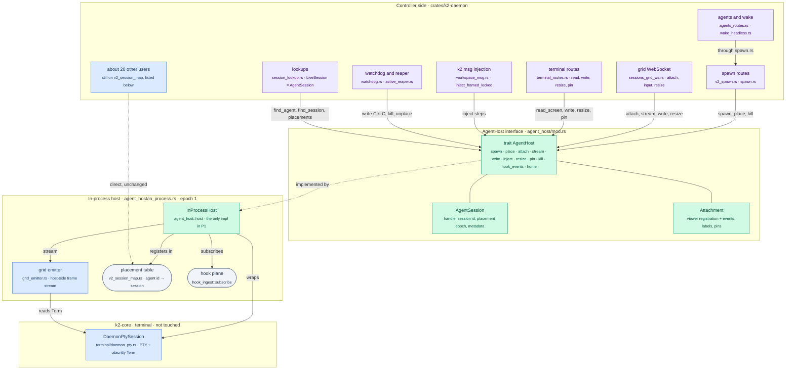
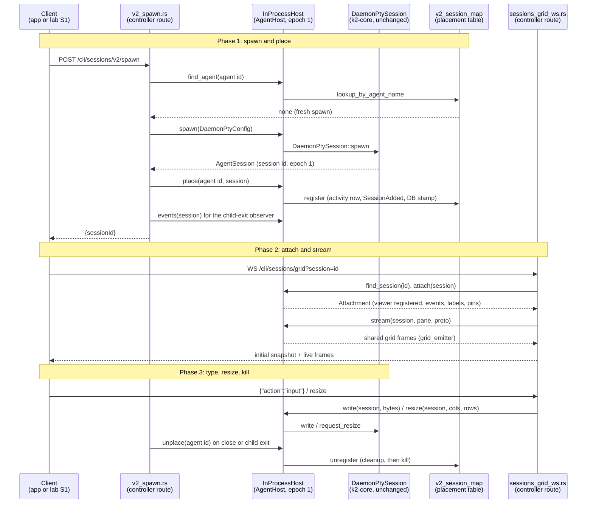

# k2-dist · agenthost: the AgentHost interface, in-process only (PRD P1)

Task `agenthost`, branch `k2-dist/agenthost`. Stage **P1**, gate **G1**:
"A refactor with zero behavior change." Every way the daemon drives an agent
session goes through one `AgentHost` interface. The only implementation is
the in-process host, a thin wrapper over today's `DaemonPtySession` and its
placement table (`v2_session_map`). P2 adds a remote host over the signed
WebSocket; P4 adds the Kubernetes ones. Neither is in scope.

## What changes



## Main flow: spawn, attach, type (scenario S1) through `AgentHost`



## How to try it

```sh
# The gate the owner runs (same result as the base commit):
scripts/lab/prove.sh G0 --topology solo && open "$(ls -dt lab-runs/G0/*/ | head -1)report.html"

# The in-process host's own tests (shim agent, attach, stream, inject,
# resize, kill, home):
for v in $(env | grep -oE '^K2(SO)?_[A-Z0-9_]+'); do unset $v; done
CARGO_BUILD_JOBS=4 cargo test -p k2-daemon --lib -- agent_host:: --test-threads=4
```

## The interface

`crates/k2-daemon/src/agent_host/mod.rs` (it lives in `k2-daemon`: every
caller is daemon code, and `k2-core` needs none of it).

| Group | `AgentHost` methods | In-process implementation (unchanged code it calls) |
|---|---|---|
| spawn and placement | `spawn`, `place`, `unplace`, `find_agent`, `find_session`, `placements` | `DaemonPtySession::spawn`; `v2_session_map::{register, unregister, lookup_*, snapshot}` |
| attach and stream | `attach` (returns an `Attachment`: viewer registration, events, labels, pins), `detach`, `stream` (shared grid frames), `events`, `read_screen` | `attach_viewer`, `subscribe_*`, `detach_subscriber`, `grid_emitter::attach`, `snapshot_term` |
| input, inject, resize, kill | `write`, `inject` (a compiled inject flow as one unit), `resize` (debounced), `resize_now`, `size`, `claimed_size`, `set_claimed_size`, `pin`, `set_label`, `mark_exited`, `kill` | `write`, the inject loop from `workspace_msg`, `request_resize`, `apply_resize_now`, `active_cols/rows`, `set_pinned`, `set_label`, `mark_child_exited`, `kill` |
| hook events | `hook_events` | `hook_ingest::subscribe` |
| the agent's home | `read_home`, `write_home` (relative paths only, atomic replace) | `std::fs` under `AgentHome::root` |

Ids are explicit: an agent id (the placement key), the `SessionId`, and a
`PlacementEpoch` (I1). Every in-process placement has `IN_PROCESS_EPOCH`
(1). Sessions travel as `AgentSession` handles; `session_lookup::LiveSession`
is now the same type under its older name, so its ~30 callers did not
change. The trait is `pub(crate)` and object safe; the daemon holds one
`&'static dyn AgentHost` (`agent_host::host()`).

## Call sites moved

| Group | File | What goes through `AgentHost` now |
|---|---|---|
| 1 spawn | `v2_spawn.rs` | find-or-spawn, evict, spawn, claimer seed, place, pending-live drain writes, close, refresh, child-exit observer (`events`, `mark_exited`, `unplace`), reuse fit (`size`, `resize_now`, claimed size) |
| 1 spawn | `spawn.rs` | the same for the canonical workspace spawn |
| 1 spawn | `agents_routes.rs` | no direct use: it spawns through `spawn.rs` (`spawn_agent_session_v2_blocking`) |
| 1 spawn | `wake_headless.rs` | post-spawn lookup (`find_session`) |
| 2 attach, stream | `sessions_grid_ws.rs` | lookup, `attach`, `stream`, pre-snap resize, input `write`, resize frames, input-claim resize, `detach` |
| 2 attach, stream | `grid_emitter.rs` | unchanged: it is the in-process host's `stream` implementation (host-side code, see below) |
| 3 input, kill | `terminal_routes.rs` | read (`read_screen`), label, pin, resize, write, reap (`unplace`) |
| 3 input, kill | `workspace_msg.rs` | the injection call (`inject`) |
| 3 input, kill | `watchdog.rs` | Ctrl-C (`write`), `kill`, `unplace` |
| 3 input, kill | `active_reaper.rs` | `placements`, `unplace` |
| 4 lookups | `session_lookup.rs` | every lookup; `LiveSession` = `AgentSession` |
| 4 lookups | `v2_session_map.rs` | unchanged: it is the in-process host's placement table |

### Host-side code that still reads the session directly

`AgentSession::pty()` is the one escape hatch, used only by code that runs
on the host in P2: the Term-reading half of `sessions_grid_ws.rs` (initial
and resync snapshots, label and pin frames, the viewport arbitration in
`apply_set_active` / `apply_claim_pin`) and `grid_emitter.rs`. In P2 that
code moves into `k2-host` with the grid emitter, and the controller relays
pre-encoded frames.

### Other users of `DaemonPtySession` / `v2_session_map`, not moved

| File | Uses | What moving it would take |
|---|---|---|
| `activity_events.rs`, `activity_store.rs`, `activity_transcript.rs`, `hook_ingest.rs` | `lookup_by_session_id` for pane facts and cwd | `host().find_session`; mechanical |
| `agent_retire.rs`, `db_routes.rs`, `workspace_routes.rs` | `unregister`, `stop_workspace_sessions` | add `stop_workspace` to the trait (it is a placement sweep), or `unplace` per key |
| `chat_overlay_ws.rs`, `llm_accounts_routes.rs`, `zen_agent_routes.rs` | `lookup_by_agent_name` | `host().find_agent`; mechanical |
| `chat_routes.rs`, `companion_routes.rs`, `misc_routes.rs` | `LiveSession.0.label()`, `.set_label()` | `AgentSession::label()`, `host().set_label`; mechanical |
| `compute_manage.rs`, `ops_routes.rs`, `publish_runtime.rs`, `v1_ws_message.rs`, `vault/mod.rs`, `sql/pgmove/k2.rs`, `sql/versions_access.rs`, `handoff/mod.rs` | `snapshot()` for cwd, program, session id | `host().placements()`; mechanical |
| `feedback_routes.rs`, `remote_session_sessions.rs` | `unregister` | `host().unplace` |
| `heartbeat_launch.rs` | `lookup_by_session_id` + `LiveSession(..)` | `host().find_session` |
| `pinned_chat.rs`, `sidecar_routes.rs` | lookup, `unregister`, take `&Arc<DaemonPtySession>` | handles instead of `Arc`s; small |
| `sandbox_reaper.rs`, `v1_host_sessions.rs`, `v1_sandboxes.rs` | `register`, `unregister`, `reconcile_dead_children`, `agent_name_for_session_id`, spawn | trait methods for reconcile and reverse lookup; the `/v1` API spawn path joins `spawn`/`place` |
| `overlay_routes.rs` (test), `codex_no_daemon_tests.rs`, `triage.rs`, `routes/dispatcher.rs` (doc) | tests and comments | nothing, or test-only edits |
| `session_activity.rs` | observer over `subscribe_events` (spawned by `register`) | host-side (title/bell → activity); moves with the host in P2 |
| `llm_accounts_runtime.rs`, `person_wallet_runtime.rs` | their own login PTYs, never placed | not agent sessions; stay local in every topology |
| `canonical_session.rs`, `session_events.rs` | comments only | nothing |
| `daemon_main.rs` (image worker owns it) | `migrate_legacy_keys_to_bare_pid` at boot | in-process placement-table upkeep; stays |

## What P2's remote host needs that the in-process host hides

- **Blocking calls.** `spawn` returns after the PTY opened (a round trip
  for a remote host); `kill` sleeps about 100 ms in the SIGHUP → SIGKILL
  reap; `inject` sleeps through its settles (about 520 ms) while the caller
  holds the injection lock. Their callers run on blocking threads today
  (route handlers, `spawn_blocking`), so a remote host can block the same
  way first and go async later; `write` and `resize` must stay
  enqueue-and-return.
- **Shared memory.** Metadata reads (`is_child_alive`, `label`, `cwd`,
  `args`, `subscriber_count`, `ever_attached`, `bracketed_paste_active`,
  `visible_text_rows`) are atomic loads or a Term lock today. A remote
  handle needs a cached copy kept current by host events, and
  `visible_text_rows`/`read_screen` become requests or a mirrored screen.
  The claimed-size atomics and the viewport registry (grid arbitration)
  must live on the host with the grid emitter.
- **Events.** `events` hands out alacritty's `AlacEvent` stream; a remote
  host sends a typed subset (output wakeup, title, bell, child exit with
  code) over the channel. `Attachment` and `GridStream` become frames on
  the attach channel; the grid snapshot and its version floor come from
  the host.
- **No fd passing.** Nothing crosses the trait as a file descriptor. The
  per-cell hook socket (`cell_uds`) is bound by the spawn route next to the
  PTY; in P2 it is bound by `k2-host` (FR3), so that block moves into the
  remote `spawn`.
- **Data, not handles.** `spawn` takes `DaemonPtyConfig` (plain data); P2
  needs it serialisable, including `SandboxSpec` and `WorkspaceMountSpec`.
  `place`/`unplace` also run controller-side bookkeeping (activity row,
  `SessionAdded`, DB stamps): P2 splits that from the host's half.
- **Epochs.** Every placement returns a `Placement` with an epoch; P2 must
  store it and refuse a host frame with a stale one (I1).

## Trace points (for the `trace` worker)

Natural trace points on the trait, none added here: `spawn` (spawn
requested / PTY opened), `place` and `unplace` (placement changes, with the
epoch), `attach`/`detach` (viewer attach), `inject` (delivery attempt and
result), `kill`, and `mark_exited` (CLI exit seen).

## Results (zero behavior change)

Base is `66f48678a` (the tip of `k2-dist/lab` this branch was cut from);
head is this branch. Everything ran on this Mac with a fresh `mktemp -d`
HOME, every `K2_*`/`K2SO_*` unset, `CARGO_BUILD_JOBS=3`, 3 test threads.

| Check | Base | Head |
|---|---|---|
| `cargo test -p k2-core` | not rerun (no `k2-core` change) | 3854 passed, 0 failed, 1 ignored (17 binaries) |
| `cargo test -p k2-daemon` | – | 5151 passed; 4 failed under load and all 4 pass when rerun alone (below) |
| in-process host tests | – | 10 of 10 pass |
| clippy, files changed | – | 0 findings on lines this branch added (9 old ones on untouched lines) |
| `prove.sh G0 --topology solo` S1 | pass | pass |
| tier 1, tier 3, must-not-break | fail, fail, pass | fail, fail, pass (same reasons, word for word) |
| `tests/cli/*.sh` | 150 of 158 pass | 150 of 158 pass after reruns; the same 7 always fail on both |
| report statuses | fail (Linux gate held, S12 and I5 NOT RUN) | identical |
| Linux gate (`test-gate-linux.sh` in Docker) | held | NOT RUN: the Docker VM has 11 GB free, the gate needs 20 GB |

The 4 `k2-daemon` failures, all from load on a shared Mac: a port clash in
`publish_runtime` (`bind clash ... already accepting connections`), the
`k2-ptyd` binary not yet built for `ptyd_p76_integration` (built, then it
passes), a job-state timing assertion in `compute_integration`, and a
cancel-before-argv race in `llm_accounts_integration`. Each passes when
run alone.

`tests/cli`: 7 fail on both base and head every time (`app_runtime_cli_smoke`,
`compute_cli_smoke`, `compute_node_install_linux`, `mail_calendar_providers`,
`node_admin_linux`, `node_admin_linux_container`, `permission_off_golden`:
Linux-only or need this Mac's services). 5 more differed between the two
full runs (`app_resources`, `git_changes_headless`, `sources_cli_smoke`,
`zen_cli` failed on head; `changes_cli_headless` on base), all on timeouts
while the Mac was swapping and later asleep; rerun alone through the lab's
own `run_clean`, all 5 pass on both base and head.

The Linux gate was held on both full runs (`--linux-gate hold`): its
container must be memory-capped on this machine and `parity.sh` (not mine)
starts it without a cap. A separate capped run on head (6 GB, 3 CPUs, `jobs = 1`, same mounts as
`parity.sh`, under the shared Docker lock) refused to start: "11G free under
/gate/work, need 20G (K2_GATE_MIN_FREE_GB)". The Docker disk is shared with
the owner's kind cluster, so I neither freed space nor lowered the minimum.
The gate's suites are the same two `cargo test` runs as the host rows above,
but as root on Linux; they still need a run once the Docker disk has room.

### NFR1: spawn latency and idle RSS (`metrics.csv`)

S1-only lab runs (`--parity none`), base and head interleaved, 20 rounds
each:

| metric | base median | head median | change |
|---|---|---|---|
| `daemon_rss_idle` (KiB) | 69616 | 69360 | -0.4% |
| `daemon_rss_after_s1` (KiB) | 86968 | 86816 | -0.2% |
| `spawn_to_banner_ms` | 293.4 | 305.9 | +4.3% |
| `type_to_reply_ms` | 525.7 | 529.1 | +0.7% |

Both within 5%. Spawn latency is noisy on a shared machine (base 269 to
397 ms, head 266 to 532 ms); the difference is not significant
(Mann-Whitney U = 143.5, p = 0.13). The code path adds one dynamic
dispatch per call and one short `String` per placement.

## Status

- **Milestone:** done. The Linux gate is NOT RUN for lack of Docker disk
  (on base it was held too, so the comparison is like for like).
- **Next:** for P2, the remote host (see "What P2's remote host needs").
- **Open questions:** none.

### Lab findings (for the `lab` worker)

- `prove.sh` builds with `cargo build -p k2-daemon --bin k2-daemon -p
  k2-fake-agent`; `--bin k2-daemon` applies to every package, so
  `k2-fake-agent` is never built. On a clean checkout the copy fails and S1
  is NOT RUN. Workaround used here: `cargo build -p k2-fake-agent` first.
- `parity.sh` starts the gate container with `--cpus` only, no memory cap.

### Decisions inside owned files

- **The trait lives in `k2-daemon`**, not `k2-core`: no `k2-core` caller
  drives sessions.
- **`LiveSession` became `AgentSession`** instead of a second wrapper, so
  the ~30 existing users of `LiveSession` (including files I don't own)
  compile unchanged; its `.0` stays crate-visible for them.
- **Sync, object-safe trait.** Every caller is synchronous code on a
  blocking thread or a short non-blocking call inside the grid WS loop;
  making the trait async would have added `block_on`s on those paths for no
  P1 benefit. P2 can add async methods next to the sync ones.
- **The child-exit observer keeps its shape** (a weak handle, a receiver
  taken inside the task, `mark_exited` on `ChildExit`) so its diff stays
  small for the `home` rebase.
- **The hook-events test publishes nothing.** `hook_ingest`'s own tests
  assert on the first frame of that process-wide bus; a publishing test
  here would make them flaky. It checks that the owner check finds panes
  through the placement, and that the receiver is live.
- **Spawn latency measured over 20 interleaved rounds**, not one run: a
  single run on this machine swung from 598 to 1195 ms with no code change.
- **Two test lines in `v2_spawn.rs` adapted**: `current_dims` now takes an
  `AgentSession`, so the attach-only test wraps its `Arc` (no assertion
  changed).
