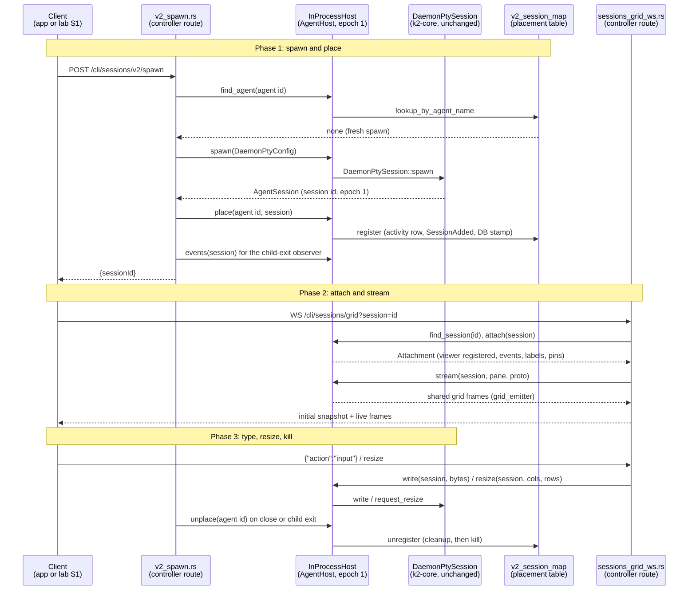

# k2-dist · agenthost: the AgentHost interface, in-process only (PRD P1)

Task `agenthost`, branch `k2-dist/agenthost`. Stage **P1**, gate **G1**:
"A refactor with zero behavior change." Every way the daemon drives an agent
session goes through one `AgentHost` interface. The only implementation is
the in-process host, a thin wrapper over today's `DaemonPtySession` and its
placement table (`v2_session_map`). P2 adds a remote host over the signed
WebSocket; P4 adds the Kubernetes ones. Neither is in scope.

## What changes


## Main flow: spawn, attach, type (scenario S1) through `AgentHost`



## How to try it

```sh
# The gate the owner runs (same result as the base commit):
scripts/lab/prove.sh G0 --topology solo && open "$(ls -dt lab-runs/G0/*/ | head -1)report.html"

# The in-process host's own tests (shim agent, attach, stream, inject,
# resize, kill, home):
for v in $(env | grep -oE '^K2(SO)?_[A-Z0-9_]+'); do unset $v; done
CARGO_BUILD_JOBS=4 cargo test -p k2-daemon --lib -- agent_host:: --test-threads=4
```

## Status

- **Milestone:** diagrams written. Design settled; no code yet.
- **Next:** the trait and the in-process host with their tests, then move
  the call sites in priority order (spawn, attach and stream, input and
  kill, lookups).
- **Open questions:** none yet.
