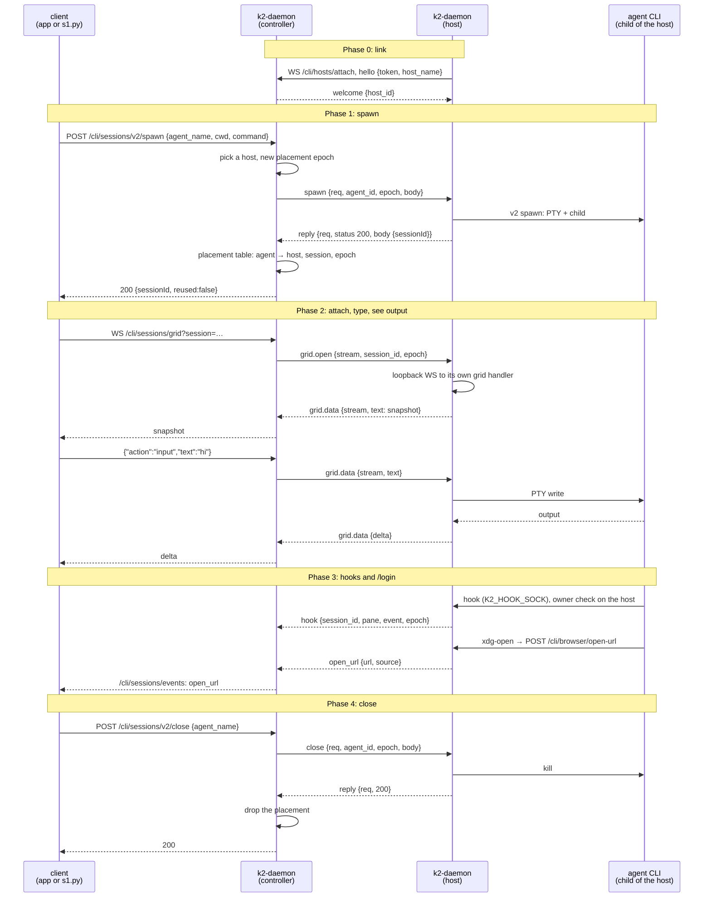

# dist-link: controller plus one remote agent host (P2, first cut)

Task `dist-link`, branch `k2-dist/dist-link`, based on `k2-dist/agenthost`
@04bcc7d5c with `k2-dist/image` (57ff61cc6) and `k2-dist/trace` (69596900b)
merged in.

The desktop app talks to one URL, the controller (`K2_ROLE=controller`).
Agents run in a separate `K2_ROLE=host` process (the same `k2-daemon`
binary) that dials the controller over one WebSocket. Scope: scenario S1
(spawn, attach, type, see output, close), hook events and the `/login`
`open_url` path.

## The change

```mermaid
graph LR
    %% ── Colour legend ──────────────────────────────
    %% Blue = exists today · Violet = changed · Green = new
    %% Orange = outside K2 · Slate = state and settings
    %% Shapes: rect = process or module, stadium = files, flag = env var

    %% ── CLIENT ─────────────────────────────────────
    subgraph mac [Client · desktop app or lab S1]
        APP[K2 app / s1.py<br/><sub>one URL: the controller</sub>]:::external
    end

    %% ── CONTROLLER ─────────────────────────────────
    subgraph ctl [Controller · k2-daemon K2_ROLE=controller]
        ROLE>K2_ROLE=controller<br/><sub>K2_HOSTS=1 · K2_HOST_BOOTSTRAP_TOKEN_FILE</sub>]:::state
        DISP[dispatcher<br/><sub>routes/dispatcher.rs · controller gate</sub>]:::changed
        GATE[controller gate<br/><sub>hosts/gate.rs · relay or 501</sub>]:::new
        HUB[host hub<br/><sub>hosts/hub.rs · /cli/hosts/attach</sub>]:::new
        RH[RemoteHost<br/><sub>agent_host/remote.rs · placement table</sub>]:::new
        NOLOCAL[no local agents<br/><sub>agent_host/mod.rs · host() refuses spawn</sub>]:::changed
        BUS[session events bus<br/><sub>session_events.rs · /cli/sessions/events</sub>]:::existing
        DISP --> GATE
        GATE -- spawn, close, grid --> RH
        RH -- frames --> HUB
        HUB -- open_url --> BUS
    end

    %% ── HOST ───────────────────────────────────────
    subgraph hst [Agent host · k2-daemon K2_ROLE=host]
        HROLE>K2_ROLE=host<br/><sub>K2_CONTROLLER_URL · K2_HOST_ENROLL_TOKEN_FILE</sub>]:::state
        LINK[host link<br/><sub>hosts/link.rs · dials out</sub>]:::new
        V2[v2 spawn / close<br/><sub>v2_spawn.rs</sub>]:::existing
        GRID[grid WS + emitter<br/><sub>sessions_grid_ws.rs · grid_emitter.rs</sub>]:::existing
        IPH[InProcessHost<br/><sub>agent_host/in_process.rs</sub>]:::existing
        HOOK[hook ingest<br/><sub>hook_ingest.rs · owner check</sub>]:::existing
        SHIM[xdg-open shim<br/><sub>POST /cli/browser/open-url</sub>]:::existing
        CLI[agent CLI<br/><sub>claude / k2-fake-agent</sub>]:::external
        HOME([agent home<br/><sub>$HOME/.claude on the host volume</sub>]):::state
        LINK -- spawn, close --> V2
        LINK -- loopback WS --> GRID
        V2 --> IPH
        IPH -- PTY child --> CLI
        CLI --> HOME
        CLI -- hooks --> HOOK
        CLI -- /login --> SHIM
        HOOK -. hook events .-> LINK
        SHIM -. open_url .-> LINK
    end

    APP -- HTTP + grid WS --> DISP
    APP -. /cli/sessions/events .-> BUS
    LINK == one WebSocket<br/>/cli/hosts/attach ==> HUB

    classDef existing fill:#dbeafe,stroke:#2563eb,color:#1e3a5f
    classDef changed  fill:#ede9fe,stroke:#7c3aed,color:#3b0764
    classDef new      fill:#d1fae5,stroke:#059669,color:#064e3b
    classDef external fill:#ffedd5,stroke:#ea580c,color:#7c2d12
    classDef state    fill:#f1f5f9,stroke:#64748b,color:#1e293b
```

## The S1 flow it touches



## Wire protocol (`/cli/hosts/attach`, protocol 1)

One WebSocket per host, dialled by the host (no inbound port on hosts,
NFR7). Every frame is one JSON text message, an object tagged by `t`.

```text
{"t": "<type>", ...fields}
```

Rules for both ends:

- Unknown fields are ignored. An unknown `t` is logged and ignored, never a
  disconnect, so a newer peer can add frame types.
- Binary WebSocket messages are not used in protocol 1. Ping/pong is
  WebSocket-level (the controller pings every 15 s).

### Handshake

| Dir | Frame | Fields |
|---|---|---|
| host → ctl | `hello` | `protocol` (1), `host_name`, `token`, `labels` (list) |
| ctl → host | `welcome` | `protocol`, `host_id`, `controller` (version string) |
| ctl → host | `refused` | `code` (`bad_token`, `protocol`, `duplicate`), `message`; then close |

Auth: `token` must equal the controller's bootstrap token
(`K2_HOST_BOOTSTRAP_TOKEN_FILE`, compared in constant time). The token
rides in the first frame, never in the URL, so it is not in access logs.
The host has 10 s to send `hello`. A second link with the same `host_name`
replaces the first (`duplicate` goes to the old one).

### Requests (controller → host, one reply each)

| Frame | Fields | Host does |
|---|---|---|
| `spawn` | `req`, `agent_id`, `epoch`, `body` (the `/cli/sessions/v2/spawn` JSON) | `v2_spawn::handle_v2_spawn(body)` |
| `close` | `req`, `agent_id`, `epoch`, `body` (the `/cli/sessions/v2/close` JSON) | `v2_spawn::handle_v2_close(body)` |
| `reply` (host → ctl) | `req`, `status` (the HTTP status line, `"200 OK"`), `body` (the JSON body, as a string) | |

`req` is a controller-chosen id unique on the link. If the link drops, every
waiting request fails with 502.

### Grid streams (both ways)

| Dir | Frame | Fields |
|---|---|---|
| ctl → host | `grid.open` | `stream`, `session_id`, `epoch`, `proto` (`null` or `"k1"`, protocol 1 sends `null`) |
| both | `grid.data` | `stream`, `text`: one WebSocket text message of the app's grid protocol, verbatim |
| both | `grid.close` | `stream`, `reason` |

The host serves `grid.open` with its own `/cli/sessions/grid` handler over
a loopback socket, so snapshots and deltas are encoded once, on the host,
next to the Term, and the controller only relays them.

### Events (host → controller)

| Frame | Fields | Controller does |
|---|---|---|
| `hook` | `session_id`, `pane`, `event`, `conversation`, `agent_pid`, `at_ms`, `epoch` | records it on the placement, publishes to `RemoteHost::hook_events` |
| `open_url` | `url`, `source` | `session_events::emit(OpenUrl {url, source})`: the same event `/cli/sessions/events` sends today |
| `session.gone` | `agent_id`, `session_id`, `epoch` | drops the placement (the child exited on the host) |

Hook owner checks run on the host (FR3); the controller only accepts hook
frames for a session it placed on that host.

### Reserved, not implemented

| Field or frame | For | Rule now |
|---|---|---|
| `epoch` on every placement-scoped frame | I1 (one live placement) | controller assigns one per placement; a frame whose epoch doesn't match the table is dropped and logged |
| `seq`, `ack` | S3 durable outbox | absent; a peer must ignore them |
| `ring_offset` on `grid.open` and `grid.data` | S9 replay after controller restart | absent; a peer must ignore it |
| `resume` in `hello` (list of placements the host still runs) | S9 re-adoption | absent |
| `sig` in `hello`/`welcome` (signed handshake like `/cli/compute/attach`) | FR2 | protocol 2 |

## Env contract

Names follow `deploy/README.md` and `deploy/compose/compose.yaml`. The task
prompt said `K2_HOSTS=static` and `K2_HOST_TOKEN_FILE`; the deploy files are
the reviewed interface, so this code uses theirs.

| Process | Setting | Meaning |
|---|---|---|
| controller | `K2_ROLE=controller` | no in-process agents; every spawn goes to a host |
| controller | `K2_HOSTS=1` | required with `controller` (otherwise a boot error); turns on `/cli/hosts/attach` |
| controller | `K2_HOST_BOOTSTRAP_TOKEN_FILE` | required; the file holds the token hosts present (trimmed) |
| controller | `K2_DAEMON_PORT`, `K2_LISTEN=lan` | existing (P0): the one URL clients and hosts use |
| host | `K2_ROLE=host` | today's daemon plus the link; agents are its children |
| host | `K2_CONTROLLER_URL` | `ws://controller:7420` (path `/cli/hosts/attach` is appended) |
| host | `K2_HOST_ENROLL_TOKEN_FILE` | required; same token as the controller's file |
| host | `K2_HOST_NAME` | optional; default the machine hostname |
| host | `K2_DAEMON_PORT` | optional; the host's own loopback API (hook CLI, xdg-open shim) |

Readiness:

- `GET /boot-status` on either process: `phase` = `ready` (existing).
- `GET /cli/hosts/status` (no token, no secrets): controller
  `{"role":"controller","hosts":[{"host_id","host_name","placements"}]}`;
  host `{"role":"host","linked":true|false,"host_id":…}`. A host is ready
  for work when `linked` is true.

The host reconnects with backoff (1 s doubling to 30 s) when the link
drops. Agents keep running on the host while the link is down; the
controller forgets the host's placements when the link closes (re-adoption
is S9).

## Under `K2_ROLE=controller`

| Path | Behaviour |
|---|---|
| `POST /cli/sessions/v2/spawn` | placed on a connected host; with none: 503 `{"error":"no agent host is connected …"}` |
| `POST /cli/sessions/v2/close` | forwarded to the owning host; unknown agent: 200 as today (`closed:false`) |
| `GET /cli/sessions/grid` | relayed to the owning host (owner token only in this cut; connect users and stream tokens get an error frame) |
| `GET /cli/sessions/events` | served by the controller as today; host `open_url` arrives here |
| `GET /cli/hosts/attach`, `GET /cli/hosts/status` | new |
| every other spawn path (`spawn.rs`, heartbeats, wake, `/v1` sandboxes, sidecars, pinned chat) | `host()` is the "no local agents" host: `spawn` fails with `K2_ROLE=controller runs no agents locally`; lookups find nothing |
| routes that spawn their own PTY without the trait (listed below) | 501 `{"error":"not available with K2_ROLE=controller (dist-link first cut)"}` |

The ~20 files in agenthost's "bypass" table only look up, list or unplace
sessions in the in-process placement table. On a controller that table is
always empty, so they find nothing; none of them can start an agent.

The 501 list (`hosts/gate.rs`, `CONTROLLER_NOT_IMPLEMENTED`): routes that
start a PTY themselves, not through `AgentHost`, or drive one by raw bytes:

| Route | Why |
|---|---|
| `/cli/llm/accounts/login`, `…/login/cancel`, `…/login/input`, `…/login/status` | LLM login wallet: its own login PTY (`llm_accounts_runtime`) |
| `/cli/skin/wallet/login`, `…/cancel`, `…/input`, `…/status` | App users' wallet sign-in: its own PTY (`person_wallet_runtime`) |
| `/cli/sessions/bytes`, `/cli/sessions/subscribe` | raw byte streams from an in-process PTY |
| `/cli/sessions/v2/refresh` | sidecar kill-and-resume on the in-process host |
| `/cli/terminal/*` | the terminal API (read, write, resize, label, pin, reap) on in-process sessions |

Background loops that spawn (`llm_accounts_runtime::spawn`,
`person_wallet_runtime::spawn_loop`, heartbeats, wake) hit the
`InProcessHost::spawn` refusal and log it; they never start a process on
the controller. `/cli/claude-auth/*` reads and refreshes credentials files
and runs no agent, so it stays as is (on a controller it finds none).

## Merge notes

- `k2-dist/image` (57ff61cc6): clean.
- `k2-dist/trace` (69596900b): one conflict, `workspace_msg.rs`
  `inject_framed_locked`: agenthost replaced the inject loop with
  `host().inject(..)`, trace added a `host.inject` event before the old loop.
  Resolved by keeping `host().inject` and emitting the trace event before it.

## How to try it

```sh
# toolchain (shared machine: 3 jobs, 3 test threads)
export RUSTUP_HOME=$HOME/.cache/k2-dist-rust/rustup CARGO_HOME=$HOME/.cache/k2-dist-rust/cargo
export PATH=$CARGO_HOME/bin:$PATH CARGO_BUILD_JOBS=3

# loopback fake-host tests
cargo test -p k2-daemon --lib hosts:: -- --test-threads=3

# two real processes and the lab S1 client (builds first; --no-build to skip).
# Evidence under lab-runs/dist-link/<UTC>/: checks.txt, scenarios/S1.*,
# process-tree.txt, open-url.txt, controller.log, host.log, *.trace.jsonl
scripts/lab/topology/two-process.sh

# by hand: a controller and a host on fixed ports
tok=$(mktemp); openssl rand -hex 24 > "$tok"
env -i PATH=/usr/bin:/bin HOME=$(mktemp -d) K2_ROLE=controller K2_HOSTS=1 \
    K2_HOST_BOOTSTRAP_TOKEN_FILE=$tok K2_DAEMON_PORT=17420 target/debug/k2-daemon &
env -i PATH=/usr/bin:/bin HOME=$(mktemp -d) K2_ROLE=host K2_CONTROLLER_URL=ws://127.0.0.1:17420 \
    K2_HOST_ENROLL_TOKEN_FILE=$tok K2_HOST_NAME=host-1 K2_DAEMON_PORT=17421 target/debug/k2-daemon &
curl -s http://127.0.0.1:17420/cli/hosts/status   # {"role":"controller","hosts":[{"host_id":"host-1",…}]}
```

## Status

- Milestones: diagrams written; host env contract (stable, handed to
  `kind-dist`).
- Code: protocol, controller hub, `RemoteHost`, host link, gate, boot
  wiring, loopback tests and the two-process script are committed.
- Next: run the `hosts::` tests and the two-process S1 run, then the
  `K2_ROLE=all` regression suite.

### Handoff notes for `kind-dist`

- The spawn body's `cwd` goes to the host verbatim. The desktop app on the
  Mac sends Mac paths; in a host pod the directory must exist on the host's
  volume (or the app must send a pod path). This cut does no path mapping.
- Claude credentials are the host's `$HOME/.claude`: `/login` once per host
  pod, through the controller (the `open_url` event reaches the app).
- One host link per host name; a restarted pod with the same name replaces
  its old link. The controller forgets a host's placements when its link
  drops (the agents keep running; a re-spawn of the same `agent_name` finds
  them again on that host).
- Open questions: none blocking. Deviation to confirm: `RemoteHost` does not
  implement the `AgentHost` trait yet (see below).

### Why `RemoteHost` is not an `impl AgentHost` in this cut

`AgentSession` is a concrete handle over an in-process
`Arc<DaemonPtySession>`, and ~15 files read its metadata straight from that
memory. A remote implementation of the trait needs `AgentSession` to become
host-polymorphic (cached metadata, remote screen reads), which edits files
this task doesn't own and collides with the `home` worker's edits. So the
controller relays the S1 routes to `RemoteHost` directly, and `host()` on a
controller is a "no local agents" implementation that refuses `spawn`.
Folding `RemoteHost` into the trait is the next P2 step; the wire protocol
does not change when that happens.
