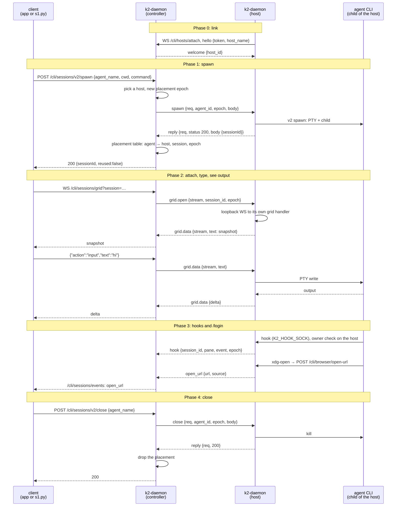

# dist-link: controller plus one remote agent host (P2, first cut)

Task `dist-link`, branch `k2-dist/dist-link`, based on `k2-dist/agenthost`
@04bcc7d5c with `k2-dist/image` (57ff61cc6) and `k2-dist/trace` (69596900b)
merged in.

The desktop app talks to one URL, the controller (`K2_ROLE=controller`).
Agents run in a separate `K2_ROLE=host` process (the same `k2-daemon`
binary) that dials the controller over one WebSocket. Scope: scenario S1
(spawn, attach, type, see output, close), hook events and the `/login`
`open_url` path.

## The change

```mermaid
graph LR
    %% ── Colour legend ──────────────────────────────
    %% Blue = exists today · Violet = changed · Green = new
    %% Orange = outside K2 · Slate = state and settings
    %% Shapes: rect = process or module, stadium = files, flag = env var

    %% ── CLIENT ─────────────────────────────────────
    subgraph mac [Client · desktop app or lab S1]
        APP[K2 app / s1.py<br/><sub>one URL: the controller</sub>]:::external
    end

    %% ── CONTROLLER ─────────────────────────────────
    subgraph ctl [Controller · k2-daemon K2_ROLE=controller]
        ROLE>K2_ROLE=controller<br/><sub>K2_HOSTS=1 · K2_HOST_BOOTSTRAP_TOKEN_FILE</sub>]:::state
        DISP[dispatcher<br/><sub>routes/dispatcher.rs · controller gate</sub>]:::changed
        GATE[controller gate<br/><sub>hosts/gate.rs · relay or 501</sub>]:::new
        HUB[host hub<br/><sub>hosts/hub.rs · /cli/hosts/attach</sub>]:::new
        RH[RemoteHost · the controller's AgentHost<br/><sub>agent_host/remote.rs · placements, sessions</sub>]:::new
        HOSTFN[host&#40;&#41; by role<br/><sub>agent_host/mod.rs · RemoteHost on a controller</sub>]:::changed
        SPAWN[workspace spawn<br/><sub>spawn.rs · forwarded whole as spawn.workspace</sub>]:::changed
        HOSTFN --> RH
        SPAWN --> RH
        BUS[session events bus<br/><sub>session_events.rs · /cli/sessions/events</sub>]:::existing
        DISP --> GATE
        GATE -- spawn, close, grid --> RH
        RH -- frames --> HUB
        HUB -- open_url --> BUS
    end

    %% ── HOST ───────────────────────────────────────
    subgraph hst [Agent host · k2-daemon K2_ROLE=host]
        HROLE>K2_ROLE=host<br/><sub>K2_CONTROLLER_URL · K2_HOST_ENROLL_TOKEN_FILE</sub>]:::state
        LINK[host link<br/><sub>hosts/link.rs · dials out</sub>]:::new
        V2[v2 spawn / close<br/><sub>v2_spawn.rs</sub>]:::existing
        GRID[grid WS + emitter<br/><sub>sessions_grid_ws.rs · grid_emitter.rs</sub>]:::existing
        IPH[InProcessHost<br/><sub>agent_host/in_process.rs</sub>]:::existing
        HOOK[hook ingest<br/><sub>hook_ingest.rs · owner check</sub>]:::existing
        SHIM[xdg-open shim<br/><sub>POST /cli/browser/open-url</sub>]:::existing
        CLI[agent CLI<br/><sub>claude / k2-fake-agent</sub>]:::external
        HOME([agent home<br/><sub>$HOME/.claude on the host volume</sub>]):::state
        LINK -- spawn, close --> V2
        LINK -- loopback WS --> GRID
        V2 --> IPH
        IPH -- PTY child --> CLI
        CLI --> HOME
        CLI -- hooks --> HOOK
        CLI -- /login --> SHIM
        HOOK -. hook events .-> LINK
        SHIM -. open_url .-> LINK
    end

    APP -- HTTP + grid WS --> DISP
    APP -. /cli/sessions/events .-> BUS
    LINK == one WebSocket<br/>/cli/hosts/attach ==> HUB

    classDef existing fill:#dbeafe,stroke:#2563eb,color:#1e3a5f
    classDef changed  fill:#ede9fe,stroke:#7c3aed,color:#3b0764
    classDef new      fill:#d1fae5,stroke:#059669,color:#064e3b
    classDef external fill:#ffedd5,stroke:#ea580c,color:#7c2d12
    classDef state    fill:#f1f5f9,stroke:#64748b,color:#1e293b
```



## The S1 flow it touches



## Wire protocol (`/cli/hosts/attach`, protocol 1)

One WebSocket per host, dialled by the host (no inbound port on hosts,
NFR7). Every frame is one JSON text message, an object tagged by `t`.

```text
{"t": "<type>", ...fields}
```

Rules for both ends:

- Unknown fields are ignored. An unknown `t` is logged and ignored, never a
  disconnect, so a newer peer can add frame types.
- Binary WebSocket messages are not used in protocol 1. Ping/pong is
  WebSocket-level (the controller pings every 15 s).

### Handshake

| Dir | Frame | Fields |
|---|---|---|
| host → ctl | `hello` | `protocol` (1), `host_name`, `token`, `labels` (list) |
| ctl → host | `welcome` | `protocol`, `host_id`, `controller` (version string) |
| ctl → host | `refused` | `code` (`bad_token`, `protocol`, `duplicate`), `message`; then close |

Auth: `token` must equal the controller's bootstrap token
(`K2_HOST_BOOTSTRAP_TOKEN_FILE`, compared in constant time). The token
rides in the first frame, never in the URL, so it is not in access logs.
The host has 10 s to send `hello`. A second link with the same `host_name`
replaces the first (`duplicate` goes to the old one).

### Requests (controller → host, one reply each)

| Frame | Fields | Host does |
|---|---|---|
| `spawn` | `req`, `agent_id`, `epoch`, `body` (the `/cli/sessions/v2/spawn` JSON) | `v2_spawn::handle_v2_spawn(body)` |
| `close` | `req`, `agent_id`, `epoch`, `body` (the `/cli/sessions/v2/close` JSON) | `v2_spawn::handle_v2_close(body)` |
| `reply` (host → ctl) | `req`, `status` (the HTTP status line, `"200 OK"`), `body` (the JSON body, as a string) | |

`req` is a controller-chosen id unique on the link. If the link drops, every
waiting request fails with 502.

### Grid streams (both ways)

| Dir | Frame | Fields |
|---|---|---|
| ctl → host | `grid.open` | `stream`, `session_id`, `epoch`, `proto` (`null` or `"k1"`, protocol 1 sends `null`), `as_user` (the Connect user the client signed in as; `null` for the owner token) |
| both | `grid.data` | `stream`, `text`: one WebSocket text message of the app's grid protocol, verbatim |
| both | `grid.close` | `stream`, `reason` |

The host serves `grid.open` with its own `/cli/sessions/grid` handler over
a loopback socket, so snapshots and deltas are encoded once, on the host,
next to the Term, and the controller only relays them.

Who may use a relayed grid is decided on the controller, exactly as the
grid route decides it under `K2_ROLE=all` (`gate::grid_client`): a Skin
pass → 403; the owner token → relayed as the owner; a live Connect session
(the desktop app's `POST /cli/auth/login` token) → relayed as that user;
anything else → 403. The host's handler sees an owner connection, so the
relay keeps a Connect user's rules from `all`: the stream starts as a
viewer (`set_mode viewer` goes first and the host's initial owner `mode`
frame is not passed on), `capable` in every `mode` event comes from the
controller's user store, the token is re-checked every 5 s, and a removed
user or revoked token ends the stream. Per-session `/v1` stream tokens are
refused on a controller in this cut.

### Events (host → controller)

| Frame | Fields | Controller does |
|---|---|---|
| `hook` | `session_id`, `pane`, `event`, `conversation`, `agent_pid`, `at_ms`, `epoch` | records it on the placement, publishes to `RemoteHost::hook_events` |
| `open_url` | `url`, `source` | `session_events::emit(OpenUrl {url, source})`: the same event `/cli/sessions/events` sends today |
| `session.gone` | `agent_id`, `session_id`, `epoch` | drops the placement (the child exited on the host) |

Hook owner checks run on the host (FR3); the controller only accepts hook
frames for a session it placed on that host.

### Reserved, not implemented

| Field or frame | For | Rule now |
|---|---|---|
| `epoch` on every placement-scoped frame | I1 (one live placement) | controller assigns one per placement; a frame whose epoch doesn't match the table is dropped and logged |
| `seq`, `ack` | S3 durable outbox | absent; a peer must ignore them |
| `ring_offset` on `grid.open` and `grid.data` | S9 replay after controller restart | absent; a peer must ignore it |
| `resume` in `hello` (list of placements the host still runs) | S9 re-adoption | absent |
| `sig` in `hello`/`welcome` (signed handshake like `/cli/compute/attach`) | FR2 | protocol 2 |

## Protocol 2 (W0: the wave-2 contract, defined, not yet sent)

Defined in `crates/k2-daemon/src/hosts/proto.rs` so the wave-2 workers
(outbox S3, inject, re-adoption S9) build against one format. The frames
exist, encode and round-trip (`hosts::proto::tests`); nothing sends them
yet, and `RemoteHost::adopt` is a stub.

Versions. This build speaks protocol 2 (`PROTOCOL`) and the controller
accepts hosts speaking 1 or 2 (`MIN_PROTOCOL..=PROTOCOL`, `negotiate`):
`welcome.protocol` is the host's version, stored per link
(`RemoteHost::link_protocol`), and no frame whose `Frame::min_protocol()`
is 2 may be sent on a protocol-1 link. Anything else is refused with
`refused {code: "protocol", message: "controller speaks protocols 1 to 2,
host sent N"}`. So protocol-1 hosts (the image on kind today) keep working
against a new controller. The other way round does not: a protocol-1
controller refuses a protocol-2 host, so **upgrade the controller first**.
Every field added in protocol 2 is optional and left out when empty, so a
protocol-1 frame encodes byte for byte as before
(`protocol_1_frames_encode_exactly_as_protocol_1`).

| Dir | Frame | Fields | For |
|---|---|---|---|
| host → ctl | `hello` + `resume` | list of `{agent_id, session_id, epoch, ring: {start, end}?, child_alive}`: placements the host still runs | S9: a restarted controller re-adopts them (`RemoteHost::adopt`) |
| ctl → host | `grid.open` + `ring_offset` | replay output from this ring offset before live frames; absent = fresh snapshot | S9, FR5 |
| host → ctl | `grid.data` + `ring_offset` | the offset this frame brings the client to | S9 reattach |
| either | `deliver` | `msg_id`, `agent_id` (recipient), `epoch`?, `from` (`agent:…`/`user:…`), `body` (as the inbox stores it), `attempt` (default 1) | S3, FR4: at least once; the sender resends until acked |
| either | `deliver.ack` | `msg_id`, `status` (`delivered` \| `duplicate` \| `rejected`), `reason`? | the receiver dedupes on `msg_id`; `rejected` = retrying won't help (unknown agent, stale epoch); anything retryable is simply not acked |
| ctl → host | `inject` | `req`, `agent_id`, `epoch`, `steps` (`{op: write, text}` \| `{op: write_b64, b64}` \| `{op: sleep, ms}` \| `{op: check_alive}`), `msg_id`? | `AgentHost::inject` remote (`InjectStep::from_action` / `to_action`, lossless for any bytes) |
| host → ctl | `inject.result` | `req`, `result` (`delivered` \| `child_gone` \| `not_placed`) | |
| ctl → host | `release` | `req`, `agent_id`, `epoch`, `reason` (`sleep`, `move`, `drain`) | stop the child after its turn, keep the home |
| host → ctl | `released` | `req`, `agent_id`, `epoch`, `ring_end`? | |

Placement epochs (I1) now come from `EpochCounter`, a monotonic counter
the controller persists at `<K2 home>/hosts/placement-epoch` (the last epoch
issued, written with temp file + fsync + rename before the epoch is used).
A missing or unreadable file starts it at the current Unix time in ms, once,
which keeps it above every epoch a protocol-1 controller issued (those were
ms timestamps); after that it counts by 1 across restarts. `observe(epoch)`
keeps it above an epoch a host resumed with; S9 must call it for every
adopted placement. If the file can't be written, the spawn answers 500
rather than issue an unpersisted epoch.

`RemoteHost::adopt(host_id, resume)` (stub): called by the hub when a
`hello` carries `resume`; logs and traces each placement and returns
`AdoptDecision::Deferred`; the table is unchanged. The rule for S9 is in its
doc comment (adopt when the controller has no placement for the agent or the
same host at the same epoch; refuse a lower epoch; `observe` adopted epochs).

Trace event names (`proto::trace_events`, for the lab's flow files):
`ctl.deliver`, `ctl.deliver_ack`, `host.deliver`, `ctl.inject`,
`host.inject_result`, `host.resume`, `ctl.adopt`, `ctl.release`,
`host.release`, `grid.replay`, `ctl.epoch` (the last two are emitted
now: `ctl.epoch` per issued epoch, `ctl.adopt` per resumed placement).

Ownership hint for wave 2: each worker adds its own `RemoteHost` method and
host-side handler (`link::handle`) for its frames; `proto.rs` changes only
by adding optional fields or new frame types, never by renaming or
retyping, so the three branches merge mechanically.

## W1: `RemoteHost` is the controller's `AgentHost`

`agent_host::host()` is the `RemoteHost` on `K2_ROLE=controller` and the
in-process host otherwise. `AgentSession` wraps `SessionRef { Local, Remote }`
(also the `.0` older call sites read: `label`, `label_source`, `set_label`,
`kill`), so the ~15 files that read session metadata compile unchanged.

| Read or call on a remote session | Answered by |
|---|---|
| `session_id`, `cwd`, `program`, `args`, `sandbox` | the spawn reply (cached) |
| `label`, `label_source` | the spawn reply, refreshed by every `meta` and `set_label` |
| `is_child_alive` | `session.gone` from the host (and link loss) |
| `child_pid` | `None` (a host pid means nothing on the controller) |
| `visible_text_rows`, `read_screen`, `bracketed_paste_active`, `subscriber_count`, `ever_attached`, `size`, `resize_now`, `claimed_size` | an `op` request to the host |
| `write`, `resize`, `set_claimed_size` | an `op` without `req`: fire-and-forget, run on the host in the order sent |
| `inject` | the protocol-2 `inject` frame (one unit on the host, under its lock) |
| `kill`, `unplace` | `op kill` / `close` (sync) |
| `events` | the controller's `ChildExit` (from `session.gone`) |
| `attach` | events, labels, pins; no viewer registration (the relayed grid stream is the host's viewer) |
| `stream` | never on a controller (the gate relays `/cli/sessions/grid`); panics with a clear message if reached |
| `spawn(DaemonPtyConfig)` | refused: spawns are placed whole (next row) |
| `read_home`, `write_home`, `hook_events` | not in this build (agent home is FR6; hooks arrive as `hook` frames) |

The workspace spawn (`spawn::spawn_agent_session_v2_blocking`: chat overlay
and pinned chat, heartbeats, wake, agents routes, sidecars, terminal and
remote-session routes) is forwarded whole as `spawn.workspace`, so the
scoped hook token, the cell socket, vault env, identity env, LLM login and
the child-exit observer stay next to the agent. The controller resolves
the tab label (it has the projects table) and drains its own pending-live
signals into the new session. Sync trait calls wait under `block_in_place`
(30 s per op, 120 s per spawn; deadlines only stop a hung host).

New protocol-2 frames (additive, `proto.rs`): `spawn.workspace`,
`op {req?, session_id, epoch, op}` / `op.result {req, value, error?}`
(`SessionOp`: write, resize, resize_now, size, claimed_size,
set_claimed_size, pin, set_label, kill, screen, visible_rows, meta), and
`exit_code` on `session.gone`. A protocol-1 host gets none of them: the
controller answers "agent host speaks protocol 1 (update k2 on the host)".

Call-site edits (minimal): `spawn.rs` (the controller seam, serde on the
request), `pinned_chat.rs` (lookups, force-respawn and the size fit through
`host()`), `heartbeat_launch.rs` (the non-claude delivery looks the session
up through `host()`), a test constructor in `workspace_msg.rs`. Under
`K2_ROLE=all` each makes the same in-process call as before.

W1 results:

| Check | Result |
|---|---|
| `hosts::tests::remote_host_drives_a_workspace_spawn_through_the_agent_host_trait` | real host link, real PTY, only the trait: spawn forwarded, reuse, lookups, metadata, size/resize_now, write and screen read, inject Delivered, set_label, pin, kill → ChildExit on the controller, unplace closes on the host, low-level spawn refused |
| `cargo test -p k2-daemon --lib -- hosts:: agent_host:: runtime_role:: pinned_chat::` | 53 passed |
| two-process (run `20261025T160857Z`) | checks 1–7 PASS (S1 still PASS); check 8 W1 23/25; the controller ran no agent processes |
| W1 via the controller | chat overlay: ensure-pinned-chat spawns on the host, banner and reply on the relayed grid, reuse; wake (S4): asleep → `k2 msg --wake` wakes it on the host, message answered; close puts it back to sleep; heartbeat fire (S5): fired on the host, wakeup answered |
| `K2_ROLE=all` regression after W1: `cargo test -p k2-daemon --no-fail-fast -- --test-threads=3`, throwaway HOME | 160 test binaries: 5198 passed, 0 failed, 6 ignored |
| resume after sleep (was the gap; fixed, option A approved) | `k2_core::transcript_probe`: a process-wide probe consulted first by `ProviderResume::session_file_exists`, `chat_history::claude_session_file_exists` and `sidecar::conversation_exists`. None is installed except on a controller, so under every other role those functions run exactly as before. The controller's probe sends `transcript.exists {req, provider, session_id, project_path}` (protocol 2, answered by `op.result` with a bool) to the host that last ran an agent in that project (or a worktree of it), or to every protocol-2 host when none is known; no answer falls back to the local check. Tests: `k2_core::transcript_probe::tests` (each of the three lookups consults the probe; an id it doesn't answer for is the local check), `hosts::tests::transcript_probe_asks_the_host_that_ran_the_project` |
| `K2_ROLE=all` regression after W1 + probe: `cargo test -p k2-daemon --no-fail-fast -- --test-threads=3`, throwaway HOME | 161 test binaries: **5200 passed, 0 failed**, 6 ignored |
| `cargo test -p k2-core --no-fail-fast -- --test-threads=3`, throwaway HOME | 3865 passed, **1 failed**, 1 ignored: `fork_tab_repair::tests::repair_splits_a_fork_tab_off_the_source_conversation` (`repair()` sometimes returns no repair for the fork tab). Unrelated to the probe and flaky on its own: run alone (`-- fork_tab_repair`, where no probe is ever installed, so the probe lines are `None` early-outs) it failed 2 of 3 times. The test doesn't touch the transcript lookups. Not fixed here (not my file); reported to the coordinator |
| two-process (run `20261025T170926Z`) | **all 9 checks PASS**; W1 25/25, including "the second wake resumed the same conversation (same session id, answered)" and "--resume" in the fake agent's argv (`--resume cb650df8-…`, the first wake's session id) |

## W3: placements survive (S8, S9, I1)

The controller keeps every placement it makes, and the epoch counter, in its
own `k2.db`:

| Table | Holds |
|---|---|
| `host_placements` | `agent_id` (key), `host_id`, `session_id`, `epoch`, `cwd`, `program`, `args_json`, `label`, `label_source`, `updated_at`: written on place, deleted (at that epoch) on close, `session.gone` and "gone" |
| `host_epoch` | the last epoch issued (one row). The old `hosts-epoch` file is read once as a floor |

Both are `CREATE TABLE IF NOT EXISTS`, created on the first `host()` of a
controller; no other role touches them. `PlacementStore` has its own
connection to the file `k2_core::db` opened (`db::shared_path()`), never the
shared one: its lock is taken while `RemoteHost::inner` is held and inside the
first `host()` call, and other threads (the active reaper) hold the shared
lock while they call `host()`. On the shared connection a restarted
controller hung at boot (`restore` waiting for the reaper's lock, the reaper
waiting for `restore`); found by the S9 run, covered by
`hosts::tests::the_placement_store_never_waits_on_the_shared_db_lock`.

What happens when things die:

| Event | Controller | Host |
|---|---|---|
| Link drops (protocol 2) | the host is **lost**, not forgotten: placements and sessions stay, marked lost; `/cli/hosts/status` lists it under `lost`; spawning its agent is a 502 "lost" (never placed elsewhere, I1); a grid attach answers an "is lost" error; waiting requests fail | keeps running its agents; reconnects with backoff |
| Link drops (protocol 1) | forgets the host's placements, as before | |
| Controller restarts | restores every row as lost until its host links | `hello.resume` lists every agent it still runs: agent, session, epoch, alive, cwd, program, args, label |
| Host links with `resume` | per agent: same host and epoch → **Adopted** (lost cleared); a newer epoch or one it doesn't know → adopted as sent; held elsewhere or at another epoch → **Released** (the host is told to `release` it, and kills it); placed here but not resumed → **Gone** (`ChildExit`, row deleted) | on `release`: kills the session, answers `released` |

Grid replay: `grid.data.ring_offset` carries the frame's version. v2 sessions
have no byte ring yet (that needs `k2-core`), so a client that reconnects
gets the host's snapshot of the screen, which holds everything the agent
printed while the controller was away; the client re-attaches and loses
nothing on screen. The old-epoch refusal is a unit test with a fake host
(`an_old_epoch_placement_is_released_and_a_missing_one_is_gone`), since a
real controller never issues an older epoch.

W3 results:

| Check | Result |
|---|---|
| `cargo test -p k2-daemon --lib -- hosts:: agent_host::` | 39 passed: `placements_survive_a_controller_restart_and_are_adopted`, `an_old_epoch_placement_is_released_and_a_missing_one_is_gone`, `a_real_host_resumes_its_agents_after_a_link_drop`, `grid_frames_carry_their_version_as_the_ring_offset`, `link_loss_fails_waiting_requests_and_keeps_placements_as_lost` (with the protocol-1 forget), `the_placement_store_never_waits_on_the_shared_db_lock` |
| two-process check 10, S9 (run `20261025T213031Z`) | spawn through the controller, type a prompt (the turn is running: the prompt is in the transcript), `kill -TERM` the controller, start it again: it restores 4 placements, the host relinks and all 4 are **Adopted**; the agent's pid and parent are unchanged (`12929 8664`, the host); the client re-attaches through the new controller and sees banner, prompt and reply in order (positions 0, 81, 95); the prompt is in the transcript once. 8/8 |
| two-process check 11, S8 (same run) | `kill -9` the host mid-turn: the controller reports `lost: [host-1]`; spawning the agent → 502 "lost"; grid → "is lost" error; the host restarts and links: its dead placements are **Gone**; the agent spawns fresh on the host (`reused: false`), the interrupted prompt is in its transcript and it resumes the same conversation. 10/10 |
| two-process, every check | **12/12 PASS** (S1, W1 25/25 and the rest unchanged) |
| two-process on the merged tree (wave2-preview + outbox 86276d0d5 + lab's fake-agent fix 2c1bc8cb9; run `20261025T232814Z`) | **12/12 PASS**: S1, W1 25/25 (S4 wake through the outbox's controller path), S9 8/8 (same pid), S8 10/10 |
| `K2_ROLE=all` regression after W3: `cargo test -p k2-daemon --no-fail-fast -- --test-threads=3`, throwaway HOME | 161 test binaries: **5204 passed, 0 failed**, 6 ignored |
| `cargo test -p k2-core -- --test-threads=3` (W3 adds `db::shared_path`), throwaway HOME | 17 test binaries: **3866 passed, 0 failed**, 1 ignored (fork_tab_repair green since `d543108d5`) |

## W3b: byte streams through the controller (in progress)

`/cli/sessions/bytes?session&from` on a controller is relayed to the
session's host (it was a 501). Same client protocol as under
`K2_ROLE=all`: a `session:ack` text event (`fromOffset`,
`currentFrontOffset` = the first byte sent, above `fromOffset` when the
ring had dropped some, `currentBackOffset` = the ring's end), then binary
messages in offset order, then live output. A client that kept its offset
reconnects after a controller restart with `from` = its next byte and gets
exactly the bytes it missed. When the host ends the stream (link lost,
session gone, ring overrun) an `error` event names why and the offset
reached; a chunk out of order is never passed on. `/cli/sessions/grid`
keeps its snapshot replay as the fallback.

Frames (protocol 2): `bytes.open {stream, session_id, epoch, from}`,
`bytes.ack {stream, start, end, error?}`, `bytes.data {stream, offset,
b64}`, `bytes.close {stream, reason}` (either way). The host serves them
from `hosts::byte_ring`, a process-wide ring source: 32 KiB per
`bytes.data`, a 50 ms look for new output once caught up, and on a ring
overrun the stream ends with the dropped range rather than skipping it.

Open (blocked on a decision outside my files): v2 sessions have no byte
ring to install as the source. k2-ptyd keeps one per session, but its only
read is `Attach`, and ptyd allows one data stream per session, which the
daemon's own IO loop holds. Options: A2 a read-only `ReadRing{sid, from,
max}` in k2-ptyd plus `Owner::read_ring` in k2-core (recommended); A3 a
tee in k2-core's ptyd IO loop into a `BytesRing`; B K2's own reader on
the alacritty path. Either A needs `K2_PTYD=1` and the k2-ptyd binary on
hosts.

| Check | Result |
|---|---|
| `hosts::tests::a_byte_stream_relays_the_hosts_ring_from_the_clients_offset` | fake host: ack and bytes from the client's offset; out of order → error, closed on the host; no ring → error; link lost → error; lost host → 400 |
| `hosts::tests::a_reconnecting_byte_client_gets_exactly_the_bytes_it_missed` | real host link, test ring: read, the link drops while the agent prints, relink, reconnect with `from`: exactly the session's bytes, once each, in order |
| `hosts::tests::a_ring_overrun_ends_the_byte_stream_instead_of_skipping` | the ring drops unsent bytes: the stream ends naming `[10, 20)`; a reconnect's ack shows the gap |
| `cargo test -p k2-daemon --lib -- hosts:: agent_host::` | 42 passed, 3 runs |

## Env contract

Names follow `deploy/README.md` and `deploy/compose/compose.yaml`. The task
prompt said `K2_HOSTS=static` and `K2_HOST_TOKEN_FILE`; the deploy files are
the reviewed interface, so this code uses theirs.

| Process | Setting | Meaning |
|---|---|---|
| controller | `K2_ROLE=controller` | no in-process agents; every spawn goes to a host |
| controller | `K2_HOSTS=1` | required with `controller` (otherwise a boot error); turns on `/cli/hosts/attach` |
| controller | `K2_HOST_BOOTSTRAP_TOKEN_FILE` | required; the file holds the token hosts present (trimmed) |
| controller | `K2_DAEMON_PORT`, `K2_LISTEN=lan` | existing (P0): the one URL clients and hosts use |
| host | `K2_ROLE=host` | today's daemon plus the link; agents are its children |
| host | `K2_CONTROLLER_URL` | `ws://controller:7420` (path `/cli/hosts/attach` is appended) |
| host | `K2_HOST_ENROLL_TOKEN_FILE` | required; same token as the controller's file |
| host | `K2_HOST_NAME` | optional; default the machine hostname |
| host | `K2_DAEMON_PORT` | optional; the host's own loopback API (hook CLI, xdg-open shim) |

Readiness:

- `GET /boot-status` on either process: `phase` = `ready` (existing).
- `GET /cli/hosts/status` (no token, no secrets): controller
  `{"role":"controller","hosts":[{"host_id","host_name","placements"}]}`;
  host `{"role":"host","linked":true|false,"host_id":…}`. A host is ready
  for work when `linked` is true.

The host reconnects when the link ends for any reason (connect error, read
error, close, silence): 1 s after a link that was up, then doubling to 30 s
while attempts fail. Every wait has a deadline (`link::Timings`): connect
plus upgrade 10 s (a SYN to a vanished pod IP otherwise waits out the
kernel's retries, ~127 s), welcome 10 s, nothing from the controller for
45 s (it pings every 15 s), close 2 s. Each attempt logs
`[hosts/link] connecting to … (attempt N)` and its outcome with the delay
chosen; `/cli/hosts/status` on the host adds `attempts` and `links`. Agents keep running on the host while the link is down; the
controller forgets the host's placements when the link closes (re-adoption
is S9).

## Under `K2_ROLE=controller`

| Path | Behaviour |
|---|---|
| `POST /cli/sessions/v2/spawn` | placed on a connected host; with none: 503 `{"error":"no agent host is connected …"}` |
| `POST /cli/sessions/v2/close` | forwarded to the owning host; unknown agent: 200 as today (`closed:false`) |
| `GET /cli/sessions/grid` | relayed to the owning host for the owner token and Connect sessions (the desktop app's login), with `all`'s viewer/claimer rules; `/v1` stream tokens get 403 |
| `GET /cli/sessions/events` | served by the controller as today; host `open_url` arrives here |
| `GET /cli/hosts/attach`, `GET /cli/hosts/status` | new |
| the workspace spawn (`spawn.rs`: chat overlay / pinned chat, heartbeats, wake, agents routes, sidecars, terminal and remote-session routes) | placed on a host whole (`spawn.workspace`, W1); with no host: the `NO_HOSTS` error |
| everything that reads or drives a session through `host()` | `host()` is `RemoteHost` (W1): lookups return remote handles, writes/injects/screen reads go to the host |
| `/v1` sandboxes (`v2_spawn::spawn_session` → `host().spawn(DaemonPtyConfig)`) | refused by `RemoteHost::spawn` ("runs no agents locally"): the low-level spawn has no remote form yet |
| routes that spawn their own PTY without the trait (listed below) | 501 `{"error":"not available with K2_ROLE=controller (dist-link first cut)"}` |

The files in agenthost's "bypass" table that still read `v2_session_map`
directly (not `host()`) see an empty table on a controller, so they find
nothing; none of them can start an agent. W1 moved the ones on the S1, S4,
S5 and chat-overlay paths (`pinned_chat.rs`, `heartbeat_launch.rs`) to
`host()`.

The 501 list (`hosts/gate.rs`, `CONTROLLER_NOT_IMPLEMENTED`): routes that
start a PTY themselves, not through `AgentHost`, or drive one by raw bytes:

| Route | Why |
|---|---|
| `/cli/llm/accounts/login`, `…/login/cancel`, `…/login/input`, `…/login/status` | LLM login wallet: its own login PTY (`llm_accounts_runtime`) |
| `/cli/skin/wallet/login`, `…/cancel`, `…/input`, `…/status` | App users' wallet sign-in: its own PTY (`person_wallet_runtime`) |
| `/cli/sessions/bytes`, `/cli/sessions/subscribe` | raw byte streams from an in-process PTY |
| `/cli/sessions/v2/refresh` | sidecar kill-and-resume on the in-process host |
| `/cli/terminal/*` | the terminal API (read, write, resize, label, pin, reap) on in-process sessions |

Heartbeats and wake go through the workspace spawn and are placed on a
host. The login-PTY loops (`llm_accounts_runtime::spawn`,
`person_wallet_runtime::spawn_loop`) call `DaemonPtySession::spawn`
directly and are behind the 501 routes above. Nothing reaches
`InProcessHost` on a controller (`host()` is `RemoteHost`; the
`InProcessHost::spawn` refusal stays as a backstop), so no agent process
starts on the controller (two-process check "the controller ran no agent
processes"). `/cli/claude-auth/*` reads and refreshes credentials files
and runs no agent, so it stays as is (on a controller it finds none).

## Merge notes

- `k2-dist/image` (57ff61cc6): clean.
- `k2-dist/trace` (69596900b): one conflict, `workspace_msg.rs`
  `inject_framed_locked`: agenthost replaced the inject loop with
  `host().inject(..)`, trace added a `host.inject` event before the old loop.
  Resolved by keeping `host().inject` and emitting the trace event before it.

## How to try it

```sh
# toolchain (shared machine: 3 jobs, 3 test threads)
export RUSTUP_HOME=$HOME/.cache/k2-dist-rust/rustup CARGO_HOME=$HOME/.cache/k2-dist-rust/cargo
export PATH=$CARGO_HOME/bin:$PATH CARGO_BUILD_JOBS=3

# loopback fake-host tests
cargo test -p k2-daemon --lib hosts:: -- --test-threads=3

# two real processes and the lab S1 client (builds first; --no-build to skip).
# Evidence under lab-runs/dist-link/<UTC>/: checks.txt, scenarios/S1.*,
# process-tree.txt, open-url.txt, controller.log, host.log, *.trace.jsonl
scripts/lab/topology/two-process.sh

# by hand: a controller and a host on fixed ports
tok=$(mktemp); openssl rand -hex 24 > "$tok"
env -i PATH=/usr/bin:/bin HOME=$(mktemp -d) K2_ROLE=controller K2_HOSTS=1 \
    K2_HOST_BOOTSTRAP_TOKEN_FILE=$tok K2_DAEMON_PORT=17420 target/debug/k2-daemon &
env -i PATH=/usr/bin:/bin HOME=$(mktemp -d) K2_ROLE=host K2_CONTROLLER_URL=ws://127.0.0.1:17420 \
    K2_HOST_ENROLL_TOKEN_FILE=$tok K2_HOST_NAME=host-1 K2_DAEMON_PORT=17421 target/debug/k2-daemon &
curl -s http://127.0.0.1:17420/cli/hosts/status   # {"role":"controller","hosts":[{"host_id":"host-1",…}]}
```

## Status

- Milestones: diagrams written; host env contract (handed to `kind-dist`);
  first working slice; done; host reconnect after read error; app session
  through controller; W0 protocol 2; W1 first working slice; W1 done;
  W3 first working slice; W3 checks green; W3 done.
- Next: whatever the coordinator assigns. Later: a byte ring on v2 sessions
  (true offset replay, `k2-core`), stream-token grid relays, `proto=k1` over the link, cwd
  mapping for pods, remote `read_home`/`write_home` (FR6), host hook
  envelopes into the controller's activity store.
- Open: none. (The first cut's deviation, `RemoteHost` not an
  `impl AgentHost`, was closed by W1.)

### Results

| Check | Result |
|---|---|
| `cargo test -p k2-daemon --lib -- hosts:: agent_host::` | 21 passed: 13 new (`hosts::`), 8 existing `agent_host` |
| `hosts::tests::real_host_link_runs_the_agent_and_relays_its_pty` | the real link with real PTYs: spawn placed on the host, snapshot relayed, typed text echoed back through the relay, close kills and reaps the child |
| `hosts::tests::fake_host_s1_…` | placement and epoch, reuse goes back to the same host, grid both ways, hooks accepted only for a placed session at its epoch, `open_url` on the session events bus, close drops the placement |
| `hosts::tests::spawn_with_no_host_connected_is_a_clear_error` | 503 with the `NO_HOSTS` message (criterion 3) |
| `scripts/lab/topology/two-process.sh` (runs `20261025T005250Z`, `20261025T005539Z`; with check 7: `20261025T145839Z`) | all checks PASS, below |
| `hosts::tests::host_reconnects_after_a_reset_a_mute_peer_and_a_silent_controller` | kind-dist finding: a reset mid-session, then a peer that never upgrades, then a silent controller; the link retries after the minimum after a link, doubled after a failed attempt, and links a fourth time (asserts the decided delays, not elapsed time) |
| `hosts::tests::app_session_token_spawns_and_attaches_through_the_controller` | an Owner-role Connect user's session token: spawn on the real host, attach, first `mode` is `{viewer, capable:true}`, viewer input → `input_denied` and never reaches the PTY, `set_mode claimer` then typing echoes, removing the user ends the stream |
| `K2_ROLE=all` regression: `cargo test -p k2-daemon --no-fail-fast -- --test-threads=3`, throwaway HOME, 3 jobs | 161 test binaries: 5185 passed, 2 failed, 6 ignored. Both failures are environmental and pass on rerun: `ptyd_p76_integration` needs the `k2-ptyd` binary built (`cargo build -p k2-ptyd`; then 1/1 ok); `skin_integration::skin_sixth_login_with_forwarded_ip_is_429` got 401 instead of 429 once under heavy machine load, then passed with its whole binary (33/33). The new dispatcher hook returns early for every path but `/cli/hosts/*` under `all`. |

Two-process run (controller :17420, host :17421, `k2-fake-agent` as
`claude`, throwaway HOMEs):

```text
PASS zero hosts: spawn is refused HTTP 503 {"error":"no agent host is connected to this controller (…)"}
PASS host linked {"hosts":[{"hooks":0,"host_id":"host-1","host_name":"host-1","placements":0}],"role":"controller"}
PASS S1 through the controller status=pass          (8/8 checks; spawn→banner 391 ms, type→reply 626 ms)
PASS agent is a child of the host                    agent ppid 46032 = host 46032, != controller 45144; controller has no children
                                                     (only this run's agents: commands under its throwaway shim dir)
PASS open_url from the host reaches the controller's /cli/sessions/events
     controller event: {"kind":"open_url","url":"https://claude.ai/oauth/authorize?dist-link=8759","source":"shim"}
PASS hook events reached the controller              3 hook lines in controller.log
PASS app session token: login, spawn, attach, type, open_url, close via the controller
```

Check 7 (`app-session.txt`, run `20261025T145839Z`), the desktop app's way
in with the session token only:

```text
users/add (200, {'success': True})
users/set-role (200, {'success': True})
logged in as applab7e5046 (session token, not the owner token)
spawn -> 200 sessionId c0110bbe-0179-4894-9910-c2b6026590bc reused False
first mode: {"capable": true, "mode": "viewer"}
after set_mode claimer: {"capable": true, "mode": "claimer"}
reply seen on the grid: reply #1: hello from the app session 4e1914
open_url on /cli/sessions/events (session token): {"kind": "open_url", "url": "https://claude.ai/oauth/authorize?app-session=ab2046", "source": "shim"}
close -> 200 {'closed': True, 'indexCleared': True}
```

The controller's log for the run:

```text
[hosts] placed agent lab-s1-086a306b on host host-1 epoch 1792889574017 session dbb07f71-…
[hosts] hook SessionStart from host host-1 agent lab-s1-086a306b session dbb07f71-…
[hosts] hook UserPromptSubmit from host host-1 agent lab-s1-086a306b session dbb07f71-…
[hosts] placed agent parent-probe-8759 on host host-1 epoch 1792889574018 session 29068e16-…
[hosts] hook SessionStart from host host-1 agent parent-probe-8759 session 29068e16-…
```

Every hook the host ingested reached the controller (3 of 3). The fake
agent's `Stop` hook for the S1 turn started 0.1 s before S1's forced close
and never reached the host's ingest, so it isn't in either count; that is
S1's timing, not the link.

Controller trace events added (`K2_TRACE_FILE`): `ctl.host_linked`,
`ctl.host_unlinked`, `ctl.place`, `ctl.hook`, `ctl.open_url`; host:
`host.linked`. The host keeps every existing trace event (`host.spawn`,
`pty.*`, `cell.*`).

### Known gaps on a controller

- `/v1` sandboxes refuse on a controller (`RemoteHost::spawn`).
- A Connect user's or a `/v1` stream token's grid: Connect users are
  relayed with `all`'s rules; stream tokens are refused.
- Agent home reads (`read_home`/`write_home`) and the activity store's hook
  plane don't cross the link yet; transcripts are probed on the host for
  resume decisions (`transcript.exists`).
- Link loss forgets placements (the agents keep running on the host; a
  re-spawn finds them). W3 replaces that with "lost" and adoption.
- (Fixed in W1: the app's chat overlay spawn, which failed with
  `K2_ROLE=controller runs no agents locally`, now places on a host.)

### Handoff notes for `kind-dist`

- The spawn body's `cwd` goes to the host verbatim. The desktop app on the
  Mac sends Mac paths; in a host pod the directory must exist on the host's
  volume (or the app must send a pod path). This cut does no path mapping.
- Claude credentials are the host's `$HOME/.claude`: `/login` once per host
  pod, through the controller (the `open_url` event reaches the app).
- One host link per host name; a restarted pod with the same name replaces
  its old link. The controller forgets a host's placements when its link
  drops (the agents keep running; a re-spawn of the same `agent_name` finds
  them again on that host).
- Hosts must run the W1 build (protocol 2) for the workspace spawn, ops and
  the transcript probe; a protocol-1 host is told to update.

### `RemoteHost` and the `AgentHost` trait (history)

The first cut relayed only the S1 routes to `RemoteHost` and refused every
other spawn on a controller, because `AgentSession` was a concrete
in-process handle. W1 made `AgentSession` host-polymorphic (`SessionRef`)
and `RemoteHost` an `impl AgentHost`; see "W1" above. The wire protocol of
the first cut did not change; W1 only added protocol-2 frames.
