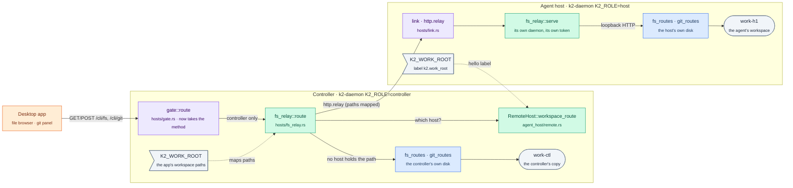

# fs-relay: the app's files and git through a controller, from the agent's host

Branch `k2-dist/fs-relay`, from `k2-dist/wave3` 897c06c4a. Task from the
coordinator (2026-10-26), after rc1: kind-app traced every route that acts
on the controller's own disk (`docs/prd/progress/kind-p4.md` on
`k2-dist/kind-p4`, "What still needs the shared volume"). This is the first
cut: the file browser and the git panel, reads and writes.

## The gap

Under `K2_ROLE=controller`, `/cli/fs/*` and `/cli/git/*` read and write the
controller's own disk. With the shared `k2-work` volume that is the same
disk the agents use; without it (a host on its own disk, `K2_WORK_ROOT`, home
sync) the app shows the controller's copy, not what the agent did, and its
edits and commits never reach the agent.

## The change



```mermaid
sequenceDiagram
    participant A as Desktop app
    participant C as k2-daemon<br/>(controller)
    participant H as k2-daemon<br/>(host-1, own disk)
    participant HD as host-1's daemon<br/>(loopback route)
    Note over C,H: Phase 0: host-1 links, hello labels k2.work_root=/var/lib/k2/work
    A->>C: GET /cli/git/changes?path=/work/notes&token=…
    Note over C: relayed route; a host on its own disk;<br/>notes runs on host-1 in /var/lib/k2/work/notes
    C->>C: token_ok (the controller authorises)
    C->>H: http.relay {GET, /cli/git/changes, path=/var/lib/k2/work/notes}
    H->>HD: GET /cli/git/changes?path=…&token=<host-1's own>
    HD-->>H: 200 [{"path":"lib.txt","status":"modified"}, …]
    H-->>C: http.reply {200, application/json, body}
    C-->>A: 200, paths mapped back to /work/notes
```

## Decisions

1. **Which requests.** Relayed: the file browser's reads (`info`,
   `read-dir`, `read-file`, `read-binary`, `read-range`, `stat`,
   `search-tree`, `zip-list`), its writes (`create`, `delete`, `move`,
   `rename`, `copy`, `duplicate`, `write-file`), every `/cli/git/*` route
   (status, diffs, branches, worktrees, stage, commit, notes, …) and
   `/cli/worktree`. Not relayed: what is about the controller's own machine
   (`open-finder`, `open-external`, `clipboard-paths`, `resolve-links`), the
   file events socket, the streaming uploads (`upload-binary`,
   `upload-chunk`), and the compress/extract jobs (their status polls carry
   a job id, no path, so they can't follow the start to its host). Those
   stay local; they are the next cut if the app needs them on a host.
2. **Which host.** The workspace of an agent placed on a host (its session's
   cwd), else the host that last ran an agent there (`last_host_for_cwd`,
   kept across restarts in `host_affinity`): "the workspace's home lives on
   that host". A placed agent wins; the longest matching workspace wins. A
   request naming workspaces on two hosts is refused (501 `cross_host`); a
   workspace whose host is not linked is a 503 `host_away`, never a silent
   read of the controller's stale copy (I2's spirit: loud, not wrong).
3. **Only hosts on their own disk.** A host with `K2_WORK_ROOT` adds the
   label `k2.work_root=<root>` to its hello (labels already carry
   `k2.max_awake`, `k2.kind`; no protocol change). Hosts without it share the
   controller's volume (`deploy/kind/dist`) and are never relayed to, so a
   shared-volume deployment, `K2_ROLE=all` and a controller with no such
   host take today's code path, byte for byte (the relay returns before it
   reads anything).
4. **Path namespaces (D2).** A workspace has the same path relative to each
   work root. The controller's root is its own `K2_WORK_ROOT`; the host's is
   its label. A request's paths (query values, and every string of a JSON or
   form body) under the workspace as either side names it are mapped to the
   host's name; the answer's paths are mapped back. In production the roots
   are the same path (`/var/lib/k2/work`), so the mapping is the identity;
   the lab runs them side by side on one Mac with different roots.
5. **Auth.** The controller authorises with the same check as the local
   routes (`http::token_ok`: the owner token or a Connect login; the role
   gate ran before). The host then runs the request as its own owner (its
   own token, loopback), and only for the relayed routes: a controller can't
   make a host run anything else.
6. **How the host serves it.** Through its own daemon's route over
   loopback (`http://127.0.0.1:<its port>`), so every relayed route behaves
   exactly as it does on that disk, with no per-route plumbing. The client
   keeps no idle connections (the daemon closes each one; see the enroll
   fix c453b247a).
7. **POST bodies.** The controller peeks the request (up to 8 MiB) without
   consuming it, so a request that turns out local reaches today's handlers
   untouched.
8. **What a host's own registry decides.** Routes that consult the host's
   project registry answer as the host does: `git/init` (and the git notes
   routes) need the workspace registered on the host, which hosts don't do
   today. That, and project create/add, clone-to unpack and app deploy from
   a folder, are the next phase (they create workspaces, not read them).

## Checks

| Check | Result |
|---|---|
| Unit: route set, path mapping by whole components, query/JSON/form paths, the label | `hosts::fs_relay::tests` 2 tests, `hosts::config_tests` (the label) |
| Unit: which host (placed, the controller's or the host's name, siblings, no path, two hosts → split, host gone → away, shared-volume host → local) | `a_path_goes_to_the_host_its_agents_workspace_is_on` |
| In process: the controller's relay → a fake host link → a real host daemon: read-dir, read-file (paths mapped back), a bad token refused before relaying, a path no host holds stays local, write-file, git changes, stage-all, commit, diff-file | `the_file_browser_and_git_panel_through_the_controller_see_the_hosts_disk` |
| Two processes, separate work roots (`scripts/lab/topology/fs-relay.sh`) | **7/7 PASS** (`lab-runs/fs-relay/20261026T143509Z`) |

## How to try it

```sh
scripts/lab/topology/fs-relay.sh            # builds k2-daemon and the fake agent, then 7 checks
cargo test -p k2-daemon --lib fs_relay      # the unit and in-process tests
```

## Status

- First cut done: reads and writes of files and git through the controller
  from the agent's host.
- Next: project create/add on a host (and registering a workspace there, so
  `git init` works through the relay), clone-to unpack, app deploy from a
  folder, uploads and compress/extract jobs; then drop the shared `k2-work`
  on kind (`deploy/kind/p4`).
