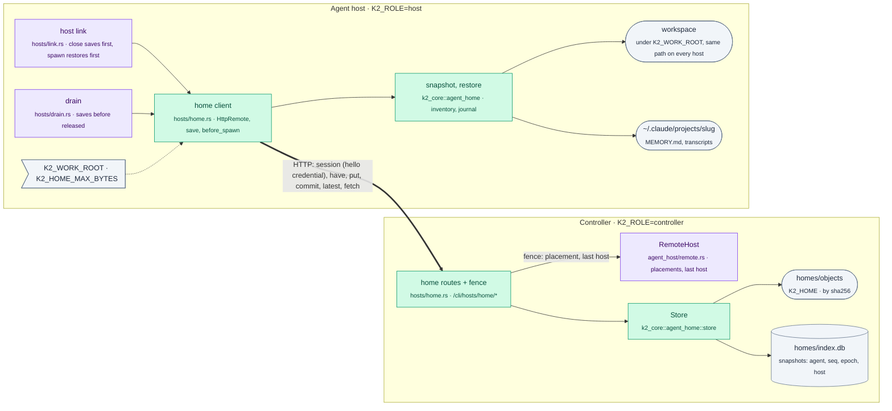

# home-sync: an agent's home moves with it (P3 T1, FR6)

Branch `k2-dist/p3-home-sync`, from `k2-dist/wave2-preview` @18a13dbda (W5,
g2-fixes). The design and the decisions behind it (T1-a to T1-j) are in
`docs/prd/progress/p3-plan.md` on `k2-dist/p3-plan`, section "T1 in detail".

Before T1, a host that was drained or scaled down took its agents' homes
with it: the workspace, `MEMORY.md` and the transcripts lived only on that
host's disk. P4's kind acceptance reported `homes snapshotted: FAIL`.
Now every release saves the home to the controller first, and every spawn
restores the newest snapshot first.

## The change



The flow, per release path, is drawn in the plan ("T1 in detail").

## How to try it

```sh
export RUSTUP_HOME=$HOME/.cache/k2-dist-rust/rustup CARGO_HOME=$HOME/.cache/k2-dist-rust/cargo
export PATH=$CARGO_HOME/bin:$PATH CARGO_BUILD_JOBS=3

# the format, store, snapshot and restore
~/.cache/k2-dist-cargo-slot.sh cargo test -p k2-core --lib -- agent_home:: --test-threads=3
# the routes, fence and client over loopback; the drain's order
~/.cache/k2-dist-cargo-slot.sh cargo test -p k2-daemon --lib -- hosts:: --test-threads=3
# three processes: a home survives a drain to another host (evidence in lab-runs/home-sync/<UTC>/)
scripts/lab/topology/home-sync.sh
# on a controller: every agent's newest snapshot
curl -s "http://127.0.0.1:$PORT/cli/hosts/home/status?token=$OWNER_TOKEN"
```

To turn it on, set `K2_WORK_ROOT` on each host (for example
`/var/lib/k2/work`). Agents whose cwd is under it are synced; nothing else
ever is.

## What's built

| Piece | Where |
|---|---|
| `Manifest` (version, agent, epoch, host, project path, slug, parent seq, entries with class, path, sha256, size, mode; scrubbed secrets); `Remote` trait; path safety (`safe_rel`: plain components only) | `crates/k2-core/src/agent_home/mod.rs` |
| `Store`: objects under `objects/ab/cdef…`, hash-checked on put and get; `index.db` (its own SQLite file) with `snapshots(agent, seq, epoch, host, manifest_sha, created_ms, files, bytes)`; `commit` checks the manifest, that every object is stored, and the caller's fence, then assigns `seq`; `InProcess` remote | `agent_home/store.rs` |
| `snapshot::push`: `clone::inventory` (workspace with `.git`, Claude memory and sessions, other providers' sessions; `.gitignore`/`.k2ignore`, the bulk skip-list, the secret scrub), minus git hooks and lock files; caps `K2_HOME_MAX_BYTES` (2 GiB) and 256 MiB per file; sends only the objects the store lacks | `agent_home/snapshot.rs` |
| `restore::restore`: the newest snapshot over what the host has; files already right are kept, others staged next to their targets, journal committed, renamed into place; deletes only what the previous snapshot it held put there; never through a symlink; only under the work root; `recover` rolls a killed restore back (before the commit) or forward (after) | `agent_home/restore.rs` |
| Routes (`K2_ROLE=controller`): `POST session` (the hello credential → a 10-minute transfer token), `POST have`, `POST put`, `GET fetch`, `POST commit` (409 when fenced, 422 when invalid), `GET latest` (only the agent's placed host), `GET status` (owner token) | `crates/k2-daemon/src/hosts/home.rs` |
| The fence (I4): placed → its placement's host at its epoch; not placed → the host that last ran it, at an epoch no lower than the newest snapshot's | `hosts/home.rs` `fence` |
| Host: `save(agent, epoch)` (scope check, transfer token, push, record), `before_close`, `with_home` (the close reply's `home`), `before_spawn` (restore; a failure fails the spawn), `HttpRemote` (blocking reqwest off the async workers) | `hosts/home.rs` |
| `hosts::home::latest(agent)`: the newest snapshot, for the pool's scale-down check and T2 phase B's `Need.home_seq` | `hosts/home.rs` |

Traces: `host.home_saved {seq, files, bytes, sent_objects, sent_bytes}`,
`host.home_save_failed {error}`, `host.home_restored {seq, fetched,
fetched_bytes, kept, deleted}`, `host.home_restore_failed {error}`,
`ctl.home_commit {host, epoch, seq}`, `ctl.home_refused {host, epoch, why}`.

### Hook points in other files

| File | Edit |
|---|---|
| `hosts/link.rs` `handle()`, `spawn` and `spawn.workspace` arms | the body binds `mut`; first thing in the spawned task: `if let Some(reply) = super::home::before_spawn(req, &agent_id, &mut body).await { let _ = tx.send(reply); return; }` (`&mut request` for the workspace spawn) |
| `hosts/link.rs` `handle()`, `close` arm | binds `epoch`; `let home = super::home::before_close(&agent_id, epoch).await;` before the close, and `let body = super::home::with_home(body, home);` before the reply |
| `hosts/link.rs` | `pub(crate) fn placed_epoch(agent) -> Option<u64>` (reads `placed()`, for the drain) |
| `hosts/gate.rs` | `if super::home::route(stream, buf, path, query, owner_token).await { return true; }` after the enroll routes |
| `hosts/mod.rs` | `pub mod home;` |
| `routes/route_policy.rs` | seven rows: `/cli/hosts/home/{commit,fetch,have,latest,put,session}` `Public` (the transfer token is the credential, like `attach`), `/status` `NoLogin` |
| `hosts/drain.rs` (mine, S8) | `DrainHost::save_home`, called before `released`; `LiveHost` saves at `placed_epoch` |
| `agent_host/remote.rs` (mine, S7) | `pub fn last_host_of(agent)` |
| `k2-core` `clone/mod.rs`, `clone/providers.rs`, `clone/unpack.rs` | `providers`, `unpack`, `reroot_provider` / `ProviderDest` and `replace_bytes` from private or `pub(super)` to `pub(crate)` (restore places provider files where clone's unpack does, and rewrites paths in transcripts the same way) |
| `hosts/hub.rs`, `hosts/proto.rs` | none: no protocol change |

## Decisions taken by the coordinator (dist-link's review)

| # | Decision | As built |
|---|---|---|
| A | **Separate disks in the lab**: each host its own `K2_WORK_ROOT` (`work-h1`, `work-h2`), and the restore must really fetch | D2 now reads "the same path **relative to `K2_WORK_ROOT`**": with the same root everywhere (production) that is the same absolute path. A manifest records `work_rel`, the workspace's path under the snapshotting host's root. A restore puts the workspace at `<its root>/<work_rel>` and rewrites the old path inside transcripts (Claude's `cwd` lines; other providers' `.json`/`.jsonl`). A spawn whose `cwd` names the workspace under another root runs it under this host's (`before_spawn` rewrites `cwd` in the spawn body). The lab asserts `host.home_restored` with `fetched > 0`, on both moves. Not mapped: the controller's `transcript.exists` probe (the wake path's resume check) still asks for the registered path. With different roots it answers "not here" and the wake starts a new conversation; with one root it is right |
| B | **A new agent on a fresh host gets its cwd**: the host creates it before the spawn | `before_spawn` runs `mkdir -p` on the (mapped) cwd, only under `K2_WORK_ROOT` and never the root itself. Test `a_new_agents_cwd_is_created_under_the_work_root_only`; lab check 5 |
| C | **One cwd per agent** | The first agent placed in a cwd on a host owns it. A second agent there while the owner is placed gets a warning in the log, no restore, and no save: its close reply carries `home.error: "… one cwd per agent …"`, so the two never overwrite each other's homes. When the owner is no longer placed, the cwd is free. Test `one_cwd_per_agent_the_second_agent_in_a_placed_agents_cwd_is_refused`; lab check 6 |
| D | **After a drain, the agent resumes elsewhere** (lab on wave3: placed on the other host with the same session id, but started with `--session-id`, `resumed: false`) | (1) The snapshot already carries the conversation store: class `session` is `~/.claude/projects/<slug>/<id>.jsonl` (and the fake agent's, the same layout). (2) The controller chooses `--session-id` or `--resume` with its transcript probe *before* the new host has restored the home, so it chose `--session-id`. Now `before_spawn`, after the restore, turns `--session-id <id>` into `--resume <id>` when this host holds that conversation (`k2_core::sidecar::conversation_exists`), traced `host.home_resume`. Test `a_spawn_resumes_a_conversation_the_restored_home_holds` |
| – | Optional: a `debug_assert` that `save_home`'s `block_on` runs on a blocking thread | Not added: tokio has no public way to tell a blocking thread, and `Handle::block_on` already panics ("Cannot start a runtime from within a runtime") on an async worker |

## Settings

| Setting | Where | Default | Meaning |
|---|---|---|---|
| `K2_WORK_ROOT` | host | unset (home sync off) | agents whose cwd is under it are saved on release and restored on spawn, at the same path relative to it; a new agent's cwd under it is created before its spawn |
| `K2_HOME_MAX_BYTES` | host | 2147483648 | a bigger home (after excludes) isn't saved; the agent stays on its host (D12). One file over 256 MiB does the same |

## Results

| Check | Result |
|---|---|
| `cargo test -p k2-core --lib -- agent_home::` | **13 passed**: a home round trips byte for byte to another host (every workspace file and its mode bits, `.git` included; `git log` and `status` agree; `MEMORY.md` and the transcript), then is `Current`; a host with its own work root gets the workspace at the same place under it, every object fetched, the transcript's embedded path rewritten (A); secrets, bulk dirs and git hooks stay behind (`.env` listed as scrubbed); a second snapshot sends only the 2 changed files, a third with no change sends nothing; the store's fence refuses a stale epoch, and a manifest with missing objects, another agent's name or an unsafe path is invalid; a corrupt object is refused on the wire and in the store, and nothing changes; a restore killed after staging leaves exactly the old tree (recover removes the staged files), one killed after its commit is finished by the next restore; the overlay deletes what the old snapshot put there and keeps the host's own `node_modules` and `.env`; never through a symlink; never outside the work root; over the cap refused naming `K2_HOME_MAX_BYTES`; unsafe paths never decode |
| `cargo test -p k2-daemon --lib -- hosts:: agent_host:: delivery_drain:: routes::route_policy` | **112 passed**, including: `a_home_moves_between_hosts_over_http_and_only_its_writer_may_commit` (fake hosts on the loopback hub, the routes on loopback HTTP, the host's `HttpRemote`: a wrong hello token gets no transfer token; host-b may neither commit nor read host-a's agent; after the agent's placement ends its last host may still save it; restored on host-b; host-a back with a stale copy is refused 409 naming host-b's epoch; status by owner token only); `the_fence_follows_the_placement_then_the_last_host`; one cwd per agent (C); the spawn's cwd mapped to this host's workspace (A); a new agent's cwd created under the work root only (B); the close reply's `home`; the work-root scope; the drain saves each agent before `released` |
| `scripts/lab/topology/home-sync.sh` (controller, host-1 on `work-h1`, host-2 on `work-h2`; enrolled hosts; k2-fake-agent) runs `20261026T075156Z`, `20261026T075319Z` | **8/8 PASS, twice**. SIGTERM host-1: it drained, saved notes' home (35 files, 34 objects sent) and exited. With host-1 down, notes woke with `--resume` on host-2, which restored snapshot 1 into `work-h2/notes`, fetching all 34 objects, and ran it there: the workspace identical (git HEAD, history, dirty and untracked state, file hashes), `MEMORY.md` and the transcript as host-1 left them, the same session resumed, and its new turn appended to memory. A new agent with no cwd yet got `work-h2/fresh` created and ran (B). twin, spawned in notes' cwd, ran, but its close reply said `home.error: … one cwd per agent …` and host-2 logged a warning (C). notes slept (v2 close): host-2 saved snapshot 2 first (3 objects sent) and the close reply said `home.seq: 2`. host-1 came back and host-2 left: notes woke on host-1, which fetched 3 objects over its snapshot 1 and kept 32, and host-2's memory line was there |
| `cargo test -p k2-daemon --no-fail-fast -- --test-threads=3` (throwaway HOME, final tree) | **5259 passed, 0 failed**, 6 ignored, across 161 binaries. An earlier run caught `routes::frame_walk::every_raw_http_response_carries_the_frame_headers`: the home routes' raw replies now carry `frame_policy::CONNECT_HEADER_LINES` |
| `cargo clippy -p k2-daemon` | no finding in `agent_home/` or `hosts/home.rs`, `drain.rs`, `link.rs` (two `type_complexity` warnings fixed with the `Collected` and `FenceFn` aliases). clippy still exits 101 on deny errors that were already in k2-core: `deprecated/delegate.rs` (5) and `terminal/grid_snapshot.rs` (1) |
| `scripts/lab/topology/home-sync.sh` on the final tree, `20261026T092222Z` | **8/8 PASS** |

### Lab G2, S8 resume elsewhere (lab-g2 b0d0b81ae merged on a throwaway branch with this one)

`LAB_S8_RESUME_ELSEWHERE=1 scripts/lab/prove.sh G2 --topology fleet --parity
none --linux-gate hold`:

| Run | S8 resume elsewhere | All |
|---|---|---|
| home sync on, in-process agents (`lab-runs/G2/2026-10-26T08-29-27Z`) | **PASS**: `--resume <same id>`, `resumed: true`, on the other host | S1–S9 PASS, I1–I4 pass |
| home sync on, agents under k2-ptyd, `LAB_HOST_PTYD=1` (`08-30-36Z`) | **PASS** | S1–S9 PASS, I1–I4 pass |
| control: home sync off, `LAB_HOME_SYNC=0` (`08-32-08Z`) | FAIL, `--session-id`, as lab saw on wave3 | |

The report's verdict reads `fail` only because `--parity none` leaves the
parity suites `not_run`. Two lab changes were needed, and lab-g2 should take
both:

- `tests/lab/labkit/fleet.py`: the fleet's hosts get
  `K2_WORK_ROOT=<fleet work dir>` when `LAB_HOME_SYNC=1`, which is the
  default when `LAB_S8_RESUME_ELSEWHERE=1`. Without it home sync is off.
- `tests/lab/labkit/g2.py` `exec_of`: take the newest `cli.exec` by `ts`.
  `fake_events` lists events host by host, so `evs[-1]` was the last
  *host's* last exec. The first run here resumed correctly on host-1
  (08:28:03.243, `--resume`) and was still judged by host-2's older
  `--session-id` exec (08:27:53).

## Follow-ups

- **P4's pool** (dist-link): before `ScaledDown`, check that each agent
  released by `Drain(host)` has `hosts::home::latest(agent)` at its last
  epoch. The close reply already carries `home: {seq}` or `home: {error}`.
- **kind** (`deploy/kind/dist/`): set `K2_WORK_ROOT=/var/lib/k2/work` on the
  host pods, and give each host its own `k2-work` volume (D9).
- **Turn-end snapshots** (D3, debounced to 60 s) belong with S10 in T2
  phase B. Until then, a hard crash loses whatever changed since the last
  release.
- **Store garbage collection**: every snapshot is kept. Keeping the last N
  per agent and sweeping unreferenced objects is a follow-up.
- **Transfer tokens per spawn**: a host asks for a new transfer token on
  each release and spawn (in enroll mode that is an enroll call, a
  challenge and a session call). Caching the token for its lifetime is a
  small follow-up.
- **S7's `placementNote`**: done on `k2-dist/placement-note`.
  - **What the note says now:** the new host's situation.
    - The store holds a snapshot and the host syncs homes: "…placed on
      host-2 by load, which restores its home (snapshot N, saved on host-1)
      before it starts, so its conversation and memory come with it".
    - No snapshot, or a host without `K2_WORK_ROOT`: the warning, with why.
  - **How the controller knows:** a host with `K2_WORK_ROOT` set adds the
    `k2.home_sync` label to its hello; the labels are free-form, so the
    protocol doesn't change.
  - **The function:** `hosts::home::placement_note`. `reserve_for` looks up
    the snapshot before it takes the placement lock.
  - **Evidence:** the S7 test still passes. There is a new test with a
    snapshot and a syncing host. In a turn-snapshots.sh run
    (`20261026T155821Z`), the controller logged exactly that note for the
    moved agent.
- Hermes's `state.db` merge isn't restored (T1-h).
