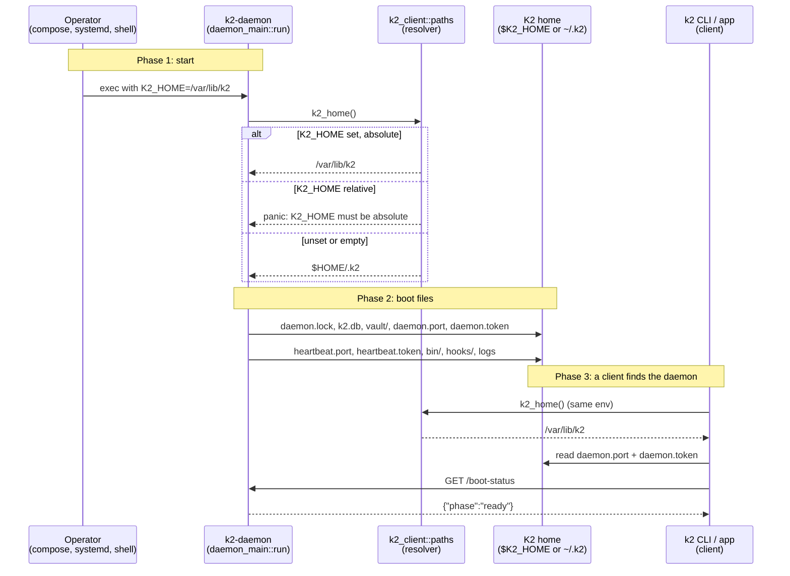

# k2-dist · home: `K2_HOME` honoured everywhere (P0)

Task `home`, branch `k2-dist/home`. PRD stage P0 → gate G0
("K2_HOME honoured everywhere"), `deploy/README.md`:
`K2_HOME · new (P0) · Root for every path under ~/.k2 today`.

**Semantics.** `K2_HOME` *is* the K2 home, not a replacement `$HOME`:
`K2_HOME=/var/lib/k2` puts the DB at `/var/lib/k2/k2.db`. Unset or empty
means `$HOME/.k2`, byte for byte as before.

## Change

```mermaid
graph TD
    %% ── Colour legend ──────────────────────────────
    %% Blue = exists today · Violet = changed · Green = new · Slate = state · Orange = outside K2
    %% Shapes: rect = code, stadium = files, flag = env var, hexagon = test/report

    %% ── ENV ────────────────────────────────────────
    subgraph env [Process env · k2-daemon]
        KH>K2_HOME<br/><sub>absolute path, or unset</sub>]:::new
        HO>HOME<br/><sub>today's root</sub>]:::existing
    end

    %% ── K2-CLIENT ──────────────────────────────────
    subgraph client [Crate · k2-client]
        P[paths::k2_home<br/><sub>src/paths.rs · the one resolver</sub>]:::changed
        PH[named helpers<br/><sub>k2_bin · k2_hooks · k2_file</sub>]:::changed
        CL[wake · migration_home · app_settings_view<br/><sub>src/*.rs</sub>]:::changed
    end

    %% ── K2-CORE / K2-DAEMON ─────────────────────────
    subgraph core [Crates · k2-core, k2-daemon]
        DM[daemon_main::run<br/><sub>k2so_dir = paths::k2_home</sub>]:::changed
        CS[~400 call sites<br/><sub>db, vault, tunnel, zen, logs, …</sub>]:::changed
        RT{{ratchet test<br/><sub>no_new_k2_home_paths_outside_paths</sub>}}:::new
    end

    %% ── OUTSIDE K2 ─────────────────────────────────
    subgraph os [Provider and OS homes · under $HOME]
        PROV([~/.claude · ~/.codex · …<br/><sub>see measured list</sub>]):::external
    end

    %% ── STATE ──────────────────────────────────────
    subgraph state [Disk · K2 home]
        H([K2 home<br/><sub>$K2_HOME or $HOME/.k2</sub>]):::state
    end

    KH -- set: wins --> P
    HO -- unset: $HOME/.k2 --> P
    P --> PH
    PH --> CL
    PH --> CS
    P --> DM
    DM -- k2.db, daemon.port, tokens --> H
    CS -- reads and writes --> H
    CS -. provider config .-> PROV
    RT -. fails on new home_dir().join(".k2") .-> CS

    classDef existing fill:#dbeafe,stroke:#2563eb,color:#1e3a5f
    classDef changed  fill:#ede9fe,stroke:#7c3aed,color:#3b0764
    classDef new      fill:#d1fae5,stroke:#059669,color:#064e3b
    classDef external fill:#ffedd5,stroke:#ea580c,color:#7c2d12
    classDef state    fill:#f1f5f9,stroke:#64748b,color:#1e293b
```

## Main flow: daemon boot resolves its home



## Boot measurement (before the change)

`k2-daemon` built from `2a2b9e0ef` on macOS, run with `env -i`,
`HOME=<empty sentinel>`, `K2_HOME` unset, private `TMPDIR` and
`XDG_RUNTIME_DIR`, the keychain kill switches (`K2_TUNNEL_LEASE=off`,
`K2_LLM_ACCOUNTS_KEYCHAIN=0`, `K2_SUBSCRIPTION_PROBE=deny`) and logging
`launchctl`/`security`/`crontab`/`systemctl` shims first on `PATH`. It
reached `phase: ready` in about 3 s, ran 20 s more, then got SIGTERM.

Under `$HOME/.k2` (moves behind `K2_HOME`):

```text
auth-audit.jsonl   bin/k2-open        daemon.lock        daemon.port
daemon.token       federation/identity.pem               garden-access-on
heartbeat.port     heartbeat.token    hooks/notify.sh    k2-threads.redb
k2so.db(-shm,-wal) llm-accounts/{claude,codex,gemini,grok}/.lock
publish-env.json   settings.json      skin.db(-shm,-wal) tunnel-ingress.sticky-port
usage/{prices.json,subscriptions.json,tokens.sqlite}
vault/{vault.db(-shm,-wal),key/kek,key/CACHEDIR.TAG}     vault.sock
```

Outside `$HOME/.k2`, written on boot:

| Path | Who | Notes |
|---|---|---|
| `$HOME/.k2so` → `$HOME/.k2` | `k2_client::migration_home` | 0.40 compat symlink |
| `$TMPDIR/k2-runtime/` (Linux: `$XDG_RUNTIME_DIR/k2`) | `k2_core::runtime_dir` | already has its own `K2_RUNTIME_DIR` |

No `launchctl`, `security`, `crontab` or `systemctl` call, and nothing
under `~/.claude`, `~/.codex`, `~/.config` or `~/Library` on a fresh
boot. Provider homes are written later, on demand: hook config when an
agent spawns (`agent_hooks/install.rs`: `~/.claude`, `~/.cursor`,
`~/.codex`, `~/.grok`, `~/.hermes`), the claude-auth LaunchAgent when
that scheduler is installed. Note the DB file is `k2so.db`, not `k2.db`.

## How to try it

To be filled once the first slice works.

## Status

- **Milestone:** diagrams written.
- **Next:** measure what a fresh daemon writes on boot; settle provider
  homes and the `~/.k2so` symlink with the owner; then the resolver,
  call sites and ratchet.
- **Open questions:** provider/OS homes written on boot; `~/.k2so`
  compat symlink when `K2_HOME` is set.
- **Toolchain note:** this Mac had no Rust toolchain. The worker installed
  rustup into `~/.cache/k2-dist-rust` (`RUSTUP_HOME`/`CARGO_HOME` there,
  nothing in `~/.cargo` or `~/.rustup`, no shell profile edits).
