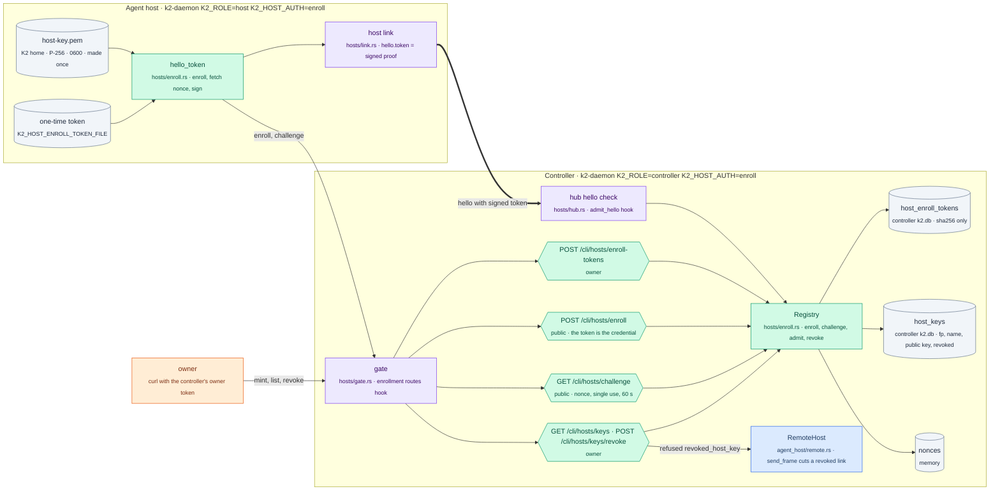
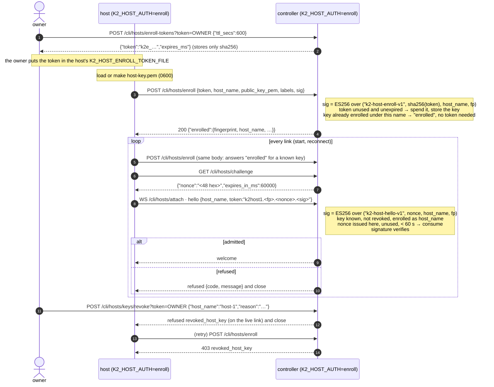

# host-enroll: signed host enrollment (W5: PRD P2 "k2-host: k2-node's enrollment, signed channel"; FR2)

Task `host-enroll`, branch `k2-dist/host-enroll`, based on
`k2-dist/wave2-preview`.

dist-link's first cut lets any process that holds the shared bootstrap token
link as an agent host under any name. With `K2_HOST_AUTH=enroll`, each host
has its own P-256 key. It enrolls once with a one-time token the owner mints
on the controller, and every later link proves it holds that key by signing
a fresh nonce from the controller. The controller refuses an unknown or
revoked key, a name other than the enrolled one, a replayed hello, and the
bootstrap token itself. A stolen bootstrap token alone can't impersonate an
enrolled host.

`K2_HOST_AUTH=token`, the default, is today's behaviour, so kind and every
existing script keep working unchanged. `K2_ROLE=all` never reads any of it.

## The change



## Enrollment and every link



The proof travels in `hello.token`, so the wire protocol is unchanged: no new
frame and no new field. The nonce comes over plain HTTP from the same
controller URL (`ws://` becomes `http://`, `wss://` becomes `https://`).

## Refusals

| code | when | where the host sees it |
|---|---|---|
| `enrollment_required` | enroll-mode controller, hello without a signed token (the bootstrap token) | `refused: enrollment_required: …` |
| `unknown_host_key` | the fingerprint isn't enrolled | `refused: unknown_host_key: …` |
| `revoked_host_key` | the key was revoked (also pushed on the live link at revoke time); a revoked key can't enroll again | `refused: …` / `enroll refused: revoked_host_key: …` |
| `host_name_mismatch` | an enrolled key linking under another name | `refused: …` |
| `bad_nonce` | nonce never issued, already used, or over 60 s old (a replayed hello) | `refused: …` |
| `bad_signature` | hello or enroll signature doesn't verify for the key | `refused: …` / `enroll refused: …` |
| `token_invalid` | enrollment token unknown, used or expired | `enroll refused: token_invalid: …` |
| `name_taken` | another active key holds the name (revoke it first) | `enroll refused: name_taken: …` |
| `already_enrolled` | this key is enrolled under another name | `enroll refused: …` |
| `bad_token` | token mode: wrong bootstrap token, or the host signs while the controller runs `token` | `refused: bad_token: …` |

The host puts the latest one in `last_error` of `GET /cli/hosts/status`, and
keeps retrying with dist-link's backoff (1 s doubling to 30 s).

## Settings

| variable | role | meaning |
|---|---|---|
| `K2_HOST_AUTH` | controller, host | `token` (default; unset or empty too) or `enroll`. Checked at boot for both roles; any other value refuses to boot. `K2_ROLE=all` ignores it |
| `K2_HOST_ENROLL_TOKEN_FILE` | host | `token`: the bootstrap token (as before). `enroll`: the one-time enrollment token. Still required at boot; once the key is enrolled its content no longer matters |
| `K2_HOST_KEY_FILE` | host | the host's private key (PKCS#8 PEM). Default `<K2 home>/host-key.pem`; made 0600 on first start |
| `K2_HOST_BOOTSTRAP_TOKEN_FILE` | controller | still required at boot (dist-link's config is unchanged); under `enroll` no hello is accepted with it |

## Routes (controller only; under any other role they fall through to the usual 404)

| route | auth | body → answer |
|---|---|---|
| `POST /cli/hosts/enroll-tokens` | owner token | `{"ttl_secs"?: n}` (default 3600, max 7 days) → `{"token","expires_ms"}` |
| `POST /cli/hosts/enroll` | the one-time token | `{token, host_name, public_key_pem, labels, sig}` → `{"enrolled":{…},"mode"}` |
| `GET /cli/hosts/challenge` | none | → `{"nonce","expires_in_ms"}` (at most 1024 outstanding) |
| `GET /cli/hosts/keys` | owner token | → `{"mode","keys":[{fingerprint, host_name, labels, enrolled_ms, revoked_ms, revoked_reason}]}` |
| `POST /cli/hosts/keys/revoke` | owner token | `{"host_name"|"fingerprint", "reason"?}` → `{"revoked":{…},"disconnected":bool}` |

Trace events (`K2_TRACE_FILE`): `host.enrolled` (host), `ctl.host_enrolled`,
`ctl.host_admitted`, `ctl.host_refused` (attr `code`), `ctl.host_revoked`.

### Where it hooks in

All the logic is in the new `crates/k2-daemon/src/hosts/enroll.rs`. The
edits in other files are one call each:

| file | edit |
|---|---|
| `hosts/mod.rs` | `pub mod enroll;` |
| `hosts/hub.rs` `serve_attach` | the bootstrap `ct_eq_token` check becomes `super::enroll::admit_hello(remote, token, &presented, &host_name)`; refusal goes through the existing `refuse`. Token mode runs the same check with the same code and message |
| `hosts/link.rs` `serve_once` | `let token = super::enroll::hello_token(cfg).await?;` before the connect, and `token,` in the `Hello` (was `cfg.token.clone()`) |
| `hosts/gate.rs` `route` | `if super::enroll::route(stream, buf, path, query, owner_token).await { return true; }` before the `role != Controller` return |
| `runtime_role.rs` `check_settings` | controller and host also run `hosts::enroll::auth_mode(&get)` at boot |
| `routes/route_policy.rs` | five rows for the new routes (the dispatcher 405s any POST not in the table): `challenge` and `enroll` `Public`, `enroll-tokens`, `keys` and `keys/revoke` `NoLogin` (the handlers check the owner token) |

The host key loader repeats `k2_node::identity::load_or_create_key`'s rule
(made once, 0600) in about 20 lines, because the daemon links `k2-node` only
as a dev-dependency. The signatures are k2-node's domain-separated ES256
(`k2_node_proto::crypto::sign_domain`/`verify_domain`, through k2-core's
`compute::proto` re-export).

## How to try it

```bash
# toolchain (shared machine: 3 jobs, 3 test threads, cargo slot)
export RUSTUP_HOME=$HOME/.cache/k2-dist-rust/rustup CARGO_HOME=$HOME/.cache/k2-dist-rust/cargo
export CARGO_BUILD_JOBS=3 CARGO_INCREMENTAL=0 PATH=$HOME/.cache/k2-dist-rust/cargo/bin:$PATH

# unit + loopback tests (registry rules; a real hub and the host's own enroll-and-sign code over HTTP)
~/.cache/k2-dist-cargo-slot.sh cargo test -p k2-daemon --lib -- hosts:: runtime_role:: --test-threads=3

# two real processes with enrollment on (evidence under lab-runs/host-enroll/<UTC>/)
scripts/lab/topology/two-process-enroll.sh
```

By hand, against a controller started with `K2_HOST_AUTH=enroll`:

```bash
curl -s -X POST "http://ctl:7420/cli/hosts/enroll-tokens?token=$OWNER" -d '{}' | jq -r .token > host-token
# on the host: K2_ROLE=host K2_HOST_AUTH=enroll K2_HOST_ENROLL_TOKEN_FILE=host-token K2_CONTROLLER_URL=ws://ctl:7420 …
curl -s "http://ctl:7420/cli/hosts/keys?token=$OWNER"
curl -s -X POST "http://ctl:7420/cli/hosts/keys/revoke?token=$OWNER" -d '{"host_name":"host-1","reason":"retired"}'
```

## Known limits

- Nonces live in memory: a controller restart voids the ones not used yet, and
  the host fetches a new one on its next attempt.
- On `ws://` the nonce, hello and enrollment token cross the network in clear.
  The signature stops replay and impersonation, but not a man in the middle
  who relays a live link. Use `wss://` off the machine.
- `GET /cli/hosts/challenge` is public. Outstanding nonces are capped at 1024
  (oldest dropped), so flooding it can only make a host fetch again.
- No `k2` CLI verbs yet: mint, list and revoke are owner-token HTTP calls.
- The host can't tell "my key was forgotten" (controller database lost) from
  any other `unknown_host_key`. Recovery: give it a new one-time token; the
  same key enrolls again.

## Status

Done. Branch `k2-dist/host-enroll`: 48f76eb6c (code), 23dd7bed4 (lab, docs),
b908afbd8 (merge of `k2-dist/wave2-preview` 6e24dd5be: wave1, W1, W2 and
its fixes, W3; it merged cleanly, and the checks below were rerun on it).

### Results

| check | result |
|---|---|
| `cargo test -p k2-daemon --lib -- hosts:: runtime_role:: routes::route_policy delivery_drain::` (merged tree) | 87 passed, 2 runs out of 2 |
| enroll tests in `hosts/enroll_tests.rs` | 16 passed: enroll once per token, enroll needs the private key, signed hello admitted, bad signature, single-use and expiring nonces, unknown key, another host's name, bootstrap token refused in enroll mode, token mode unchanged (and names a mode mismatch), revoke (refused, can't re-enroll, a new key may take the name), enrollments survive a controller restart, owner-only routes, the host key made once 0600, and on loopback through the real hub: enroll over HTTP, signed link, replay, stolen bootstrap token, revoke cutting the live link |
| `scripts/lab/topology/two-process-enroll.sh` | PASS 5/5 before the merge (`lab-runs/host-enroll/20261025T213035Z`) and after it (`20261026T003547Z`) |
| `scripts/lab/topology/two-process.sh` (token mode, the default) on the merged tree | PASS |
| `K2_ROLE=all` regression: `cargo test -p k2-daemon --no-fail-fast -- --test-threads=3`, throwaway `HOME` (pre-merge tree) | 162 test binaries, 5225 passed, 0 failed, 6 ignored |

An existing flake seen once: `hosts::tests::host_reconnects_after_a_reset_a_mute_peer_and_a_silent_controller`
expected the reset to surface as `read:` and got `send: Broken pipe`, a race over which side sees the RST
first. In token mode the link hook only clones the token. The test then passed 6/6 alone and in 3 runs of `hosts::`.
