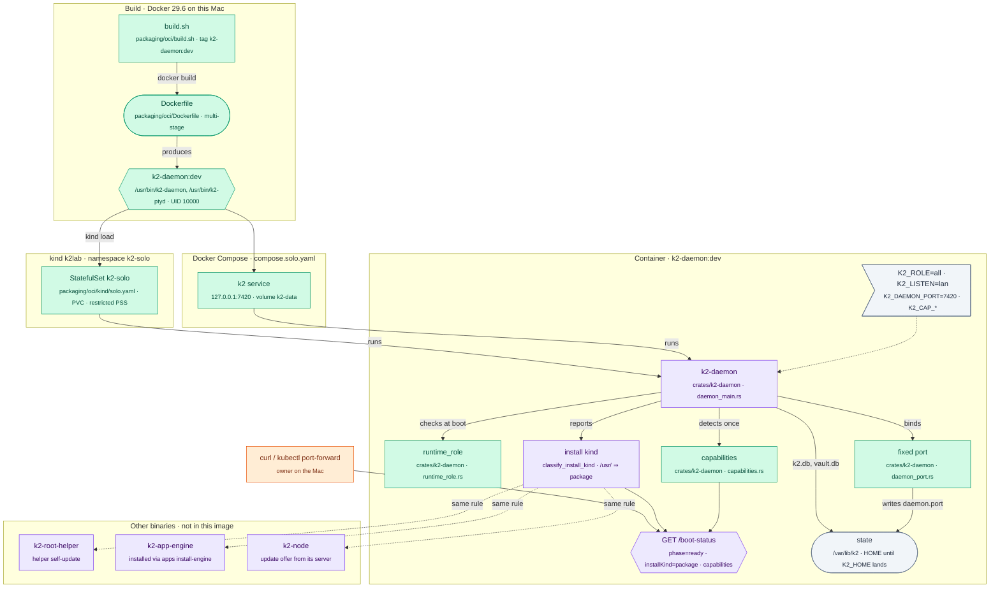

# k2-dist: image (P0, K2 in a container)

Today's K2 (`K2_ROLE=all`: controller plus the in-process agent host) in one
OCI image, run the same way under Docker Compose on the Mac and as one pod on
the kind cluster `k2lab`. This is the PRD's "Container" topology for gate G0.

## The change



## Boot in a container

```mermaid
sequenceDiagram
    participant R as docker / kubelet<br/>(runner)
    participant D as k2-daemon<br/>(K2_ROLE=all)
    participant RR as runtime_role<br/>(new)
    participant P as daemon_port<br/>(new)
    participant C as capabilities<br/>(new)
    participant V as /var/lib/k2<br/>(volume)
    participant H as healthcheck<br/>(curl / readinessProbe)

    Note over R,D: Phase 1: start and settings
    R->>D: exec /usr/bin/k2-daemon (UID 10000 or any UID, GID 0)
    D->>RR: K2_ROLE
    alt K2_ROLE = controller
        RR-->>D: Err "K2_ROLE=controller needs agent hosts (PRD P2); not available yet"
        D-->>R: exit 2
    else K2_ROLE not all/controller
        RR-->>D: Err "allowed values: all, controller"
        D-->>R: exit 2
    else unset or all
        RR-->>D: all
    end

    Note over D,V: Phase 2: bind
    D->>P: K2_DAEMON_PORT=7420
    alt port taken
        P-->>D: Err "K2_DAEMON_PORT=7420 is in use"
        D-->>R: exit 2 (no random fallback)
    else free
        P-->>D: listener on 0.0.0.0:7420 (K2_LISTEN=lan)
        D->>V: write .k2/daemon.port = 7420
    end

    Note over D,C: Phase 3: capabilities (computed, logged, not acted on)
    D->>C: detect(env K2_CAP_*, root helper present?, keychain?)
    C-->>D: postgres/mail/sew/apps/front/vault = host-native | delegated | off
    D->>D: log one line "[daemon] capabilities: …"

    Note over D,H: Phase 4: ready
    D->>D: migrations, boot_status::set_ready()
    H->>D: GET /boot-status
    D-->>H: 200 phase=ready, installKind=package, capabilities{…}
```

## How to try it

```sh
# Build (host arch; kind's nodes match it). Default K2_BUILD_PROFILE=dev:
# release without fat LTO, about 25 min cold, minutes warm.
packaging/oci/build.sh                        # → k2-daemon:dev (≈290 MB)

# Compose on this Mac
docker compose -f deploy/compose/compose.solo.yaml up -d --wait \
  && curl -fsS http://127.0.0.1:7420/boot-status | jq .
# Through Docker's port mapping the daemon sees a non-loopback client and
# answers the compat view (phase, version, features; no installKind or
# capabilities), by design (boot_status::view_for). For the full view, send
# the owner token:
curl -fsS -H "Authorization: Bearer $(docker compose -f deploy/compose/compose.solo.yaml exec -T k2 cat /var/lib/k2/.k2/daemon.token)" \
  http://127.0.0.1:7420/boot-status | jq '{phase, installKind, capabilities}'

# kind k2lab, explicit kubeconfig only
kind get kubeconfig --name k2lab > "$TMPDIR/k2lab.kubeconfig"
kind load docker-image k2-daemon:dev --name k2lab
kubectl --kubeconfig "$TMPDIR/k2lab.kubeconfig" apply -f packaging/oci/kind/solo.yaml
kubectl --kubeconfig "$TMPDIR/k2lab.kubeconfig" -n k2-solo rollout status sts/k2-solo
kubectl --kubeconfig "$TMPDIR/k2lab.kubeconfig" -n k2-solo port-forward svc/k2-solo 7440:7420 &
curl -fsS http://127.0.0.1:7440/boot-status | jq '{phase, installKind, capabilities}'   # full view: port-forward arrives on loopback
```

## Status

- **Milestone:** done (coordinator: k2-core / k2-daemon suites go to the integrator's Linux gate, option C).
- Verified 2026-10-24 (see Test runs for cargo):
  - `k2-daemon:dev` built (dev profile, 293 MB).
  - Compose: `up -d --wait` healthy; `/boot-status` phase `ready`; with the
    owner token: `installKind` `package`, `listen.lan` true, capabilities
    all `off` except vault `host-native (key store file)`; runs as
    `uid=10000 gid=0`; `daemon.port` = 7420.
  - k2lab: namespace `k2-solo` (Pod Security `restricted`, no warnings),
    `sts/k2-solo` 1/1 Ready, PVC bound; through the port-forward:
    `{"phase":"ready","installKind":"package","view":"full",…}`.
  - The boot log has the one capability line.
  - Any UID: `docker run --user 54321:0` and `--user 0:0` both reach
    phase `ready`, `installKind` `package`.
  - Boot refusals, each exit 2 before anything starts:
    `K2_ROLE=controller` → `K2_ROLE=controller needs agent hosts (PRD P2); not available yet`;
    `K2_ROLE=host` → `K2_ROLE="host" is not a role; allowed values: all, controller`;
    `K2_CAP_FRONT=engine` → `… allowed values: host, listen, off`;
    `K2_DAEMON_PORT=abc` → `… is not a port; use a number from 1 to 65535`.
  - Occupied port (second daemon in the Compose container's network):
    `K2_DAEMON_PORT=7420: can't listen on 0.0.0.0:7420: Address already in use (os error 98) (no fallback to another port)`, exit 2; the first daemon keeps serving.
- **Left running:** `k2-solo` on k2lab and the Compose project `k2-solo`, for
  the kind-app worker and the owner. Tear down with
  `kubectl --kubeconfig … delete namespace k2-solo` and
  `docker compose -f deploy/compose/compose.solo.yaml down -v`.
- **Docker restart (2026-10-24 19:10, coordinator):** `docker rm -f
  k2dist-image-cargo` (cleanup of a paused, test-listing container) had
  completed (rc 0) before it. After the restart, check
  that the Compose service (`restart: unless-stopped`) and `sts/k2-solo` on
  k2lab came back Ready; nothing was re-run yet.
- **Not run here:** `cargo test -p k2-core` and `-p k2-daemon` in full (the
  k2-daemon lib needs about 4.8 GB to compile; the Docker cap is 3 GB). The
  integrator's `scripts/test-gate-linux.sh` runs them after the wave-1 merge.

### Owner decisions (2026-10-24)

- Q1, option A: `capabilities` is always in the full `/boot-status` view
  (nothing removed or renamed). The one-line update to
  `tests/golden/permission_off/daemon/boot_status.txt` adds `capabilities` to
  its `keys:` line; nothing else in that golden changes.
- Q2, option A: `classify_install_kind`, `is_package_path` and
  `INSTALL_KIND_PACKAGE` live in `crates/k2-root-proto/src/install_kind.rs`;
  `boot_status` re-exports them, so the daemon API is unchanged.

### Decisions inside owned files

- `K2_ROLE`: unset, empty or `all` boot as today; `controller` exits 2 with
  "K2_ROLE=controller needs agent hosts (PRD P2); not available yet"; anything
  else exits 2 naming `all, controller`. Case-sensitive, like the docs.
- `K2_DAEMON_PORT`: 1–65535. Taken ⇒ exit 2 with
  `K2_DAEMON_PORT=<p>: can't listen on <addr>: <os error> (no fallback to another port)`.
  A hand-off's inherited listener still wins (same port). `daemon.port` is
  written as today. All three settings are checked together in
  `daemon_main::run` before the runtime starts, so a bad value never
  half-boots.
- Capability values: the `K2_CAP_*` override values come from
  `deploy/README.md`; each feature takes the subset its comments in
  `compose.yaml` / `controller.yaml` use: Postgres, mail, Sew `host |
  external | kubernetes | off`; Apps `host | engine | kubernetes | off`; front
  `host | listen | off`. Anything else is a boot error naming that feature's
  values. The report maps them onto the PRD's states: `host` ⇒ `host-native`;
  `external`, `engine`, `kubernetes`, `listen` ⇒ `delegated`; `off` ⇒ `off`.
- Detection without an override: the root helper (installed and `sudo -n`
  allowed) ⇒ `host-native`, else `off`; Apps is also `host-native` when the
  App engine's socket exists; the vault is `host-native` with the key store
  it opened (`keychain`, `keeper`, `systemd-creds`, `file`, …), `off` if it
  didn't open. Detected once, after the vault opens, logged as one line
  (`[daemon] capabilities: postgres=off (no root helper), …`).
- `/boot-status` shape: `"capabilities": {"postgres": {"state", "mode",
  "via"}, "mail", "sew", "apps", "front", "vault"}`, full view only (compat
  and public views unchanged).
- Install-kind opt-outs (refusal code `package_owned` everywhere):
  - root helper: `helper self-update` and `apps install-engine` refuse when
    the helper itself is a package install (`Ctx::is_package_install`,
    classified below the ctx root so tests work in temp roots);
  - App engine: its `version` answer (CLI and socket) carries `installKind`;
    the daemon's `engine_install::install_core` refuses to install over an
    engine reporting `package`;
  - k2-node: a package-installed node refuses `update_offer` and stops
    advertising `self-update` (`node_features_for`). New refusal code
    `k2_node_proto::admin::code::PACKAGE_OWNED` (additive).
- Image contents: `k2-daemon` (embedding `k2-ptyd`, as release builds do)
  and `k2-ptyd` under `/usr/bin`. No root helper, node or engine (the daemon
  doesn't need them at boot). Dev builds bake no Gmail OAuth (the release
  script's `require_mail_oauth_build_env` is not run), so mail linking with
  Google isn't usable in `k2-daemon:dev`.
- Random UID: state is `10000:0` mode `0770`, the user is in group 0, so
  `--user <any>:0` works (OpenShift style).

### Clippy baseline (rustc/clippy 1.99.1, aarch64 Linux)

The acceptance command
`cargo clippy -p k2-daemon -p k2-root-helper -p k2-app-engine -p k2-node --all-targets -- -D warnings`
already fails on `k2-dist/wave1` (`a6a3f3a9e`): clippy lints the workspace's
path dependencies too, and CI never runs clippy. Without `-D warnings`, base has
**390 findings** (k2-core 318, k2-root-helper 23, k2-node 20, k2-client 10,
k2-app-engine 6, k2-vault 6, k2-node-proto 4, k2-ptyd 2, k2-root-proto 1), and
**7 deny-level errors** that stop the build before `k2-daemon` is linted:

- `crates/k2-core/src/deprecated/delegate.rs` lines 37, 61, 90, 115, 150: `deprecated_semver`
- `crates/k2-core/src/terminal/grid_snapshot.rs:337`: `while_immutable_condition`
- `crates/k2-node/src/packages.rs:500`: `never_loop`

With those allowed, `k2-daemon` adds one more: `crates/k2-daemon/src/llm_routes.rs:316`
(`ifs_same_cond`), plus 436 warnings.

Criterion now (coordinator): no new findings in the files this task changed,
compared with `k2-dist/wave1`; deny-level lints in untouched files don't
count; k2-node files this task touched pass clippy. Head vs base on the plain
run: the same 390 findings (file and message, line numbers ignored). The
`is_multiple_of` warnings in `crates/k2-node/src/node/mod.rs` (a touched file)
are fixed. In `k2-daemon` the only finding on a changed line (a doc comment
attached to the wrong function in `daemon_main.rs`) is fixed.

### Test runs

All cargo runs are in `k2-oci-toolchain:dev` under `env -i` with a temp
`HOME`/`TMPDIR` (no `K2_*`), `--memory=3g --cpus=4`, `CARGO_BUILD_JOBS≤3`,
`--test-threads=3`, debuginfo 0 (as the gate), holding the shared k2-dist
Docker lock.

First run (as root):

| crate | result |
|---|---|
| k2-root-proto | ok |
| k2-app-engine | ok |
| k2-root-helper | 204 passed, 1 failed + `tests/binary.rs` 1 failed: both assert "run as non-root" (`geteuid() != 0`) |
| k2-node | `tests/cli.rs` 2 failed, `tests/servers_cli.rs` 1 failed: root-only refusals asserted as non-root |
| k2-core | lib 3644 passed, 2 failed (`daemon_pty` fd tests need `lsof`, absent in the toolchain image); `tests/ptyd_backend.rs` 8 failed (needs `k2-ptyd` built first) |
| k2-daemon | lib test build OOM-killed (debuginfo 2 under the 3 GB cap) |

Every failure is the test environment, not this change.

Re-runs:

- k2-root-helper and k2-node as UID 1000 (opt-level 0, debuginfo 0): **19
  binaries, 453 passed, 0 failed, 18 ignored**, so the four root-only failures
  above were the root user.
- k2-daemon: the lib OOMs under 3 GB at debuginfo 0 with 2 jobs, then 1 job,
  then opt-level 0. Per the coordinator, the full k2-core and k2-daemon suites
  run in the integrator's Linux gate instead (option C). Not run here:
  k2-daemon unit tests (`runtime_role`, `daemon_port`, `capabilities`,
  `engine_install`) and the permission-off golden with `capabilities`.
- k2-core: the lib passed 3644 of 3646 in the first run (the 2 need `lsof`);
  `ptyd_backend` needs `k2-ptyd` built first. Both are left to the gate.
