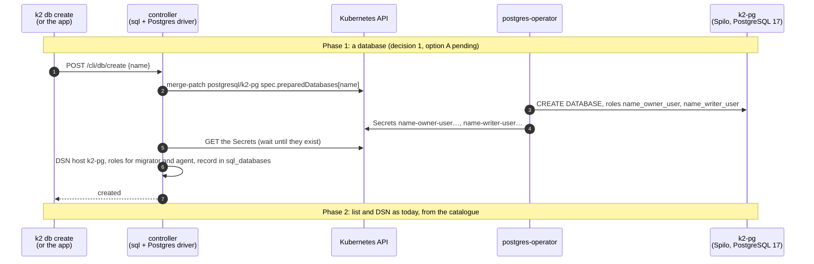

# k8s-capabilities: Postgres, Apps, mail, Sew and the front door on Kubernetes (P4 T3)

Task T3 of `docs/prd/progress/p4-plan.md` (branch `k2-dist/p4-plan`). Branch `k2-dist/k8s-capabilities`, from `k2-dist/wave2-preview` @3912ab2ff. Tests run on kind `k2lab` in namespace `k2-p4-caps` only, through an explicit kubeconfig: never `k2-kind` or `k2-kind-dist`, their proxies, the agent-sandbox controller, or the `default` context.

**Goal.** The controller's `K2_CAP_*` switches stop being report-only (`capabilities.rs`: "Nothing acts on it yet"). With `kubernetes` or `external`:
- Postgres goes through the Zalando operator;
- Apps become Deployment + Service + NetworkPolicy;
- mail and Sew are reached at their management URLs;
- the front door sits behind a Gateway.

## The change

## Acceptance (from p4-plan T3) and status

| # | item | status |
|---|---|---|
| 1 | NetworkPolicy is enforced on kindnet (deny probe, then allow) | **PASS** (ad28865c1, `scripts/kind/caps/netpol-check.sh`): same node and across nodes; deny, allow, and removal |
| 2 | S12 parity: an App gives a Deployment, Service and NetworkPolicy; its database user is made through `postgresql/k2-pg` and logs in; the policy lets the controller and its database in and keeps a neighbour out; `/cli/db` lists it; deleting the App removes all four | **Decisions 1–3 are implemented, unit-tested and the check is written; the kind run is pending.** `scripts/kind/caps/apps-check.sh` runs after lab's Linux gate frees Docker. The database is the App's workspace database, made through `postgresql/k2-pg` (decision 1; per-App databases are S21). Uninstalling the App removes its three objects; the database is the workspace's and stays (its drop is `db-check.sh`'s) |
| 3 | Mail and Sew answer on their management APIs | **Mail: PASS** after decision 4: `mail-check.sh` (never open, 401 without credentials, 8080 for the controller only) and `mail-enable-check.sh` (the controller sets it up and leaves no recovery credential known). **Sew: no image exists**, deferred. Before decision 4, mail answered but was unconfigured (`scripts/kind/caps/mail-check.sh`). The declared `mail.yaml` boots Stalwart 0.16 in *bootstrap mode*: a temporary admin in its log, a recovery listener on 8080, and `/jmap/session` answering 200 without credentials. See decision 4. **Sew: no image exists** (`deploy/kubernetes/kustomization.yaml`), so it is deferred until one does |
| 4 | Front door through a Gateway (D7 (a): Envoy Gateway in its own namespace) | **PASS** (`scripts/kind/caps/gateway-check.sh`): `gateway.yaml`'s listener and route with TLS passthrough; the client sees the backend's own certificate, a line round-trips, an unknown SNI gets no route. The backend is a stand-in for the controller's front door until item 5 runs a controller here |
| 5 | `/boot-status` capabilities read `delegated` for each | **PASS** (`scripts/kind/caps/controller-check.sh`, image `k2-daemon:caps` at 7720600b8). A controller shaped like `controller.yaml`, with the RBAC of `rbac.yaml`, reads `delegated` for postgres, mail, sew, apps and front. Its drivers report: postgres ok (`postgresql/k2-pg` Running, `k2` credentials readable), apps ok (may list Deployments), mail ok (`/healthz/ready` 200; still unconfigured, see decision 4), front ok. Sew is not ok, as expected with no Sew image |
| – | k8s client (D1) and capability drivers | `crates/k2-daemon/src/k8s/` and `capabilities/kubernetes/`: every delegated feature gets a driver that checks its backend every 30 s, and `/boot-status` shows `capabilities.<f>.driver`. `cargo test -p k2-daemon --lib -- k8s:: capabilities:: boot_status`: 61 passed, twice |

### What the infra checks showed

- **NetworkPolicy** (`lab-runs/caps/netpol-check.log`):
  - server on `k2lab-worker`, the allowed client and a denied client on `k2lab-worker2`, another denied client on the server's node;
  - baseline: all reach the server;
  - deny + allow: both denied clients are blocked and the allowed one reaches it;
  - policies removed: all reach it again.
- **The operator** (`lab-runs/caps/pg-smoke.log`):
  - `postgresql k2-pg` (PostgreSQL 17.9 on Spilo 18) runs in `k2-p4-caps`;
  - user `k2` logs in;
  - a patched-in `app_smoke` user and database get a Secret and log in;
  - a `preparedDatabases` entry gets `_owner_user` and `_writer_user` roles with Secrets: the owner creates a table, and the writer writes to it.
  - Passwords reach the client pods only through `secretKeyRef`.
- **Stalwart as declared** (`lab-runs/caps/mail-check.log`):
  - `stalwartlabs/stalwart:v0.16.25` runs in `k2-p4-caps` and `/healthz/ready` answers 200 from a pod.
  - With no config file, it logs "Server started in bootstrap mode" and prints a temporary admin login to its log.
  - Its 8080 listener is `http-recovery`, and `GET /jmap/session` answers 200 without credentials.
  - K2's mail code drives Stalwart over JMAP (`crates/k2-daemon/src/mail/`), and today the root helper writes Stalwart's config. On Kubernetes nothing does, and **no code reads `K2_STALWART_URL`**.
  - The test Stalwart was deleted with its volume, so its log with the temporary login is gone; nothing of it was printed.
- **Gateway** (`lab-runs/caps/gateway-check.log`), Envoy Gateway 1.9.2:
  - The controller went in by Helm, into `envoy-gateway-system`.
  - Only Envoy's 8 CRDs went in, rendered and applied server-side: Helm can't store that chart's release, which would exceed 1 MiB.
  - The rendered set is checked to hold no `gateway.networking.k8s.io` object, and the Gateway API CRDs' resourceVersion is unchanged before and after (v1.6.3).
  - GatewayClass `k2-p4-eg` uses an `EnvoyProxy` with a ClusterIP Service, because kind has no LoadBalancer; k3s would keep ServiceLB.
  - The Gateway is Programmed and the TLSRoute Accepted.
  - SNI `front.k2.test` reaches the backend, which shows its own certificate (CN=front.k2.test): the gateway did not terminate TLS.
  - `gateway-check.sh --uninstall` removes Envoy Gateway, its CRDs and the class.
- **Pod Security**: `k2-p4-caps` enforces `baseline` and warns on `restricted`, exactly like namespace `k2` in `deploy/kubernetes/namespaces.yaml`. Spilo and Stalwart need more than `restricted`.

## Decisions (coordinator, owner AFK, per recommendation, 2026-10-26)

1. **Databases:** the per-workspace databases (`/cli/db`) become Kubernetes-native through the operator (`preparedDatabases`; owner and writer roles for migrator and agent). Per-App databases wait for S21.
   - **Done** (84ad76701, 70300b1f5; `lab-runs/caps/db-check.log`, `scripts/kind/caps/db-check.sh` PASS in a fresh namespace `k2-p4-db`). With `K2_CAP_POSTGRES=kubernetes`, `/cli/db` runs on the operator's cluster (`sql/k8s.rs`).
     - `k2 db create` adds a `preparedDatabases` entry. The operator makes the database and the users `{db}_owner_user` and `{db}_writer_user`, with their Secrets. K2's migrator is the owner user and its agent the writer user.
     - K2 waits until both roles and the database exist (the operator writes the Secrets first). Then, as the operator's superuser, it applies its own shape: NOINHERIT, the database owned by the migrator, the migrator a member of the agent, and the unchanged grants SQL (`_k2_*`, the `k2` helpers, the seal).
     - The operator's syncs keep that shape (checked live).
     - Drop removes the entry first, then the database; the operator does not recreate it.
     - Enable has no unit, fence or GUC pins. `k2 db upgrade`, other majors and password rotation are the operator's.
     - Checked on kind:
       - DSNs reach the Service with `sslmode=require`; Spilo refuses other pods without TLS.
       - Migrations run as the migrator.
       - The agent writes but can't `CREATE TABLE` or alter K2's tables.
       - Another workspace's agent can't read the tables.
     - The controller image needs `psql`. `packaging/oci/Dockerfile` installs `postgresql-client`; kind adds it with `scripts/kind/caps/build-image.sh`.
     - **Finding, closed (coordinator's decision):** K2 never revoked `PUBLIC`'s default `CONNECT` on a workspace database, so any K2 login could open another workspace's database (though not read its tables).
       - Now, on host and Kubernetes alike (`ops::connect_lockdown_sql`), create revokes it and grants `CONNECT` to the database's migrator and agent only. `k2 db grant` and `k2 db revoke` already grant and revoke it per grantee.
       - The boot seal pass applies the same to databases made before.
       - Tests:
         - unit tests (host and Kubernetes);
         - `real_pg_connect_is_the_databases_own`, for a throwaway Postgres 16: B refused, A's logins in, grant then revoke, and an old database locked by the boot pass;
         - `db-check.sh` on kind: B's agent is refused at connect, and `PUBLIC` still has no `CONNECT` after the operator's syncs.
2. **App code:** the App's Deployment fetches its code archive (the Seed) from the controller with a per-App token. **This revises D6: no registry** (recorded in `p4-plan.md`).
   - **Done (code: 570a81d69, c20ee52e0; unit tests).** `K2_CAP_APPS=kubernetes` selects `apps/k8s_engine.rs`, a `RuntimeEngine`. It is chosen by `engine_for_app`, `engine_of` and adopt at boot.
     - Each instance is a Deployment, a Service and a NetworkPolicy named `app-<app>-<deployment>`. The Service and policy are owned by the Deployment, so stop deletes all three.
     - The pod runs the guarded engine's pinned base image: `node24`, or `node24-full` for the open path.
     - An init container fetches the Seed from `GET /cli/apps/k8s-seed/<app>/<hash>` with a per-App token, checks its sha256 from the pod spec, and unpacks it into `/app`. The App mounts `/app` read-only and runs as uid 20001.
     - The token is an HMAC of App and Seed under a controller key, so it is stateless. It sits in the init container's env, not a Secret: it opens only this App's code, and the controller needs no right to create Secrets.
     - The policy lets the controller in on the instance's port. It lets the App out to the controller, the operator's Postgres, DNS and HTTPS (as `examples/app.yaml`).
     - **Not yet on Kubernetes:**
       - the App gateway link (`K2_GATEWAY_URL`, S14);
       - `k2 app exec` and shell;
       - data that outlives an instance (`/data` and `$HOME` are emptyDirs);
       - the egress gate (the policy is the boundary).
3. **Routing:** minimal edits in `apps/router.rs` and `tunnel_tls_listener.rs`: an optional upstream host, default unchanged, with tests proving `K2_ROLE=all` and local are byte for byte the same.
   - **Done (570a81d69).**
     - `router::Backend` has `host` (`None` = `127.0.0.1`) and `switch_to`. `switch` and `switch_with`, and every local engine, are unchanged.
     - k2-core `health` gains `probe_*_at` and `wait_*_at`, which take a host. The existing probes delegate with `None` and send the same bytes; a test checks the request line.
     - The supervisor's four switches and two probes pass `k8s_engine::upstream_host`, which is `None` for every local engine.
     - `tunnel_tls_listener.rs` changed only its log line: Apps already went through `router::splice`.
4. **Mail, a security fix, first:** T3 now owns `deploy/kubernetes/core/mail.yaml`. A config Secret with a generated admin credential, never in git; no bootstrap or open admin; K2's mail code wired to `K2_STALWART_URL` and those credentials.
   - **Part 1 done** (4e513f659): `STALWART_RECOVERY_ADMIN` comes from the generated Secret `k2-mail-recovery`, so Stalwart never invents or logs an admin and answers 401 without credentials.
   - The volume now sits at the image's real paths: the declared `/opt/stalwart` doesn't exist in the image, so nothing used to persist.
   - The image's uid 2000 runs with `runAsNonRoot`.
   - A Role grants exactly the rights recovery-off needs.
   - For the `deploy/kubernetes` owner (`controller.yaml`, not T3's):
     - `k2-secrets/stalwart-admin` and `K2_STALWART_ADMIN_FILE` have no reader in the code; the controller reads `k2-mail-recovery` through the API.
     - `K2_STALWART_ALLOWED_IPS` is now in `controller.yaml` (T3 owns `deploy/kubernetes` for this change): the k3s pod CIDR `10.42.0.0/16` by default, to be set per cluster (`10.244.0.0/16` on kind). Empty, the ApiKey is accepted from any address and mail-ingress is the only boundary.
   - **Part 2 done** (0c198cc36, 6b0fc47e7, 8cf46835b, 34150b9aa; `lab-runs/caps/mail-enable-check.log`, PASS on a fresh Stalwart and a fresh controller). `POST /cli/mail/server/enable` on the controller (`K2_CAP_MAIL=external`) sets Stalwart up over `K2_STALWART_URL` (`mail/k8s_enable.rs`), with the native machine's steps, markers and vault:
     - bootstrap with the Secret's recovery password, then a restart into normal mode (the pod is deleted and its replacement waited for);
     - a `k2-daemon` service account and its ApiKey, allowed only from `K2_STALWART_ALLOWED_IPS`; the host keeps its loopback-only key;
     - recovery-off: the admin principals are rotated, the Secret is overwritten with a value nobody keeps, and Stalwart is restarted.
     - Checked afterwards: the Stalwart pod was replaced and runs in normal mode; the original recovery password gets 401; the Secret's value changed; no credentials gets 401; the controller's health ping with the ApiKey says running.
   - Found live and fixed on the way:
     - the rotation can invalidate the session in use, so it retries with the ApiKey (as natively);
     - a key pinned to 127.0.0.1 is 403 from a pod;
     - a run that stopped mid-rotation resumes with the Secret's password;
     - `/cli/mail/status` asked systemd about a unit that lives in a pod.

## What T3 installed on k2lab, and how to remove it

All of it is through `$TMPDIR/k2-kind/caps/kubeconfig` (`kind get kubeconfig --name k2lab`); nothing is in `k2-kind`, `k2-kind-dist`, `agent-sandbox-system` or any node's configuration. Set `KC="kubectl --kubeconfig $TMPDIR/k2-kind/caps/kubeconfig"`.

| what | where | remove with |
|---|---|---|
| namespace `k2-p4-caps`: `postgresql k2-pg` (Spilo pod, PVC, the operator's Secrets), Secret `k2-mail-recovery`, while kept: `k2-mail`, the controller, the RBAC, policies | namespace `k2-p4-caps` | `$KC -n k2-p4-caps delete postgresql k2-pg --wait=true && $KC delete namespace k2-p4-caps` |
| Envoy Gateway 1.9.2 (Helm release `eg`: Deployment, Services, ServiceAccounts, cluster-scoped ClusterRoles and bindings) | namespace `envoy-gateway-system` plus cluster scope | `helm --kubeconfig $TMPDIR/k2-kind/caps/kubeconfig -n envoy-gateway-system uninstall eg` |
| Envoy Gateway's 8 CRDs (`*.gateway.envoyproxy.io`: backends, backendtrafficpolicies, clienttrafficpolicies, envoyextensionpolicies, envoypatchpolicies, envoyproxies, httproutefilters, securitypolicies) | cluster scope | `$KC delete crd backends.gateway.envoyproxy.io backendtrafficpolicies.gateway.envoyproxy.io clienttrafficpolicies.gateway.envoyproxy.io envoyextensionpolicies.gateway.envoyproxy.io envoypatchpolicies.gateway.envoyproxy.io envoyproxies.gateway.envoyproxy.io httproutefilters.gateway.envoyproxy.io securitypolicies.gateway.envoyproxy.io` |
| GatewayClass `k2-p4-eg` and EnvoyProxy `k2-p4-eg` | cluster scope; `envoy-gateway-system` | `$KC delete gatewayclass k2-p4-eg && $KC delete namespace envoy-gateway-system` |
| namespace `k2-p4-db` (`db-check.sh`: its own `postgresql k2-pg`, a controller, a client pod) | deleted by the check at the end; if one is left: `$KC -n k2-p4-db delete postgresql k2-pg --wait=true && $KC delete namespace k2-p4-db` | — |
| image `k2-daemon:caps` | the kind nodes' image store (`kind load`), and the Mac's Docker | Mac: `docker rmi k2-daemon:caps`. Nodes: left alone (removing it means exec'ing into the node containers; an unused image does nothing) |
| image `stalwartlabs/stalwart:v0.16.25` | pulled by a kind node (the kubelet) | left alone, as above |

`scripts/kind/caps/gateway-check.sh --uninstall` runs the Envoy Gateway rows. The Gateway API CRDs (v1.6.3) were there before and were never changed (checked by resourceVersion).

## Status

- MILESTONE 1/6: NetworkPolicy enforced on kindnet (ad28865c1).
- MILESTONE 4/6: front door through Gateway API, TLS passthrough (5d39026a9).
- MILESTONE 5/6: a controller on Kubernetes reads every capability `delegated`, and its drivers reach what they are delegated to.
- MILESTONE decision 4 part 1: `mail.yaml` is never open and never logs a credential (4e513f659).
- MILESTONE decision 4 part 2: K2's controller sets Stalwart up over `K2_STALWART_URL`; no recovery credential is known afterwards.
- Done: the Postgres operator path checked on k2lab (8ab1ee4f3); the k8s client and the drivers (7720600b8).
- Left on k2lab, in `k2-p4-caps` only: `postgresql k2-pg` (for item 2), the namespace itself, and Envoy Gateway in `envoy-gateway-system` with GatewayClass `k2-p4-eg` (`gateway-check.sh --uninstall` removes them). The test Stalwart was deleted.
- The mail checks clean up after themselves: the controller, Stalwart, their volumes and the Secret are deleted.
- MILESTONE decision 1: `/cli/db` through the operator's `preparedDatabases` (`db-check.sh` PASS).
- MILESTONE CONNECT hardening (0951429dd).
- Decisions 2 and 3: code done, tests pass (full `k2-daemon` lib: 4484 passed, 0 failed).
- Next: the item 2 run on kind, after lab's gate. Item 3 waits only on a Sew image.
