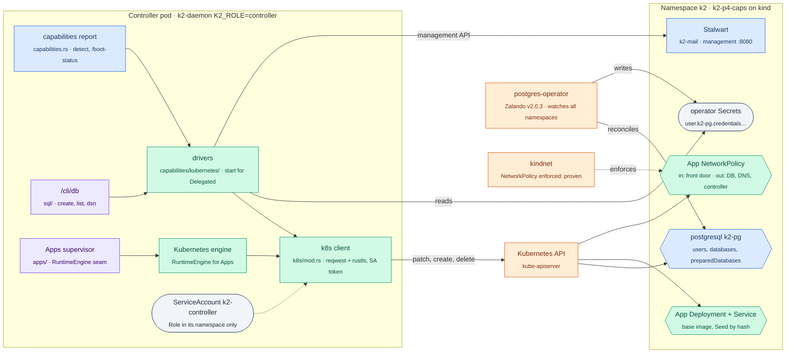
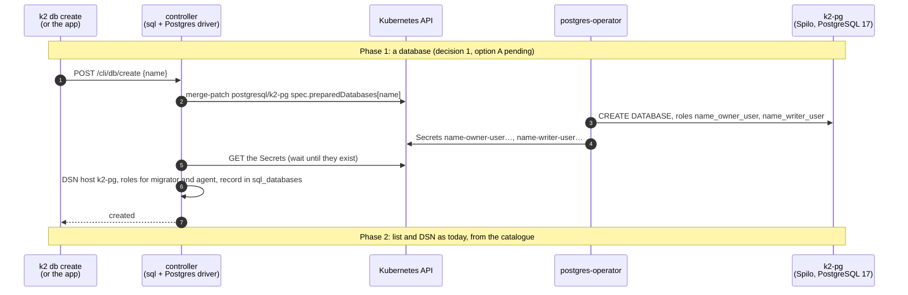

# k8s-capabilities: Postgres, Apps, mail, Sew and the front door on Kubernetes (P4 T3)

Task T3 of `docs/prd/progress/p4-plan.md` (branch `k2-dist/p4-plan`). Branch `k2-dist/k8s-capabilities`, from `k2-dist/wave2-preview` @3912ab2ff. Tests run on kind `k2lab` in namespace `k2-p4-caps` only, through an explicit kubeconfig: never `k2-kind` or `k2-kind-dist`, their proxies, the agent-sandbox controller, or the `default` context.

**Goal.** The controller's `K2_CAP_*` switches stop being report-only (`capabilities.rs`: "Nothing acts on it yet"). With `kubernetes` or `external`:
- Postgres goes through the Zalando operator;
- Apps become Deployment + Service + NetworkPolicy;
- mail and Sew are reached at their management URLs;
- the front door sits behind a Gateway.

## The change

## Acceptance (from p4-plan T3) and status

| # | item | status |
|---|---|---|
| 1 | NetworkPolicy is enforced on kindnet (deny probe, then allow) | **PASS** (ad28865c1, `scripts/kind/caps/netpol-check.sh`): same node and across nodes; deny, allow, and removal |
| 2 | S12 parity: an App gives a Deployment, Service and NetworkPolicy; its database user is made through `postgresql/k2-pg` and logs in; the policy lets the controller and its database in and keeps a neighbour out; `/cli/db` lists it; deleting the App removes all four | **Needs decisions 1–3** (below). Infra checked: `pg-smoke.sh` PASS (8ab1ee4f3) |
| 3 | Mail and Sew answer on their management APIs | **Mail: answers, but unconfigured** (`scripts/kind/caps/mail-check.sh`). The declared `mail.yaml` boots Stalwart 0.16 in *bootstrap mode*: a temporary admin in its log, a recovery listener on 8080, and `/jmap/session` answering 200 without credentials. See decision 4. **Sew: no image exists** (`deploy/kubernetes/kustomization.yaml`), so it is deferred until one does |
| 4 | Front door through a Gateway (D7 (a): Envoy Gateway in its own namespace) | **PASS** (`scripts/kind/caps/gateway-check.sh`): `gateway.yaml`'s listener and route with TLS passthrough; the client sees the backend's own certificate, a line round-trips, an unknown SNI gets no route. The backend is a stand-in for the controller's front door until item 5 runs a controller here |
| 5 | `/boot-status` capabilities read `delegated` for each | the report already does this for any non-`host`, non-`off` override. To do: show it on a controller in `k2-p4-caps` with the drivers running |
| – | k8s client (D1) | written (`crates/k2-daemon/src/k8s/`), with tests against a fake API server |

### What the infra checks showed

- **NetworkPolicy** (`lab-runs/caps/netpol-check.log`):
  - server on `k2lab-worker`, the allowed client and a denied client on `k2lab-worker2`, another denied client on the server's node;
  - baseline: all reach the server;
  - deny + allow: both denied clients are blocked and the allowed one reaches it;
  - policies removed: all reach it again.
- **The operator** (`lab-runs/caps/pg-smoke.log`):
  - `postgresql k2-pg` (PostgreSQL 17.9 on Spilo 18) runs in `k2-p4-caps`;
  - user `k2` logs in;
  - a patched-in `app_smoke` user and database get a Secret and log in;
  - a `preparedDatabases` entry gets `_owner_user` and `_writer_user` roles with Secrets: the owner creates a table, and the writer writes to it.
  - Passwords reach the client pods only through `secretKeyRef`.
- **Stalwart as declared** (`lab-runs/caps/mail-check.log`):
  - `stalwartlabs/stalwart:v0.16.25` runs in `k2-p4-caps` and `/healthz/ready` answers 200 from a pod.
  - With no config file, it logs "Server started in bootstrap mode" and prints a temporary admin login to its log.
  - Its 8080 listener is `http-recovery`, and `GET /jmap/session` answers 200 without credentials.
  - K2's mail code drives Stalwart over JMAP (`crates/k2-daemon/src/mail/`), and today the root helper writes Stalwart's config. On Kubernetes nothing does, and **no code reads `K2_STALWART_URL`**.
  - The test Stalwart was deleted with its volume, so its log with the temporary login is gone; nothing of it was printed.
- **Gateway** (`lab-runs/caps/gateway-check.log`), Envoy Gateway 1.9.2:
  - The controller went in by Helm, into `envoy-gateway-system`.
  - Only Envoy's 8 CRDs went in, rendered and applied server-side: Helm can't store that chart's release, which would exceed 1 MiB.
  - The rendered set is checked to hold no `gateway.networking.k8s.io` object, and the Gateway API CRDs' resourceVersion is unchanged before and after (v1.6.3).
  - GatewayClass `k2-p4-eg` uses an `EnvoyProxy` with a ClusterIP Service, because kind has no LoadBalancer; k3s would keep ServiceLB.
  - The Gateway is Programmed and the TLSRoute Accepted.
  - SNI `front.k2.test` reaches the backend, which shows its own certificate (CN=front.k2.test): the gateway did not terminate TLS.
  - `gateway-check.sh --uninstall` removes Envoy Gateway, its CRDs and the class.
- **Pod Security**: `k2-p4-caps` enforces `baseline` and warns on `restricted`, exactly like namespace `k2` in `deploy/kubernetes/namespaces.yaml`. Spilo and Stalwart need more than `restricted`.

## Decisions asked of the coordinator (2026-10-26)

Found by reading the code (`apps/`, `sql/`, `capabilities.rs`) against the plan.

1. **There is no per-App Postgres database yet.**
   - Only workspace databases exist (`sql/ops.rs`, through the root helper's psql). The App side is a stub: `db_port: None`, "Lane 3 (S21) fills the App's database door" (`apps/guarded.rs:749`).
   - **A (recommended):** make the workspace databases Kubernetes-native through `preparedDatabases`, with the owner and writer roles standing in for migrator and agent. The App door waits for S21.
   - **B:** T3 builds the App door too.
2. **No per-App image.**
   - Every App runs a pinned base image (`node24`) with its code as a hash-named Seed tar at `/app`.
   - **A (recommended):** the Deployment uses the same base image; an init container fetches the Seed by hash from the controller with a per-App token. No registry is needed, which revises D6.
   - **B:** keep D6's registry, which needs per-App image builds.
3. **App routing assumes loopback.**
   - `router::Backend` is a port only; the front door connects to `127.0.0.1:<port>` (`apps/router.rs:162`, `tunnel_tls_listener.rs:954`).
   - **A (recommended):** add an optional host (default loopback, so current paths are unchanged) as a listed hook.
   - **B:** whoever owns `apps/` makes the change.

4. **Stalwart's configuration on Kubernetes.**
   - `deploy/kubernetes/core/mail.yaml` mounts no config, so Stalwart runs in bootstrap mode (unauthenticated, with a temporary admin in its log). The mail driver also has to change: no code reads `K2_STALWART_URL`; the mail supervisor manages a local Stalwart.
   - **A (recommended):** the end state adds a config Secret (`config.toml`, with the admin from `k2-secrets/stalwart-admin`) to `mail.yaml`, made with the `deploy/kubernetes` owner; T3 points the mail supervisor's JMAP client at `K2_STALWART_URL` with that admin. The acceptance item becomes "configured, not in bootstrap mode; `/jmap/session` 401 without credentials, 200 with the admin".
   - **B:** mail on Kubernetes moves to a later task; T3 records it as not available.

## Status

- MILESTONE 1/6: NetworkPolicy enforced on kindnet (ad28865c1).
- Done: the Postgres operator path checked on k2lab (8ab1ee4f3); the k8s client written, its tests running.
- Waiting for decisions 1–4 before the Apps, database and mail drivers. Next without them: the Stalwart management check, the Gateway (D7 (a)), and the capability-driver hook with `/boot-status` on a controller in `k2-p4-caps`.
