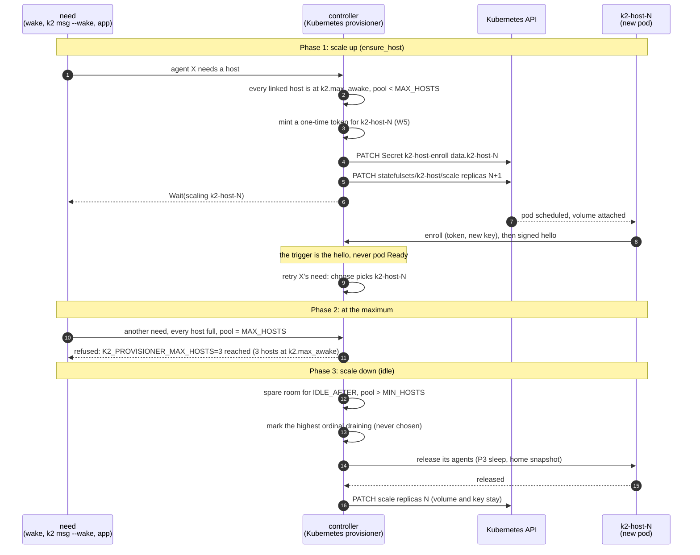

# k8s-provisioner: the host pool on Kubernetes (P4 T1)

Task `k8s-provisioner`, branch `k2-dist/k8s-provisioner` from
`k2-dist/wave2-preview` @3912ab2ff. Plan: `docs/prd/progress/p4-plan.md`
(branch `k2-dist/p4-plan`), section 1 and task T1. Owner decisions taken
per the plan's recommendations: D1 a small typed REST client on the
daemon's HTTP stack, D2 the controller scales between a minimum (1) and a
maximum, D8 W5 enroll per ordinal, D10 `k2-daemon --host-health`.

## The change


`Provisioner trait` is drawn blue because P3 T2 owns it; it isn't on
`wave2-preview` yet (see Status).

## The flows

### Scale up for a wake, scale down when idle



## How to try it

```sh
# toolchain (shared machine: 3 jobs, 3 test threads)
export RUSTUP_HOME=$HOME/.cache/k2-dist-rust/rustup CARGO_HOME=$HOME/.cache/k2-dist-rust/cargo
export PATH=$CARGO_HOME/bin:$PATH CARGO_BUILD_JOBS=3

# the client, the pool logic and --host-health against fakes
~/.cache/k2-dist-cargo-slot.sh cargo test -p k2-daemon --lib -- k8s:: provisioner::kubernetes host_health --test-threads=3

# kind (k2lab only, explicit kubeconfig, namespace k2-p4-pool): see "kind" below once it lands
kind get kubeconfig --name k2lab > "$TMPDIR/k2lab.kubeconfig"
kubectl --kubeconfig "$TMPDIR/k2lab.kubeconfig" -n k2-p4-pool get statefulset,pods,pdb
```

## Status

- Milestones: diagrams written.
- Dependencies not on `wave2-preview` @3912ab2ff:
  - P3 T2 phase A (`provisioner/` trait, `agent_placement`): no branch yet;
  - S8 SIGTERM drain: in progress on `k2-dist/g2-fixes` (outbox worker).
- Building now (no dependency on either): the `k8s/` client (D1), `--host-health`
  (D10), and the pool scaler in `provisioner/kubernetes.rs` against P3's
  trait sketch (`Need`, `HostView`, `Ensure`), with a one-file adapter when
  P3 T2 lands.
- Waits for P3 and S8: the kind acceptance (six wakes → 3 pods; back to 1
  after the idle window with homes snapshotted).
