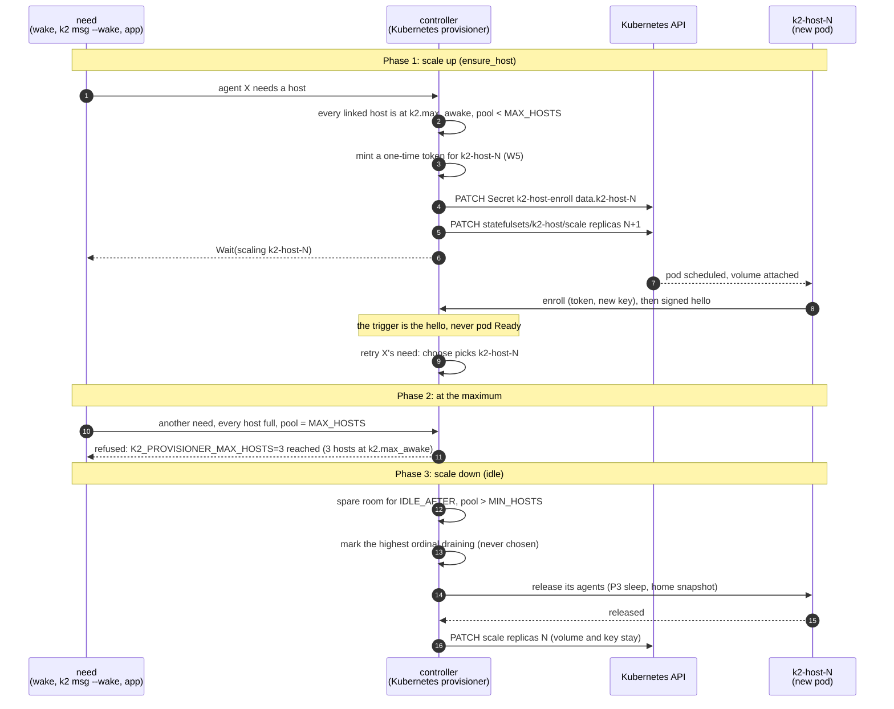

# k8s-provisioner: the host pool on Kubernetes (P4 T1)

Task `k8s-provisioner`, branch `k2-dist/k8s-provisioner` from
`k2-dist/wave2-preview` @3912ab2ff. Plan: `docs/prd/progress/p4-plan.md`
(branch `k2-dist/p4-plan`), section 1 and task T1. Owner decisions taken
per the plan's recommendations: D1 a small typed REST client on the
daemon's HTTP stack, D2 the controller scales between a minimum (1) and a
maximum, D8 W5 enroll per ordinal, D10 `k2-daemon --host-health`.

## The change

```mermaid
graph LR
    %% ── Colour legend ──────────────────────────────
    %% Blue = exists today · Violet = changed · Green = new
    %% Orange = outside K2 · Slate = state and settings
    %% Shapes: rect = process or module, stadium = Secret or volume,
    %% hexagon = an object Kubernetes holds, cylinder = database, flag = setting

    %% ── CONTROLLER POD · k2-daemon K2_ROLE=controller ──
    subgraph ctl [Controller pod · k2-daemon K2_ROLE=controller]
        RH[RemoteHost<br/><sub>agent_host/remote.rs · links, placements</sub>]:::existing
        PV[Provisioner trait<br/><sub>provisioner/mod.rs · P3 T2</sub>]:::existing
        KP[Kubernetes provisioner<br/><sub>provisioner/kubernetes.rs · pool scaler</sub>]:::new
        KC[k8s client<br/><sub>k8s/ · reqwest + rustls · ServiceAccount</sub>]:::new
        EN[enroll Registry<br/><sub>hosts/enroll.rs · mint_token</sub>]:::existing
        DB[(k2.db<br/><sub>host_keys, enroll_tokens, placements</sub>)]:::state
        SET>K2_PROVISIONER=kubernetes<br/><sub>MIN_HOSTS 1 · MAX_HOSTS · IDLE_AFTER 15 min</sub>]:::state
        RH -- need a host --> PV
        PV -- kind = kubernetes --> KP
        KP -- mint for ordinal N --> EN
        KP -- scale, Secret, pods --> KC
        EN --- DB
        SET -.-> KP
    end

    %% ── NAMESPACE k2 · HOST POOL ───────────────────
    subgraph pool [Namespace k2 · host pool]
        STS{{StatefulSet k2-host<br/><sub>statefulsets/scale · replicas</sub>}}:::external
        ES([Secret k2-host-enroll<br/><sub>key k2-host-N · one-time token</sub>]):::state
        H[k2-host-N<br/><sub>K2_ROLE=host · enroll, signed hello</sub>]:::existing
        HH[k2-daemon --host-health<br/><sub>readinessProbe · exit 0 when linked</sub>]:::new
        STS --> H
        ES -.-> H
        HH -- GET /cli/hosts/status --> H
    end

    API[Kubernetes API<br/><sub>in-cluster · RBAC namespace k2</sub>]:::external
    KC -- PATCH scale, PATCH Secret, GET or watch pods --> API
    API --> STS & ES
    H -- enroll, then signed hello --> RH
    RH -- hello from k2-host-N --> KP

    classDef existing fill:#dbeafe,stroke:#2563eb,color:#1e3a5f
    classDef changed  fill:#ede9fe,stroke:#7c3aed,color:#3b0764
    classDef new      fill:#d1fae5,stroke:#059669,color:#064e3b
    classDef external fill:#ffedd5,stroke:#ea580c,color:#7c2d12
    classDef state    fill:#f1f5f9,stroke:#64748b,color:#1e293b
```



`Provisioner trait` is drawn blue because P3 T2 owns it; it isn't on
`wave2-preview` yet (see Status).

## The flows

### Scale up for a wake, scale down when idle



## How to try it

```sh
# toolchain (shared machine: 3 jobs, 3 test threads)
export RUSTUP_HOME=$HOME/.cache/k2-dist-rust/rustup CARGO_HOME=$HOME/.cache/k2-dist-rust/cargo
export PATH=$CARGO_HOME/bin:$PATH CARGO_BUILD_JOBS=3

# the client, the pool logic and --host-health against fakes
~/.cache/k2-dist-cargo-slot.sh cargo test -p k2-daemon --lib -- k8s:: provisioner::kubernetes host_health --test-threads=3

# kind (k2lab only, explicit kubeconfig, namespace k2-p4-pool): see "kind" below once it lands
kind get kubeconfig --name k2lab > "$TMPDIR/k2lab.kubeconfig"
kubectl --kubeconfig "$TMPDIR/k2lab.kubeconfig" -n k2-p4-pool get statefulset,pods,pdb
```

## What's built

| Piece | Where | Notes |
|---|---|---|
| D1 client | `crates/k2-daemon/src/k8s/mod.rs` | In-cluster config (`KUBERNETES_SERVICE_HOST`/`_PORT`, the ServiceAccount's `namespace`, `ca.crt`, `token`; the token re-read on every call since projected tokens rotate). Blocking `reqwest` + rustls already in the daemon, no new dependency: `get_scale`/`set_replicas` (merge patch of `statefulsets/<name>/scale`), `list_pods`/`get_pod`/`watch_pods` (410 → `Expired`), `put_secret_key`/`remove_secret_key` (merge patch of one `data` key; the Secret must exist, RBAC is by name). Errors keep the API's `Status` reason and message. Calls block: run them on a blocking thread |
| Pool scaler | `crates/k2-daemon/src/k8s/pool.rs` | P3's `ensure_host` and `idle` for `kubernetes`, over `PoolApi` (the client) and `Enroller` (W5 `Registry`: `mint_token` inside the controller, no HTTP). Settings `K2_PROVISIONER_MIN_HOSTS` (1), `_MAX_HOSTS` (3), `_IDLE_AFTER` seconds (900), `_STATEFULSET` (`k2-host`), `K2_HOST_ENROLL_SECRET` (`k2-host-enroll`). Moves to `provisioner/kubernetes.rs` behind P3's trait when it exists (P3 owns `provisioner/mod.rs`; no add/add conflict meanwhile) |
| `--host-health` (D10) | `crates/k2-daemon/src/hosts/health.rs`, one line in `daemon_main.rs`'s early dispatch | Never boots a daemon. GETs the local `/cli/hosts/status` on `K2_DAEMON_PORT` (else the `daemon.port` file through `k2_core::paths`): exit 0 only for `role: host` with `linked: true`, else 1 with the reason |

Rules the pool keeps:
- A usable host is linked, not away, not draining (on its own or for this pool's scale-down); `Ready` is the one with the most room under `k2.max_awake`.
- No room: if a pod exists without a hello (still starting, or the controller restarted mid scale-up), wait for it; at `MAX_HOSTS` refuse naming the limit; else mint for ordinal N (skipped when N is already enrolled: its key is on its volume), put it in the Secret, *then* scale to N+1, and `Wait` until N's signed hello (`on_hello` returns true: retry the waiting needs). Pod Ready is never read.
- Idle: only the highest ordinal, only when its agents fit in the others' free room for `IDLE_AFTER`, never below `MIN_HOSTS`, never while a scale-up is pending, never an away host or one draining on its own. Mark it draining (`Drain`: the caller releases its agents), and scale down once it has none.

### Results

| Check | Result |
|---|---|
| `cargo test -p k2-daemon --lib -- k8s:: hosts::health` | 19 passed, 2 runs |
| `k8s::tests::*` (6) | in-cluster config (IPv6 brackets, missing token); scale get and patch body; 403 `Forbidden` reason kept, nothing listening is a transport error; a rotated token file is picked up on the next call; Secret key put (base64) and removed, other keys kept, a missing Secret is 404; pods list (selector encoded), get, watch (`MODIFIED`, a terminating pod, 410 → `Expired`) |
| `k8s::pool::tests::with_max_awake_2_a_third_wake_scales_1_to_2_minting_the_token_first` | `Wait` naming `k2-host-1`, replicas 2, the Secret's `k2-host-1` holds the minted token, and the Secret PATCH precedes the scale PATCH in the API log |
| `…the_need_is_retried_on_the_new_hosts_hello_never_on_pod_ready` | the pod Running and Ready changes nothing (no API call, no second scale); another host's hello doesn't count; `k2-host-1`'s does, then `Ready(k2-host-1)` |
| `…a_pod_without_a_hello_is_waited_for_not_added_to` | replicas 2 with one hello: wait for `k2-host-1`, no mint, no scale |
| `…at_the_maximum_the_refusal_names_the_limit` | `K2_PROVISIONER_MAX_HOSTS=3 reached … k2.max_awake` |
| `…an_enrolled_ordinal_scales_up_without_a_new_token` | no mint, no Secret key |
| `…after_the_idle_window_the_highest_ordinal_drains_then_scales_down` | nothing before the window; `Drain(k2-host-2)` at it; never `Ready` while draining; no scale while its agent remains; `ScaledDown{to: 2}` once released |
| `…never_below_the_minimum`, `…a_draining_or_away_host_is_never_chosen_and_never_scaled` | min respected; an away host's room doesn't count (a new host comes instead) and it is never scaled down; a SIGTERM-draining host likewise |
| `hosts::health::tests::*` (2) | 0 only for a linked host; not linked (with the last error), a controller, a `K2_ROLE=all` 404, nothing listening, no port: 1 |

## Status

- Milestones: diagrams written; unit acceptance (pool, client, `--host-health`).
- Dependencies not on `wave2-preview` @3912ab2ff:
  - P3 T2 phase A (`provisioner/` trait, `agent_placement`): no branch yet;
  - S8 SIGTERM drain: in progress on `k2-dist/g2-fixes` (outbox worker).
- Building now (no dependency on either): the `k8s/` client (D1), `--host-health`
  (D10), and the pool scaler in `provisioner/kubernetes.rs` against P3's
  trait sketch (`Need`, `HostView`, `Ensure`), with a one-file adapter when
  P3 T2 lands.
- Waits for P3 and S8: the kind acceptance (six wakes → 3 pods; back to 1
  after the idle window with homes snapshotted).
