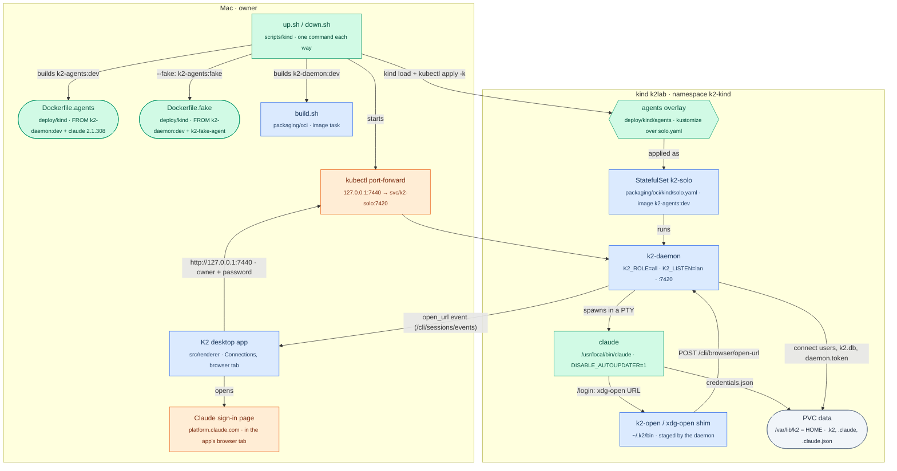

# k2-dist: kind-app (K2 on kind, driven from the desktop app)

The last mile of P0 on this Mac: today's daemon (`K2_ROLE=all`) in one pod on
the kind cluster `k2lab`, with the Claude Code CLI in the image, reached from
the K2 desktop app through `kubectl port-forward`. The owner signs Claude in
the way K2 intends, with `/login` in a claude session opened from the app. No
API key, no OAuth token and no credential Secret is involved.

## The change



## Up, connect, sign in, work

```mermaid
sequenceDiagram
    participant O as owner<br/>(Mac terminal)
    participant U as up.sh<br/>(new)
    participant K as kind k2lab<br/>(kubectl, explicit kubeconfig)
    participant D as k2-daemon<br/>(pod, K2_ROLE=all)
    participant A as K2 app<br/>(Mac, remote client)
    participant C as claude<br/>(pod PTY)

    Note over O,K: Phase 1: up
    O->>U: scripts/kind/up.sh
    U->>U: build k2-daemon:dev, then k2-agents:dev
    U->>K: kind load docker-image (both), kubectl apply -k deploy/kind/agents
    K->>D: start StatefulSet, PVC at /var/lib/k2
    U->>K: rollout status, then port-forward 127.0.0.1:7440
    U->>D: GET /boot-status
    D-->>U: phase=ready
    U->>K: exec cat daemon.token (into memory only)
    U->>D: POST /cli/users/add, /cli/users/set-role owner (first run)
    U-->>O: URL http://127.0.0.1:7440, user owner, password (once)

    Note over O,A: Phase 2: connect the app
    O->>A: Settings → Connected Servers → + Add a server (URL, owner, password)
    A->>D: POST /cli/auth/login
    D-->>A: session token
    A->>D: /cli/... ?token=<session>, WS /cli/sessions/events
    D-->>A: workspaces, sessions, app-level events

    Note over A,C: Phase 3: sign Claude in (once; survives restarts)
    A->>D: spawn claude in a workspace
    D->>C: exec claude (PATH: ~/.k2/bin first, then /usr/local/bin)
    O->>C: /login
    C->>D: xdg-open <authorize URL> (k2-open shim → /cli/browser/open-url)
    D-->>A: open_url event, opens as a browser tab in the app
    C-->>O: "Browser didn't open? Use the url below", "Paste code here if prompted"
    O->>A: open the printed URL, sign in, copy the code
    O->>C: paste the code
    C->>D: (writes /var/lib/k2/.claude/.credentials.json on the PVC)

    Note over A,C: Phase 4: work
    O->>C: type a task
    C-->>A: output on the grid (/cli/sessions/grid)
```

## How to try it

```sh
scripts/kind/up.sh            # builds, loads, applies, waits, port-forwards; prints URL, user, password
# then follow deploy/kind/README.md in the desktop app
scripts/kind/down.sh          # stops the port-forward, deletes namespace k2-kind (and its PVC)
```

## What the app needs from a self-hosted host (read from code)

- **URL:** `http://127.0.0.1:<port>` is accepted (`connect-validate.ts`
  `parseServerUrl`: http or https; loopback is not special, and the host key
  is `127.0.0.1:<port>`, never the local daemon). So `kubectl port-forward`
  to loopback works with today's app, with no cluster change.
- **Credential:** a K2 Connect username and password, not `daemon.token`.
  The app calls `POST /cli/auth/login` and sends the session token as
  `?token=`. `up.sh` creates an Owner login once, through `/cli/users/add` and
  `/cli/users/set-role` with the owner token. That token is read into memory
  only and passed to curl through a `-K` pipe, never on argv.
- **Daemon side:** `K2_LISTEN=lan` binds `0.0.0.0`. A port-forward peer
  arrives as loopback inside the pod, and Lan has the same access. Spawn
  (`/cli/sessions/v2/spawn`) and grid (`/cli/sessions/grid`) need Member;
  Owner passes.
- **Login URL:** Claude on Linux runs `xdg-open`. The daemon's staged shim
  posts the URL to `/cli/browser/open-url`, the daemon broadcasts `open_url`,
  and the app (local or remote) opens it in an in-app browser tab. The
  automatic URL's callback is `localhost:<port>` in the pod, so the runbook
  uses Claude's printed fallback URL plus "Paste code here". No daemon or
  app change is needed.
- **Login storage:** `/var/lib/k2/.claude/.credentials.json`, the wallet's
  "live store" (`llm_accounts/mod.rs`), on the PVC.

## Evidence (2026-10-24)

S1 against the fake pod through the port-forward, from a clean namespace
(`down.sh --fake` then `up.sh --fake`), evidence in
`lab-runs/kind/2026-10-24T18-55-43Z/` (first run: `…T18-45-52Z`, same result):

```text
S1 PASS
  ok   spawn returns a session
  ok   spawn is fresh, not reused
  ok   attach to /cli/sessions/grid
  ok   the fake agent runs as claude (banner on the grid)
  ok   the agent shows its prompt
  ok   the reply comes back on the grid
  ok   transcript in the agent home has the prompt
  ok   close is accepted
```

The first run took 1070 ms from spawn to banner and 601 ms from typing to
the reply. The SessionStart, UserPromptSubmit and Stop hooks ran inside the
pod with exit 0. Daemon `k2-daemon 0.46.3` (`/boot-status`: phase ready,
protocol 1–1, installKind package).

Other checks:

| Check | How | Result |
|---|---|---|
| App login | `up.sh` on `k2-kind`, then `POST /cli/auth/login` as the app does | 64-char session token, role owner, `mustChangePassword` false; `/boot-status`, `/cli/auth/whoami`, `/cli/fs/info` (home `/var/lib/k2`) all 200 with it |
| Claude in the agents image | `ls` in the `k2-kind` pod (claude not run) | `/usr/local/bin/claude` 2.1.308, `DISABLE_AUTOUPDATER=1`, `~/.k2/bin/{k2-open,xdg-open}` staged |
| Login URL reaches the app | fake pod: subscribe to `/cli/sessions/events` through the port-forward, run `~/.k2/bin/xdg-open <url>` in the pod | `{"kind":"open_url","url":…,"source":"shim"}` arrived at the client |
| Survives a restart | fake pod: write `~/.claude/persist-probe`, `kubectl delete pod`, wait | file still there; port-forward reconnected by itself (ready after 4 s); app login still works |
| `down.sh --fake` | then `kubectl get ns`, `lsof :7441` | namespace gone, port free |
| no-k2.dev settings | `up.sh --fake` after RESUME; env and log in the pod | `K2_TUNNEL_LEASE=off`, `K2_FEDERATION=off`, relay list and DNS API at `127.0.0.1:9`, no `K2_AIRGAP`; no `tunnel.json`, no frpc; log: "tunnel/relays boot refresh skipped: no tunnel token"; S1 PASS (`lab-runs/kind/2026-10-24T22-04-40Z/`) |
| Egress lock | the opt-in NetworkPolicy applied to `k2-kind-fake`, pod restarted | `http://example.com` (80) times out, `https://api.anthropic.com` (443) answers 404; boot ready in 4 s; S1 PASS (`…T22-05-22Z/`). This shows only that K2 on kind runs with frp and every non-443 port closed. It is not proof of k2.dev independence: k2.dev is also 443, and a plain NetworkPolicy can't filter by hostname |

The agent's PTY gets `~/.k2/bin` first on its PATH, so Claude's `xdg-open` is
the shim. That comes from reading `open_shim.rs` and `daemon_pty`; the fake
agent never calls `xdg-open`.

## Status

- **Milestone:** done. Everything below is verified on `k2-kind-fake`, which
  is now taken down; `k2-kind` (the owner's) was left alone after the
  coordinator took it over.
- **Earlier:** first working slice, done for the owner's path.
  `up.sh` gave a working URL and login on `k2-kind`, and the coordinator now
  owns that pod. S1 passes through the port-forward.
- **Added on request:** `deploy/kind/components/no-k2dev` (shared by both
  overlays) and the opt-in `deploy/kind/agents-egress-locked` overlay.
  Verified on `k2-kind-fake` after RESUME (see Evidence). `k2-kind` has
  not been re-applied. A later `up.sh` there changes only the ConfigMap,
  and `envFrom` takes effect at the next pod restart, not at apply.
- **Shared Docker lock:** `up.sh` holds `~/.cache/k2-dist-docker.lock`
  around its builds and `kind load` (coordinator rule), and frees it before
  touching the cluster.
- **Observed:** in the fake pod, the daemon's subscription-usage probe runs
  `codex app-server` (`subscription_usage.rs`), finds the fake `codex`
  symlink and waits for its timeout. That is harmless. The real image has
  no `codex`.
- **Fixes found by running it:**
  - The login step in `up.sh` exited silently: SIGPIPE from
    `tr </dev/urandom | head` under `pipefail`, and a JSON literal that
    brace-expanded. The script now uses Python `secrets`, and builds the
    bodies with `json.dumps`, with values passed through the environment so
    the password never appears on argv.
  - A run that died left an orphaned `kubectl port-forward` holding the port.
    `kind_stop_forward` now also kills by this variant's own kubeconfig path.
  - The fake pod crash-looped because a test daemon (`K2_TEST_AGENT_SHIM_DIR`
    set) panics when HOME is its user's real home (`zen::sync::
    guard_real_home`). `Dockerfile.fake` now moves the k2 user's passwd home
    to `/home/k2-fake`; HOME stays `/var/lib/k2`. This affects the fake
    image only.
- **Decisions (mine, inside owned files):**
  - Own namespaces (`k2-kind`, and `k2-kind-fake` for the S1 proof) so this
    never collides with `image`'s `k2-solo` namespace on the same cluster.
    The overlays rename the namespace with kustomize; `solo.yaml` is
    untouched.
  - Claude Code 2.1.308 (npm `stable` tag on 2026-10-24), the native linux
    binary, at `/usr/local/bin/claude`. The daemon always puts that
    directory on an agent's PATH (`login_path::known_fallback_dirs`).
    `DISABLE_AUTOUPDATER=1`, because a self-update would land in
    `~/.local/bin` on the volume, which is also on the agent PATH. No codex:
    it needs Node at runtime plus its own binary, which isn't cheap.
  - `up.sh` builds `k2-daemon:dev` only when it is missing (or with
    `--rebuild-daemon`), because it is the `image` task's long release
    build. A pod-template annotation with the image id rolls the pod only
    when the image changed (the tag stays `dev`). That is how the fixed fake
    image replaced the crash-looping pod.
  - S1 runs unchanged from `tests/lab`. A copy loop mirrors the pod's
    `~/.claude/projects` and the fake trace into a local temp dir, and the
    agent's cwd is `/work/lab-agent`, so the pod and the Mac compute the
    same project slug.
  - `K2_FEDERATION=off` is set as asked, but the env can only turn
    federation on; a persisted app setting would still win. Off is the
    default anyway.
  - Owner decision 2026-10-24: no credential Secret; login is `/login` in a
    claude session opened from the app.
- **Port-forward hardening (2026-10-24, after the owner's forward died):**
  - What happened: at 16:26 the pod was OOM-killed and kubectl exited
    (`lost connection to pod`), but nothing reconnected. Its loop had died
    some time after 12:55, when it last logged a reconnect, leaving kubectl
    (pid 61505) orphaned and serving.
  - Two causes in my code:
    1. The loop ran `kc … &`, which backgrounds a function, i.e. a
       subshell. `$!` was that subshell, so every `kill "$child"` orphaned
       kubectl. This also explains the orphan found at 12:28.
    2. The loop lived in its launcher's process group and session, so an
       untrappable signal to that group (a tool or terminal cleanup) could
       kill it silently. Who sent that signal can't be proven: the old loop
       logged nothing on exit.
  - Fixes:
    - The loop backgrounds `kubectl` itself.
    - The loop starts under `setsid` (`kind_start_forward`).
    - It logs every start, signal and exit, and the log is appended, not
      overwritten.
    - A watcher restarts kubectl after 3 failed `/boot-status` probes.
    - New `scripts/kind/forward.sh [--dist] [--fake] [--status]` restarts
      or inspects just the forward.
  - Tested with a stub kubectl under a throwaway TMPDIR on port 7499, no
    cluster involved:
    - kubectl exits: restarted after 2 s;
    - kubectl alive but silent: restarted after 3 probes;
    - the launcher's process group is SIGKILLed: the loop survives;
    - normal stop: the loop logs SIGTERM; no orphan, port freed.
  - The owner's running forward (pid 23886, started by the coordinator) is
    still the old code. A `scripts/kind/forward.sh` swaps it with a blip of
    about a second.
- **The Mac's door is now a proxy (coordinator decision, after
  `kubectl port-forward` dropped the owner's forward at 16:52:50 on one
  broken stream).**
  - What: `deploy/kind/proxy` (`alpine:3.20.10` + `socat=1.8.0.0-r0`, as
    nobody) runs as container `<namespace>-proxy`, with `--restart
    unless-stopped`, 64 MB and 0.5 CPU, on Docker's `kind` network. It
    relays `127.0.0.1:<port>` to `k2lab-control-plane:<NodePort>`.
  - NodePorts are fixed per variant in the overlays: agents 30740, fake
    30741, dist-fake 30742, dist 30743.
  - `up.sh` creates or replaces the proxy (`--port-forward` for the
    fallback), `down.sh` removes it, and `forward.sh` checks or recreates
    either door.
  - Verified on `k2-kind-fake` (18:33):
    - S1 PASS through the proxy (`lab-runs/kind/2026-10-25T00-33-25Z/`);
    - `kubectl delete pod k2-solo-0`, and `/boot-status` answers through
      the untouched proxy 1 s after the rollout (0 proxy restarts);
    - S1 PASS again (`…T00-33-53Z/`);
    - `down.sh --fake`: proxy container gone, 7441 free.
  - The owner's `k2-kind-proxy` was not touched. A later `up.sh` on agents
    replaces it with the same thing aimed at the control-plane node.
- **Open questions:** none.
