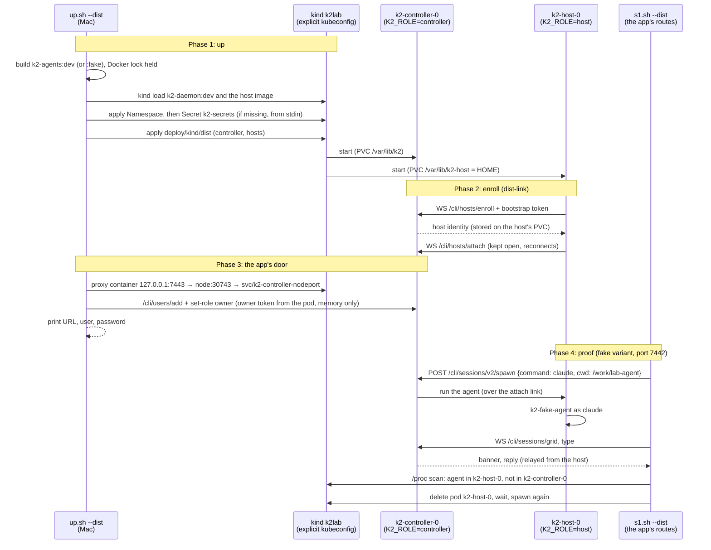

# k2-dist: kind-dist (distributed K2 on kind)

K2 split in two on the kind cluster `k2lab`: one controller pod
(`K2_ROLE=controller`, no agents) and one agent-host pod (`K2_ROLE=host`,
image `k2-agents:dev`, its own volume holding `HOME`, so Claude logins
persist). The host dials the controller and enrolls with a bootstrap token
that `up.sh` generates into a Secret. The desktop app talks only to the
controller, through `kubectl port-forward`. The manifests are a kustomize
overlay over the end state, `deploy/kubernetes/core/{controller,hosts}.yaml`
(controller and hosts only: no Postgres, mail or Gateway;
`K2_PROVISIONER=static`).

The daemon side (`K2_ROLE=host`, `/cli/hosts/*`) is being built by
`dist-link`. Every env name below that it has not confirmed yet is marked
**provisional**.

## The change

```mermaid
graph TD
    %% ── Colour legend ──────────────────────────────────────────────
    %% Blue = exists today · Violet = changed · Green = new
    %% Orange = outside K2 · Slate = files, volumes, env, Secrets
    %% Shapes: rect = process, stadium = files/volume, hexagon = derived,
    %%         flag = env var or setting

    %% ── MAC · the owner's machine ─────────────────────────────────
    subgraph mac [Mac · owner]
        UP[up.sh --dist / down.sh --dist / s1.sh --dist<br/><sub>scripts/kind · --fake for the test variant</sub>]:::changed
        PF[k2-kind-dist-proxy<br/><sub>socat · 127.0.0.1:7443 (fake 7442) → node:30743 (30742)</sub>]:::new
        APP[K2 desktop app<br/><sub>Connected Servers · owner + password</sub>]:::existing
        UP -- starts --> PF
        APP --> PF
    end

    %% ── OVERLAY · deploy/kind/dist ────────────────────────────────
    subgraph ovl [Overlay · deploy/kind/dist]
        BASE([controller.yaml, hosts.yaml<br/><sub>deploy/kubernetes/core · end state, untouched</sub>]):::existing
        KZ{{dist overlay<br/><sub>static provisioner · no PG/mail/Gateway · kind images</sub>}}:::new
        NK{{no-k2dev component<br/><sub>deploy/kind/components · both ConfigMaps</sub>}}:::existing
        BASE --> KZ
        NK --> KZ
    end

    %% ── KIND · namespace k2-kind-dist (fake: k2-kind-dist-fake) ───
    subgraph kind [kind k2lab · namespace k2-kind-dist]
        SEC([Secret k2-secrets<br/><sub>host-enroll-token · made by up.sh, never printed</sub>]):::state
        CTL[k2-controller-0<br/><sub>k2-daemon:dist · K2_ROLE=controller · K2_HOSTS=1</sub>]:::changed
        HOST[k2-host-0<br/><sub>k2-agents:dist · K2_ROLE=host</sub>]:::new
        CL[claude / k2-fake-agent<br/><sub>runs in k2-host-0 only</sub>]:::new
        CPVC([PVC data-k2-controller-0<br/><sub>/var/lib/k2 · k2.db, users, daemon.token</sub>]):::state
        HPVC([PVC data-k2-host-0<br/><sub>/var/lib/k2-host = HOME · .claude, .k2</sub>]):::state
        SEC -. bootstrap token file .-> CTL
        SEC -. enroll token file .-> HOST
        HOST -- "dials ws://k2-controller:7420 /cli/hosts/enroll, /attach" --> CTL
        HOST -- spawns --> CL
        CTL --> CPVC
        HOST --> HPVC
    end

    UP -- "kind load, kubectl apply" --> KZ
    KZ -- applied as --> CTL
    KZ -- applied as --> HOST
    UP -- "creates (once)" --> SEC
    PF --> CTL

    classDef existing fill:#dbeafe,stroke:#2563eb,color:#1e3a5f
    classDef changed  fill:#ede9fe,stroke:#7c3aed,color:#3b0764
    classDef new      fill:#d1fae5,stroke:#059669,color:#064e3b
    classDef external fill:#ffedd5,stroke:#ea580c,color:#7c2d12
    classDef state    fill:#f1f5f9,stroke:#64748b,color:#1e293b
```

## Up, enroll, spawn on the host



## How to try it

`k2-daemon:dist` comes from a dist-link checkout until dist-link is merged
here:

```sh
scripts/kind/build-daemon.sh ../dist-link k2-daemon:dist   # capped compile; K2_KIND_BUILD_MEMORY=6g CARGO_BUILD_JOBS=1 was needed
scripts/kind/up.sh --dist --fake     # k2-kind-dist-fake on 127.0.0.1:7442
scripts/kind/s1.sh --dist            # S1 through 7442, plus placement and host-restart checks
scripts/kind/down.sh --dist --fake

scripts/kind/up.sh --dist            # k2-kind-dist on 127.0.0.1:7443 (k2-agents:dev, real claude)
scripts/kind/down.sh --dist
```

## Evidence (2026-10-24, run at 22:25 local)

`scripts/kind/s1.sh --dist` on `k2-kind-dist-fake`, through the proxy on
127.0.0.1:7442 (`k2-kind-dist-fake-proxy` to `k2lab-control-plane:30742`).
Evidence is in `lab-runs/kind-dist/2026-10-25T04-25-16Z/`:

```text
S1                    PASS
placement             PASS
S1 after host restart PASS
```

- **S1** (8/8): spawn, attach `/cli/sessions/grid` relayed by the
  controller, banner, prompt, reply, the transcript in the host's
  `~/.claude`, close. Spawn to banner took 79 ms and typing to the reply
  675 ms. SessionStart, UserPromptSubmit and Stop hooks ran on the host,
  all exit 0.
- **Placement:** a spawn through the controller, then a /proc scan of both
  pods:
  - `k2-host-0`: `pid 558 comm=claude exe=/opt/k2-fake/bin/k2-fake-agent`
  - `k2-controller-0`: none
  - close → 200 `{"closed":true,"indexCleared":true}`
- **Host restart:** `kubectl delete pod k2-host-0`. The new pod (uid
  91c0015e…, started 04:25:34Z) relinked and became Ready (probe:
  `"linked":true`). S1 passed again (8/8; spawn to banner 636 ms).
- **Topology:**
  - `k2-controller-0` runs `k2-daemon:dist` (dist-link a2488e783,
    `k2-daemon 0.46.3`, protocol 1);
  - `k2-host-0` runs `k2-agents:dist-fake`;
  - `up.sh` reported `controller /cli/hosts/status: role=controller, 1
    host(s): k2-host-0 (0 placements)`.
- **The image build** (`scripts/kind/build-daemon.sh`, dist-link
  a2488e783):
  1. 4 GB, 3 jobs: OOM-killed (`k2-core` and `k2-daemon` together).
  2. 4 GB, 1 job: OOM-killed (`k2-daemon` alone needs about 4.8 GB).
  3. 6 GB, 1 job: built, under a cap the coordinator allowed for this one
     build. The `k2-daemon` compile took 11m31s at 3–4.2 GiB.

  Docker stayed responsive throughout; dependencies were cached between
  attempts. `k2-agents:dist-fake` builds FROM it, with no daemon compile.

## Status

- **Milestone:** 7443 ready for the owner (the real dist variant;
  details below). Earlier: S1 runs distributed. Every acceptance check passes on
  `k2-kind-dist-fake` (see Evidence). The namespace is left up for the
  coordinator; `scripts/kind/down.sh --dist --fake` removes it.
- **First build attempt (18:35–19:05), killed by the coordinator:**
  - `packaging/oci/build.sh` compiles inside `docker build`, where
    BuildKit can't cap memory. After 29 min the Docker API had been wedged
    for 26 min (the VM at about 650% CPU, kind starved, the owner's 7440
    down).
  - Replacement: `scripts/kind/build-daemon.sh <tree> <tag>`. Its steps:
    - compiles in a plain `docker run` on `k2-kind-toolchain:1.99.1`
      (`deploy/kind/Dockerfile.toolchain`, the same packages as
      packaging/oci's toolchain stage), with `--memory 4g
      --memory-swap 4g --cpus 2` and `CARGO_BUILD_JOBS=2`;
    - mounts the source read-only, with cargo's registry and target in
      named volumes;
    - builds the image with `deploy/kind/Dockerfile.daemon-prebuilt` (the
      runtime stage of packaging/oci, unchanged), which copies the two
      binaries in, with no compile;
    - holds the Docker lock and a cargo slot for the whole run.
  - The agents images build FROM it, so the binary is compiled once.
  - `up.sh` calls it before taking its own lock. Not run yet: waiting for
    the coordinator's RESUME-BUILD.
- **Contract, as used here:**
  - controller: `K2_ROLE=controller`, `K2_HOSTS=1`,
    `K2_HOST_BOOTSTRAP_TOKEN_FILE`, `K2_DAEMON_PORT=7420`, `K2_LISTEN=lan`.
  - host: `K2_ROLE=host`, `K2_CONTROLLER_URL=ws://k2-controller:7420`,
    `K2_HOST_ENROLL_TOKEN_FILE` (same Secret key), `K2_HOST_NAME` (the pod
    name), `K2_DAEMON_PORT=7420` (loopback only).
  - Dropped `K2_HOST_TOKEN_FILE`, the relayed name: dist-link uses
    deploy/README's. `K2_PROVISIONER=static` stays (declared in
    deploy/README; dist-link doesn't read it yet).
  - Readiness: the controller's `/boot-status`. For the host, an exec probe
    curls its loopback `/cli/hosts/status` for `"linked":true`, because the
    host's API listens on loopback only, so the kubelet can't `httpGet`
    it.
- **The owner's real deployment (2026-10-25, 09:12 local):**
  - `k2-daemon:dist` rebuilt from dist-link 2c95fc4c2 (with the
    app-session-token fix f3f2ed2dd and the reconnect fix b962aa4a2). It
    was incremental: only `k2-daemon` recompiled, in about 6.5 min at 6 GB
    and 1 job.
  - No regression on `k2-kind-dist-fake`: `s1.sh --dist` PASS/PASS/PASS
    (`lab-runs/kind-dist/2026-10-25T15-09-46Z/`, 8/8 both times).
    `app-check.sh --dist --fake` PASS: login, then spawn and attach with
    the session token; the fake agent ran in `k2-host-0` (pid 183) and
    the controller had none.
  - `k2-kind-dist` is up: `k2-controller-0` on `k2-daemon:dist`,
    `k2-host-0` on `k2-agents:dist` (claude 2.1.308,
    `DISABLE_AUTOUPDATER=1`), both on `k2lab-worker2`. The door is the
    `k2-kind-dist-proxy` container, 127.0.0.1:7443 to NodePort 30743. The
    host is linked (`/cli/hosts/status`: `linked:true`, 5 attempts while
    the controller came up).
  - The app login `owner` was created with a random password, written
    only to `~/.local/state/k2-kind/dist/owner-password` (0600) and
    never printed.
  - `/var/lib/k2/work/demo` (git) is on `k2-work`. Both pods see it, and a
    file written by the controller is read on the host.
  - `app-check.sh --dist` PASS, with no agent CLI: login, then spawn `sh`
    with the session token. The grid shows `K2CHECK host=k2-host-0
    uid=10000 cwd=/var/lib/k2/work/demo`; /proc shows it in `k2-host-0`
    and none in `k2-controller-0`; close returns 200.
  - The owner's `k2-kind` and `k2-kind-proxy` were not touched (7440 still
    returns 200).
- **After the coordinator's verification (6/6):**
  - Every probe on both pods has `timeoutSeconds: 5`, and readiness has
    `failureThreshold: 3`. The host's exec probes run `curl --max-time 3`,
    and the 1 s default logged "timed out after 1s" under load. Committed
    in the overlays only; nothing live redeployed.
  - `deploy/kind/README.md` has a "Distributed variant" section. It
    documents `k2-work` as ReadWriteOnce with same-node podAffinity, a
    lab-only workaround; the real fix is the PRD's portable home (P3).
  - Next: deploy the real agents variant (`k2-agents:dist`, with claude)
    once dist-link lands the app-session fix for `/cli/sessions/grid`.
- **Workspaces (coordinator decision):** one `k2-work` PVC (RWO,
  local-path) at `/var/lib/k2/work` in both pods, because the app browses
  the controller's files and dist-link sends that cwd to the host verbatim.
  The host has podAffinity to the controller (RWO is per node). Each pod
  keeps its own HOME volume. `up.sh --dist` seeds `/var/lib/k2/work/demo`
  from the host pod.
- **Host UID 10000** (the end state uses 10001): both pods write the shared
  workspaces, and git refuses a repo another UID owns.
- **Images:**
  - `k2-daemon:dist` is built from a dist-link checkout:
    `K2_KIND_DAEMON_SRC=<that worktree> scripts/kind/up.sh --dist [--fake]`.
    `up.sh` refuses a tree without `crates/k2-daemon/src/hosts`.
  - `k2-agents:dist` and `k2-agents:dist-fake` build `FROM k2-daemon:dist`
    (`--build-arg BASE_IMAGE`).
  - Rust-compiling builds take a cargo slot and use `CARGO_BUILD_JOBS=3`.
- **The Mac's door:** proxy container `k2-kind-dist-fake-proxy` on
  127.0.0.1:7442 to NodePort 30742 (`k2-controller-nodeport`); dist uses
  7443 and 30743.
- **Limits of this cut (from dist-link's notes), relevant to the app:**
  - The controller relays `/cli/sessions/grid` for the owner token only. A
    desktop-app login (Connect session) gets an error frame, so the owner's
    app can't yet attach to an agent's terminal on the dist variant. S1
    uses the owner token.
  - The controller 501s the LLM login routes. `/login` inside a claude
    session would go through the grid, so it is blocked for the app by the
    same limit.
  - Mac paths aren't mapped. The app must send pod paths, which the
    controller's folder picker gives it.

## 2026-10-25: the owner's deployment upgraded to wave2-preview @713156ea5

Source: `k2-dist/wave2-preview` @713156ea5. It adds W1 remote-host (RemoteHost as AgentHost: chat overlay, wake, heartbeats, resume through the controller) and W2 outbox (`k2 msg` across hosts).

1. **Images.** `k2-daemon:dist` was built with `build-daemon.sh` at 6g, 1 job, in 10m43s (peak about 3.3 GiB). Then `k2-agents:dist` (claude 2.1.308, `DISABLE_AUTOUPDATER=1`) and `k2-agents:dist-fake`.
2. **`k2-kind-dist-fake` (7442)** was scaled back up and rolled with `up.sh --dist --fake`.
   - `s1.sh --dist`: S1, placement and S1 after a host restart all PASS (`lab-runs/kind-dist/2026-10-25T18-31-10Z/`).
   - `app-check.sh --dist --fake` PASS: the fake claude ran in k2-host-0, nothing ran in the controller.
3. **`k2-kind-dist` (7443)** was rolled with `up.sh --dist`.
   - No `--reset-password` or `--password-file`, so the password file is unchanged.
   - The Secret and all three PVCs are the same volumes as before the roll (same `pvc-…` names).
   - Both pods run the new image ids.
   - The owner's Claude login on the host volume survived: `/var/lib/k2-host/.claude/.credentials.json` and `.claude.json` have the same sizes and mtimes. Only their existence was checked, never their contents.
4. **`app-check.sh --dist` on 7443** PASS: `K2CHECK host=k2-host-0 uid=10000 cwd=/var/lib/k2/work/demo`, nothing in k2-controller-0, close 200.
5. **`k2-kind-dist-fake`** was scaled back to 0. The namespace, PVCs and Secret are kept.

Seen during the Docker Desktop restart (VM raised to 14 GB): every proxy container exited with 143 (SIGTERM at shutdown), and `--restart unless-stopped` did not bring them back.
- `up.sh` recreates its own variant's proxy; `forward.sh [--dist] [--fake]` does it without a redeploy.
- The owner's `k2-kind-proxy` (7440) needs `scripts/kind/forward.sh` or `docker start k2-kind-proxy`.
- Also, `kind load` re-points a tag on the nodes, so a pod that restarts before its roll comes back on the new image. The owner's controller did this when the VM restarted.
