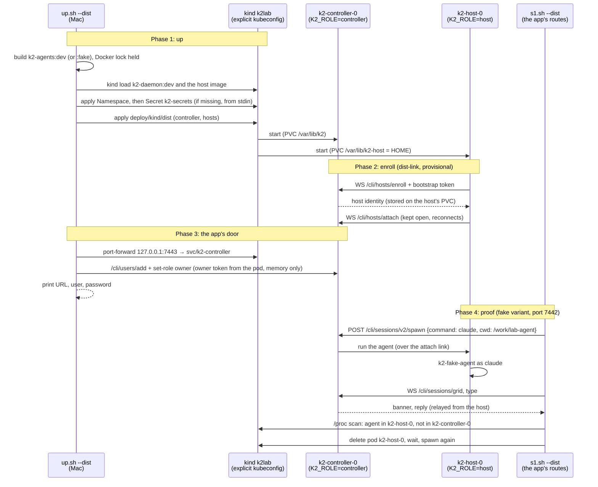

# k2-dist: kind-dist (distributed K2 on kind)

K2 split in two on the kind cluster `k2lab`: one controller pod
(`K2_ROLE=controller`, no agents) and one agent-host pod (`K2_ROLE=host`,
image `k2-agents:dev`, its own volume holding `HOME`, so Claude logins
persist). The host dials the controller and enrolls with a bootstrap token
that `up.sh` generates into a Secret. The desktop app talks only to the
controller, through `kubectl port-forward`. The manifests are a kustomize
overlay over the end state, `deploy/kubernetes/core/{controller,hosts}.yaml`
(controller and hosts only: no Postgres, mail or Gateway;
`K2_PROVISIONER=static`).

The daemon side (`K2_ROLE=host`, `/cli/hosts/*`) is being built by
`dist-link`. Every env name below that it has not confirmed yet is marked
**provisional**.

## The change

```mermaid
graph TD
    %% ── Colour legend ──────────────────────────────────────────────
    %% Blue = exists today · Violet = changed · Green = new
    %% Orange = outside K2 · Slate = files, volumes, env, Secrets
    %% Shapes: rect = process, stadium = files/volume, hexagon = derived,
    %%         flag = env var or setting

    %% ── MAC · the owner's machine ─────────────────────────────────
    subgraph mac [Mac · owner]
        UP[up.sh --dist / down.sh --dist / s1.sh --dist<br/><sub>scripts/kind · --fake for the test variant</sub>]:::changed
        PF[kubectl port-forward<br/><sub>127.0.0.1:7443 (fake 7442) → svc/k2-controller:7420</sub>]:::external
        APP[K2 desktop app<br/><sub>Connected Servers · owner + password</sub>]:::existing
        UP -- starts --> PF
        APP --> PF
    end

    %% ── OVERLAY · deploy/kind/dist ────────────────────────────────
    subgraph ovl [Overlay · deploy/kind/dist]
        BASE([controller.yaml, hosts.yaml<br/><sub>deploy/kubernetes/core · end state, untouched</sub>]):::existing
        KZ{{dist overlay<br/><sub>static provisioner · no PG/mail/Gateway · kind images</sub>}}:::new
        NK{{no-k2dev component<br/><sub>deploy/kind/components · both ConfigMaps</sub>}}:::existing
        BASE --> KZ
        NK --> KZ
    end

    %% ── KIND · namespace k2-kind-dist (fake: k2-kind-dist-fake) ───
    subgraph kind [kind k2lab · namespace k2-kind-dist]
        SEC([Secret k2-secrets<br/><sub>host-enroll-token · made by up.sh, never printed</sub>]):::state
        CTL[k2-controller-0<br/><sub>k2-daemon:dev · K2_ROLE=controller · K2_HOSTS=1</sub>]:::changed
        HOST[k2-host-0<br/><sub>k2-agents:dev · K2_ROLE=host (provisional)</sub>]:::new
        CL[claude / k2-fake-agent<br/><sub>runs in k2-host-0 only</sub>]:::new
        CPVC([PVC data-k2-controller-0<br/><sub>/var/lib/k2 · k2.db, users, daemon.token</sub>]):::state
        HPVC([PVC data-k2-host-0<br/><sub>/var/lib/k2-host = HOME · .claude, .k2</sub>]):::state
        SEC -. bootstrap token file .-> CTL
        SEC -. enroll token file .-> HOST
        HOST -- "dials ws://k2-controller:7420 /cli/hosts/enroll, /attach" --> CTL
        HOST -- spawns --> CL
        CTL --> CPVC
        HOST --> HPVC
    end

    UP -- "kind load, kubectl apply" --> KZ
    KZ -- applied as --> CTL
    KZ -- applied as --> HOST
    UP -- "creates (once)" --> SEC
    PF --> CTL

    classDef existing fill:#dbeafe,stroke:#2563eb,color:#1e3a5f
    classDef changed  fill:#ede9fe,stroke:#7c3aed,color:#3b0764
    classDef new      fill:#d1fae5,stroke:#059669,color:#064e3b
    classDef external fill:#ffedd5,stroke:#ea580c,color:#7c2d12
    classDef state    fill:#f1f5f9,stroke:#64748b,color:#1e293b
```

## Up, enroll, spawn on the host



## How to try it

Not runnable until `dist-link` lands `K2_ROLE=host` and `/cli/hosts/*`. The
commands the finished task gives:

```sh
scripts/kind/up.sh --dist --fake     # k2-kind-dist-fake on 127.0.0.1:7442
scripts/kind/s1.sh --dist            # S1 through 7442, plus placement and host-restart checks
scripts/kind/down.sh --dist --fake

scripts/kind/up.sh --dist            # k2-kind-dist on 127.0.0.1:7443 (k2-agents:dev, real claude)
scripts/kind/down.sh --dist
```

## Status

- **Milestone:** diagrams written.
- **Next:** overlays (`deploy/kind/dist`, `deploy/kind/dist-fake`), the
  `--dist` flag in the scripts, the placement and host-restart checks.
  Build and run once `dist-link` publishes its env contract.
- **Provisional names** (from `deploy/README.md` and what the coordinator
  relayed; set side by side until `dist-link` confirms):
  - host: `K2_ROLE=host`, `K2_CONTROLLER_URL=ws://k2-controller:7420`,
    `K2_HOST_ENROLL_TOKEN_FILE` (deploy/README) and `K2_HOST_TOKEN_FILE`
    (relayed), both pointing at `/run/secrets/k2/host-enroll-token`,
    `K2_HOST_NAME` (pod name), `K2_HOST_LABELS`, `K2_HOST_MAX_AWAKE`.
  - controller: `K2_ROLE=controller`, `K2_HOSTS=1`,
    `K2_HOST_BOOTSTRAP_TOKEN_FILE`, `K2_PROVISIONER=static`.
- **Decisions (mine):**
  - Port 7443 for the non-fake dist variant: 7440 is the owner's live
    `k2-kind` port-forward.
  - Lab-sized: one host, small requests, a 60 s grace period (the end
    state's 600 s would make "delete k2-host-0" slow), no `k2-host health`
    readiness probe (no such binary in our image; provisional).
- **Open questions (for dist-link):** where the controller resolves a
  spawn's `cwd` (on the host, I assume); what a host's readiness check is;
  whether the controller needs `K2_KEK_FILE` (not set here; solo runs
  without it).
