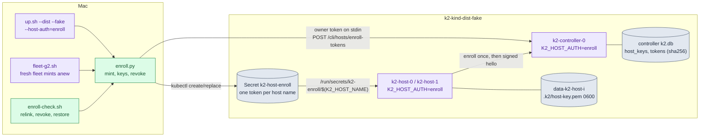
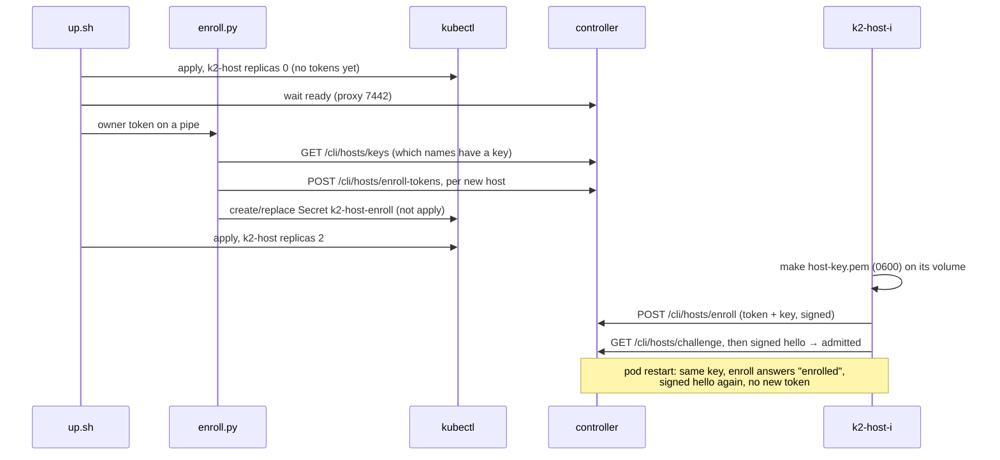

# kind-enroll: signed host enrollment on kind (W5), test variant

Branch `k2-dist/kind-app`, after merging `k2-dist/wave2-preview` 3912ab2ff (W5, `docs/prd/progress/host-enroll.md`).

**Goal.** Run `up.sh --dist --host-auth=enroll` on `k2-kind-dist-fake`:
- one one-time enrollment token per host, minted on the controller into a Secret and never printed;
- each host's key on its own volume (0600);
- hosts enroll once and relink by key after a pod restart;
- a revoked host is refused.

Then run the kind fleet's S1–S7 and I1–I4 with 2 hosts in that mode. The owner's `k2-kind-dist` is unchanged.

## The change





Details:
- **Switch.** `--host-auth=token|enroll`; without the flag a run uses `token`.
  - `K2_HOST_AUTH=enroll` goes into the controller's and the hosts' pod templates, so switching modes rolls them.
  - In token mode nothing is added: both namespaces render exactly as before. Checked against their last applied renders.
  - `up.sh` refuses `enroll` on the owner's `k2-kind-dist`.
- **Token file per host.** `K2_HOST_ENROLL_TOKEN_FILE=/run/secrets/k2-enroll/$(K2_HOST_NAME)`.
  - A patch's env entries go first in the merged list, and `$(VAR)` expands only variables defined earlier. So the patch repeats `K2_HOST_NAME` (from the pod name) before the token file; the render shows it once, in the right order.
  - The Secret volume is `optional`.
- **What gets a token.** Only host names with no key on the controller.
  - An enrolled host keeps a placeholder (the file must exist at boot).
  - A revoked host gets nothing and stays refused. `--renew <host>`, used by `enroll-check.sh` after it deletes the host's key file, mints for a revoked name: a new key may take the name.
- **Fresh fleet.** `fleet-g2.sh`'s fresh step deletes the controller's and hosts' volumes. In enroll mode it now mints new tokens after the controller is up and before the hosts start.

## How to try it

```sh
scripts/kind/up.sh --dist --fake --hosts=2 --host-auth=enroll   # 127.0.0.1:7442
scripts/kind/enroll-check.sh                    # relink by key, revoke, restore
scripts/kind/fleet-g2.sh                        # S1..S7, I1..I4 in enroll mode
kubectl --kubeconfig $TMPDIR/k2-kind/dist-fake/kubeconfig -n k2-kind-dist-fake \
  exec k2-controller-0 -- cat /var/lib/k2/.k2/daemon.token \
  | python3 -I scripts/kind/enroll.py keys --url http://127.0.0.1:7442
```

## Results (2026-10-26)

Daemon: `k2-daemon:dist-fake` from 613b95202 (wave2-preview 3912ab2ff). The owner's `k2-daemon:dist` is still 6e24dd5be. The fake agent is from lab-g2 0d825db09.

**`enroll-check.sh` PASS** (`lab-runs/kind-enroll/enroll-check-1.log`):

| check | evidence |
|---|---|
| enrolled, linked, key 0600 | k2-host-0 key `38f31fd7fe3e8ea1`, k2-host-1 key `8a54d9019ee9b4ec`; both linked; `/var/lib/k2-host/.k2/host-key.pem` mode 600 on each |
| pod restart relinks by key | k2-host-1 deleted, back and ready. Secret `k2-host-enroll` unchanged (resourceVersion 144023), same key, `ctl.host_enrolled` 1 → 1, `ctl.host_admitted` 1 → 2 |
| revoke refuses | live link cut. The host's `last_error` is `refused: revoked_host_key: host key 8a54d9019ee9b4ec… (k2-host-1) was revoked …`; not linked |
| still refused after a restart | `enroll refused: revoked_host_key: …`; not linked |
| restore | key file deleted, a token minted with `--renew`; enrolled again with key `a28193c9f4aee174` and linked |

**`fleet-g2.sh` in enroll mode: S1–S7 PASS, I1–I4 PASS** (`lab-runs/kind-g2-enroll/`, lab-g2 6e32ccec1):
- The fresh fleet minted new tokens for both hosts.
- S2 and S3 each put one agent on each host.
- k2-host-1 was restarted twice by the scenarios (held for S1, killed in S6). Each time it relinked on a signed hello: `ctl.host_admitted` ×2, and no `ctl.host_refused` in the run.
- 13 placements: 6 on k2-host-0, 7 on k2-host-1.

## Switching the owner's `k2-kind-dist` to enroll mode (next owner roll)

The owner decided on 2026-10-26: switch, but only in the next owner roll, after the S7/S8 G2 fixes and W3b are merged, so the owner reconnects once. The owner's overlay renders correctly in enroll mode: the env is in order, the Secret volume is present, and token mode is still identical to the last applied render.

1. **Build and rehearse on the test variant with the roll's exact images.**
   - `build-daemon.sh . k2-daemon:dist` (6g, jobs=1), then `docker tag k2-daemon:dist k2-daemon:dist-fake`.
   - `up.sh --dist --fake --hosts=2 --host-auth=enroll`, then `enroll-check.sh`, `fleet-g2.sh`, `s1.sh --dist`, `app-check.sh --dist --fake` and `reconnect-check.sh --dist --fake`. All must pass.
   - If W3b is in: also with `--ptyd=1`.
2. **Allow enroll on the owner's variant.** Remove the `--host-auth=enroll is for the test variant only` guard in `up.sh` (one commit, which names the owner's decision).
3. **Before-snapshot of `k2-kind-dist`.**
   - Pods, PVC names and image ids.
   - That the login file is present and `hasCompletedOnboarding` is set.
   - That `/var/lib/k2/.k2` has `connect-users.json`, `connect-sessions.json` and `hosts/`.
   - That `k2-host-enroll` doesn't exist yet.
4. **The roll:** `scripts/kind/up.sh --dist --host-auth=enroll` (add `--ptyd=1` if decided). No `--reset-password` and no `--password-file`. What it does, in order:
   1. Applies with k2-host at 0 replicas, because the Secret `k2-host-enroll` doesn't exist yet. `k2-host-0` stops: its agents drain on SIGTERM.
   2. Rolls the controller with `K2_HOST_AUTH=enroll` and the new image. **The owner's app reconnects here, once.**
   3. Mints one token for `k2-host-0` (the controller has no host keys yet) into `k2-host-enroll`.
   4. Applies k2-host at 1 replica. `k2-host-0` starts on its old volume, so the Claude login is kept. It makes `/var/lib/k2-host/.k2/host-key.pem` (0600), enrolls with the token and links on a signed hello.
5. **Checks on 7443.**
   - `enroll.py keys` lists `k2-host-0` as enrolled.
   - The host's `/cli/hosts/status` says `linked: true`.
   - The key file has mode 600.
   - `app-check.sh --dist` passes.
   - `reconnect-check.sh --dist --restart-live` passes: both pods restart, and the host relinks by key with no new token (the Secret's resourceVersion is unchanged).
   - The login file and `hasCompletedOnboarding` are as before.
   - **Never run `enroll-check.sh` here**: it revokes a host (it is pinned to the test variant).
6. **Rollback if anything fails:** `up.sh --dist`, without the flag. Both sides go back to token mode and the host links with the bootstrap token again. The key file and `k2-host-enroll` are left, unused.

## Status

- MILESTONE: kind-enroll green. Enroll mode on `k2-kind-dist-fake` with 2 hosts; enroll-check PASS; S1–S7 and I1–I4 PASS.
- The owner's `k2-kind-dist` is untouched: token mode, `k2-daemon:dist` 6e24dd5be.
- Decided: `k2-kind-dist` switches to enroll mode in the next owner roll (steps above).
- Later: the `k2` CLI verbs for mint, list and revoke (W5 has none yet).

## The owner's end-state roll onto wave3 (prepared 2026-10-26, applied the same day)

`scripts/kind/owner-roll-wave3.sh` folds the enroll switch above into the roll onto `k2-dist/wave3`: the host pool (`K2_PROVISIONER=kubernetes`), enroll, `K2_PTYD=1` and the real agents image. `--dry-run` (the default) changes nothing. `--go` waits for the coordinator.

- **Dry run, 2026-10-26: OK.**
  - (a) `k2-host` keeps its name, its `serviceName` and its claim template (`data`, 10Gi, RWO), so `k2-host-0` mounts `data-k2-host-0` again at `/var/lib/k2-host`. The Claude login lives there and is never copied.
  - (b) The pool's floor and ceiling are both 1 (`K2_PROVISIONER_MIN_HOSTS` = `_MAX_HOSTS` = `--hosts`). The pool never drops to zero hosts, and no second host can appear whose idle scale-down would strand agent homes before home sync (P3 T1) lands.
  - (c) NodePort 30743 and the controller's claim are unchanged, and the proxy answers on 7443.
  - The `kubectl diff` is limited to:
    - the controller's ServiceAccount and token;
    - the enroll and pool env;
    - the host's enroll token file and `K2_PTYD`;
    - the new Role `k2-controller-pool`, its RoleBinding, and ServiceAccount `k2-controller`.
- **`up.sh`:**
  - `--provisioner=kubernetes` (needs `--host-auth=enroll`) adds `deploy/kind/dist/pool-rbac.yaml`: scale `k2-host`, patch only the Secret `k2-host-enroll`.
  - `--render-only=PATH` renders without building or applying.
  - The enroll guard for the owner's variant is gone, per the owner's decision above.
- **Risks to watch in `--go`:**
  - Rollback to the older daemon after wave3 migrated the controller's database is untested.
  - At boot the pool may raise `k2-host` before `enroll.py` has created `k2-host-enroll`. The host then waits for its optional token file. The rehearsal on `k2-kind-dist-fake` runs exactly this path first.

### Applied, 2026-10-26: `k2-kind-dist` runs wave3 853157fee

- **Rehearsal on `k2-kind-dist-fake` (2 hosts, the roll's exact images).** enroll-check, app-check and reconnect-check all PASS. On the way it caught three bugs, fixed before the owner was touched:
  - the pool's RBAC landed in k2lab's `default` namespace (5bf0944d5);
  - a stale test password;
  - a race in `app-check.sh` (907486e6f).
- **The roll:**
  - an in-cluster backup of the controller's volume (PVC `k2-backup-controller-20261026-083333`);
  - `up.sh --dist --host-auth=enroll --ptyd=1 --provisioner=kubernetes`;
  - the after-checks all passed except one false positive (the roll's own backup PVC in the PVC list).
- **The false positive started a rollback.** The coordinator stopped it before any image changed. Its restore had already put the pre-roll database back, with the root-dir `tar` error. The coordinator re-minted `k2-host-0`'s token and restarted it.
- **Checks on the end state (the pre-roll database, re-migrated by wave3):**
  - `k2-host-0` is enrolled and linked, with a 0600 key.
  - `reconnect-check --restart-live` PASS, and the host relinked by key: same key, `k2-host-enroll` unchanged, no new token.
  - `app-check --dist` PASS.
  - **owner-proof PASS through 7443 with the owner's app login.** A Claude Code agent on `k2-host-0` answered one short prompt (in its transcript), was slept, and was woken into the same session.
  - The PVCs keep their uids. `.credentials.json` is unchanged; `.claude.json` changed only because Claude ran.
- **Fixed afterwards (33c5059f2), verified with a backup and restore on `k2-kind-dist-fake`:**
  - the backup Job uses `nodeAffinity`, not `nodeName`;
  - restore extracts through a directory it owns;
  - Jobs are polled for success or failure;
  - after a restore in enroll mode, hosts get fresh tokens and restart;
  - the PVC check ignores the roll's backup.
- **For dist-link (daemon):** a host reads its enroll token file only at boot. A re-minted token is not picked up until the pod restarts.

### Restoring the owner's controller volume (by hand)

1. `docker tag k2-daemon:dist-prev k2-daemon:dist && docker tag k2-agents:dist-prev k2-agents:dist`. Do this only to go back to the images the backup was made with: `-prev` is 43efc6471.
2. `scripts/kind/backup-controller.sh --restore=k2-backup-controller-20261026-083333`:
   - the controller goes to 0;
   - the archive's sha256 is checked;
   - the volume is emptied and re-filled;
   - the controller goes back to 1;
   - in enroll mode, hosts get fresh tokens and restart.
3. To go back to the previous deployment: `scripts/kind/up.sh --dist` (pool off, token auth). It loads the images tagged in step 1.
4. Check 7443 (`/boot-status` 200) and `app-check.sh --dist --password-file=$HOME/.local/state/k2-kind/dist/owner-password`.

The backup PVC is kept in `k2-kind-dist`. Nothing of it left the cluster.

## Owner roll #2: k2-kind-dist onto rc1 (2026-10-26, applied)

The coordinator's go: `k2-dist/wave3` c59acf7e0 (`k2-daemon:rc1`, verified
by dist-link), pool MIN = MAX = 1 until `k2-dist/drain-move` lands,
`K2_WORK_ROOT=/var/lib/k2/work` on the host, `data-k2-host-0` kept.
`POOL_MAX=1 scripts/kind/owner-roll-rc1.sh --go`; evidence in the run's
`$TMPDIR/k2-kind/dist/owner-roll-rc1/` (before.txt, after.txt, diff.txt,
owner-proof.txt, go.log). **ROLLED**, no check failed, no password in the log.

- **Dry run:** login present, onboarding done; k2-host-0 reuses
  `data-k2-host-0`; MIN=MAX=1, 1 replica; NodePort 30743 and the
  controller's claim unchanged; `K2_WORK_ROOT` on k2-host; `login-seed`
  read-only on its own mount; `k2-daemon:rc1` is c59acf7e0's build.
- **Rollback images:** `k2-daemon:dist-wave3` = 4352788a3c46,
  `k2-agents:dist-wave3` = db44e263047e (what the pods ran, by id).
- **Rehearsal on k2-kind-dist-fake, PASS:** rolled; a fresh k2-host-1
  (new volume, old key revoked, `--renew` token) got k2-host-0's dummy
  login through `login-seed` (0600, onboarding done) and linked;
  enroll-check, app-check, reconnect-check.
- **Backup:** `k2-backup-controller-20261026-134916` (in the cluster, kept).
- **After:**
  - the PVCs from before keep their uids;
  - k2-host-0's login file is unchanged;
  - 1 replica, k2-host-0 linked by its 0600 key, `K2_WORK_ROOT` set;
  - `app-check.sh --dist` and `reconnect-check.sh --dist --restart-live` pass;
  - **owner-proof PASS through 7443**: Claude Code answered on k2-host-0
    (session 3d441929…); a **turn-end home snapshot** of the proof agent was
    in the controller's store before any sleep (seq 1, 23 files, 261086
    bytes, from k2-host-0); slept, woken, answered again in the same session.

Fixed on the way (each caught before anything changed, or by the rehearsal):
- step 6 read the rollback image ids from the whole snapshot (9cc4202ad);
- the rehearsal could print a new test login's password (it now uses its
  0600 file);
- `login-seed` didn't carry the onboarding flag onto a used volume (a
  `.claude.json` without it); it now takes the source's and keeps the old
  one as `.claude.json.k2-prev`.

**To go back to wave3:**
1. `docker tag k2-daemon:dist-wave3 k2-daemon:dist && docker tag k2-agents:dist-wave3 k2-agents:dist`;
2. `scripts/kind/backup-controller.sh --restore=k2-backup-controller-20261026-134916`
   (checks the sha256, restores, re-mints the host's token and restarts it);
3. `scripts/kind/up.sh --dist --host-auth=enroll --ptyd=1 --provisioner=kubernetes`
   (wave3's flags);
4. check 7443 and `app-check.sh --dist --password-file=$HOME/.local/state/k2-kind/dist/owner-password`.

## Owner roll #3: k2-kind-dist onto rc2 (2026-10-27, applied)

`k2-dist/wave3` ec518d8c1 (drain-move, K2-d, K2-e, the cli-stage fix):
`RC_DAEMON=k2-daemon:rc2 RC_COMMIT=ec518d8c1… PREV=rc1 POOL_MAX=2
scripts/kind/owner-roll-rc1.sh --go`, the pool MIN=1 MAX=2, home sync
(K2_WORK_ROOT), the login copy to the second host by `login-seed`.

Before it, on `:rc2` with the fake agents (k2lab):
- `drain-demo.sh` (k2-kind-p4) 7/7, including 5–7: after the drain the agent
  continues on k2-host-1 with k2-host-0's home and the same session;
- `kind-pool-accept.sh` (k2-p4-pool-rc2) 8/8: 0 → 3 hosts, the MAX refusal,
  the idle scale-down to 1 with the drained agent's home restored elsewhere;
- the dry run: only `K2_PROVISIONER_MAX_HOSTS` 1 → 2 in the server-side diff.

`k2-daemon:rc2` is `sha256:390cc5d126d0…` (revision ec518d8c1). It
compiled only at `K2_KIND_BUILD_MEMORY=6g`, 2 CPUs, `CARGO_BUILD_JOBS=1`;
4g was OOM-killed even at one job.

Evidence (roll log, steps 1–10, all `ok`):
- rehearsal on k2-kind-dist-fake: rolled; `k2-host-1` from a fresh volume
  got k2-host-0's (dummy) login by `login-seed` (0600, onboarding done);
  enroll-check, app-check, reconnect-check PASS;
- backup PVC `k2-backup-controller-20261027-001906` (kept);
- after the roll: PVC uids unchanged; k2-host-0's login unchanged; k2-host
  at 1 replica; k2-controller runs `390cc5d126d0` and k2-host `65cde461451b`,
  both labelled ec518d8c1; K2_WORK_ROOT on k2-host-0; app-check --dist,
  reconnect-check --restart-live PASS;
- **owner-proof PASS**: Claude Code answered on k2-host-0 (session
  eaa94551…); a turn-end home snapshot in the controller's store before any
  sleep (seq 1, 23 files, 260329 bytes, from k2-host-0); slept, woken,
  answered again in the same session;
- the second host: k2-host-1 minted, scaled up, `login-seed` copied
  k2-host-0's login (0600, onboarding done), linked; back to 1 replica
  (`data-k2-host-1` and its key stay for the pool's next scale-up);
- 7443 answers.

Fixed on the way: the first rehearsal hung because `up.sh` started
enroll-mode hosts before minting whenever the Secret `k2-host-enroll` had
an entry for them. After an interrupted fleet-g2 run that entry was a spent
token against a fresh controller volume. `up.sh` now also asks the running
controller for live keys (3dd8f4076). The owner's k2-host-0 has one, so its
path is unchanged.

**To go back to rc1:**
1. `docker tag k2-daemon:dist-rc1 k2-daemon:dist && docker tag k2-agents:dist-rc1 k2-agents:dist`;
2. `scripts/kind/backup-controller.sh --restore=k2-backup-controller-20261027-001906`;
3. `scripts/kind/up.sh --dist --host-auth=enroll --ptyd=1 --provisioner=kubernetes --max-hosts=1 --work-root=/var/lib/k2/work --login-from=k2-host-0`
   (rc1's flags);
4. check 7443 and `app-check.sh --dist --password-file=$HOME/.local/state/k2-kind/dist/owner-password`.

## Owner roll #4: k2-kind-dist onto rc3 (2026-10-27, applied)

`k2-dist/wave3` b60a9fd80 (K2-f through K2-f.4; fs-relay merged and OFF):
`RC_DAEMON=k2-daemon:rc3 RC_COMMIT=b60a9fd80… PREV=rc2 POOL_MAX=2
scripts/kind/owner-roll-rc1.sh --go`, the same shape as rc2 (MIN 1, MAX 2,
home sync, the login copy to the second host). Before the go: lab's final
Linux gate on b60a9fd80 (9413 passed, one test-fixture EINTR fixed in a
test) and S10 heavy chaos 10/10; `--rehearse` on k2-kind-dist-fake 49/49.

Images: `k2-daemon:rc3` `6bce83207ce9`, `k2-agents:rc3` `7fd3542bd47b`
(both labelled b60a9fd80). The daemon was built at
`K2_KIND_BUILD_MEMORY=6g CARGO_BUILD_JOBS=1` with a disk watcher (the
Docker VM had 3–8 GB free throughout).

Evidence (roll log, steps 1–10: 87 `ok`, no FAIL):
- dry-run checks (a)–(f), (f) `K2_FS_RELAY` unset everywhere; the
  rehearsal on k2-kind-dist-fake (enroll-check, app-check, reconnect-check);
- backup PVC `k2-backup-controller-20261027-165810` (kept);
- after the roll: PVC uids unchanged; k2-host-0's login unchanged; k2-host
  at 1 replica; k2-controller runs `6bce83207ce9` and k2-host
  `7fd3542bd47b`, both labelled b60a9fd80; K2_WORK_ROOT on k2-host-0;
  app-check --dist and reconnect-check --restart-live PASS;
- **owner-proof PASS**: Claude Code answered on k2-host-0 (session
  3d339f5a…); a turn-end home snapshot in the controller's store before any
  sleep (seq 1, 23 files, 260285 bytes, from k2-host-0); slept, woken,
  answered again in the same session;
- the second host: k2-host-1 kept its own login from roll #3 (0600,
  onboarding done) and linked; back to 1 replica;
- afterwards: `K2_FS_RELAY` absent from both pods' env and both ConfigMaps;
  `K2_PROVISIONER_MIN_HOSTS=1`, `MAX_HOSTS=2`; 7443 answers.

**To go back to rc2:**
1. `docker tag k2-daemon:dist-rc2 k2-daemon:dist && docker tag k2-agents:dist-rc2 k2-agents:dist`;
2. `scripts/kind/backup-controller.sh --restore=k2-backup-controller-20261027-165810`;
3. `scripts/kind/up.sh --dist --host-auth=enroll --ptyd=1 --provisioner=kubernetes --max-hosts=2 --work-root=/var/lib/k2/work --login-from=k2-host-0`
   (rc2's flags);
4. check 7443 and `app-check.sh --dist --password-file=$HOME/.local/state/k2-kind/dist/owner-password`.
