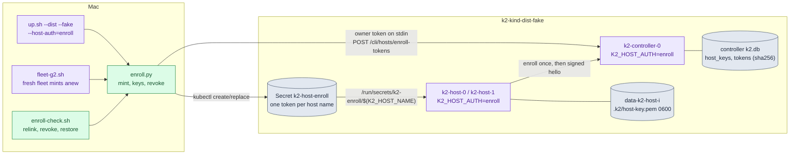
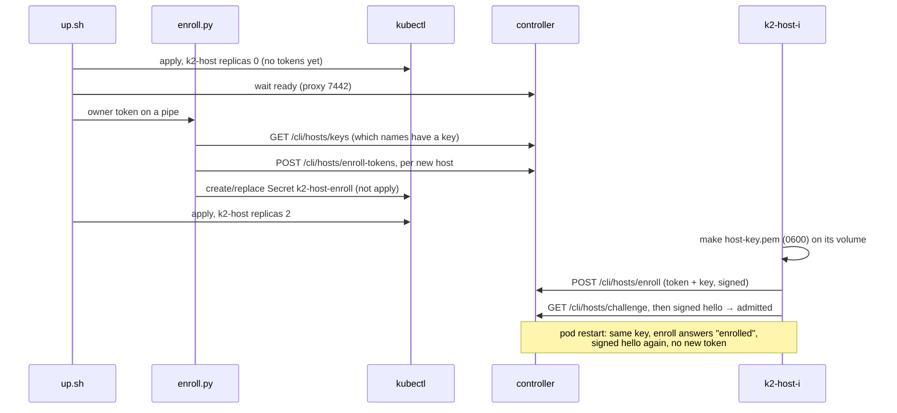

# kind-enroll: signed host enrollment on kind (W5), test variant

Branch `k2-dist/kind-app`, after merging `k2-dist/wave2-preview` 3912ab2ff (W5, `docs/prd/progress/host-enroll.md`).

**Goal.** Run `up.sh --dist --host-auth=enroll` on `k2-kind-dist-fake`:
- one one-time enrollment token per host, minted on the controller into a Secret and never printed;
- each host's key on its own volume (0600);
- hosts enroll once and relink by key after a pod restart;
- a revoked host is refused.

Then run the kind fleet's S1–S7 and I1–I4 with 2 hosts in that mode. The owner's `k2-kind-dist` is unchanged.

## The change





Details:
- **Switch.** `--host-auth=token|enroll`; without the flag a run uses `token`.
  - `K2_HOST_AUTH=enroll` goes into the controller's and the hosts' pod templates, so switching modes rolls them.
  - In token mode nothing is added: both namespaces render exactly as before. Checked against their last applied renders.
  - `up.sh` refuses `enroll` on the owner's `k2-kind-dist`.
- **Token file per host.** `K2_HOST_ENROLL_TOKEN_FILE=/run/secrets/k2-enroll/$(K2_HOST_NAME)`.
  - A patch's env entries go first in the merged list, and `$(VAR)` expands only variables defined earlier. So the patch repeats `K2_HOST_NAME` (from the pod name) before the token file; the render shows it once, in the right order.
  - The Secret volume is `optional`.
- **What gets a token.** Only host names with no key on the controller.
  - An enrolled host keeps a placeholder (the file must exist at boot).
  - A revoked host gets nothing and stays refused. `--renew <host>`, used by `enroll-check.sh` after it deletes the host's key file, mints for a revoked name: a new key may take the name.
- **Fresh fleet.** `fleet-g2.sh`'s fresh step deletes the controller's and hosts' volumes. In enroll mode it now mints new tokens after the controller is up and before the hosts start.

## How to try it

```sh
scripts/kind/up.sh --dist --fake --hosts=2 --host-auth=enroll   # 127.0.0.1:7442
scripts/kind/enroll-check.sh                    # relink by key, revoke, restore
scripts/kind/fleet-g2.sh                        # S1..S7, I1..I4 in enroll mode
kubectl --kubeconfig $TMPDIR/k2-kind/dist-fake/kubeconfig -n k2-kind-dist-fake \
  exec k2-controller-0 -- cat /var/lib/k2/.k2/daemon.token \
  | python3 -I scripts/kind/enroll.py keys --url http://127.0.0.1:7442
```

## Results (2026-10-26)

Daemon: `k2-daemon:dist-fake` from 613b95202 (wave2-preview 3912ab2ff). The owner's `k2-daemon:dist` is still 6e24dd5be. The fake agent is from lab-g2 0d825db09.

**`enroll-check.sh` PASS** (`lab-runs/kind-enroll/enroll-check-1.log`):

| check | evidence |
|---|---|
| enrolled, linked, key 0600 | k2-host-0 key `38f31fd7fe3e8ea1`, k2-host-1 key `8a54d9019ee9b4ec`; both linked; `/var/lib/k2-host/.k2/host-key.pem` mode 600 on each |
| pod restart relinks by key | k2-host-1 deleted, back and ready. Secret `k2-host-enroll` unchanged (resourceVersion 144023), same key, `ctl.host_enrolled` 1 → 1, `ctl.host_admitted` 1 → 2 |
| revoke refuses | live link cut. The host's `last_error` is `refused: revoked_host_key: host key 8a54d9019ee9b4ec… (k2-host-1) was revoked …`; not linked |
| still refused after a restart | `enroll refused: revoked_host_key: …`; not linked |
| restore | key file deleted, a token minted with `--renew`; enrolled again with key `a28193c9f4aee174` and linked |

**`fleet-g2.sh` in enroll mode: S1–S7 PASS, I1–I4 PASS** (`lab-runs/kind-g2-enroll/`, lab-g2 6e32ccec1):
- The fresh fleet minted new tokens for both hosts.
- S2 and S3 each put one agent on each host.
- k2-host-1 was restarted twice by the scenarios (held for S1, killed in S6). Each time it relinked on a signed hello: `ctl.host_admitted` ×2, and no `ctl.host_refused` in the run.
- 13 placements: 6 on k2-host-0, 7 on k2-host-1.

## Status

- MILESTONE: kind-enroll green. Enroll mode on `k2-kind-dist-fake` with 2 hosts; enroll-check PASS; S1–S7 and I1–I4 PASS.
- The owner's `k2-kind-dist` is untouched: token mode, `k2-daemon:dist` 6e24dd5be.
- Next, when the owner decides:
  - allow `--host-auth=enroll` on `k2-kind-dist`. Switching an existing deployment needs a token for `k2-host-0`, minted on the first enroll-mode run, while the host keeps its volume and makes a key on first start;
  - the `k2` CLI verbs for mint, list and revoke (W5 has none yet).
