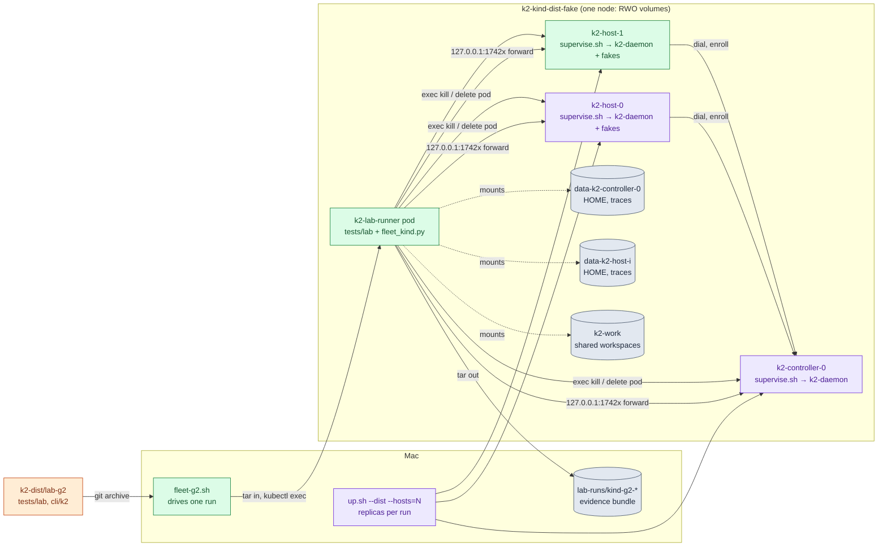
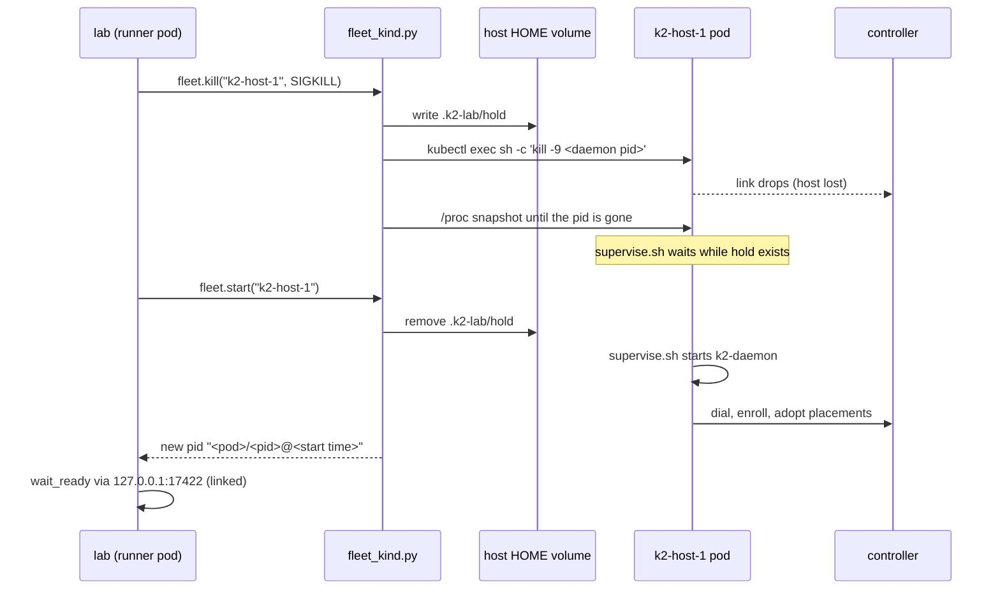

# kind-fleet: the lab's G2 scenarios on kind with two agent hosts

Branch `k2-dist/kind-app` (task kind-fleet, after the 2026-10-26 upgrade of the owner's dist deployment, in `kind-dist.md`).

**Goal.** Run distributed K2 on kind with N agent-host pods (`up.sh --dist --hosts=N`), and run the lab's G2 scenario clients against it. That includes chaos, and placement across both hosts, as `/cli/hosts/status` shows it.

## The change





**Why a runner pod.** The lab checks its scenarios by reading agent homes, transcripts, MEMORY.md, traces and workspaces from disk, and by running `cli/k2` with a host's HOME. kind's nodes have no Mac mounts. So the lab runs inside the cluster, with every daemon's volume mounted, as the compose fleet bind-mounts its containers' directories. Paths that the scenarios compare across machines are the same in every pod: `/var/lib/k2/work`, and the slugs derived from it.

**Why a hold file and an exec kill, rather than pod deletion only.**
- Deleting a pod gives Kubernetes the downtime, not the lab.
- Killing PID 1 makes the kubelet restart the container with back-off.
- `supervise.sh` keeps each daemon down while `$HOME/.k2-lab/hold` exists, in the same pod with the same volumes, as compose's `kill` and `start` do. Agent CLIs survive a daemon kill (tini reaps them), as they do on compose.
- `--kill=pod` deletes the pod instead. The new pod stays held until `start`.

**Why a fresh fleet per run.** The lab's own fleet starts from empty homes. On kind, state persists on the volumes: closed workspace agents' placements (their `close` answered `closed: false`) and earlier runs' outbox rows. These steered placement (S2 and S3 put both agents on the empty host) and counted in I2. `fleet-g2.sh` deletes the controller's and hosts' `data-*` volumes before each run; `--keep-state` keeps them. As a second guard, I2 is judged on this run's outbox rows only. `outbox-all/` keeps the full listing.

## How to try it

```sh
# fake agent from the lab's branch (it has the lab-g2 trace fields)
fs=$TMPDIR/k2-kind/fake-src-lab-g2; rm -rf $fs; mkdir -p $fs
git archive k2-dist/lab-g2 Cargo.lock tests/fakes/k2-fake-agent | tar -x -C $fs
K2_KIND_FAKE_SRC=$fs scripts/kind/up.sh --dist --fake --hosts=2
scripts/kind/fleet-g2.sh                       # S1..S7 → lab-runs/kind-g2-<time>/
scripts/kind/fleet-g2.sh --chaos=seed=7        # with chaos during S3..S7
curl -s http://127.0.0.1:7442/cli/hosts/status # placements per host
```

## Results

Run `lab-runs/kind-g2-fifth/`, 2026-10-26 00:35Z:
- Fresh fleet: k2-host-0 and k2-host-1, kill=process.
- Daemon: wave2-preview 6e24dd5be, built at 43efc6471.
- Lab: k2-dist/lab-g2 b6f1177b8 (fake agent from aaec7c10b).

| Scenario | Result | Evidence |
|---|---|---|
| S1 | PASS | on k2-host-0, with k2-host-1 held down (S1 reads one host's HOME) |
| S2 | PASS | `s2-a` on k2-host-0 and `s2-b` on k2-host-1; every hook recorded for its own session |
| S3 | PASS | alice on k2-host-0 and bob on k2-host-1; `cli/k2 msg` on alice's host is delivered once into bob's transcript |
| S4, S5 | PASS | the W1 wake and heartbeat flows through the controller |
| S6 | **FAIL (K2)** | see below |
| S7 | PASS | CLI SIGKILLed mid-turn on k2-host-1; the next need resumed the same session; MEMORY.md kept |
| I1, I3, I4 | PASS | 13 placements: 6 on k2-host-0, 7 on k2-host-1 (`ctl.place`) |
| I2 | FAIL (K2) | the one S6 row, `hop: down`, queued with 0 attempts |

**S6 is the outbox issue the lab recorded** (`lab-g2.md`, "The controller's outbox matches the recipient only against placement ids").
- The item, composed on k2-host-0 for `s6-bob-…` while bob's host was down, is accepted (`ctl.msg_accept`).
- The controller restarts and bob's host comes back. The controller adopts bob's placement as `gone`, then places him again under his project id.
- The `hop: down` row addressed to his workspace name never matches and stays `queued` with 0 attempts.
- The kind backend's part of S6 passes: host killed, controller restarted, host back.

Kind-side bugs found and fixed on the way (414da27e9 and after):
- The image has no `kill` binary; kills go through `sh -c 'kill …'`.
- macOS tar metadata, and the root-owned `/lab/repo`, broke the copy in.
- `lab.py fleet` takes the proc right after the action. The S1 hold was silently not applied, and an earlier S1 passed by luck of placement.
- State left on the volumes steered placement (hence the fresh fleet).

## Lab interface (asked through the coordinator)

The kind backend works today through `fleet_kind.install()`. That puts its functions on `labkit/fleet.py` at runtime. Asked of the lab worker: a generic hook in `fleet.py`.
- For a backend other than `procs` or `compose`, load `st["backend_module"]` and delegate `ours`, `start`, `kill`, `agent_cli_pids`, `kill_cli`, `cli_alive` and `down`.
- `cli_key` returns `"<host>:<pid>"` for every backend but `procs`.

`install()` steps aside when `fleet.py` has the hook.

## Status

- MILESTONE: S1–S7 run on kind with 2 hosts. All pass except S6, a K2 issue the lab had already recorded.
- Next:
  - a chaos run (`--chaos=seed=N`, both kill modes);
  - S8 and S9, which W3 brings into wave2-preview, once the lab adds them for this fleet;
  - dropping `install()` when the lab's hook lands.
- Limits: all hosts share one node (k2-work is ReadWriteOnce). The runner sees the hosts on the pod network (`K2_LISTEN=lan`), in the test variant only.
