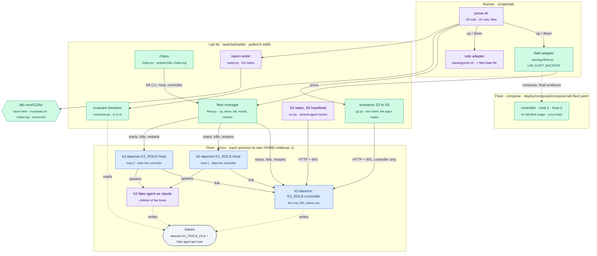
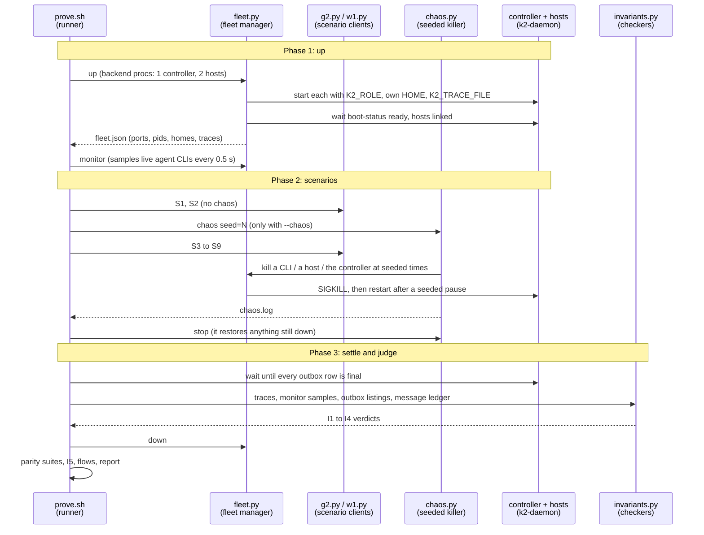

# k2-dist · lab-g2: gate G2 on solo and fleet (PRD section 3)

Task `lab-g2` (W4), branch `k2-dist/lab-g2`, from `k2-dist/wave2-preview`
(wave 1 + dist-link W0/W1 + outbox W2). It grows the G0 lab
(`docs/prd/progress/lab.md`) into the G2 gate:

```sh
scripts/lab/prove.sh G2 --topology fleet [--chaos seed=N]   # controller + 2 hosts
scripts/lab/prove.sh G2 --topology solo  [--chaos seed=N]   # today's daemon
```

New: the `fleet` topology (backends `procs`, the default, and `compose`),
scenario clients S2 to S9, `--chaos seed=N`, and checkers for invariants I1
to I4. S8 and S9 need dist-link's W3 (host drain, controller re-adoption);
they are written now and stay red until W3 lands.

## What changes



## One G2 run



## Scenarios

The client only ever talks to the controller's URL (on solo: the daemon).
Each scenario writes `scenarios/<S>.json` (checks with details) and
`scenarios/<S>.log`. Agents are `k2-fake-agent` as `claude`.

| | Scenario | What the client does | Pass when |
|---|---|---|---|
| S1 | Spawn, attach, type, see output | `labkit/s1.py` (G0), against the controller | 8/8 checks, as at G0 |
| S2 | Hook events land on the right agent | Two agents (fleet: one per host), a prompt typed into each | Every hook each CLI fired (SessionStart, UserPromptSubmit, Stop) reached the controller for that agent's session, and none for the other |
| S3 | `k2 msg` between agents on different hosts | alice on host-1 runs the real `cli/k2 msg bob …` in host-1's environment | The message is `delivered` and is in bob's transcript exactly once |
| S4 | Message wakes a sleeping agent | `w1.py wake`: an enabled agent with no process gets `k2 msg --wake` | Woken on a host, answers; asleep again, a second message resumes the same conversation |
| S5 | Heartbeat fires on a sleeping agent | `w1.py heartbeat`: add, then fire | Spawned on a host, the wakeup prompt answered |
| S6 | Inbox delivery survives restarts | fleet: host-2 (bob's) down, inbox item composed on host-1, the controller restarted, host-2 back, bob's next need | The item is in bob's inbox exactly once, its outbox rows `delivered`. solo: the item survives a daemon restart byte for byte |
| S7 | CLI killed mid-turn, next need resumes | An agent woken by a message with a long turn; its CLI SIGKILLed mid-turn; a second message | The second message resumes it with the same provider session id and the same MEMORY.md bytes, and is answered |
| S8 | Host killed mid-turn, nothing lost silently (fleet) | bob mid-turn on host-2; SIGTERM to host-2; a message to bob while it is down; host-2 restarted | host-2 drains (the turn's Stop before exit), bob is resumed by the replacement with no re-spawn by anyone, and the message is delivered once |
| S9 | Controller restart, agents keep running (fleet) | A client attached to bob; a prompt with a long turn; the controller restarted mid-turn | bob's CLI pid never changes, the turn finishes while the controller is down, the controller re-adopts bob, the reattached client sees the reply, typing and `k2 msg` reach the same pid |

Fake-agent directives (anywhere in a prompt, so they survive `k2 msg`'s
`[from …]` prefix): `[[turn-ms=N]]` sets this turn's length (S7, S8, S9
need a turn long enough to interrupt), `[[remember: text]]` appends to
MEMORY.md like a `remember ` prompt.

## Invariants

Judged after the scenarios from evidence, not from the scenarios' own
checks: daemon traces (`K2_TRACE_FILE`, one per process), fake-agent traces
(one per host, so every CLI event has its host), the fleet monitor's
samples, the outbox listings, and the lab's ledger of every message it sent.

| | Invariant | Checker |
|---|---|---|
| I1 | At most one live placement per agent; epochs | No monitor sample shows two live CLIs for one agent (keyed by its workspace) on any hosts; every `ctl.place` epoch is greater than every earlier one, across controller restarts |
| I2 | Every message reaches a final state | Every message in the ledger, the outboxes or the traces ends `delivered` or `failed` with a reason (fleet: controller hop down, each host's hop up); solo: `k2 msg` answered success, or failure with a reason |
| I3 | A resumed agent keeps its session id and memory byte for byte | For every resumed `cli.exec`: same provider session id as the agent's previous CLI, and the MEMORY.md sha256 it starts with equals the one the previous CLI last recorded |
| I4 | An agent's home is written by one host at a time | No agent has home writes (turns, memory, inbox items) from two hosts while the CLI on one of them is alive |
| I5 | Solo output matches the pre-change baseline | As at G0, against `tests/lab/baselines/G0-solo.json` |

## Chaos

`--chaos seed=N` starts `chaos.py` before S3 and stops it after S9. From
the seed it draws the schedule: every 4 to 12 s a target, a CLI (50 %), a
host (30 %) or the controller (20 %; solo: the daemon, 30 %), SIGKILLed and,
for a daemon, restarted after 1 to 5 s. Which CLI is drawn from the live
ones sorted by workspace. A scenario that is restarting processes itself
(S6, S8, S9) holds the fleet lock; chaos then logs a skip. `chaos.log`
records every step (time, target, pid, what happened); the seed is in the
report, so a failure replays with the same seed.

## How to try it

```sh
scripts/lab/prove.sh G2 --topology fleet --parity none          # scenarios + invariants only
scripts/lab/prove.sh G2 --topology fleet --chaos seed=4117 --parity none
scripts/lab/prove.sh G2 --topology solo --parity none
LAB_FLEET_BACKEND=compose scripts/lab/prove.sh G2 --topology fleet   # Docker: lock + slot, 10g cap
tests/lab/run_tests.sh                                            # the lab's own tests
```

## Status

- Milestones: diagrams written; first working slice (fleet procs: S1, S2,
  S3, S5 green; S4 red on a daemon gap); chaos runs classified; G2 on solo;
  G2 on wave2-preview 13e5a5939 (procs, chaos, compose).
- Linux gate on wave2-preview 3912ab2ff: k2-core 3867/0, k2-daemon 5250/1
  (the one failure and five ignored tests are class (b), pre-existing; see
  below). Both wave-1 gate failures are fixed.
- G2 on wave3 (below): no chaos green on procs and compose; chaos on
  636391108 green but for one new K2 red (K2-c, a duplicate after an
  interrupted delivery); hosts on `K2_PTYD=1`: unplace stops the agent, a need
  while its host is drained places it fresh on the other host (K2 gap, not
  ptyd-specific).

### G2 on k2-dist/wave3

Throwaway run branches (never wave3 itself): `k2-dist/lab-g2-wave3-run`
(853157fee + lab-g2) and `k2-dist/lab-g2-wave3b-run` (636391108, the K2-a and
K2-b fixes, + lab-g2). Under `--chaos`, every daemon gets
`K2_DELIVERY_GONE_GRACE_SECS=30` and S8 waits grace + 30 s (ecc9d1edd).

| Run | Base | Result |
|---|---|---|
| procs, no chaos `07-27-32Z` | 853157fee | S1-S9 PASS, I1-I4 pass |
| compose, no chaos `07-46-33Z` | 853157fee | S1-S9 PASS, I1-I4 pass |
| procs, seeds 4117 / 7 / 2026 `07-33-19Z` `07-37-38Z` `07-40-55Z` | 853157fee | I1-I4 pass; reds: K2-a, K2-b, allowed, lab (fixed) |
| procs, seeds 4117 / 7 / 2026 `08-24-52Z` `08-30-21Z` `08-34-48Z` | 853157fee + lab fixes | 4117 green; 7 and 2026: K2-a only (+ one lab red, fixed) |
| procs, seeds 4117 / 7 / 2026 `08-59-21Z` `09-03-17Z` `09-07-34Z` | 636391108 + lab-g2 aefdb4bfa | 4117 and 7 green; 2026: S3 round 5 red (K2-c); I1-I4 pass |
| hosts on `K2_PTYD=1`, no chaos `08-01-41Z` and seed 4117 `08-03-30Z` | 853157fee | all PASS but S8's resume elsewhere (below) |
| `LAB_S8_RESUME_ELSEWHERE=1` without ptyd `08-08-09Z` (control) | 853157fee | the same S8 red: not ptyd |

K2 reds found on wave3 (for the owners):

| | What | Evidence | Status |
|---|---|---|---|
| K2-a | Right after a controller restart, before any host linked back, ensure-pinned-chat answered 400 `spawn failed: no agent host is connected` (spawn answers 503, which the app waits on); `k2 msg --wake` failed `spawn_failed`; heartbeat fire `error` | seed 7 and 2026 round 2 (`07-37-38Z`, `07-40-55Z`) | fixed in 636391108 (gone in every round since) |
| K2-b | A message injected just before chaos SIGKILLed its host was recorded `failed` (`dormant_no_wake`) though the agent had it | seed 4117 S8 round 5 (`07-33-19Z`) | fixed in 636391108 |
| K2-c | A message injected into a CLI that chaos killed mid-turn (host answers `retry`) is delivered again by the gone rule's direct path, which spawns `--resume <session> "<msg>"`: the same prompt twice in one conversation (the host's `duplicate` check is bypassed) | seed 2026 S3 round 5 (`09-07-34Z`): `ctl.deliver` 09:10:11.899, turn 1 09:10:12.055, chaos kill 09:10:12.325, `host.deliver retry` 09:10:12.433, `ctl.msg_gone_direct ok` 09:10:42.371 | open |
| resume elsewhere | A need (the app) for an agent its drained host released for resume, while that host is down, places it on the other host with `--session-id <same id>` (`resumed: false`): a fresh conversation under the old id; the history stays on the drained host | S8 `08-01-41Z`, `08-03-30Z` (3 rounds), `08-08-09Z` (in-process) | open (design: wait for the host, or carry the conversation) |

`K2_PTYD=1` (all 18 / 49 agent sessions `backend: ptyd`): the drain's turn ends
before exit, unplacing stops the agent's CLI though both hosts' k2-ptyd keep
running (as designed; the lab records them in `ptyd-leftovers.txt` and kills
them by pid), the queued message is delivered once, and the drained host's
return never places the agent twice.

Allowed reds (PRD failure table) the lab now tells apart, from `chaos.log`
only: chaos killed the scenario's own agent CLI or host (S8 drain, S9: the
attempt is redone, at most 3, dropped checks kept in `info.redone_after_chaos`),
killed the controller under a spawn in flight (S9), or killed the resumed CLI
before or during the queued message (S8: failing it with a reason is right).
Lab fixes: reattach when a controller restart closes the grid stream (S7, S9),
S3 sends from the other host when chaos left both agents on one, idempotent
routes wait on 502 `is not connected` (b0d0b81ae, fca655129, 2feba07f0,
aefdb4bfa).

### G2 matrix on wave2-preview 13e5a5939 (merged as 319e17dbb)

wave2-preview = wave 1 + W1 + W2 outbox + S4 wake fix + W3 survive +
the outbox recipient-by-workspace-name fix + the fake-agent line fix.
`prove.sh G2 --topology fleet --parity none` (procs), then `--chaos`:

| | no chaos `00-23-13Z` | seed 4117 `00-32-23Z` | seed 7 `00-38-58Z` | seed 2026 `00-45-33Z` |
|---|---|---|---|---|
| S1 spawn, attach, type | PASS | PASS | PASS | PASS |
| S2 hooks on the right agent | PASS | PASS | PASS | PASS |
| S3 k2 msg across hosts | PASS | PASS | PASS | PASS |
| S4 message wakes a sleeping agent | PASS | PASS | PASS | PASS |
| S5 heartbeat on a sleeping agent | PASS | PASS | PASS | PASS |
| S6 inbox survives restarts | PASS | PASS | PASS | PASS |
| S7 CLI killed mid-turn, resumes | PASS | FAIL (K2 placement) | PASS | FAIL (K2 placement) |
| S8 host killed mid-turn | FAIL (drain) | FAIL (drain) | FAIL (drain; crash: lab, fixed) | FAIL (drain) |
| S9 controller restart | PASS | PASS | PASS | PASS |
| S12 | NOT RUN (no client) | | | |
| I1 one live placement, epochs | pass | pass | pass | pass |
| I2 every message final | FAIL: S8's message queued | same | same | same |
| I3 resume keeps session, memory | pass | pass | pass | pass |
| I4 one writer host per home | pass | pass | pass | pass |

Reds, classified:

- **S8 drain (K2, spec)**: S8 has two halves (`g2.py` `s8`). The crash half
  is dist-link W3's definition (SIGKILL: host reported lost, the agent not
  placed elsewhere (I1), the grid ends, on return it spawns again resuming
  its conversation, the interrupted prompt in the transcript): it passes.
  The drain half is the PRD failure table's row for S8 ("SIGTERM starts a
  drain: … wait for each turn's Stop hook … The replacement resumes agents
  that were awake"): the host exits at once on SIGTERM, the turn never ends,
  nothing resumes the agent, and the message sent meanwhile stays queued
  (the I2 red). Not built by W3; for the owner to decide whether S8 needs it.
- **S7 under chaos (K2, placement)**: when the app reopens an agent whose CLI
  died, the controller places the resume by load only. In seeds 4117 and
  2026 it chose the other host, where the conversation does not exist (each
  host has its own home): the CLI started with `--resume <id>` and exited 1
  at once, while `ensure-pinned-chat` answered 200; the client's attach got
  `session … not found in v2 session map`. Without chaos it happens to pick
  the same host. The transcript probe (W1) knows which host ran a project;
  placement does not use it. Portable homes (P3) would also cover it.
- **S8 crash in seed 7 (lab, fixed e3bc70e98)**: S8 killed the host 56 ms
  after the turn started, before the agent recorded the prompt (the fake
  agent writes it after its UserPromptSubmit hook, slower while chaos
  restarts the controller). S8 now crashes only once the prompt is recorded.

Lab changes for this tree: S3 and I2 accept the controller's traced direct
delivery (`ctl.msg_accept` delivered, no outbox row, since the S4 fix) as
final (e74d18e1f); I1 treats the same placement traced again (a spawn
refused while its host is lost) as one placement (aaec7c10b); a spawn
refused because no host is linked is asked again once one is (b6f1177b8).

### Compose run (final evidence, LAB_FLEET_BACKEND=compose)

`lab-runs/G2/2026-10-26T01-11-23Z` (sha 0d825db09; `fleet-compose.txt` in
the bundle): Linux k2-daemon and k2-fake-agent built from `git archive` in
`k2-lab-gate:3` capped at 10g, 3 CPUs, 2 jobs (slot, then the Docker lock,
held for the whole run); image `k2-lab-fleet:<sha12>`; three containers
from `deploy/compose/compose.lab-fleet.yaml`, 3g and 2 CPUs each.

| S1 | S2 | S3 | S4 | S5 | S6 | S7 | S8 | S9 | I1 | I2 | I3 | I4 |
|---|---|---|---|---|---|---|---|---|---|---|---|---|
| PASS | PASS | PASS | PASS | PASS | PASS | PASS | FAIL (drain) | PASS | pass | fail (S8's message) | pass | pass |

The same as procs without chaos: the only red is S8's drain half and the
message it leaves queued. The first compose try (`00-53-09Z`) found one lab
bug: S3 read the sending daemon's TMPDIR from the state file, which compose
keeps in the compose file (0d825db09).

### Daemon gaps the lab found (for the owners)

| Gap | Scenario | Evidence |
|---|---|---|
| On a host or controller, `k2 msg` hands every message to the outbox and ignores `wake` (`workspace_msg.rs:951`, `delivery_drain::send`); the outbox only delivers to a placed agent, so a sleeping agent is never woken and the message waits for the 7-day TTL | S4 on fleet; I2 | being fixed by the outbox worker |
| The controller's outbox matches the recipient only against placement ids (`delivery_drain.rs:282`): a workspace agent (placed under its project id) addressed by its workspace name, as agents address each other today (`k2 connections list`), never matches, so the message waits for the TTL. On solo the same `k2 msg <workspace>` and inbox compose deliver. The outbox's own test used bare v2 agent names, which solo's `k2 msg` does not accept (`workspace_not_found`) | S3, S6 on fleet; I2 | `lab-runs/dev/r4` (solo: PASS), `r5` (fleet: queued) |
| A host exits at once on SIGTERM: no drain, the turn in progress never ends, nothing resumes the agent | S8 | W3 |
| A restarted controller does not re-adopt running agents (no `ctl.adopt`, placements 0) | S9 | W3 |

### Chaos runs and how each red was classified

`--chaos seed=N`: under chaos the scenario set repeats in rounds for at
least 180 s (`LAB_CHAOS_MIN_S`), so chaos acts even on solo, where S3 to S9
take ~10 s; a scenario passes only if it passed in every round. Every red
was matched to `chaos.log` by time. Classes: **K2** (a daemon gap, table
above), **allowed** (a loss the PRD failure table allows: the turn in
progress when the CLI, or on solo the daemon, dies), **lab** (the lab
client or manager; fixed, commit given).

| Run | Result | Reds and class |
|---|---|---|
| fleet 4117 (`22-04-38Z`, 29 steps: 10 host, 6 controller, 2 CLI kills) | S1-S3, S5-S7 PASS | S4, S8, S9, I2: K2 |
| fleet 7 (`22-12-42Z`) | as 4117, plus S7 | S7: lab: chaos killed S7's CLI 0.1 s after its banner and S7 gave up; it now reopens the agent (the next need) and counts it (3beb44399) |
| fleet 2026 (`22-21-26Z`) | as 4117, plus S6 | S6: lab: its last read of the sender host's outbox raced a chaos restart of that host; it now waits for the host (3beb44399) |
| fleet 4117, first try (`21-55-47Z`) | — | lab: two lab processes wrote back each other's stale pids (chaos "killed" a gone pid, then started a second host-1), and chaos counted host helper CLIs as agents. Fixed: per-process state updates under a file lock, no signal unless the pid runs this run's daemon, agents only (3beb44399) |
| solo, first tries (`22-42-41Z`, `22-46-34Z`) | most rounds red | lab: the client gave up on "connection refused" and 503 `migrating` while chaos restarted the daemon, kept the old token after a restart (a daemon issues a new one each boot, `daemon_main.rs:811`), and retried nothing a dying daemon dropped. Fixed: wait for the daemon as the app does, rebuild each retry with the current token, resend only idempotent requests, never `k2 msg` or inbox compose (cb8ec65e7, 08bfdc7a9) |
| solo 7 (`23-03-46Z`, 2 rounds) | all PASS; I1-I4 PASS | none |
| solo 4117 (`23-07-16Z`, 8 rounds) | S4 red in round 8 | allowed: the solo daemon was killed 7 times in that round; the second wake's CLI died mid-turn. The client now does every w1 turn again when its CLI died first, counted (3a97361e3, 97145c43d) |
| solo 2026 (`23-13-22Z`, 6 rounds) | S5 red in rounds 5, 6; S7 in round 4 | S5: allowed (daemon or CLI killed mid-turn), same fix. S7: lab: chaos killed S7's CLI 0.16 s before S7 did; S7 now accepts a CLI already gone (97145c43d) |
| fleet 7, after those fixes (`23-17-20Z`) | S1, S2, S7 PASS; I1, I3, I4 PASS | S3, S4, S8, S9, I2: K2. S5: allowed (the heartbeat's CLI killed at 23:22:17; this run loaded w1 before the redo fix). S6: lab: chaos killed host-2 0.5 s before placement, so alice and bob both went to host-1 (correct placement); S6 now sends from any other host (6c9e62056) |

I1 (never two live CLIs for one agent; epochs strictly increasing across 6
to 7 controller kills per run), I3 and I4 passed in every chaos run.

### G2 on solo

`prove.sh G2 --topology solo --parity none` (`lab-runs/G2/2026-10-25T22-41-34Z`):
S1 to S7 PASS, S8 and S9 n/a (not on solo in the PRD matrix), I1 to I4
PASS. S12 is NOT RUN (no client yet), so the gate stays red.

### Linux gate fixes (wave-1 gate: k2-daemon 5179 passed, 2 failed)

Both failures were the gate container, not the code (20dfc130d):

- `root_helper::cli_refresh::tests::inspect_names_a_linked_or_writable_directory`
  expects a temp dir root does not own; the gate ran every test as root.
  `test-gate-linux.sh` takes `K2_GATE_TEST_USER=<user>` (root only): the
  workdir is handed to that user and the k2-ptyd build and package tests run
  as it (`runuser`); the root-only allowlisted `cell_egress` run stays root.
  Unset, the script runs as before. `linux_gate.sh` creates `k2gate` (uid
  10001) in the container and sets it.
- `sidecar_cli_integration` `resume_after_restart_cursor_agent`: its fake CLI
  calls `/usr/bin/uuidgen`; `gate.Dockerfile` adds `uuid-runtime`
  (`k2-lab-gate:3`).
- Proven: both pass in the gate run below.

### Linux gate on wave2-preview 3912ab2ff (W5 included)

`lab-runs/gate-debug/2026-10-26T05-09-20Z`, through `scripts/lab/lib/linux_gate.sh`: slot,
then the Docker lock; `k2-lab-gate:3` at `--memory=10g`, 3 CPUs;
`K2_GATE_LOW_MEMORY=1` (1 build job, 256 codegen units); `K2_GATE_BATCH=20`;
tests as `k2gate`, the root-only allowlisted run as root.

| Package | Test binaries | Passed | Failed | Ignored |
|---|---|---|---|---|
| k2-core | 17 | 3867 | 0 | 1 (allowlisted) |
| k2-daemon | 162 | 5250 | 1 | 9 |
| k2-daemon root-only `cell_egress` | 1 | 1 | 0 | 0 |

- `root_helper::cli_refresh::...inspect_names_a_linked_or_writable_directory`
  and `sidecar_cli_integration` `resume_after_restart_cursor_agent` (the
  wave-1 gate's two failures) pass.
- Failed, class (b) pre-existing: `k2_home_integration`
  `k2_home_holds_the_whole_k2_home_and_home_stays_empty`: `$HOME` gets
  `.local/bin/k2`. On Linux the daemon stages the `k2` CLI at
  `/usr/local/bin/k2` and falls back to `$HOME/.local/bin/k2` when that is
  not writable (`k2-core/src/cli_stage.rs`, `stage_cli`, since 33b8f82ec),
  even under `K2_HOME`. As root (every earlier gate) the canonical path is
  writable, so the fallback never ran; as an unprivileged user it does. The
  code and the test are unchanged since the wave base 2987a7576. For the
  owner: under `K2_HOME`, stage the fallback inside `K2_HOME` or skip it.
- Ignored but not allowlisted, class (b): the five tests listed below.

Three gate bugs found on the way (all class (a), fixed in this branch):

| Try | What happened | Fix |
|---|---|---|
| 1 | the k2-daemon lib-test rustc was SIGKILLed at 10g, compiled in parallel with the integration tests | `LAB_GATE_LOW_MEMORY=1` (fewer jobs; the cap is unchanged) |
| 2 | `ld: final link failed: No space left on device`: `cargo test -p k2-daemon` links all 157 integration binaries before it runs one (target volume 34G, Docker VM disk 94G shared) | `K2_GATE_BATCH=N` runs the lib and bins, then N integration targets per step, then the doctests, and removes the linked executables after each step; same tests, same flags (33efc28d2). The end-of-run trim (ab4996747) keeps the volume at ~12G between runs |
| 3 | 115 test binaries and every spawned test daemon aborted on a stack overflow: low-memory mode built at opt-level 0, where k2-daemon's async stacks outgrow the thread stack (the profile says 1) | low-memory mode keeps the profile's opt-level and cuts only jobs and codegen units (b21e9fde6) |

Class (b), pre-existing, for the owner: ignored tests that are not on the
gate's allowlist (each is ignored on base; the allowlist is unchanged since
base). The gate fails on them until each is allowlisted or run:

- `compute_tenant_guard::tests::a_headless_daemons_cell_socket_is_closed_to_tenants`
- `compute_tenant_guard::tests::a_tenant_users_loopback_client_is_found`
- `crates/k2-daemon/src/apps/mod.rs - apps::admission (line 42)` (doctest)
- `sql::pgmove::real_move::real_move_16_to_17_rollback_forget_and_refusals`
- `sql::tests::real_pg_majors::real_pg_majors_side_by_side`

### First working slice: `prove.sh G2 --topology fleet --parity none`

Run `lab-runs/G2/2026-10-25T21-30-01Z` (sha 8971f54d2, procs backend):

| Scenario | Result | Why |
|---|---|---|
| S1 | PASS | as at G0, through the controller |
| S2 | PASS | each agent's SessionStart, UserPromptSubmit and Stop reached the controller (`ctl.hook`, `attrs.pane`) for its own session; agents on host-1 and host-2 |
| S3 | PASS | real `cli/k2 msg` on host-1 → controller outbox `delivered` → bob's transcript on host-2 once |
| S4 | **FAIL** | daemon gap: on a host or controller, `k2 msg` hands every message to the outbox and ignores `wake` (`workspace_msg.rs` `deliver_live_with_receipt`, `delivery_drain::send`); the outbox only delivers to a placed agent, so a sleeping agent is never woken and the message waits for the 7-day TTL. dist-link's W1 had S4 green before the outbox merged on top |
| S5 | PASS | heartbeat fire spawns on a host, wakeup answered |
| S6 | PASS | inbox item composed on host-1 while host-2 was down, controller restarted, host-2 back, bob's next spawn: item in bob's inbox once, outbox rows delivered |
| S7 | PASS | CLI SIGKILLed mid-turn; the app's next ensure-pinned-chat resumes the same session id (`--resume`), MEMORY.md sha256 and bytes unchanged |
| S8 | FAIL (W3) | the host exits at once on SIGTERM (no drain: the turn never ends), nothing resumes the agent, the message waits queued |
| S9 | FAIL (W3) | the agent keeps running and finishes its turn while the controller is down (both PASS); the restarted controller does not re-adopt it, so the grid, typing and `k2 msg` can't reach it |
| I2 | FAIL | the S4 messages and S8's message stay `queued` |

I1, I3, I4 were NOT RUN in that run (the traces landed under `topology/`;
fixed). In the scenario-level runs before it (`lab-runs/dev/r2`, `r3`): I1
pass (502 samples, 4 placements, epochs strictly increasing), I3 pass (S7's
resume kept the session id and MEMORY.md sha256), I4 pass.

Lab fixes found by the first runs: the fleet manager's pid pipe stayed open
for the daemon's lifetime (fd 3 now closed for the daemon); helper CLIs a
host starts itself (`codex app-server`, `cursor agent stdio`) inherited the
daemon's cwd and looked like one agent on two hosts (daemons now get their
own cwd, and the checkers count only CLIs with a pane).
