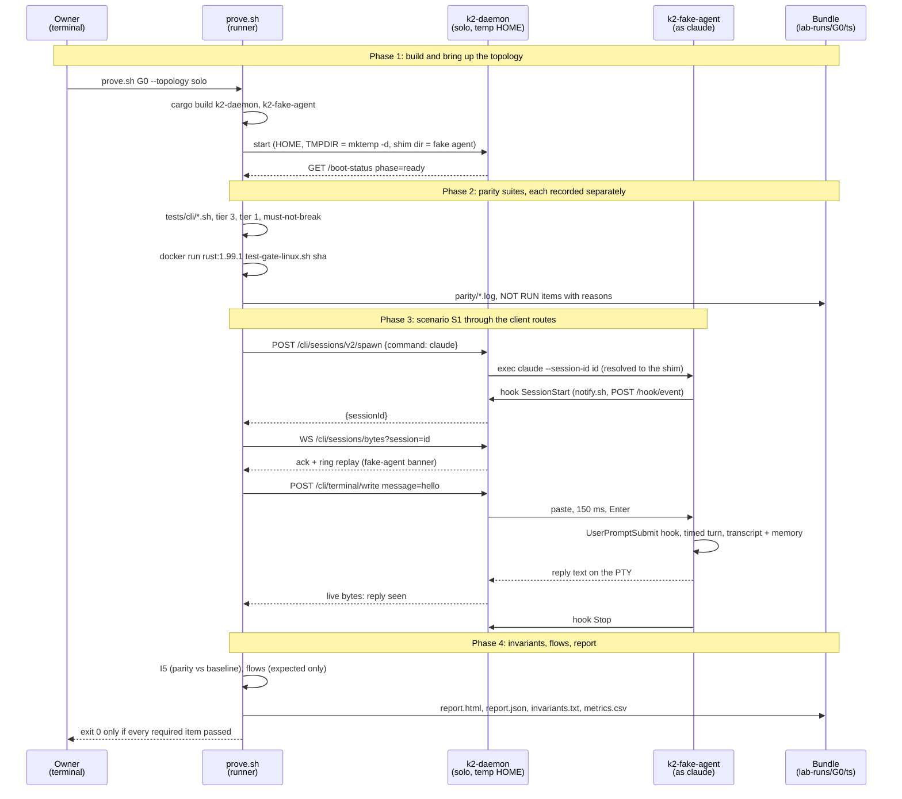

# k2-dist · lab: the validation harness (PRD section 3)

Task `lab`, branch `k2-dist/lab`. Gate **G0** on topology **solo**, against
today's daemon, with `k2-fake-agent` standing in for real agent CLIs.

## What changes

```mermaid
graph TD
    %% ── Colour legend ──────────────────────────────────────────────
    %% Blue = exists today, unchanged · Green = new in this task
    %% Orange = outside K2 (docker, rust image) · Slate = files, env, state
    %% Shapes: rect = process, stadium = files, hexagon = generated report,
    %%         flag = env var or setting

    %% ── RUNNER · scripts/lab ───────────────────────────────────────
    subgraph runner [Runner · scripts/lab]
        P[prove.sh<br/><sub>scripts/lab/prove.sh · G0 solo</sub>]:::new
        T[topology adapter<br/><sub>scripts/lab/topology/solo.sh</sub>]:::new
        PA[parity runner<br/><sub>scripts/lab/lib/parity.sh</sub>]:::new
        TC[toolchain<br/><sub>scripts/lab/lib/toolchain.sh · Rust 1.99.1</sub>]:::new
    end

    %% ── LAB KIT · tests/lab ────────────────────────────────────────
    subgraph kit [Lab kit · tests/lab · python3 stdlib]
        S1[scenario S1<br/><sub>labkit/s1.py · HTTP + WS client</sub>]:::new
        FC[flow checker<br/><sub>labkit/flows.py</sub>]:::new
        RW[report writer<br/><sub>labkit/report.py</sub>]:::new
        FJ([flows as data<br/><sub>docs/prd/flows/*.json · 11 files</sub>]):::new
    end

    %% ── SOLO TOPOLOGY · this Mac, throwaway HOME ───────────────────
    subgraph solo [Solo topology · this Mac · HOME=mktemp -d]
        D[k2-daemon<br/><sub>crates/k2-daemon · debug build of this checkout</sub>]:::existing
        SH>K2_TEST_AGENT_SHIM_DIR<br/><sub>every AGENT_CLIS name</sub>]:::state
        FA[k2-fake-agent as claude<br/><sub>tests/fakes/k2-fake-agent</sub>]:::new
        HM([agent home<br/><sub>~/.claude/projects/slug · transcript, memory</sub>]):::state
        NS[notify.sh<br/><sub>~/.k2/hooks · written by the daemon</sub>]:::existing
    end

    %% ── PARITY SUITES · unchanged ──────────────────────────────────
    subgraph suites [Existing suites · run unchanged]
        CLI[tests/cli/*.sh<br/><sub>sandbox daemons of their own</sub>]:::existing
        TR[behavior tiers 3 and 1<br/><sub>tests/behavior-test-tier*.sh</sub>]:::existing
        MNB[must-not-break<br/><sub>tests/contract/run_sandbox.sh</sub>]:::existing
    end

    %% ── LINUX GATE · Docker on this Mac ────────────────────────────
    subgraph dock [Docker · rust:1.99.1-bookworm, as root]
        G[test-gate-linux.sh sha<br/><sub>scripts/ · git archive of sha</sub>]:::existing
        V([k2-lab-gate-target<br/><sub>named volume · warm target dir</sub>]):::external
    end

    B{{lab-runs/G0/ts/<br/><sub>report.html · report.json · parity/ · scenarios/</sub>}}:::new

    P -- installs or finds --> TC
    P -- up / down --> T
    T -- starts --> D
    D -. reads .-> SH
    D -- spawns in a PTY --> FA
    FA -- writes --> HM
    FA -- runs hook commands --> NS
    NS -- POST /hook/event --> D
    P -- runs --> PA
    PA --> CLI
    PA --> TR
    PA --> MNB
    PA -- docker run --> G
    G --- V
    P -- runs --> S1
    S1 -- spawn, attach, type --> D
    S1 -- trace --> FC
    FC -- reads --> FJ
    P -- results --> RW
    RW -- writes --> B

    classDef existing fill:#dbeafe,stroke:#2563eb,color:#1e3a5f
    classDef changed  fill:#ede9fe,stroke:#7c3aed,color:#3b0764
    classDef new      fill:#d1fae5,stroke:#059669,color:#064e3b
    classDef external fill:#ffedd5,stroke:#ea580c,color:#7c2d12
    classDef state    fill:#f1f5f9,stroke:#64748b,color:#1e293b
```



## Main flow: `prove.sh G0 --topology solo`, scenario S1



## How to try it

```sh
# Whole gate (first run installs Rust 1.99.1 under lab-runs/.toolchain and
# builds the daemon; the Linux gate builds in Docker with a warm volume):
scripts/lab/prove.sh G0 --topology solo && open "$(ls -dt lab-runs/G0/*/ | head -1)report.html"

# Iterate on S1 and the report only (parity shows NOT RUN, gate is red):
scripts/lab/prove.sh G0 --topology solo --parity none

# The lab's own tests (flow checker, report writer, flows in sync with the PRD,
# fake agent resume and memory):
tests/lab/run_tests.sh
```

## Status

- **Milestone:** diagrams written.
- **Next:** fake agent crate, flows JSON and checker, prove.sh with S1.
- **Open questions:** see the list below.

### Decisions inside owned files

- **Rust toolchain.** This Mac has no `cargo`. `scripts/lab/lib/toolchain.sh`
  uses `cargo` from PATH when present; otherwise it installs Rust 1.99.1
  (stable on 2026-10-22, what CI pins) under `lab-runs/.toolchain/` with
  `--no-modify-path`, after checking rustup-init's sha256. Nothing outside the
  repo changes.
- **Lab kit language.** The runner is bash; scenario client, flow checker and
  report writer are Python 3 standard library only (`python3 -I`), so the lab
  needs no `npm`/`pip` install. The fake agent is Rust (it must be a real
  executable the daemon can spawn).

### Open questions

- None yet.
