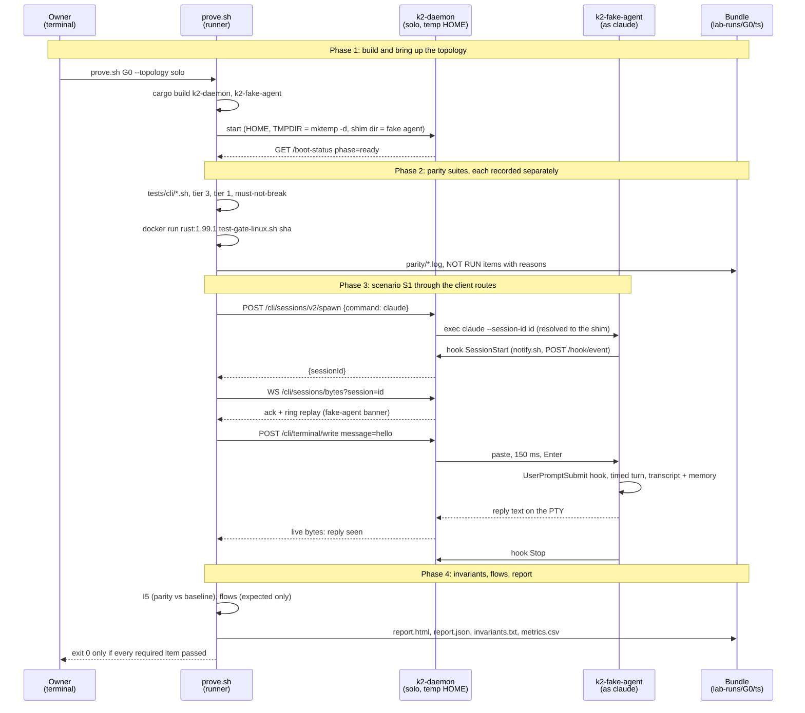

# k2-dist · lab: the validation harness (PRD section 3)

Task `lab`, branch `k2-dist/lab`. Gate **G0** on topology **solo**, against
today's daemon, with `k2-fake-agent` standing in for real agent CLIs.

## What changes


## Main flow: `prove.sh G0 --topology solo`, scenario S1



## How to try it

```sh
# Whole gate (first run installs Rust 1.99.1 under lab-runs/.toolchain and
# builds the daemon; the Linux gate builds in Docker with a warm volume):
scripts/lab/prove.sh G0 --topology solo && open "$(ls -dt lab-runs/G0/*/ | head -1)report.html"

# Iterate on S1 and the report only (parity shows NOT RUN, gate is red):
scripts/lab/prove.sh G0 --topology solo --parity none

# The lab's own tests (flow checker, report writer, flows in sync with the PRD,
# fake agent resume and memory):
tests/lab/run_tests.sh
```

## Trace format (what wave 2 emits)

The checker (`tests/lab/labkit/flows.py`) reads a JSONL trace, one event per
line. Wave 2 only has to write these lines; the flows already name the events
(`docs/prd/flows/<id>.json`, field `steps[].event`).

```json
{"ts": "2026-11-14T09:12:03.123Z", "event": "host.spawn", "src": "k2-host",
 "agent_id": "a1b2", "msg_id": null, "host": "host-1", "session_id": "…",
 "epoch": 3, "attrs": {"harness": "claude"}}
```

| Field | Required | Meaning |
|---|---|---|
| `ts` | yes | RFC 3339 UTC with milliseconds; events are ordered by it (stable) |
| `event` | yes | dotted name, `<place>.<what>`, as in the flow files |
| `src` | yes | emitter: `k2-daemon`, `k2-host`, `k2-ptyd`, `k2-fake-agent`, `lab` |
| `agent_id`, `msg_id`, `host` | when known | correlation keys; a flow names one in `correlate` |
| `session_id`, `epoch` | when known | provider session id; placement epoch (I1) |
| `attrs` | no | anything else; a step's `match` fields are looked up here too |

Matching: a flow passes when, for one value of its correlation key, the
events with that value (plus events that carry no value for it, such as a CLI
hook) contain every step's event in order. A trace with no event from the
system under test (only `lab` and `k2-fake-agent`) leaves every flow
"expected only"; that is wave 1's state. The fake agent already emits
`cli.exec`, `cli.hook` (`attrs.hook` = SessionStart, UserPromptSubmit, Stop,
SessionEnd; written BEFORE the hook command starts, as a real CLI starts the
hook before the daemon receives it), `cli.hook.done` (after, `attrs.exit`),
`cli.turn.start`, `cli.turn.end` and `cli.exit` when `K2_FAKE_AGENT_TRACE` is
set.

## Status

- **Milestone:** first working slice, hardened. `prove.sh G0 --topology solo`
  (and `--parity none`) runs end to end; S1 passes over the app's routes.
- **Waiting on:** the coordinator's go (the Mac is shared; image's kind build
  is the critical path) before the next heavy runs: `cargo test -p k2-core` and
  `-p k2-daemon` under `lab_cargo`, then `prove.sh --record-baseline`, then a
  verification run for I5.
- **Safety incident (2026-10-24, fixed):** an early host `cargo test -p
  k2-core` here ran with the real HOME; pre-existing tests
  (`garden_data/signer_gate.rs`, a workspace lifecycle-seed test) wrote
  `~/.k2/auth-audit.jsonl` and `~/.k2/wiki`. Since commit 2078ac05b every lab
  cargo command goes through `lab_cargo` (env -i, throwaway HOME and TMPDIR,
  as the Linux gate's `clean_cargo`); the two tests are the coordinator's
  follow-up, not lab files.
- **First full run (exploratory, pre-fixes):** S1 pass; must-not-break pass
  (its 3 `k2 db` checks are reported not run off Linux, by the suite itself);
  tier 3 and tier 1 fail (pre-existing, below); `tests/cli` 156 scripts, a few
  Linux-only ones fail; the Linux gate did not run (old invocation).

### Decisions inside owned files

- **Rust toolchain.** This Mac has no `cargo`. `scripts/lab/lib/toolchain.sh`
  uses `cargo` from PATH when present; otherwise it installs Rust 1.99.1
  (stable on 2026-10-22, what CI pins) under `lab-runs/.toolchain/` with
  `--no-modify-path`, after checking rustup-init's sha256. Nothing outside the
  repo changes.
- **OpenSSL.** Homebrew's `openssl` is 4.x now, and llama.cpp's vendored
  cpp-httplib does not compile against it. The lab sets
  `OPENSSL_ROOT_DIR=/opt/homebrew/opt/openssl@3` in its own environment only.
- **Lab kit language.** The runner is bash; scenario client, flow checker and
  report writer are Python 3 standard library only (`python3 -I`), so the lab
  needs no `npm`/`pip` install. The fake agent is Rust (it must be a real
  executable the daemon can spawn).
- **S1 uses the app's path.** Attach is `/cli/sessions/grid` (what the
  desktop app's terminal uses for v2 sessions; `/cli/sessions/bytes` serves
  only the v1 registry), typing is `{"action":"input"}` on that socket, paste
  then Enter 150 ms later.
- **The fake agent fires hooks from Claude's settings files**, so the hooks
  that run are the ones the daemon installed (`~/.k2/hooks/notify.sh`), with
  `$PPID` = the agent, exactly as under Claude Code.
- **Binaries are copied per run.** 27 `tests/cli` scripts rebuild
  `target/debug/k2-daemon`, some with other features, so the topology and
  must-not-break use a copy taken right after the build, and the cli scripts
  run one at a time.
- **`prove` flow not extracted.** The PRD's 12th diagram (`prove`, a gate
  run) describes the runner itself, not the system under test; the 11 flows
  the task names are extracted.
- **demo.cast.** asciinema is not installed here; the report says so, and
  `scenarios/S1.cast` (asciicast v2 of the client's screen, one frame per grid
  update) is always written.

### Answered (coordinator, 2026-10-24)

- **Docker disk.** Was full (98%); the owner restarted Docker and grew the
  disk (56 GB free). While it was full, `prove.sh` held the gate
  (`--linux-gate hold` never touches Docker and reports NOT RUN); I removed
  what this task had put there (`rust:1.99.1-bookworm`, `k2-lab-gate:1`, two
  empty volumes). **Decision: `--linux-gate run` is the default again**: with
  space there, holding by default would leave the owner's try-it red on a
  suite that can run, and the gate itself refuses below 20 GB free (reported
  NOT RUN with its own message). `hold` stays for iterating. The Docker path
  mounts the repo read-only at `/src/wt` (Docker Desktop cannot mount at a
  target under `/Users`) and finds the sha through `GIT_DIR`.
- **CPU budget.** The Mac is shared by three workers. Every cargo command in
  the lab gets `CARGO_BUILD_JOBS=4` (also passed into the suites' clean env);
  test runs use 4 threads; the gate container gets `--cpus 4` and the gate's
  own `K2_GATE_THREADS=4`; the Linux gate runs last, after the local suites,
  never alongside another heavy build.
- **S12 at G0.** Confirmed: G0 on solo stays red with S12 NOT RUN until S12
  exists; S2 and S7 are reported, not required.
- **Tier 1.** Today's daemon makes the `~/.k2so -> ~/.k2` compat link, so tier
  1 does reach the solo sandbox daemon (confirmed in the first full run). It
  then fails on its own stale expectations (retired `k2so agents triage`
  verbs), a pre-existing result. The run-time check stays.

### Pre-existing suite results seen on this Mac (not caused by the lab)

- `tests/behavior-test-tier3.sh` exits 1 with no output: it `cat`s
  `crates/k2so-core/...`, renamed to `crates/k2-core`, under `set -e`.
- `tests/behavior-test-tier1.sh` fails its triage checks: the verbs it calls
  are retired.
- Some `tests/cli` scripts expect Linux (for example `app_runtime_cli_smoke`
  wants the App-box doctor's helper check).

### tests/cli on this Mac (first full run, 156 scripts)

147 pass. The lab now builds `k2-node` and `k2-provider-fakes` with the daemon
(`compute_cli_smoke` and `mail_calendar_providers` failed only because they
were not built). Scripts that exit after printing their own refusal to run
here are NOT RUN with that line as the reason (`parity/cli/not-run.txt`), not
FAIL; the suite is then NOT RUN, never green:

- `compute_node_install_linux`, `node_admin_linux`: refuse outside a
  disposable Linux box (`K2_DISPOSABLE_BOX`), by design.
- `node_admin_linux_container`: a build-box script that needs an output dir
  argument and podman.
- `sign_app_engine`, `sign_k2_node`: need `minisign`, which this Mac does not
  have. Not installed (coordinator, 2026-10-24); they stay NOT RUN with that
  reason while the coordinator raises it with the owner.

Real failures (pre-existing): `app_runtime_cli_smoke` (expects the Linux App
box doctor), `permission_off_golden` (its schema golden is stale against
`k2 zen widget errors`). The image branch updates that golden for its new
capabilities key: **recheck `permission_off_golden` after integration.**

### I5 baseline

While the Linux gate is held, a baseline records the suites that ran and lists
the rest under `not_recorded` with their reason. I5 is then NOT RUN (never
pass) and names the suite it could not compare, even when the others match.

## Hand-off: what `prove.sh G1 --topology solo` needs

G1 (PRD P1: AgentHost interface, in-process only, zero behaviour change) on
solo requires, per the PRD's P1 proof and scenario matrix:

| Item | Status in wave 1 | To do |
|---|---|---|
| Parity suites, I5 against the **pre-refactor** baseline | done (`tests/lab/baselines/G0-solo.json`, recorded at the G0 sha) | Compare G1 runs against that G0 baseline, not a re-recorded one: point `run.json.baseline` at it for G1 |
| S1 | done | none |
| S2 hook events land on the right agent | not built | `labkit/s2.py`: two agents, check each agent's `cli.hook` lands on its own agent in the daemon (activity route or the new trace) |
| S7 CLI killed mid-turn, next need resumes | not built | `labkit/s7.py`: start a turn with a long `K2_FAKE_AGENT_TURN_MS`, kill the fake agent's pid (in its trace, `cli.exec`), make a need (type again), check the respawn passes `--resume <same id>`; then I3: memory bytes and session id equal (the fake agent's `remember ` writes the memory) |
| S12 Postgres, Apps, mail, Sew, front door parity | not built (required since G0) | its own task; on a Mac most of it is Linux-only, so solo S12 may need the container topology's Linux |
| Trace diff for `spawn`, `hook` and the CLI-crash flow | checker done, flows `expected only` | Daemon emits the JSONL above to a file the lab names (for example an env var set by `topology/solo.sh` into `$RUN/topology/daemon.trace.jsonl`); scenarios merge it into `S*.trace.jsonl`; `report.py` gets a per-gate list of **required** flows (G1 solo: `spawn`, `hook`, `crash`) that must be `pass` |
| Bench: no change in spawn latency or idle RSS (NFR1: within 5%) | one sample each in `metrics.csv` | N spawns per run (median, p95), the G0 run's numbers stored with the baseline, and a report row comparing them |

Code seams: `report.SCENARIOS[("G1", "solo")]`, `report.INVARIANT_NA[("G1",
"solo")]` (I3 no longer n/a once S7 exists), the gate/topology guard at the
top of `prove.sh`, and a scenario loop in `prove.sh` instead of the S1
block. Note for **trace**: commit 3105385e6 (on top of 66f48678a) lets
`docs/prd/flows/` hold flow files beyond the 11 PRD flows; before it,
`test_flows.py` failed on any extra file such as `crash.json`.
