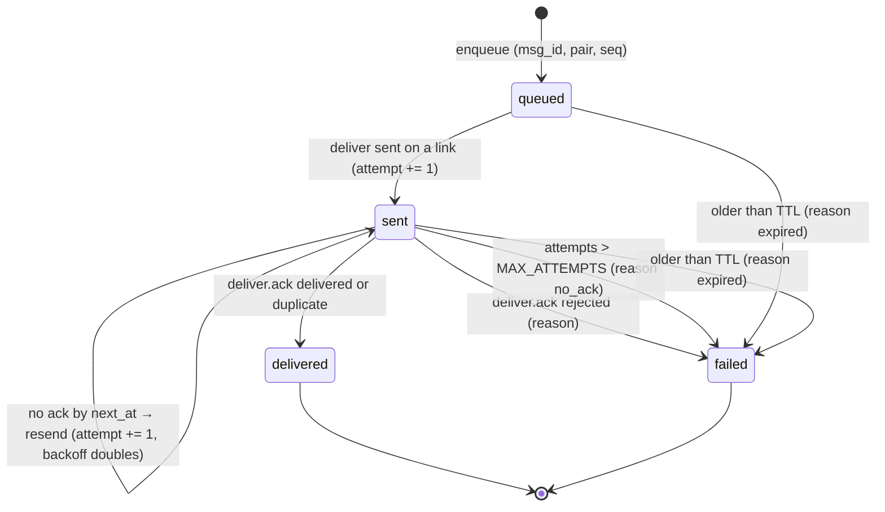

# outbox: durable message delivery across hosts (W2: PRD S3, S6, I2)

Task `outbox`, branch `k2-dist/outbox`, based on `k2-dist/dist-link`
@faefee0a8 (the protocol 2 contract, W0).

In a distributed K2 the controller owns messages (ADR-0002). An agent on a
host that runs `k2 msg <agent> "text"` (or composes into an inbox) hands the
message to its own host daemon, which forwards it up the host link as a
`deliver` frame. The controller writes it to a durable outbox in its
database and drains it to the host that runs the recipient, which injects it
into the agent and acks. Every hop is at least once, with the receiver
deduping on `msg_id`, so a message ends `delivered` or `failed` with a
reason (invariant I2); none vanish.

## The change


## The S3 flow, with the link to B dropping before the ack

```mermaid
sequenceDiagram
    participant A as agent alice<br/>(child of host A)
    participant HA as k2-daemon<br/>(host A)
    participant K as k2-daemon<br/>(controller)
    participant HB as k2-daemon<br/>(host B)
    participant B as agent bob<br/>(child of host B)

    Note over A,HA: Phase 1: send (hop up)
    A->>HA: POST /cli/workspace/msg {workspace: bob, text}
    HA->>HA: outbox row msg_id, hop=up, queued
    HA->>K: deliver {msg_id, agent_id: bob, from: agent:alice, body}
    K->>K: seen? no → outbox row hop=down, queued (one transaction)
    K-->>HA: deliver.ack {msg_id, delivered}
    HA->>HA: row → delivered (accepted by the controller)
    HA-->>A: {success: true, msg_id, state: accepted}

    Note over K,B: Phase 2: drain (hop down), first attempt
    K->>K: bob placed on host B at epoch e; head of (alice, bob)
    K->>HB: deliver {msg_id, agent_id: bob, epoch: e, attempt: 1}
    K->>K: row → sent, next try at now + backoff
    HB->>HB: seen? no
    HB->>B: inject "[from alice] text"
    HB->>HB: record msg_id in delivery_seen
    HB--xK: deliver.ack {delivered} (link drops, ack lost)

    Note over K,B: Phase 3: link back, resend, dedupe
    HB->>K: hello … welcome (relink); bob placed again
    K->>HB: deliver {msg_id, attempt: 2}
    HB->>HB: seen? yes → not injected again
    HB-->>K: deliver.ack {duplicate}
    K->>K: row → delivered; next message of the pair may go
```

## Delivery state machine (each outbox row)



Rules:

- `msg_id`: `m_<13-digit ms>_<16 hex>`, minted where the message enters K2
  (the sender's host, or the controller for a `k2 msg` sent to it). The same
  id travels every hop and is the dedupe key end to end.
- Order per (sender, recipient): `outbox::due` only returns the oldest
  unfinished row of a pair, so the next one goes after the head is
  `delivered` or `failed`. A pair is keyed by the caller's `from` (not the
  `[from …]` label, which carries a per-send id).
- Attempts only count when a `deliver` actually went out on a link. A
  recipient with no placement (host down, agent not running) waits, without
  spending attempts, until it is placed again or the TTL ends it.
- Backoff: the ack wait after attempt n is `2 s × 2^(n-1)`, capped at 60 s
  (`Policy::PRODUCTION`). After 10 sends without an ack: `failed`,
  `no_ack: 10 attempts without an ack`. TTL 7 days (the PRD's away-host
  hold): `failed`, `expired: …`. A `rejected` ack: `failed`,
  `rejected by host <h>: <reason>`. Finished rows are kept 7 days for
  inspection; the receiver remembers the last 20 000 ids.
- Failures are loud: a `failed` row keeps its reason, the daemon logs
  `[delivery] FAILED <msg_id> (<from> → <to>, hop <up|down>): <reason>`, and
  emits the trace event `delivery.failed`.

## Sleeping recipients and `--wake` (G2 S4 fix)

The outbox delivers only to a placed agent. A recipient that isn't placed
but that the controller resolves itself (a workspace path or name, a
sidecar, a session id) is asleep, and `k2 msg` keeps today's
`K2_ROLE=all` rules for it: the controller runs the existing cascade
(`delivery_drain::Direct`, `workspace_msg::deliver_for_controller`).

- `k2 msg` sent to the controller: `delivery_drain::send` returns `None`
  for it and `deliver_live_with_receipt` runs the cascade as under `all`.
  Without `--wake` the answer is `dormant_no_wake` (or `no_agent_mode`);
  with `--wake` the agent is spawned on a host through `host()` (W1's
  `RemoteHost`), with the message as its launch prompt or injected once it's
  ready, and the answer carries `woke: true`.
- `k2 msg` on a host: the body carries `wake` and `wake_timeout_ms`, and
  the host waits up to 5 s plus the wake timeout for the ack. The
  controller's `take` runs the cascade off the link's task and acks
  `delivered`, or `rejected` with the cascade's reason (the host's answer
  keeps it, e.g. `reason: "dormant_no_wake"`). It records the msg_id in
  `delivery_seen` first (`handling`, then the answer): a resend during the
  wake gets no ack, and one after it gets the same answer, so the wake runs
  once.
- A placed recipient, an agent name the controller doesn't resolve, and
  every inbox item still go through the outbox as before.

## Protocol

The frames are W0's protocol-2 `deliver` / `deliver.ack`, unchanged
(`docs/prd/progress/dist-link.md`, "Protocol 2"). Both are refused on a
protocol-1 link (`RemoteHost::send_frame` checks `min_protocol`): a message
for an agent on a protocol-1 host waits until the host is upgraded or the TTL.

| Hop | Frame | Sender does | Receiver does |
|---|---|---|---|
| up | `deliver {msg_id, agent_id: recipient, from: agent:<name>, body, attempt}` (no `epoch`) | host: row `up` queued; sends while linked; resends after the backoff with `attempt + 1`; on relink resends what is due | controller: `enqueue(down)`; new → ack `delivered` (accepted), already there → `duplicate`; empty id, recipient or body → `rejected` |
| up | `deliver.ack` | | host: row `delivered` (accepted) or `failed`; wakes the waiting `k2 msg` |
| down | `deliver {msg_id, agent_id, epoch: placement epoch, from, body, attempt}` | controller drain: head of each pair, recipient placed on a linked host | host: seen? → `duplicate` (or `rejected` again); else deliver locally: done → record id, ack `delivered`; not now (no live session, PTY busy) → no ack; malformed → record, ack `rejected` |
| down | `deliver.ack` | | controller: `delivered` / `duplicate` → row `delivered`; `rejected` → `failed` with the reason |

`body` is `{"kind": "msg", "text", "command", "label"}` for `k2 msg` (the
recipient's host injects `[from <label>] text` into the agent's live
session through `send_message_to_session_with_command`, the composer's
locked inject) or `{"kind": "inbox", "title", "body", "priority", "source"}`
for inbox compose (composed with `k2_core::inbox::compose` in the agent's
cwd). The receiving host never spawns.

What `k2 msg` answers on a host (the canonical `MsgResponse` plus two
optional fields; under `all` the JSON is unchanged):

```json
{"success": true, "target_session_id": null, "attempts": 1, "reason": null,
 "hint": "queued for delivery; GET /cli/hosts/outbox?msg_id=… shows when it lands",
 "msgId": "m_1792953600000_3f2a…", "delivery": "accepted"}
```

`delivery` is `accepted` (the controller has it), `queued` (no ack within
5 s; durable on this host, forwarded when the link is back) or `failed`
(`success: false`, `reason: delivery_failed: …`).

`GET /cli/hosts/outbox[?msg_id=…]` (owner token; controller: hop down,
host: hop up): `{"hop", "counts": {queued, sent, delivered, failed},
"messages": [{seq, msg_id, sender, recipient, state, attempts, created_ms,
updated_ms, reason}]}`, or `{"hop", "message": {…}}` for one id. Bodies are
not listed.

Trace events (`K2_TRACE_FILE`): W0's `ctl.deliver` (attempt, host),
`ctl.deliver_ack` (status), `host.deliver` (status, duplicate); new here:
`host.msg_send` (up hop, attempt), `ctl.msg_accept` (host, status),
`host.msg_ack` (status), `delivery.failed` (hop, reason). Each carries
`msg_id` and the recipient as `agent_id`.

### Where it hooks in

| File | Change |
|---|---|
| `k2-core/src/delivery/` (new) | `outbox` and `seen` tables, `Policy`, `new_msg_id`; tables created with `CREATE TABLE IF NOT EXISTS` on first use (no migration file touched) |
| `k2-daemon/src/delivery_drain.rs` (new) | `Controller` (accept, drain, acks), `HostSide` (up hop, receive), `send`, `OUTBOX_PATH` |
| `agent_host/remote.rs` | approved hook: `deliver`/`deliver.ack` arm in `on_frame` → `delivery_drain::on_host_frame`; new `RemoteHost::send_frame` |
| `hosts/link.rs` | approved hooks: `deliver`/`deliver.ack` arm in `handle` → `delivery_drain::on_controller_frame`; `delivery_drain::host_linked(tx)` once linked |
| `hosts/gate.rs` | the controller drain starts when a host attaches (so a restarted controller drains its queue); `GET /cli/hosts/outbox` |
| `workspace_msg.rs` | `deliver_live_with_receipt` (the `/cli/workspace/msg` path, i.e. `k2 msg`) hands off to `delivery_drain::send` on host/controller; `deliver_to_local_agent` for the receiving host; `msgId`/`delivery` in `MsgResponse` |
| `inbox_routes.rs` | `handle_compose_post` on host/controller → `delivery_drain::send` with `kind: inbox` |

Other internal callers of `deliver_live` (heartbeats, compute, federation)
keep their local behaviour on a host; only `k2 msg` and inbox compose go
through the controller in this cut.

## How to try it

```sh
# toolchain (shared machine: 3 jobs, 3 test threads, cargo slot)
export RUSTUP_HOME=$HOME/.cache/k2-dist-rust/rustup CARGO_HOME=$HOME/.cache/k2-dist-rust/cargo
export PATH=$CARGO_HOME/bin:$PATH CARGO_BUILD_JOBS=3

# unit tests: store (dedupe, order, backoff, dead letter, restart)
~/.cache/k2-dist-cargo-slot.sh cargo test -p k2-core --lib delivery:: -- --test-threads=3
# fake-host loopback test: A → controller → B exactly once across a link drop
~/.cache/k2-dist-cargo-slot.sh cargo test -p k2-daemon --lib delivery_drain:: -- --test-threads=3

# three real processes: controller + host-1 + host-2 (evidence under lab-runs/outbox/<UTC>/)
scripts/lab/topology/three-process-msg.sh
```

## Status

- Milestones: diagrams written; first working slice; done (every
  acceptance criterion below holds).
- Next (not this task): route the other `deliver_live` callers
  (heartbeats, wake) and the controller's own waking of a sleeping
  recipient (S4) through the outbox; `drain` on SIGTERM (S8: stop taking
  deliveries); re-adoption after a link blip (S9) so a running recipient
  does not wait for a re-spawn to be placed again.
- Open: none blocking. The four hook edits in `agent_host/remote.rs` and
  `hosts/link.rs` were approved by the coordinator (option A).

### Results

| Check | Result |
|---|---|
| `cargo test -p k2-core --lib delivery::` | 9 passed: msg ids, dedupe by id per hop, seen table bounded, per-pair order, doubling backoff, `no_ack` dead letter after max attempts (a late ack can't revive it), `rejected` and TTL `expired` → failed with reason, pruning, restart mid-queue keeps every row and its state |
| `cargo test -p k2-daemon --lib delivery_drain::` (3 runs, with `hosts::`: 27 passed each) | `a_message_from_host_a_reaches_host_b_exactly_once_when_the_link_to_b_drops_before_the_ack`: real hub and drain, fake hosts; up-hop resend → `duplicate`; B delivers, link drops before the ack, B relinks, bob placed again, attempt 2 → `duplicate`, row `delivered`, bob got it once. Also: pair order and a `rejected` ack failing loudly; a restarted controller drains its queue; the receiving side dedupes, retries, rejects and remembers across a host restart; the up hop resends until acked and across a link drop |
| `scripts/lab/topology/three-process-msg.sh` (runs `20261025T162221Z`, `20261025T162248Z`) | 4/4 PASS, below |
| `K2_ROLE=all` regression: `cargo test -p k2-daemon --no-fail-fast -- --test-threads=3`, throwaway HOME | 161 test binaries: 5202 passed, 0 failed, 6 ignored |
| `cargo test -p k2-core --lib -- --test-threads=3`, throwaway HOME | 3685 passed, 1 failed, 1 ignored. The failure, `fork_tab_repair::tests::repair_splits_a_fork_tab_off_the_source_conversation`, is in a file this branch doesn't touch, on the shared test DB; it passes 3/3 alone |

Three-process run `20261025T162248Z` (controller :17440, host-1 :17441,
host-2 :17442, `k2-fake-agent` as `claude`, throwaway HOMEs):

```text
PASS three processes; alice on host-1, bob on host-2
PASS k2 msg from host-1 lands in bob's session on host-2   msg m_1792945374116_… state=delivered, in bob's transcript 1 time(s)
     k2 msg: {"attempts":1,"delivery":"accepted","msgId":"m_1792945374116_…","success":true,…}
PASS inbox compose from host-1 lands in bob's inbox on host-2   <root>/h2/home/work/bob/.k2/inbox/s6-inbox-item-eca1b64b.md
PASS I2: every message ends delivered or failed after host-2 died mid-delivery
     8/8 final (8 delivered, 0 failed); reached bob more than once: 0
```

Check 2 runs the real `cli/k2 msg bob "…" --from alice` in host-1's
environment (its HOME and daemon token). In run `20261025T162221Z` the
controller's outbox at the moment host-2 was SIGKILLed held one message
`sent` (attempt 1, unacked) and three `queued`; after the restart and
re-placement of bob the controller resent it as attempt 2, and every burst
message reached bob's transcript exactly once:

```text
16:22:29.009 [delivery] deliver m_…49009_ccd1f75f… to bob on host host-2 (attempt 1)
             (host-2 killed; 4 more messages queued while it was down)
16:22:31.010 [delivery] deliver m_…49009_ccd1f75f… to bob on host host-2 (attempt 2)
16:22:31.553 [delivery] m_…49009_ccd1f75f… Delivered by host host-2
16:22:31.553 [delivery] deliver m_…49047_fd0d3b79… to bob on host host-2 (attempt 1)
…
```

Known limits of this cut:

- A host acks after the PTY write. A message the agent never processes
  because its CLI died right after the write counts as delivered (the lab
  also reports "delivered but not in a transcript"; 0 in both runs).
- When a host's link drops, the controller forgets its placements (as
  dist-link does), so a message for an agent that is still running there
  waits until that agent is spawned again (re-placed) or the TTL. S9
  re-adoption removes that wait.
- A message for an agent id the controller never placed waits for the TTL
  (7 days) before it fails `expired`; `GET /cli/hosts/outbox` shows it as
  `queued` meanwhile.
