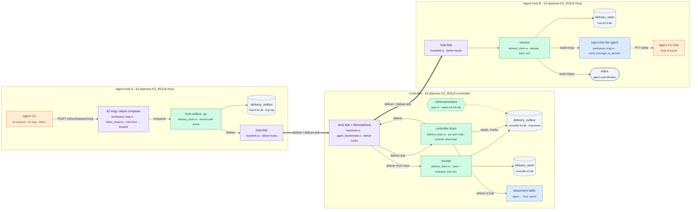
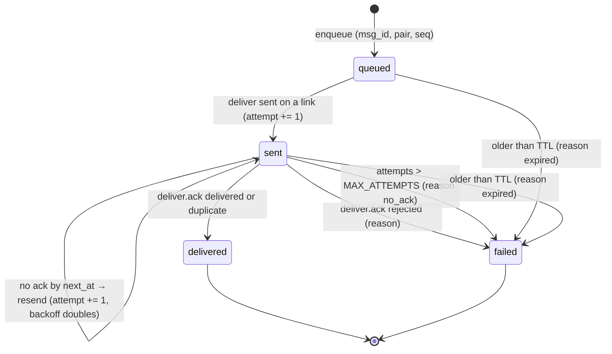

# outbox: durable message delivery across hosts (W2: PRD S3, S6, I2)

Task `outbox`, branch `k2-dist/outbox`, based on `k2-dist/dist-link`
@faefee0a8 (the protocol 2 contract, W0).

In a distributed K2 the controller owns messages (ADR-0002). An agent on a
host that runs `k2 msg <agent> "text"` (or composes into an inbox) hands the
message to its own host daemon, which forwards it up the host link as a
`deliver` frame. The controller writes it to a durable outbox in its
database and drains it to the host that runs the recipient, which injects it
into the agent and acks. Every hop is at least once, with the receiver
deduping on `msg_id`, so a message ends `delivered` or `failed` with a
reason (invariant I2); none vanish.

## The change



## The S3 flow, with the link to B dropping before the ack

```mermaid
sequenceDiagram
    participant A as agent alice<br/>(child of host A)
    participant HA as k2-daemon<br/>(host A)
    participant K as k2-daemon<br/>(controller)
    participant HB as k2-daemon<br/>(host B)
    participant B as agent bob<br/>(child of host B)

    Note over A,HA: Phase 1: send (hop up)
    A->>HA: POST /cli/workspace/msg {workspace: bob, text}
    HA->>HA: outbox row msg_id, hop=up, queued
    HA->>K: deliver {msg_id, agent_id: bob, from: agent:alice, body}
    K->>K: seen? no → outbox row hop=down, queued (one transaction)
    K-->>HA: deliver.ack {msg_id, delivered}
    HA->>HA: row → delivered (accepted by the controller)
    HA-->>A: {success: true, msg_id, state: accepted}

    Note over K,B: Phase 2: drain (hop down), first attempt
    K->>K: bob placed on host B at epoch e; head of (alice, bob)
    K->>HB: deliver {msg_id, agent_id: bob, epoch: e, attempt: 1}
    K->>K: row → sent, next try at now + backoff
    HB->>HB: seen? no
    HB->>B: inject "[from alice] text"
    HB->>HB: record msg_id in delivery_seen
    HB--xK: deliver.ack {delivered} (link drops, ack lost)

    Note over K,B: Phase 3: link back, resend, dedupe
    HB->>K: hello … welcome (relink); bob placed again
    K->>HB: deliver {msg_id, attempt: 2}
    HB->>HB: seen? yes → not injected again
    HB-->>K: deliver.ack {duplicate}
    K->>K: row → delivered; next message of the pair may go
```

## Delivery state machine (each outbox row)



Rules (details fill in as the code lands):

- `msg_id`: `m_<13-digit ms>_<16 hex>`, minted where the message enters K2
  (the sender's host, or the controller for a message sent there). The same
  id travels every hop and is the dedupe key end to end.
- Order per (sender, recipient): the drain only sends the oldest unfinished
  row of a pair; the next goes after the head is `delivered` or `failed`.
- Attempts only count when a `deliver` actually went out on a link. A
  recipient with no placement (host away, agent not running) waits, without
  burning attempts, until it is placed again or the TTL ends it.
- Failures are loud: a `failed` row keeps its reason, the daemon logs
  `[delivery] FAILED <msg_id> …`, and a trace event records it.

## How to try it

```sh
# toolchain (shared machine: 3 jobs, 3 test threads, cargo slot)
export RUSTUP_HOME=$HOME/.cache/k2-dist-rust/rustup CARGO_HOME=$HOME/.cache/k2-dist-rust/cargo
export PATH=$CARGO_HOME/bin:$PATH CARGO_BUILD_JOBS=3

# unit tests: store (dedupe, order, backoff, dead letter, restart)
~/.cache/k2-dist-cargo-slot.sh cargo test -p k2-core --lib delivery:: -- --test-threads=3
# fake-host loopback test: A → controller → B exactly once across a link drop
~/.cache/k2-dist-cargo-slot.sh cargo test -p k2-daemon --lib delivery_drain:: -- --test-threads=3

# three real processes: controller + host-1 + host-2 (evidence under lab-runs/outbox/<UTC>/)
scripts/lab/topology/three-process-msg.sh
```

## Status

- Milestone: diagrams written.
- Next: `k2_core::delivery` store and its unit tests; then the drain and
  the host handlers.
- Open question (asked of the coordinator): the delivery hooks need small
  additive edits in `agent_host/remote.rs` and `hosts/link.rs`, which this
  task was told not to touch.
