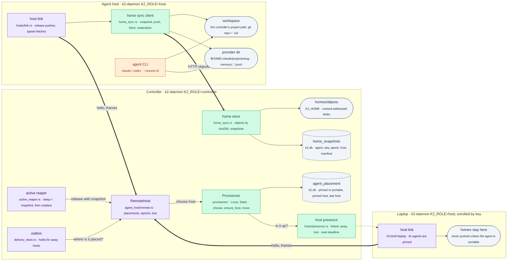
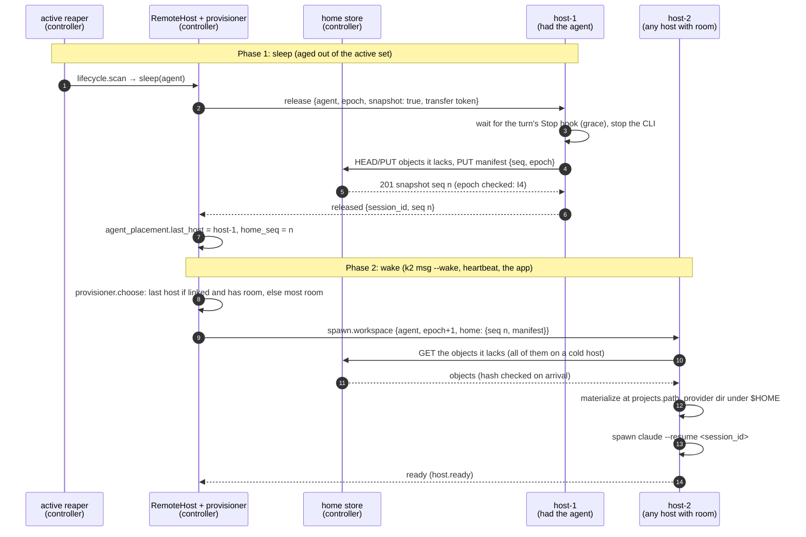
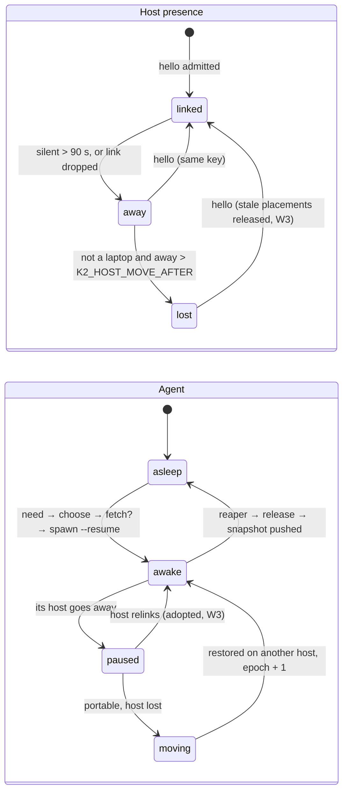
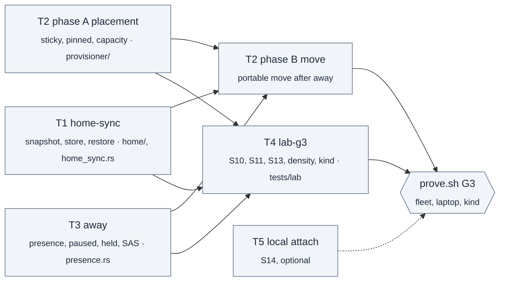

# p3-plan: portable agents, sleep and laptops (PRD stage P3 → gate G3)

Design for PRD stage P3, written on `k2-dist/p3-plan` from
`k2-dist/wave2-preview` @13e5a5939 (wave 1, W1, W2 outbox with its two fixes,
W3). W5 host enrollment (`k2-dist/host-enroll`) is being verified and is not in
that tree yet; this plan assumes it lands.

P3 builds three things (PRD section 4, "P3 → G3"):

1. **Portable home**: the agent's workspace git repo, its `.k2/` and the
   provider's project directory (memory and transcripts), stored
   content-addressed, so an agent can wake or move to another host.
2. **Sleep and wake through a provisioner**: `Local` and `Static` (enrolled
   VMs and laptops); `Kubernetes` comes in P4.
3. **Laptops**: enrollment, an "away" state, pinning and outbox hold.

The proof is S10, S11 and S13 on the fleet, plus a density report. Gate G3 also
lists S14 (local attach). Decision D8 puts it in a separate, optional task.

## The change



## Where things stand on wave2-preview

### Where an agent's home lives on a host today

| Piece | Where it is | What that means for moving |
|---|---|---|
| Workspace (git repo, `.k2/`: AGENT.md, inbox, skills, session archive) | the controller's `projects.path`, sent to the host **verbatim** as the spawn's `cwd` (dist-link handoff notes: "this cut does no path mapping") | it works only where the host can see the same path |
| Provider dir: transcripts `<id>.jsonl`, `memory/MEMORY.md` | `$HOME/.claude/projects/<slug>/` on the **host**, where `slug = claude_project_hash(cwd)` (`k2_core::chat_history`; `k2-fake-agent` writes the same layout) | each host has its own `$HOME`, so a transcript exists only on the host that wrote it |
| Logins, skills, plugins (the "wallet") | the host's `$HOME` | stays per host by design (PRD section 7: secrets stay where they are used) |
| Identity, connections, heartbeats, placements, outbox | the controller's `k2.db` | already host-independent |

How the existing topologies get around the missing path mapping:

- **kind** (`k2-dist/kind-app`, `deploy/kind/dist/`): one `k2-work` PVC,
  ReadWriteOnce on local-path, is mounted at `/var/lib/k2/work` in both the
  controller pod and the host pod. The host StatefulSet has `podAffinity` to
  the controller, because RWO on local-path is per node, and runs as the
  controller's UID so git accepts the shared repos. That is the stopgap: one
  node, one host, no moves. Each pod keeps its own `HOME` volume, which holds
  the Claude login.
- **Lab fleet** (`tests/lab/labkit/fleet.py`): homes and workspaces are bind
  mounts at the same absolute paths.
- **End state** (`deploy/kubernetes/core/hosts.yaml`): each host pod gets its
  own 100 Gi RWO `data` volume ("agent homes, ~/.claude, ~/.codex, login
  wallet"). The comment there already defers moves to "K2's home sync (P3)".

### What W1–W3, the outbox and enrollment already provide

| Need in P3 | Already there | Where |
|---|---|---|
| One interface for start, stop, find, inject | `AgentHost`; on a controller, `RemoteHost` runs it over the link | W1, `agent_host/` |
| Sleep | the active reaper unplaces aged-out canonical chats (`agent_name == project_id`) through `host()`, so a sleep works on remote hosts too | `active_reaper.rs:472` |
| Wake with the same conversation | the wake cascade resumes `--resume <session_id>`; on a controller, `transcript.exists` asks the host that last ran the project | W1, `k2_core::transcript_probe` |
| At most one live placement (I1) | epochs persisted in `host_placements` / `host_epoch`. When a host relinks with `hello.resume`, each placement is Adopted, Released (stale epoch or held elsewhere) or Gone | W3 |
| A host that vanished | placements are kept as **lost**: no new spawn elsewhere (502 "lost"), grid errors; the host's agents keep running | W3 |
| Messages to a host that is down | the outbox keeps a message while its recipient's host is lost: `send_frame` fails, so no attempt is counted, and the 7-day TTL ends it as `failed`. It drains within one 500 ms tick of the relink. Addresses resolve the way `K2_ROLE=all` resolves them | W2, `delivery_drain.rs`, fixes 86276d0d5 and 24cabd316 |
| Knowing a host by key | signed enrollment: one-time token, ES256 key, a signed nonce on every hello, revoke; a new IP changes nothing | W5 (`k2-dist/host-enroll`, in verification) |
| Gathering an agent's state | `k2_core::clone` ("Clone to"): an inventory of the workspace, the Claude memory dir and sessions, and other providers' sessions, with a secret classifier and `.gitignore`/`.k2ignore` plus a bulk skip-list; tar.gz bundle; unpack; slug and path repair | `crates/k2-core/src/clone/` |
| Moving git history | k2-node's hardened git (no hooks, no fsmonitor, explicit git-dir). Bundles of only the commits the other side lacks, plus a dirty patch and untracked files | `k2-core/src/compute/sync.rs`, `k2-node/src/sync.rs` |
| A fake agent with memory | `k2-fake-agent` writes the transcript and `MEMORY.md` where Claude does, keeps both on `--resume` (I3), and appends to memory only on `remember …` | `tests/fakes/k2-fake-agent` |
| Lab process fleet | `lab.py fleet` (backends `procs` and `compose`): a controller plus host-1 and host-2, with kill, start, monitor, chaos and invariants | `k2-dist/lab-g2` |
| Expected flows | `sleep.json`, `move.json`, `laptop.json`, `drain.json`, `localattach.json` | `docs/prd/flows/` |

### What's missing

1. **Wakes aren't sticky to the host that has the agent's data.** A new
   placement goes to `RemoteHost::pick_host`: the fewest placements, ties
   broken by name. Labels are logged but never used. After a sleep, a wake can
   land on a host whose `$HOME` has no transcript, so `--resume` starts a fresh
   conversation (breaking I3). Only shared paths hide this today. It's the
   cheapest fix in P3 and should ship first (T2 phase A).
2. **Pinning isn't enforced.** No agent is marked pinned or portable. Even
   once an agent is marked, the `--wake` path on a controller
   (`deliver_for_controller` → `wake_and_fire` → `host().spawn`) would place a
   sleeping laptop agent on whichever host `pick_host` picks.
3. **Hosts can't move homes.** `RemoteHost::read_home` / `write_home` aren't
   implemented, and nothing snapshots, stores or restores a home. `clone`
   bundles the whole tree as one tar.gz, with no content addressing, no
   increments and no epoch fence.
4. **Away isn't distinguished from lost.** A dropped link marks the host lost
   at once. A frozen host (lid closed, `SIGSTOP`) isn't noticed at all: the
   hub pings every 15 s but sets no read deadline (`hosts/hub.rs`), so a TCP
   connection to a sleeping laptop looks linked. There is no 90 s "away", no
   "paused" agent state, and no "move after N minutes" rule for portable
   agents.
5. **No provisioner, no capacity limit.** `K2_PROVISIONER` and
   `K2_HOST_MAX_AWAKE` exist in `deploy/` but not in code. Nothing scales a
   host down when its last agent sleeps.
6. **The outbox doesn't tell the sender why a message is waiting.** It holds
   correctly, but the sender sees `accepted`, not "held: bob is paused on
   eric-mbp (away since 10:02)".
7. **Laptop enrollment UX.** W5 enrolls with a one-time token. PRD FR2 also
   asks for a confirmation string, which k2-node already has (SAS).
8. **No density bench** (S13), and nothing reports wake latency (NFR3) or
   per-agent cost.

## Design

### 1. The portable home

A home is identified by its agent (the canonical id is the project id, as in
`host_placements`). A **snapshot** is an immutable manifest:

```text
snapshot {agent, seq, epoch, host, created, parent_seq,
          entries: [{class, path, sha256, size, mode}],   # class: workspace | memory | session | provider
          git: {bundle_sha256, refs: {name: commit}, prerequisites: [commit]},
          session_ids: […], slug, project_path}
```

- **What goes in** is decided by `k2_core::clone::inventory`, reused as is. It
  honours `.gitignore`/`.k2ignore`/the bulk skip-list (`node_modules`,
  `target`, …), runs the secret classifier (no `auth.json`, no `.env*` unless
  the owner opts in) and never takes provider credentials.
- **Git**: `.git` isn't copied as files. The repo travels as a `git bundle`
  holding only the commits the previous snapshot lacked (its refs are the
  bundle's prerequisites). Tracked changes and untracked files go in as file
  entries. This reuses the k2-node hardened git runner.
- **Content addressing**: every file and every bundle is an object named by
  its sha256 and stored once on the controller (`<K2_HOME>/homes/objects/ab/cdef…`).
  The manifest is an object too. A push uploads only objects the store lacks
  (`HEAD /objects/<sha>` or a batch "have" call), so the second snapshot of a
  quiet agent costs a few KB.
- **Paths**: a host materializes the workspace at the controller's
  `projects.path`, so the slug, `--resume`, the session archive and every path
  K2 stores stay valid (decision D2). The provider dir lands under the host's
  own `$HOME`.
- **One writer (I4)**: a push carries the placement epoch. The store accepts a
  snapshot only from the host holding the current epoch, and only one with a
  higher `seq` than the last. A host that comes back after its agent moved
  pushes at a stale epoch, gets refused, and discards its copy when W3
  releases the placement.
- **Transport**: HTTP between host and controller, not frames on the host link
  (decision D1b), so a 200 MB first push never stalls terminal streams. Auth is
  the host's link identity: a per-transfer token the controller puts in the
  `release` and spawn bodies, scoped to one agent and one epoch.
- **When to snapshot** (decision D3): on sleep (before the reaper's
  unplace), on a host drain (SIGTERM), and after a turn ends (the Stop hook,
  debounced to one per 60 s per agent). What a hard crash can lose is
  exactly what the PRD table says: the turn in progress and changes since the
  last turn ended.
- **Restore**: the spawn body (`spawn.workspace` is JSON, so no protocol
  change) carries `home: {seq, manifest_sha}`. A host whose cache already
  holds that seq does nothing; otherwise it fetches the objects it lacks,
  checks every hash, writes into a staging dir and swaps it in, then spawns
  `--resume <session_id>`.

### 2. Placement, sleep and wake through a provisioner

```rust
// crates/k2-daemon/src/provisioner/mod.rs (sketch)
pub trait Provisioner: Send + Sync {
    fn kind(&self) -> &'static str;                         // "local" | "static" | "kubernetes" (P4)
    fn choose(&self, need: &Need, hosts: &[HostView]) -> Result<Choice, Refusal>;
    fn ensure_host(&self, need: &Need) -> Ensure;            // Static: Ready or Wait; Kubernetes: scale up
    fn idle(&self, host: &HostView);                         // Static: nothing; Kubernetes: scale down
}
pub struct Need { agent, mode /* Pinned{host} | Portable */, last_host, home_seq, labels }
```

- **Local**: `K2_ROLE=all`, the in-process host. Sleep and wake are today's
  code paths unchanged (I5).
- **Static**: the enrolled hosts. `choose` applies these rules in order:
  1. A pinned agent goes only to its pinned host. If that host is away, the
     answer is `Wait(host away)`, never another host.
  2. A portable agent goes to its last host if that host is linked and under
     `max_awake` (warm cache, no fetch).
  3. Otherwise a portable agent goes to the linked host with matching labels
     and the most free capacity.
  4. If no host has room, the refusal names `K2_HOST_MAX_AWAKE`.
- Hosts report their capacity and kind as **labels** in `hello`
  (`k2.max_awake=100`, `k2.kind=laptop|server`), so the protocol doesn't change.
- `RemoteHost::pick_host` becomes one call to the provisioner (a hook in
  `remote.rs`). The wake path on a controller goes through the same call, which
  closes gap 2.
- Agent placement state lives in a new controller table
  `agent_placement(agent, mode, pinned_host, last_host, home_seq)`.
  `last_host` is written on every placement. That alone fixes gap 1, even
  before home sync exists.
- **Sleep**: the reaper asks the host to `release` with `snapshot: true`. The
  host stops the CLI after its turn ends (or after a grace period), pushes the
  snapshot, then answers `released {seq}`. Pinned agents on laptops skip the
  push (their home stays on the laptop).
- **Wake**: any need (a message with `--wake`, a heartbeat fire, the app's
  ensure-pinned-chat) goes to `provisioner.choose`. The chosen host fetches if
  needed, then spawns the resume.
- **Move (S10)**: a portable agent whose host has been away for longer than
  `K2_HOST_MOVE_AFTER` (default 5 min, the drain flow's number) is placed
  elsewhere: epoch + 1, the last snapshot, `ctl.move_decision`. Its old
  placement is released when its host comes back (W3).

### 3. Laptops: away, pinning, outbox hold

- **Presence**: the controller gets a read deadline on each link, mirroring the
  host's 45 s idle deadline. Every message from the host counts as a sign of
  life; the hub's 15 s pings provoke pongs. A host has one of three states:
  - `linked`;
  - `away`: silent for over 90 s (`K2_HOST_AWAY_AFTER`), or its link dropped;
  - `lost`: away and not a laptop, past `K2_HOST_MOVE_AFTER`, for portable
    agents.

  The agents of an away host show as **paused** in `/cli/hosts/status` and the
  app.
- **Pinned by default**: every agent first placed on a `k2.kind=laptop` host
  is pinned to it. Server agents are portable only when home sync is on for
  their pool (decision D5).
- **Outbox hold**: today's behaviour is kept, and the state becomes visible.
  `Sent`/`MsgResponse` gains `held: {agent, host, away_since}`. The row stays
  `queued` until the host relinks, or the 7-day TTL ends it as `failed`
  ("expired: host eric-mbp away for 7 d"). A `--wake` for a sleeping pinned
  agent on an away laptop is held the same way (no cascade elsewhere).
- **Enrollment**: W5's one-time token and signed hello. For interactive
  enrollment from a laptop, add k2-node's SAS: both sides show six digits and
  the owner confirms on the controller (decision D7). The `k2.kind=laptop`
  label is set by the enroll command.

### The flows

Sleep and wake, with home sync (the PRD's `sleep.json`, plus the home steps):



S10, the host fails hard and a portable agent returns with its memory:

```mermaid
sequenceDiagram
    autonumber
    participant L as lab chaos<br/>(kill -9 or kubectl drain)
    participant C as controller
    participant S as home store
    participant H1 as host-1
    participant H2 as host-2

    Note over H1,S: Before: turns end, snapshots seq 1..n pushed
    L->>H1: kill -9 (or drain the node; local-path pins its volume)
    C->>C: link drops → host-1 away, agent paused
    C->>C: away > K2_HOST_MOVE_AFTER and agent portable → ctl.move_decision
    C->>C: placement.epoch_bump (epoch e+1)
    C->>H2: spawn.workspace {agent, e+1, home seq n}
    H2->>S: fetch snapshot n
    H2-->>C: ready; resumed with the same session id
    Note over C,H2: Check: MEMORY.md sha256 and session id equal snapshot n (I3)
    H1->>C: comes back: hello.resume {agent at epoch e}
    C-->>H1: release (stale epoch, W3); a late push at epoch e → 409 (I4)
```

S11, the laptop lid closes, a message waits and arrives:

```mermaid
sequenceDiagram
    autonumber
    participant Lap as laptop host<br/>(k2.kind=laptop, pinned agent)
    participant C as controller
    participant Cl as cloud agent<br/>(on host-1)

    Note over Lap,C: Phase 1: lid closes (lab: SIGSTOP the laptop host)
    Lap--xC: silence: no frames, no pongs
    C->>C: read deadline → away after 90 s; agent shown paused (ctl.host_away)
    Note over C,Cl: Phase 2: a message from the cloud
    Cl->>C: k2 msg laptop-agent "…" (deliver, up hop)
    C-->>Cl: accepted, held {host: laptop, away_since} (outbox.queued)
    C->>C: never placed elsewhere: pinned (also with --wake)
    Note over Lap,C: Phase 3: lid opens (SIGCONT, or a new IP: same key)
    Lap->>C: hello (signed, W5) with resume (W3)
    C->>Lap: deliver (outbox.drain)
    Lap-->>C: deliver.ack delivered (outbox.delivered, exactly once)
```

States:



## Decisions for the owner

| # | Decision | Options | Recommendation |
|---|---|---|---|
| D1 | Where a home lives between placements | (a) the controller's content-addressed store over HTTP; (b) an external object store (S3/MinIO); (c) a replicated volume (Longhorn) only | **(a)** for the fleet and laptops: no new infrastructure, works on the Mac and on kind. Allow **(c)** on k3s as an alternative that just turns sync off. (b) later, behind the same store interface |
| D1b | Transport for objects | frames on the host link, or HTTP to the controller | **HTTP**: big transfers stay off the link that carries terminal streams; the auth is a per-transfer token the controller issues |
| D2 | The workspace path on a host | the controller's `projects.path` as is, or per-host paths with slug and path rewrite (`clone::repair`) | **The same path**. It keeps the slug, `--resume` and every stored path. A portable agent's path must sit under the pool's work root (`K2_WORK_ROOT`, for example `/var/lib/k2/work`); others stay pinned. Rewrite stays a fallback |
| D3 | When to snapshot | sleep only; sleep plus each turn end; plus a timer | **Sleep, drain, and turn end debounced to 60 s.** What a hard crash loses is bounded by one turn |
| D4 | What a home may carry | `clone`'s rules; plus secrets | **`clone`'s rules, `carry_secrets` off.** Logins stay per host (PRD section 7) |
| D5 | Default mode for agents | everything pinned; everything portable; by host kind | **By host kind.** First placed on a laptop: pinned. On a server pool with sync: portable. Agents that exist at upgrade: pinned to their current host |
| D6 | Thresholds | | **Away after 90 s** (PRD), **move after 5 min** (the drain flow), **hold 7 days** (outbox TTL); all settings |
| D7 | Laptop enrollment | W5 token only; add k2-node's SAS confirmation | **Add SAS for interactive (laptop) enrollment.** Keep the token for kind, compose and VMs |
| D8 | S14 local attach (FR11) in P3 | in P3; defer to a P3b | **Optional task T5**, after T1–T4. G3 lists it, but the coordinator's scope names S10, S11 and S13 |
| D9 | kind after P3 | keep the shared `k2-work` stopgap; per-host volumes plus sync | **Per-host volumes plus sync**, which removes the podAffinity, and run S10 with `kubectl drain` on k2lab. The stopgap stays as the `--shared-work` fallback |
| D10 | Density "ten real CLIs" | lab; owner | **The owner runs it** (it needs keys; the lab never runs real CLIs). The lab ships the script and the report slot |
| D11 | Naming | | "pin" already means `manually_active` (keep awake) and the terminal size pin. Call this **placement: pinned to <host> or portable** everywhere |
| D12 | Very large homes | | **Over 2 GiB** after excludes (setting): the agent stays pinned and the app says why |

## Worker tasks



Every task follows the ground rules: cargo through the slot, a throwaway HOME,
kind only through an explicit kubeconfig for `k2lab`, no real agent CLIs in
tests, `K2_ROLE=all` unchanged (I5), and `target/` under 40 GB. Hook edits in
another worker's files are one call each, listed in the task's progress file.

### T1 `home-sync`: portable home (FR6)

- **Owns**: new `crates/k2-core/src/home/` (`mod.rs`, `store.rs` content
  store, `snapshot.rs` manifest built from `clone::inventory`, `gitpack.rs`
  bundles through k2-node's hardened git, `restore.rs` staging and swap,
  `tests.rs`); new `crates/k2-daemon/src/home_sync.rs` plus tests (controller
  object routes, the `home_snapshots` table, the host client);
  `docs/prd/progress/home-sync.md`.
- **Hooks**: `hosts/gate.rs` (the object routes), `routes/route_policy.rs`
  (rows), `hosts/link.rs` (release pushes, spawn fetches). `spawn.workspace`
  and `release` bodies get optional fields, so `proto.rs` doesn't change.
- **Depends on**: nothing (W5 for the transfer auth in enroll mode; a
  bootstrap-token fallback until then).
- **Acceptance**:
  - Unit:
    - Round trip byte for byte: workspace files, git history and refs, dirty
      and untracked files, `MEMORY.md`, transcripts.
    - Secrets and bulk dirs excluded.
    - A second snapshot uploads only new objects (count them).
    - A stale-epoch or lower-seq push is refused (I4).
    - A corrupted object is refused on its hash.
    - Restore is atomic: a killed restore leaves the old tree.
  - Mac, two-process: an agent on host A runs `remember x` and sleeps; it is
    restored on host B (another `$HOME`) and resumes the same session id,
    with `MEMORY.md` sha256 equal.
  - kind: two host pods on different nodes with no shared `k2-work`; the same
    check.

### T2 `placement`: provisioner, pinned or portable, sleep and wake (FR7, FR8)

- **Owns**: new `crates/k2-daemon/src/provisioner/` (`mod.rs` trait,
  `local.rs`, `static_.rs`, `policy.rs`, `tests.rs`), the `agent_placement`
  table, `docs/prd/progress/placement.md`.
- **Hooks**: `agent_host/remote.rs` (`pick_host` becomes
  `provisioner::choose`, `last_host` is recorded), `active_reaper.rs` (sleep
  is release-with-snapshot), host labels read from `hello`.
- **Phase A** (no dependencies, ship first): sticky wake to the last host,
  pinned agents never placed elsewhere (including the controller's `--wake`
  path), `K2_HOST_MAX_AWAKE` with a clear refusal, labels.
- **Phase B** (needs T1 and T3): a portable agent moves after
  `K2_HOST_MOVE_AFTER`, with epoch + 1 and its last snapshot.
- **Acceptance**:
  - Unit (fake hosts):
    - A wake goes to the last host.
    - A pinned agent with its host away waits, for a heartbeat, a `--wake` or
      the app.
    - Capacity is respected.
    - Choice order with labels.
    - A move bumps the epoch and the returning host is released.
  - Mac process fleet: S4 twice across a sleep with two hosts lands on the
    same host and resumes the same session (closes gap 1).
  - S10 on the fleet: `kill -9` host-1 with a portable agent; it returns on
    host-2 with `MEMORY.md` and the session id intact; host-1 restarts and its
    copy is released.

### T3 `away`: host presence, paused agents, outbox hold, laptop enrollment

- **Owns**: new `crates/k2-daemon/src/hosts/presence.rs` plus tests;
  `hosts/enroll.rs` (SAS, `k2.kind=laptop`); in `delivery_drain.rs` and
  `workspace_msg.rs`, the `held` state; `docs/prd/progress/away.md`.
- **Hooks**: `hosts/hub.rs` (a read deadline: every message refreshes
  presence), `agent_host/remote.rs` (the `away`/`paused` fields in
  `status_json`).
- **Depends on**: W5 merged.
- **Acceptance**:
  - Unit:
    - A fake host that stops reading and answering is marked away within the
      deadline (injected clock, nothing waits on wall time).
    - A message to a paused agent answers `held` with host and since, stays
      queued, and is delivered once on relink.
    - A `--wake` to a sleeping pinned agent on an away host is held, not
      cascaded.
    - SAS matches on both sides; a wrong confirmation refuses.
  - Mac (S11): a third fleet process `laptop` (`k2.kind=laptop`); `SIGSTOP` it
    for more than 90 s; `k2 msg` from host-1 is held; nothing is spawned
    elsewhere; `SIGCONT`; the message is delivered exactly once (I2).

### T4 `lab-g3`: scenarios, density report, kind

- **Owns**: `tests/lab/labkit/g3.py`, `tests/lab/scenarios/` for S10, S11 and
  S13, the fleet layout `laptop` (a third host process with `SIGSTOP`/`SIGCONT`
  chaos), `scripts/lab/prove.sh` G3, the density section of the report, the
  owner-run real-CLI script, `docs/prd/progress/lab-g3.md`. With the kind-app
  worker: `deploy/kind/dist/` per-host volumes (D9).
- **Depends on**: T2 phase A for the harness; T1 and T3 for the gate.
- **Acceptance**:
  - `scripts/lab/prove.sh G3 --topology fleet,laptop` writes `report.html`
    and `report.json`, with S10, S11 and S13 and invariants I1–I4.
  - The flows `sleep`, `move` and `laptop` match the traces.
  - S13 on the Mac process fleet: 500 registered agents, 100 awake fake
    agents over two hosts. The report gives:
    - RSS per host and per awake agent;
    - zero processes per sleeping agent (NFR2);
    - wake-to-ready p95 for 50 wakes (NFR3: 10 s);
    - controller CPU and RSS;
    - snapshot bytes and time.
  - kind (k2lab, explicit kubeconfig): S10 by `kubectl drain` of the node
    running `k2-host-0`.
  - Ten real CLIs: owner-run, results appended.

### T5 `local-attach` (optional): S14, FR11

- **Owns**: `K2_HOST_LOCAL_ATTACH` on the host (a loopback listener serving
  the host's own agents' grid and input with the host owner token), the
  pending queue for controller-only actions, `docs/prd/progress/local-attach.md`.
- **Depends on**: T3 (presence).
- **Acceptance**: with the controller stopped, the app (or the lab's S1
  client) attaches to the laptop host's port and types into a running agent;
  a `k2 msg` to a cloud agent is pending and is flushed when the controller
  returns.

## Open risks

- **Large repos on the first push.** The first push of a large repo can be
  slow. Excludes, incremental bundles, D12's size cap and keeping the host
  cache warm bound it; the S13 report measures it.
- **One controller store.** The controller is the only store (ADR-0002, no
  HA). If its volume is lost, portable agents fall back to whatever homes
  their hosts still hold. An object-store backend (D1 option b) is the P5 answer.
- **Running on another host.** A portable agent's tools must exist on every
  host in its pool. Labels express that; nothing checks it in P3.
