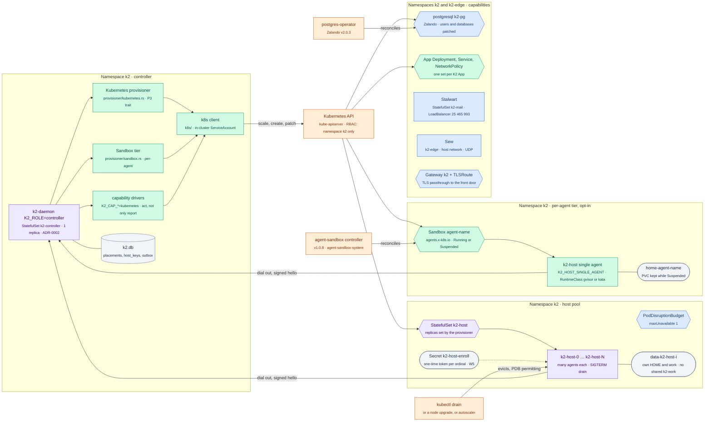
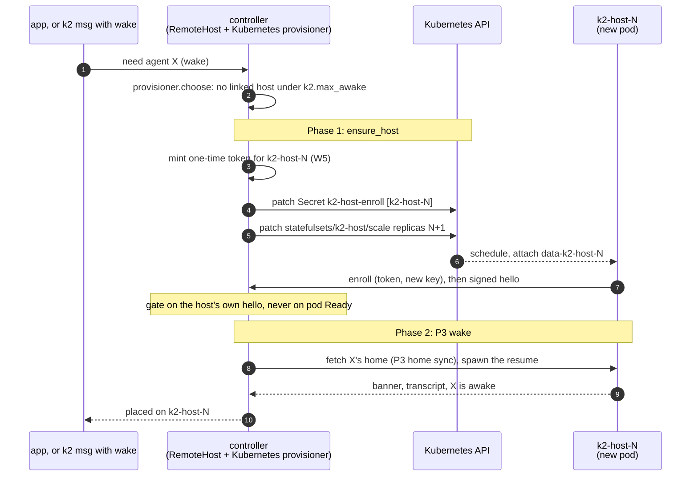
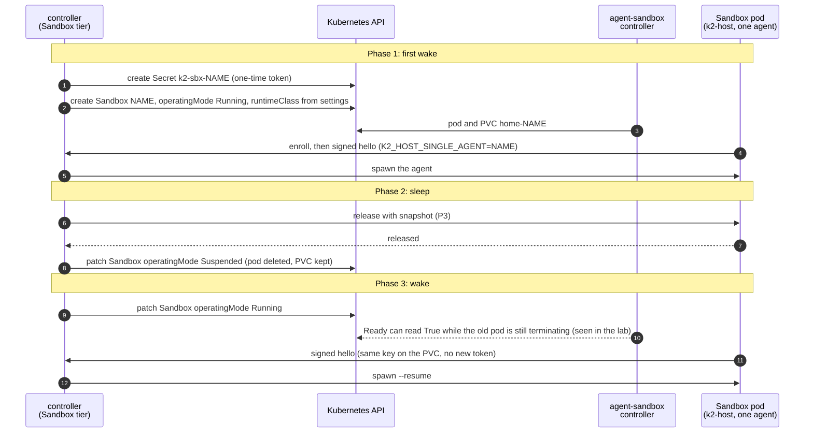
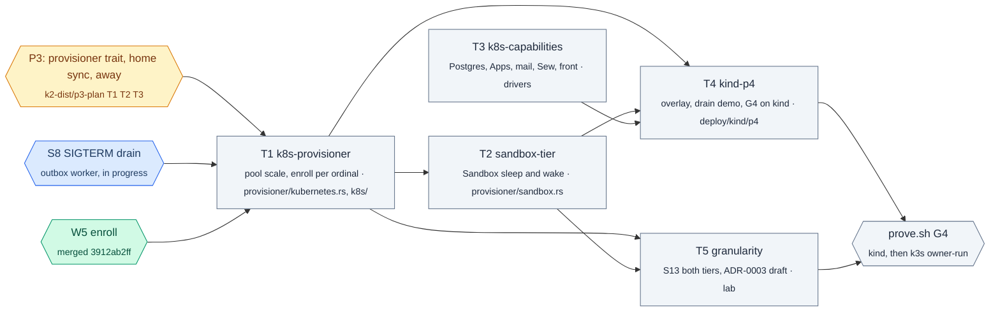

# p4-plan: Kubernetes provisioner (PRD stage P4 → gate G4)

Task `p4-plan`, branch `k2-dist/p4-plan` from `k2-dist/wave2-preview` @3912ab2ff. This is a design only; no code changes here.

PRD P4: "Kubernetes supplies hosts; everything else is already proven."

**What gets built:**
1. **Host pods**: a StatefulSet of `k2-host`, each pod running many agents, with a PodDisruptionBudget and a SIGTERM drain. The controller's Kubernetes provisioner scales it.
2. **An optional per-agent tier** on agent-sandbox `Sandbox`, with gVisor or Kata through `RuntimeClass`.
3. **Capabilities on Kubernetes**: Postgres through the Zalando postgres-operator, Apps as Deployments with a NetworkPolicy, Stalwart as a StatefulSet behind a LoadBalancer, Sew on UDP, and the front door through Gateway API.

**What proves it:**
- the full matrix on kind, then on the owner's k3s cluster (owner-run);
- a **pod-granularity decision record** with S13 numbers from both tiers and from real CLIs;
- the **demo**: drain a node during a conversation, and the agent comes back with its memory.

This builds on P3 (`docs/prd/progress/p3-plan.md` on `k2-dist/p3-plan`): its `Provisioner` trait, the portable home and the away state. P4 adds the `Kubernetes` implementation of that trait and does not redesign placement.

## The change



Blue here means **declared** in `deploy/kubernetes/` and checked by a server-side dry run, not yet running. The PDB, Stalwart, Sew, the Gateway and the postgresql object are written but have never served K2 traffic. Violet means the object exists and P4 changes how it is driven.

## The flows

### Scale up for a wake (host pool)



### Drain a node during a conversation (the demo, S8 + S10)

```mermaid
sequenceDiagram
    autonumber
    participant O as owner<br/>(kubectl drain node-a)
    participant K as Kubernetes
    participant H0 as k2-host-0<br/>(node-a)
    participant C as controller
    participant H1 as k2-host-1<br/>(node-b)

    O->>K: drain node-a
    K->>K: PDB k2-host maxUnavailable 1: evict k2-host-0
    K->>H0: SIGTERM, grace 600 s
    Note over H0,C: Phase 1: drain (S8, the outbox worker's task)
    H0->>C: draining: place nothing new here
    H0->>H0: wait for each awake agent's Stop hook (turn ends)
    H0->>C: snapshot each home (P3 T1), then release
    H0-->>K: exit 0
    Note over C,H1: Phase 2: the agent returns (S10)
    C->>C: provisioner.choose: k2-host-1 linked, has room
    C->>H1: fetch home, spawn --resume same session id
    H1-->>C: answers, MEMORY.md sha256 equal
    Note over K,H0: k2-host-0 stays Pending on local-path (its PVC is pinned to node-a)<br/>until uncordon; the provisioner sees it away and scales up if room is short
```

### The Sandbox tier: sleep and wake



## Where things stand on wave2-preview

### Declared end state (`deploy/kubernetes/`, server-side dry run only)

| object | file | P4 state |
|---|---|---|
| Controller StatefulSet, ConfigMap with `K2_PROVISIONER=kubernetes`, `K2_CAP_*` | `core/controller.yaml` | The settings parse. `capabilities.rs` reports the modes "Nothing acts on it yet". **No code reads `K2_PROVISIONER`** |
| `k2-host` StatefulSet (2 replicas, Parallel), PDB `maxUnavailable: 1`, 600 s grace, `K2_HOST_LABELS`, `K2_HOST_MAX_AWAKE`, `k2-host health` readiness | `core/hosts.yaml` | Runs on kind as one replica. **There is no `k2-host health` command**; kind uses curl. `K2_HOST_MAX_AWAKE` is read in `hosts/mod.rs` but not enforced |
| Namespace RBAC: scale `k2-host`; pods read; Sandboxes; Deployments, Services, NetworkPolicies; patch `postgresql/k2-pg`; get Secrets | `core/rbac.yaml` | Never exercised. P4 needs one more rule: patch the Secret `k2-host-enroll` (D8) |
| Zalando `postgresql k2-pg`, Stalwart StatefulSet + LoadBalancer, Gateway + TLSRoute, NetworkPolicies, Sew in `k2-edge` | `core/*.yaml`, `edge/sew.yaml` | Declared. No `k2-*`, Sew or Stalwart objects run on kind |
| Per-agent `Sandbox` with `runtimeClassName: gvisor`, `K2_HOST_SINGLE_AGENT` | `examples/sandbox-agent.yaml` | Example only. **No code reads `K2_HOST_SINGLE_AGENT`** |
| One App: Deployment, Service, NetworkPolicy, database | `examples/app.yaml` | The PRD's lab created the database for real (`app_notes` logged in to PostgreSQL 17.9) |

### What kind already proved (`deploy/kind/`, `scripts/kind/`, branch `k2-dist/kind-app`)

- **kind-dist**:
  - a controller and a host as StatefulSets, with the app connecting to one URL through a NodePort door;
  - the owner's `k2-kind-dist` runs it with their Claude login on the host's volume;
  - `K2_HOME` pinned to `$HOME/.k2`, since the home task changed its meaning: the end state's value would start empty state;
  - reconnect after a roll with the same session token in about 8 s.
- **kind-fleet**:
  - `--hosts=N`, each host with its own HOME volume;
  - the lab's S1–S7 and I1–I4 green with 2 hosts, using a runner pod and a kill/hold backend;
  - placement spreads across both hosts.
  - Limits: every host shares the `k2-work` volume, which is ReadWriteOnce, so all pods sit on the controller's node through podAffinity. **P3's D9 (per-host volumes plus home sync) removes that, and P4 needs it to spread hosts over nodes.**
- **kind-enroll**:
  - W5 on kind: a one-time token per host, minted into the Secret `k2-host-enroll` and never printed; the key on the host's volume (0600);
  - a pod restart relinks by key; a revoked host is refused;
  - S1–S7 green in enroll mode.
  - **This is exactly what the Kubernetes provisioner must do when it scales up** (D8).
- **K2_PTYD switch**: `KIND_PTYD_DEFAULT`, for W3b's byte ring.

### What k2lab has (read-only check, 2026-10-26)

| piece | state |
|---|---|
| nodes | 3, Kubernetes 1.37.0, containerd 2.3.4, 110 pods per node; the Docker VM (14 GB) is shared by all three |
| agent-sandbox | v1.0.8 in `agent-sandbox-system`; Sandbox `k2/agent-alice` Ready with a 1 GiB PVC. **The controller has restarted 22 times**: "unable to start manager … failed to get restmapping" when the API server was unreachable at start, around Docker VM restarts |
| Zalando postgres-operator | v2.0.3 in kind's `default` namespace; no `postgresql` object yet |
| Gateway API | CRDs only (TLSRoute included). **No GatewayClass, so nothing implements them** |
| RuntimeClass | **none** (no gVisor, no Kata) |
| storage | `standard`, local-path only (WaitForFirstConsumer): a volume is pinned to its node |
| CNI | kindnet (kind v0.33, kindnetd 2026-08). Recent kindnet implements NetworkPolicy, but **nothing on k2lab has shown it is enforced**: T3's first check proves it |
| LoadBalancer | none (kind has no cloud provider) |

### Daemon code

- **No Kubernetes client** in the workspace (no `kube` or `k8s-openapi` in `Cargo.lock`).
- **P3 (planned, not built)** brings `crates/k2-daemon/src/provisioner/`: the trait with `choose`, `ensure_host` and `idle` ("Kubernetes: scale up / scale down"), `Local` and `Static`, `agent_placement`, home sync, and away.
- **S8 drain**: the outbox worker is building the host's SIGTERM drain now (no branch yet).
- **W3b** (`k2-dist/w3b`): agent PTYs in k2-ptyd with a byte ring (`K2_PTYD=1`). A host pod restart then keeps a turn's bytes.
- **`g2-fixes`** (06b686e2b): a re-placed agent goes back to the host that holds its home.

## Design

### 1. Host pool: StatefulSet, PDB, drain, Kubernetes provisioner

The pool is `deploy/kubernetes/core/hosts.yaml` as declared: many agents per pod, process-level isolation (ADR-0001), and Pod Security `restricted`.

**`Kubernetes` provisioner** (`provisioner/kubernetes.rs`, implementing P3's trait):

- **`choose`**: P3's `Static` rules unchanged: pinned, then last host, then labels, then most room. Kubernetes hosts are servers (`k2.kind=server`), so agents are portable when home sync is on.
- **`ensure_host`**: when no linked host has room under `k2.max_awake`, it scales up.
  1. Mint a one-time token for ordinal N (enroll mode, W5) and patch the Secret `k2-host-enroll`.
  2. `PATCH statefulsets/k2-host/scale` to N+1, up to `K2_PROVISIONER_MAX_HOSTS`.
  3. Answer `Wait(scaling)`. The need is retried when the new host's **signed hello** arrives; pod Ready is never the signal, which is the lesson from the agent-sandbox lab.
  4. A refusal names the limit when the pool is at its maximum.
- **`idle`**: StatefulSets scale down from the highest ordinal only. So when the pool has had spare room for `K2_PROVISIONER_IDLE_AFTER` (D2, default 15 min):
  1. Mark the highest-ordinal host `draining`.
  2. Let P3 sleep or move its agents.
  3. Patch replicas down.
  4. Its volume and enrolled key stay, so a later scale-up reuses them without a new token.
- **Never** below `K2_PROVISIONER_MIN_HOSTS` (default 1). Never touch a host that is draining or away.

**Drain on SIGTERM** (S8, the outbox worker's task; P4 depends on it, does not build it):
- no new placements;
- wait for each awake turn's Stop hook, up to the grace period;
- snapshot homes (P3 T1);
- release, then exit.

The PDB (`maxUnavailable: 1`) makes `kubectl drain` evict one host at a time. A drain's eviction and the provisioner's scale-down meet in one rule: **a host that is draining is never chosen and never scaled**.

**Storage**: per-host volumes only, with **no shared `k2-work`** (P3 D9). Agents move by home sync, so hosts can be on any node and local-path is fine. With Longhorn, the drained host's own pod can also move; that is an option, not a requirement (D3).

**Readiness**: `hosts.yaml` names `k2-host health`, which doesn't exist. Add `k2-daemon --host-health` (exit 0 when linked) so images need no curl (D10).

### 2. Per-agent Sandbox tier (opt-in)

- **When**: an agent (or a whole workspace) set to `isolation: sandbox` is placed by `provisioner/sandbox.rs` into its own `Sandbox` (`examples/sandbox-agent.yaml`). Everything else stays on the pool.
- **The pod**: the same `k2-host` binary with `K2_HOST_SINGLE_AGENT=<agent>`. It accepts spawns for that agent only and refuses others (`single_agent_mismatch`).
- **The runtime**: `runtimeClassName` from `K2_SANDBOX_RUNTIME_CLASS` (`gvisor`, `kata` or empty for runc).
- **Enrollment**: one-time token in a Secret `k2-sbx-<agent>`, the key on the Sandbox's PVC. A resume relinks by key with no new token (as on kind).
- **Sleep**: release with a snapshot, then `operatingMode: Suspended`. The pod is deleted and the PVC kept.
- **Wake**: `operatingMode: Running`, then **wait for the signed hello**. The CR's `Ready` is never trusted: the PRD lab saw it read True while the old pod was still terminating.
- **When the agent-sandbox controller is down** (it crash-looped 22 times on k2lab): a wake waits for the hello up to `K2_SANDBOX_WAKE_TIMEOUT` (default 120 s), then refuses with `sandbox_unavailable`. The app shows that; nothing is placed on the pool behind the owner's back.
- **Login wallet** (the PRD's open question): see D4. The recommendation is that a Sandbox agent signs in itself, or uses a provider key from a Secret the owner names. The wallet is not copied in, since copying it would make the isolation tier mostly cosmetic.

### 3. Capabilities on Kubernetes (`K2_CAP_*` stops being report-only)

| capability | driver | what it does | on kind |
|---|---|---|---|
| `K2_CAP_POSTGRES=kubernetes` | controller | Patch `postgresql/k2-pg` `spec.users` and `spec.databases` per App, wait for the operator's credential Secret, connect with the `k2` user; `/cli/db` through the operator's Service | The operator is installed; T3 creates `k2-pg` in a test namespace |
| `K2_CAP_APPS=kubernetes` | k2-app-engine Kubernetes driver | Per App: Deployment, Service and NetworkPolicy as in `examples/app.yaml`, the image from a registry (D6), database credentials from the operator's Secret. App subdomains stay on the controller's front door (no Gateway object per App) | NetworkPolicy enforcement on kindnet is proven first by a deny probe |
| `K2_CAP_MAIL=external` | controller | Talks to Stalwart's management API at `K2_STALWART_URL`. The StatefulSet and LoadBalancer are applied by the chart, not created at runtime | No LoadBalancer on kind: management API only, unless D7 |
| `K2_CAP_SEW=external` | controller | Sew management at `K2_SEW_MGMT_URL`, in `k2-edge` on the host network | Host network works on kind nodes; UDP from outside needs D7 |
| `K2_CAP_FRONT=listen` | controller | The front door listens on 443 inside the pod; the Gateway passes TLS through (`gateway.yaml`) | Needs a GatewayClass (D7) |

### 4. Pod-granularity decision record (S13, both tiers)

The PRD's working recommendation (section 5) is host pods by default and Sandbox as an opt-in tier, decided at G4 from S13 with real CLIs. The record is `docs/adr/adr-0003-pod-granularity.md`, drafted by T5 and decided by the owner.

**What S13 measures on kind** (k2lab, a test namespace, fake agents):
- both tiers at 100 awake of 500 registered: the pool at `max_awake` 50 (2–3 pods) against 100 Sandboxes;
- pod and container overhead (per-pod RSS of `containerd-shim` and the pause container);
- kubelet CPU on the busiest node;
- the number of volumes;
- wake-to-ready p50 and p95, measured fresh, resumed from Suspended, and after a pod delete;
- controller CPU and RSS;
- zero processes per sleeping agent (NFR2).

**What the owner runs**: ten real CLIs per tier (the lab never runs real agents), giving RSS per awake agent and wake latency.

**What it is compared against**: the PRD's lab numbers:
- about 12 MiB per idle pod, against about 0.3 MiB per extra process;
- 13–23 % of a core of kubelet work for 100 idle pods, against 2–4 %;
- 330–490 MB per live claude CLI;
- a Sandbox ready 6 s fresh, 34 s after a pod delete;
- gVisor about +47 MB and git about 3× slower; Kata +120–300 MB.

**What the record must answer:**
1. Is the pool the default? (Expected yes.)
2. When is a Sandbox worth it? (Untrusted or shared clusters.)
3. Which runtime class is the default for Sandboxes on a cluster that has gVisor?
4. The `maxPods` and CIDR guidance for a cluster that runs Sandbox agents.

### 5. The demo: drain a node mid-conversation

**On kind first**, scripted (`scripts/kind/drain-demo.sh`, T4), with evidence and a cast:
1. Two host pods on different worker nodes, with no shared `k2-work`.
2. Agent `demo` on `k2-host-0` has `remember <fact>` in `MEMORY.md` and is mid-turn: a fake agent with `[[turn-ms=60000]]`.
3. `kubectl drain <node of k2-host-0> --ignore-daemonsets` (on k2lab, test namespace only, explicit kubeconfig).
4. Checks:
   - the PDB allows one eviction;
   - `k2-host-0` drains: the Stop hook, a snapshot and a release are traced;
   - the turn finishes or is resumed (W3b);
   - `demo` is placed on `k2-host-1` (`ctl.move_decision`, epoch + 1);
   - the next message resumes **the same session id**;
   - `MEMORY.md` sha256 is equal;
   - nothing is lost silently (I2);
   - `k2-host-0` is Pending on local-path until `kubectl uncordon`.
5. Uncordon. `k2-host-0` comes back and relinks by key, and its old copy of `demo` is released (P3).

**On the owner's k3s cluster**, owner-run with the same script against their context:
- **never run by a worker**: the `default` context is the owner's real cluster;
- the script refuses any context but the one passed explicitly, with `--i-am-the-owner`.

## Decisions for the owner

| # | Decision | Options | Recommendation |
|---|---|---|---|
| D1 | Kubernetes API client in the daemon | (a) `kube-rs` + `k8s-openapi`; (b) a small typed REST client on the daemon's existing HTTP stack, in-cluster ServiceAccount, about 12 calls (scale, pods get/list/watch, Sandbox CRUD, Deployment/Service/NetworkPolicy CRUD, patch `postgresql`, patch Secret) | **(b)** keeps the dependency tree and compile time down on a shared machine; watch is one streaming GET. Move to (a) if P5 needs informers and caches |
| D2 | Pool sizing | (a) fixed replicas set by the owner; (b) the controller scales between a minimum and a maximum | **(b)**: min 1, max set by the owner (default 3), scale up on demand, scale down the highest ordinal after 15 min with spare room. Node autoscaling stays P5 |
| D3 | Storage on k3s (PRD open question) | (a) home sync on local-path; (b) Longhorn as the recommended class; (c) both | **(a) by default** (P3 D1), so it works on any cluster. Document **(b)** as an option that also lets a drained host's own pod move. The demo must pass on local-path |
| D4 | Sandbox agents' provider login | (a) copy the host wallet into each Sandbox; (b) a broker; (c) the agent signs in itself, or the owner names a provider-key Secret | **(c)** for P4: copying the wallet defeats the tier's purpose. (b) later if the tier gets used a lot |
| D5 | gVisor on kind | (a) install `runsc` into k2lab's node containers (containerd config, node restart: **disrupts the owner's pods**); (b) a second, throwaway kind cluster `k2lab-sbx` for RuntimeClass tests; (c) runc on kind, gVisor and Kata only on k3s | **(b)**, with the owner's OK, since the rules say "only k2lab" today. Kata needs KVM, which kind on a Mac doesn't have: Kata is **owner-run on k3s only** |
| D6 | App images on Kubernetes | (a) an in-cluster registry in `k2`; (b) an external registry (ghcr); (c) `kind load` / `k3s ctr import` per App | **(a)**: the app-engine builds and pushes to `k2-registry` (Service, PVC); Deployments pull from it. (c) is only a kind shortcut for tests |
| D7 | LoadBalancer and Gateway on kind | (a) install cloud-provider-kind (outside the cluster) and Envoy Gateway (own namespace) on k2lab; (b) test mail, Sew and the front door only on k3s (ServiceLB and Traefik) | **(a)** for the matrix on kind, both reversible and outside the `k2-kind*` namespaces; with the owner's OK, since they are cluster-wide add-ons |
| D8 | How Kubernetes hosts authenticate | (a) the bootstrap token (today); (b) W5 enroll, with the controller minting per ordinal and per Sandbox | **(b)**, as kind-enroll does with `up.sh`. RBAC: `patch` on the pre-created Secret `k2-host-enroll` (by name), and `create`/`delete` Secrets in `k2` for `k2-sbx-*` (create can't be limited by name; namespace-scoped) |
| D9 | Who writes ADR-0003 (pod granularity) and when | | **T5 drafts it after S13 on kind; the owner decides at G4** with the real-CLI numbers |
| D10 | Host readiness | (a) curl in every image; (b) `k2-daemon --host-health` | **(b)**: no extra tools in images, the same probe in `hosts.yaml` and in the Sandbox template |

## Worker tasks



Ground rules for every task:
- Cargo goes through the slot. Daemons and tests use a throwaway HOME.
- **kind only, through an explicit kubeconfig for `k2lab`**, in new test namespaces (`k2-p4-*`). Never `k2-kind` or `k2-kind-dist`, never the `default` context (the owner's k3s cluster).
- No real agent CLIs.
- `K2_ROLE=all` stays unchanged (I5).
- Hook edits in another worker's files are one call each, listed in the task's progress file.
- `target/` stays under 40 GB.
- T3 can start now. T1 waits for P3 T2 phase A (the trait) and the S8 drain. T2 follows T1's client. T4 and T5 come last.

### T1 `k8s-provisioner`: the host pool on Kubernetes

- **Owns**:
  - new `crates/k2-daemon/src/k8s/`: `mod.rs`, a client per D1 (in-cluster config, scale, pods, Secret patch, a watch stream), tests against a fake API server;
  - new `crates/k2-daemon/src/provisioner/kubernetes.rs` plus tests;
  - `k2-daemon --host-health` (D10);
  - `docs/prd/progress/k8s-provisioner.md`.
- **Hooks**:
  - `provisioner/mod.rs` (P3): one line to select `kubernetes` from `K2_PROVISIONER`;
  - `hosts/enroll.rs`: one call to mint for an ordinal from inside the controller (no HTTP).
- **Depends on**: P3 T2 phase A (trait, `agent_placement`), S8 drain, W5 (merged).
- **Acceptance**:
  - **Unit**, with a fake API server and fake hosts:
    - with `max_awake=2`, a third wake scales 1 → 2;
    - the token is minted before the scale;
    - the need is retried on the new host's hello and never on pod Ready;
    - at the maximum, a refusal names the limit;
    - after the idle window, the highest ordinal is marked draining, its agents are released, then it is scaled down;
    - a draining or away host is never chosen and never scaled;
    - `--host-health` exits 0 only when linked.
  - **kind** (k2lab, a new namespace `k2-p4-pool`, the controller with the RBAC in `core/rbac.yaml` plus D8's rule, fake agents):
    - `K2_PROVISIONER=kubernetes`, `K2_PROVISIONER_MAX_HOSTS=3`, `max_awake=2`;
    - six wakes end with 3 host pods, each enrolled by key (`GET /cli/hosts/keys`);
    - after the idle window it is back to 1 pod, and the scaled-down hosts' agents are asleep with their homes snapshotted;
    - `kubectl get pdb` shows one disruption allowed;
    - the lab's I1–I4 hold over the run.

### T2 `sandbox-tier`: one agent per Sandbox

- **Owns**:
  - new `crates/k2-daemon/src/provisioner/sandbox.rs` plus tests;
  - the host's single-agent mode (`K2_HOST_SINGLE_AGENT`, one guard in `hosts/link.rs`'s spawn path);
  - the agent setting `isolation: sandbox`, with its route field and its column;
  - `docs/prd/progress/sandbox-tier.md`.
- **Depends on**: T1 (client, minting, health).
- **Acceptance**:
  - **Unit**:
    - create, then Suspended on sleep, then Running on wake;
    - a CR that reads Ready before the hello does not count;
    - a `single_agent_mismatch` refusal;
    - `sandbox_unavailable` after the timeout when the controller is down;
    - the per-Sandbox Secret is deleted with the agent.
  - **kind** (namespace `k2-p4-sbx`, runc):
    - an agent with `isolation: sandbox` gets `Sandbox/<agent>` and answers;
    - sleep leaves no pod and keeps the PVC;
    - a wake resumes **the same session id** with `MEMORY.md` equal;
    - `kubectl -n agent-sandbox-system scale deploy agent-sandbox-controller --replicas=0` during a wake gives the clear refusal, and scaling it back lets the next wake work;
    - pool agents are untouched throughout.
  - **gVisor** per D5 (`k2lab-sbx` if approved): the same, with `runtimeClassName: gvisor`, plus the overhead numbers for T5. **Kata**: owner-run on k3s.

### T3 `k8s-capabilities`: Postgres, Apps, mail, Sew, front door

- **Owns**:
  - new `crates/k2-daemon/src/capabilities/kubernetes/` (Postgres patching, credential Secret wait, mail and Sew wiring by URL);
  - the Kubernetes driver in `crates/k2-app-engine/` (a new module behind the engine's driver seam);
  - the `k2-registry` manifest (D6) in `deploy/kubernetes/core/`, in agreement with the `deploy/kubernetes` owner;
  - `docs/prd/progress/k8s-capabilities.md`.
- **Hooks**: `capabilities.rs`, one call to start the drivers for `kubernetes` and `external` modes (the report stays as it is).
- **Depends on**: nothing in P3. It can start now. It uses T1's client if T1 lands first, else its own minimal calls, to be merged later.
- **Acceptance on kind** (namespace `k2-p4-caps`; the Zalando operator already on k2lab):
  - **NetworkPolicy works on kindnet**: a default-deny policy blocks a probe pod and an allow rule lets it through. If kindnet does not enforce, the task stops and reports, with no workaround that touches the cluster.
  - **S12 parity on kind**:
    - creating an App gives a Deployment, a Service and a NetworkPolicy;
    - its database user is created through `postgresql/k2-pg` and **logs in**;
    - the App's NetworkPolicy lets the controller and the App's own database in and keeps a neighbour pod out;
    - `/cli/db` lists the database;
    - deleting the App removes all four.
  - Mail and Sew answer on their management APIs.
  - The front door through a Gateway: per D7, or deferred to k3s with the reason written down.
  - On the controller, `/boot-status` capabilities read `delegated` for each.

### T4 `kind-p4`: the kind overlay, the drain demo, G4 on kind (the kind-app worker)

- **Owns**:
  - `deploy/kind/p4/` (an overlay of `deploy/kubernetes/core` for namespace `k2-kind-p4`: per-host volumes, **no shared `k2-work`** (P3 D9), RBAC, enroll mode, `K2_PTYD=1`);
  - `scripts/kind/drain-demo.sh` and `scripts/kind/p4-up.sh`;
  - the kind backend's pool mode in `scripts/kind/fleet_kind.py` (hosts appear and go as the provisioner scales);
  - `docs/prd/progress/kind-p4.md`.
- **Depends on**: T1 and T2 (T3 for the capability rows); P3 T1 (home sync).
- **Acceptance** (k2lab, explicit kubeconfig, only `k2-kind-p4` and `k2-p4-*`):
  - the drain demo (design section 5): on `kubectl drain` of `k2-host-0`'s node, the agent comes back on another host with **the same session id and `MEMORY.md` sha256 equal**; I1–I4 PASS; a cast and an evidence bundle;
  - the lab's S1–S9 and I1–I4 on the pool through `fleet-g2.sh` (pool mode);
  - `prove.sh G4 --topology kind` runs the matrix (with the lab worker).
  - **k3s: the script and the steps for the owner, never run by a worker.**

### T5 `granularity`: S13 on both tiers, ADR-0003 draft (the lab worker)

- **Owns**:
  - the density harness for kind in `tests/lab/` (S13 on the pool and on Sandboxes);
  - the owner-run real-CLI script;
  - `docs/adr/adr-0003-pod-granularity.md` (draft);
  - `docs/prd/progress/granularity.md`.
- **Depends on**: T1 and T2 (gVisor per D5).
- **Acceptance**:
  - S13 on kind with fake agents, 500 registered and 100 awake, for each tier. The report has the numbers in design section 4, in a table side by side with the PRD's section 5 numbers.
  - The ADR draft answers its four questions, with the real-CLI rows marked "owner-run, pending" until the owner adds them.

## Open risks

- **agent-sandbox's controller restarts** whenever the API server blips (22 times on k2lab). The tier must be correct across that (T2's acceptance covers it). It is also a reason the pool stays the default.
- **local-path pins every volume to a node.** The demo only works because agents move by home sync. If P3 T1 slips, P4's demo slips with it; Longhorn (D3) is the fallback.
- **The Docker VM is shared** (14 GB for all three kind nodes and the owner's pods). S13 at 100 awake fake agents fits; real CLIs on kind don't, which is why they are owner-run on k3s.
- **Kata can't be tested by a worker** (no KVM on a Mac). The ADR records gVisor numbers from kind and Kata numbers only if the owner runs them.
- **RBAC creates Secrets in `k2`** for Sandbox tokens (D8). That is namespace-scoped but broader than today's `get`; the alternative is one pre-created Secret per agent, which defeats on-demand Sandboxes.

## Status

- MILESTONE: p4-plan written. Design, ten owner decisions with recommendations, five worker tasks with owned files, dependencies and acceptance on kind.
- Nothing runs or changes on any cluster in this task: k2lab was only read, and the owner's k3s cluster was not touched.
