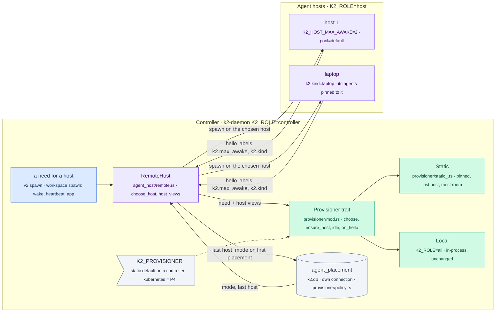

# placement: the provisioner, pinned or portable (P3 T2 phase A)

Task: P3 T2 phase A (`docs/prd/progress/p3-plan.md` on `k2-dist/p3-plan`,
section 2 and task T2), branch `k2-dist/p3-provisioner` from
`k2-dist/wave2-preview` @36db1f1eb (W1–W3, W3b, the outbox, W5). Built so
both P3 (home sync, away, moves) and P4 (`k8s-provisioner`) build on it.

Phase A: wakes are sticky to the agent's last host; pinned agents are never
placed elsewhere (the controller's `--wake` path included); `k2.max_awake`
(`K2_HOST_MAX_AWAKE`) with a clear refusal; labels. Not in phase A: moving a
portable agent after `K2_HOST_MOVE_AFTER` (phase B, needs home sync T1 and
presence T3), and the 90 s read-deadline "away" (T3); here a host is away
when its link is down.

## The change



## The flow

```mermaid
sequenceDiagram
    autonumber
    participant N as need<br/>(wake of notes)
    participant C as controller<br/>(RemoteHost + Static)
    participant P as agent_placement<br/>(controller k2.db)
    participant L as laptop<br/>(k2.kind=laptop)
    participant H as host-1<br/>(server)

    Note over N,H: Phase 1: first placement
    N->>C: spawn notes
    C->>C: choose: most room under k2.max_awake (ties by name)
    C->>L: spawn
    L-->>C: session
    C->>P: notes: pinned to laptop (D5), last host laptop
    Note over N,H: Phase 2: the laptop is away
    L--xC: link drops
    N->>C: wake notes
    C->>P: notes is pinned to laptop
    C-->>N: 503 pinned to host laptop, which is away; it waits (never elsewhere)
    Note over C,H: host-1 has room, and is not used
    Note over N,H: Phase 3: back
    L->>C: hello (labels)
    N->>C: wake notes
    C->>L: spawn
```

## How to try it

```sh
export RUSTUP_HOME=$HOME/.cache/k2-dist-rust/rustup CARGO_HOME=$HOME/.cache/k2-dist-rust/cargo
export PATH=$CARGO_HOME/bin:$PATH CARGO_BUILD_JOBS=3

# rules, the policy table, and RemoteHost with fake hosts
~/.cache/k2-dist-cargo-slot.sh cargo test -p k2-daemon --lib -- provisioner:: hosts:: --test-threads=3

# three real processes: controller, host-1, laptop (evidence in lab-runs/placement/<UTC>/)
scripts/lab/topology/three-process-placement.sh

# what the controller decided, per agent
curl -s "http://127.0.0.1:$CTL_PORT/cli/hosts/placements?token=$TOKEN"
```

## What's built

| Piece | Where |
|---|---|
| Trait `Provisioner` (`kind`, `choose`, `ensure_host`, `idle`, `on_hello`), `Need`, `HostView`, `Mode`, `Refusal`, `Ensure`, `IdleStep`; `Local`; `select` for `K2_PROVISIONER` | `crates/k2-daemon/src/provisioner/mod.rs` |
| `Static`'s rules | `provisioner/static_.rs` |
| `agent_placement (agent, mode, pinned_host, last_host, home_seq, updated_ms)` on its own connection to the controller's `k2.db` (never the shared lock: W3's boot deadlock) | `provisioner/policy.rs` |
| The hook: `RemoteHost::choose_host` replaces `pick_host` in `spawn` and in `reserve` (the workspace spawn: wake, heartbeat, the app's ensure-pinned-chat); `record_placement` after each placement; `adopt_unknown` pins an agent from before the table where it runs; hello labels kept per host (`set_labels`, one call in `hub.rs`); `status_json` gains `provisioner`, `away`, and per host `labels`, `kind`, `max_awake` | `agent_host/remote.rs`, `hosts/hub.rs` |
| `GET /cli/hosts/placements` (owner token): every agent's policy | `hosts/gate.rs` |
| `K2_HOST_MAX_AWAKE` on a host → the `k2.max_awake` hello label (an explicit label wins; a bad number fails host boot) | `hosts/mod.rs` |
| `K2_PROVISIONER` checked at boot: controller `static` (default) or `kubernetes` (static until P4 lands, logged); `local` only under `K2_ROLE=all`; anything else fails boot | one line in `daemon_main.rs::boot_settings_check` |

Rules (`Static`), in order:
1. Pinned: only its pinned host. Away → `503 … pinned to host X, which is away; it waits … (never placed elsewhere)`; linked but full → refused naming `K2_HOST_MAX_AWAKE`.
2. Portable with a last host that is usable, has room and carries the need's labels → that host.
3. Otherwise the usable host with the labels and the most room under `k2.max_awake` (no limit counts as the most; then fewest awake; ties by name). With no `k2.max_awake` anywhere this is today's `pick_host` (fewest placements, ties by name).
4. None: no host linked → today's `NO_HOSTS`; all full → refused naming `K2_HOST_MAX_AWAKE`; no labels match → named.

Usable = linked, not away, not draining. Away (phase A) = a host this process saw, that holds a placement, or that a policy names, whose link is down. Mode (D5): first placed on a `k2.kind=laptop` host → pinned there; any other host → portable; adopted without a row → pinned where it runs. `last_host` is written on every placement.

`K2_ROLE=all` never builds a `RemoteHost`: `Local` and the in-process host are unchanged (I5).

### Results

| Check | Result |
|---|---|
| `cargo test -p k2-daemon --lib -- provisioner:: hosts:: agent_host::` | **71 passed** (the existing W1–W3b tests now place through `Static`) |
| `provisioner::tests` | labels give capacity and kind; with no limits the choice is today's; a wake goes to the last host; a pinned agent waits for its away host and is never placed elsewhere (refused, `ensure_host` → `Wait`), goes back when linked, refused naming the limit when its host is full; capacity and the limit's name; label order; away and draining hosts skipped; D5 modes and `last_host` on every placement; rows survive a reopen; `K2_PROVISIONER` by role |
| `hosts::tests::a_wake_goes_back_to_the_last_host_not_the_emptiest` | fake hosts h-a, h-b: bob sleeps, h-a gets another agent, bob's wake still goes to h-a; a new agent goes to h-b |
| `hosts::tests::a_laptop_agent_is_pinned_and_waits_for_its_away_laptop` | pinned on first placement; laptop link drops → `away: ["eric-mbp"]`; v2 spawn **and the workspace spawn (the wake path)** refused, not placed on h-1; another agent still goes to h-1; laptop back → notes goes there |
| `hosts::tests::a_full_host_refuses_naming_k2_host_max_awake` | 503 naming `K2_HOST_MAX_AWAKE`; status shows `max_awake`, `kind`, labels; a sleep makes room |
| `hosts::config_tests` | `K2_HOST_MAX_AWAKE=2` → `k2.max_awake=2`; an explicit label wins; a bad number is an error |
| `scripts/lab/topology/three-process-placement.sh` (run `20261026T041154Z`) | **6/6 PASS**: kinds and limits from labels; notes pinned to the laptop (D5); bob sleeps and wakes back on host-1 although the laptop is emptier; both hosts full → 503 naming `K2_HOST_MAX_AWAKE`; laptop stopped → `away ["laptop"]`, notes' wake refused "pinned to host laptop, which is away", not placed on host-1 (which had room); laptop back → notes placed on it |
| `scripts/lab/topology/two-process.sh` (run `20261026T041202Z`) | **13/13 PASS**: the 12 before, plus "every placed agent has its placement policy" (8 agents, portable, last host host-1) |
| `K2_ROLE=all` regression: `cargo test -p k2-daemon --no-fail-fast -- --test-threads=3`, throwaway HOME | 162 binaries: **5253 passed, 0 failed**, 6 ignored |

## Follow-ups after verification (coordinator, 2026-10-26)

| # | Follow-up | Done |
|---|---|---|
| 1 | Static's host set from W5's enrolled keys | `enroll::sync_enrolled` pushes the non-revoked key names into `RemoteHost::set_enrolled` at controller start and after each enroll and revoke (enroll mode only). Never read from the registry under `RemoteHost::inner` (the shared DB lock; W3's deadlock shape). An enrolled host that isn't linked is away; revoked, it's gone. Test `enrolled_hosts_count_as_away_until_they_link_or_are_revoked` |
| 2 | `HostView.draining` from S8's drain state | waits for the outbox worker's S8 drain (coordinator relays) |
| 3 | Bound the away list | a host is known if it is linked, enrolled, holds a placement (W3 lost), is some agent's **pinned** host, or linked to this process within `K2_HOST_AWAY_FORGET` (default 24 h) since it unlinked. A host that is only some agent's `last_host` is dropped after that window. Test `a_host_seen_only_as_a_last_host_is_forgotten_a_pinned_one_is_not` |
| 4 | Adoption pinned every pre-existing agent | an agent adopted without a row gets D5 by its host's kind (the hello's labels are set before `adopt`): portable on a server, pinned on a laptop; an existing row keeps its mode. Tests `adopted_agents_from_before_the_table_are_portable_on_servers_pinned_on_laptops`, `provisioner::tests::policy_mode_…` |
| – | ptyd's socket path under a long temp dir | `two-process.sh` makes its root under `/tmp` (`LAB_SHORT_TMP`), so `<home>/.k2/run/ptyd/ctl.sock` and ptyd's fallback under the host's `TMPDIR` stay within `sun_path` (104 bytes on macOS) |

`cargo test -p k2-daemon --lib -- provisioner:: hosts:: agent_host::`: **74 passed**, 2 runs.
After the follow-ups: `three-process-placement.sh` (run `20261026T054717Z`) **6/6 PASS**; `two-process.sh` with the long macOS `$TMPDIR` (run `20261026T054730Z`) **13/13 PASS**, the host's agents under k2-ptyd (socket under the short `/tmp` root).

## Status

- Milestones: diagrams written; phase A done.
- Next (not phase A): phase B moves (needs T1 home sync and T3 presence); T3's
  90 s read-deadline away; P4 rebases `k2-dist/k8s-provisioner` onto this and
  adds `kubernetes` to `select`.
