# k2-dist · trace: trace events and flows as tests (PRD section 3, rule 4)

Task `trace`, branch `k2-dist/trace`. Stage **P1**, gate **G1** on topology
**solo**: "Trace diff passes for spawn, hook event and CLI-crash flows on
solo." The daemon writes trace events in the lab's format
(`docs/prd/progress/lab.md`, "Trace format"); the lab's checker
(`tests/lab/labkit/flows.py`) matches them against the flows.

## What changes

```mermaid
graph TD
    %% ── Colour legend ──────────────────────────────────────────────
    %% Blue = exists today, unchanged · Violet = changed (trace lines only)
    %% Green = new in this task · Orange = outside K2 · Slate = files, env
    %% Shapes: rect = process or module, stadium = file,
    %%         hexagon = generated, flag = env var

    %% ── DAEMON · crates/k2-daemon (solo: controller and in-process host) ──
    subgraph daemon [k2-daemon · solo, controller and in-process host]
        SP[HTTP spawn entry<br/><sub>v2_spawn.rs · spawn_session, 1 line</sub>]:::changed
        AT[HTTP attach entry<br/><sub>sessions_grid_ws.rs · 1 line</sub>]:::changed
        HI[hook receipt<br/><sub>hook_ingest.rs · ingest_with</sub>]:::changed
        WM[message delivery<br/><sub>workspace_msg.rs · pending_live.rs</sub>]:::changed
    end

    %% ── CORE · crates/k2-core ──────────────────────────────────────
    subgraph core [k2-core · library]
        PTY[DaemonPtySession<br/><sub>terminal/daemon_pty.rs · spawn, write, kill</sub>]:::changed
        IB[inbox write<br/><sub>inbox.rs · compose</sub>]:::changed
        TR[trace sink<br/><sub>trace/mod.rs · emit, off unless K2_TRACE_FILE</sub>]:::new
        TC[correlation<br/><sub>trace/corr.rs · pane to agent, spawn scope</sub>]:::new
        TW[PTY watcher<br/><sub>trace/pty.rs · first output, child exit</sub>]:::new
        WT[writer thread<br/><sub>bounded queue, never blocks the caller</sub>]:::new
    end

    ENV>K2_TRACE_FILE<br/><sub>absolute path · new setting</sub>]:::state
    FT([daemon trace<br/><sub>run/daemon.trace.jsonl</sub>]):::state
    FA[k2-fake-agent as claude<br/><sub>tests/fakes · K2_FAKE_AGENT_TRACE</sub>]:::existing
    FF([fake-agent trace<br/><sub>run/fake-agent.trace.jsonl</sub>]):::state

    %% ── LAB · tests/lab ────────────────────────────────────────────
    subgraph lab [Lab kit · tests/lab · python3 stdlib]
        G1[G1 scenarios<br/><sub>scenarios/g1_solo.py · S1 + S7 crash</sub>]:::new
        CK[flow checker<br/><sub>labkit/flows.py</sub>]:::existing
        FJ([flows<br/><sub>docs/prd/flows/spawn, hook · crash.json new</sub>]):::new
        V{{verdict per flow<br/><sub>flows.json · solo steps vs not in solo</sub>}}:::new
    end

    SP -- spawn scope: agent_id --> TC
    PTY -- host.spawn, ptyd.open_session, pty.* --> TR
    PTY -- subscribe events --> TW
    TW -- first output, child exit --> TR
    AT -- api.attach --> TR
    HI -- cell.*, host.agent_event --> TR
    WM -- host.inject, pending_live.* --> TR
    IB -- inbox.write --> TR
    TC -. pane to agent .-> TR
    ENV -. turns on .-> TR
    TR -- try_send --> WT
    WT -- appends lines --> FT
    FA -- cli.* --> FF
    G1 -- spawn, attach, type, kill -9, resume --> daemon
    G1 -- merges --> FT
    G1 -- merges --> FF
    G1 --> CK
    CK -- reads --> FJ
    CK --> V

    classDef existing fill:#dbeafe,stroke:#2563eb,color:#1e3a5f
    classDef changed  fill:#ede9fe,stroke:#7c3aed,color:#3b0764
    classDef new      fill:#d1fae5,stroke:#059669,color:#064e3b
    classDef external fill:#ffedd5,stroke:#ea580c,color:#7c2d12
    classDef state    fill:#f1f5f9,stroke:#64748b,color:#1e293b
```



## Main flow: the CLI-crash flow (S7) as traced on solo

```mermaid
sequenceDiagram
    participant L as Lab<br/>(g1_solo.py)
    participant D as k2-daemon<br/>(controller + in-process host)
    participant P as PTY<br/>(daemon_pty, in-process)
    participant F as k2-fake-agent<br/>(as claude)
    participant T as Trace<br/>(K2_TRACE_FILE)

    Note over L,T: Phase 1: spawn (flow spawn, steps 1, 3 to 8)
    L->>D: POST /cli/sessions/v2/spawn {agent_name, claude --session-id X}
    D->>T: api.spawn_request (agent_id)
    D->>P: DaemonPtySession::spawn
    P->>T: host.spawn, ptyd.open_session, pty.spawned
    P->>F: exec claude --session-id X
    F->>T: cli.exec, cli.hook SessionStart
    F->>D: POST /hook/event (notify.sh)
    D->>T: cell.owner_walk, cell.owner_verdict, cell.event, host.agent_event
    L->>D: WS /cli/sessions/grid (api.attach)
    P-->>T: client.stream (first output with a client attached)

    Note over L,T: Phase 2: crash mid-turn (flow crash, steps 4 to 6)
    L->>D: type "a long task"
    F->>T: cli.turn.start
    L->>F: kill -9 (pid from cli.exec)
    P->>T: ptyd.child_exit {signal: 9, clean: false}
    D->>T: host.agent_exit (session marked dead)

    Note over L,T: Phase 3: the next need resumes (flow crash, steps 7 to 11)
    L->>D: POST /cli/sessions/v2/spawn {agent_name, no command}
    D->>T: api.spawn_request
    D->>P: spawn claude --resume X (tab-row recovery, today's code)
    P->>T: host.spawn {resume: true, session_id: X}
    F->>T: cli.exec {resumed: true}, cli.hook SessionStart
    D->>T: host.agent_event
    L->>L: checker: spawn, hook, crash pass (solo steps); I3 same session id
```

## Trace events the daemon emits

`src` is always `k2-daemon` (in solo the in-process host is the daemon, so
`host.*` and `ptyd.*` come from it too). `host` is `local`, `epoch` is null
(no placements before P2). `agent_id` is the spawn's `agent_name`; the hook
plane resolves it from the pane (terminal session id) the spawn registered.
`attrs.pane` is the terminal session id; `session_id` is the provider's.

| Event | Where (file, emission point) | Flow step |
|---|---|---|
| `api.spawn_request` | `k2-daemon/src/v2_spawn.rs`, first line of `spawn_session` | spawn 1, crash 1 and 7 |
| `api.attach` | `k2-daemon/src/sessions_grid_ws.rs`, first line of `serve_session_grid_connection` | (context) |
| `host.spawn` | `k2-core/src/terminal/daemon_pty.rs`, top of `DaemonPtySession::spawn` | spawn 3, crash 2 and 8 |
| `ptyd.open_session` | `daemon_pty.rs`, just before the PTY opens (in-process or k2-ptyd) | spawn 4 |
| `pty.spawned` | `daemon_pty.rs`, once the child pid is known (the child exec) | (context) |
| `pty.first_output` | `trace/pty.rs` watcher, first output event | (context) |
| `client.stream` | `trace/pty.rs` watcher, first output after a client attached | spawn 8 |
| `pty.input` | `daemon_pty.rs`, `write` (byte count only, never content) | (context) |
| `ptyd.child_exit` | `trace/pty.rs` watcher, `ChildExit` (code, signal, clean) | crash 5 |
| `host.agent_exit` | `daemon_pty.rs`, `mark_child_exited` (session marked dead) | crash 6 |
| `pty.kill` | `daemon_pty.rs`, `kill` | (context) |
| `cell.hook_received` | `k2-daemon/src/hook_ingest.rs`, `ingest_with` | (context) |
| `cell.owner_walk` | `hook_ingest.rs`, before `owner::check` | hook 2 |
| `cell.owner_verdict` | `hook_ingest.rs`, after `owner::check` | hook 3 |
| `cell.event` | `hook_ingest.rs`, an accepted envelope | hook 4 |
| `host.agent_event` | `hook_ingest.rs`, published to the activity store, with agent_id | spawn 7, hook 5, crash 11 |
| `host.inject` | `k2-daemon/src/workspace_msg.rs`, `inject_framed_locked` | msg 7 (not G1) |
| `pending_live.enqueue` | `k2-daemon/src/pending_live.rs` | (context, not G1) |
| `inbox.write` | `k2-core/src/inbox.rs`, `compose` | (context, not G1) |

### Flow steps not in solo

| Flow | Step | Why |
|---|---|---|
| spawn | 2 `placement.choose` | No placement exists before P2 (one in-process host). The AgentHost interface (task `agenthost`) is where it lands. |

All hook steps exist in solo (the owner check runs in the daemon, on the same
kernel as the CLI). All crash steps exist in solo.

## How to try it

```sh
# One command: builds the daemon and fake agent, boots solo with
# K2_TRACE_FILE, runs S1 and the CLI crash, prints the verdict per flow.
tests/lab/scenarios/g1_solo.sh

# The sink's unit tests, under a throwaway HOME as the Linux gate does
# (some pre-existing tests write to $HOME/.k2)
HOME=$(mktemp -d) cargo test -p k2-core --lib -- trace::

# The runner's flow logic on hand-written traces (no daemon)
python3 -I -B tests/lab/scenarios/test_g1_solo.py

# Spawn latency (NFR1): S1 x9 with the trace off and on, and against a
# k2-daemon built from the base commit when G1_BASE_DAEMON names one
G1_BASE_DAEMON=/path/to/base/k2-daemon tests/lab/scenarios/g1_solo.sh --bench 9
```

Output lands in `lab-runs/G1-trace/<ts>/` (gitignored): `solo/out/trace.jsonl`
(daemon, fake agent and lab events merged), `solo/out/flows.json` (the G1
verdicts and every flow on the whole trace), `S1/`, `S7.json`,
`solo/daemon.trace.jsonl` (the daemon's own trace).

## Status

- **Milestone:** done (2026-10-25); integrated on `k2-dist/wave1`
  (`b1a5c311a`) the same day: rebased, boot check wired, solo sets
  `K2_TRACE_FILE`.
- **After the rebase and integration commit (2026-10-25):**
  - `g1_solo.sh`: G1 solo trace PASS; `spawn` 7 of 8 (`placement.choose`
    not in solo), `hook` 5 of 5, `crash` 11 of 11, with `solo.sh` setting
    `K2_TRACE_FILE` (no wrapper). Bundle `lab-runs/G1-trace/2026-10-25T20-42-57Z`.
  - Boot check, built daemon under `env -i` and a temp HOME: a relative
    path, a directory, a missing parent and a read-only directory each
    exit 2 with `[daemon/boot] FATAL: K2_TRACE_FILE="…" …` before
    `daemon.port` exists; unset boots to `ready`.
  - Sink unit tests (`trace::`): 12 passed. Lab suite: 28 OK.
  - Clippy: nothing on changed lines; the same 3 pre-existing `k2-daemon`
    deny errors as below.
  - The one rebase conflict: agenthost moved `inject_framed_locked`'s
    write loop behind `agent_host().inject`; the `host.inject` line now
    sits just before that call.
- **Checks before the rebase:**
- **Checks (all on this Mac, temp HOME, every `K2_*` unset, 3 jobs, 3
  threads):**
  - `tests/lab/scenarios/g1_solo.sh`: S1 PASS, S7 PASS; `spawn` PASS
    (7 of 8 steps, `placement.choose` not in solo), `hook` PASS (5 of 5),
    `crash` PASS (11 of 11). Bundle `lab-runs/G1-trace/2026-10-25T15-06-24Z`.
  - Sink unit tests (`trace::`): 11 passed (12 with the boot-check test).
  - `cargo test -p k2-core`: all pass (lib 3676 + 1 ignored, every
    integration binary). Two environment notes: `tests/ptyd_backend.rs`
    needs `cargo build -p k2-ptyd --bin k2-ptyd` first (8/8 then), and
    `macos_keychain_tests` needs a short `$HOME` (the `security -i` line
    carries the keychain path; 18/18 under `/tmp`). The keychain test is
    macOS-only; neither touches trace code.
  - `cargo test -p k2-daemon`: lib 4344 passed, 0 failed (5 ignored);
    162 binaries, 5143 passed. Two failed in that run, which a
    coordinator SIGSTOP froze for 3 h and which ran at load 140 to 170:
    `heartbeat_daemon_tick::headless_daemon_fires_with_no_external_ticker_within_150s`
    passes alone; `connect_login_edge::anonymous_app_spray_closes_only_anonymous_app_logins`
    failed alone at load 165 (65 of 65 anonymous app logins got 401, the
    60-failure ceiling never refused one) and passes on this branch 3 of 3
    at low load and on the base commit at low load. Not reproducible since;
    no trace line is on the login path, and with `K2_TRACE_FILE` unset none
    runs. Worth a soak under load by whoever owns login throttling.
  - Clippy (`-p k2-core -p k2-daemon --all-targets`): 0 findings on any
    added line, 0 in `trace/`. Pre-existing: 6 deny-level errors in
    `k2-core` (`deprecated/delegate.rs`, `terminal/grid_snapshot.rs`) and 3
    in `k2-daemon` (`compute_admin/tests.rs`, `llm_routes.rs`,
    `mail/external_imap.rs`) fail clippy on base too; run with
    `-A clippy::deprecated_semver -A clippy::while_immutable_condition` to
    see the rest.
  - NFR1, `g1_solo.sh --bench 9` (S1 `spawn_to_banner_ms` median): base
    commit 56.1 ms, this branch trace off 54.6 ms (-2.7%), trace on
    57.2 ms (+2.0%). Within 5%.
  - Lab suite `tests/lab/run_tests.sh`: 28 Python + fake-agent tests OK;
    `extract_flows.py --check`: 11 flows in sync; `test_g1_solo.py`: 6 OK.
- **Answered:** `crash.json` lives in `docs/prd/flows/` (coordinator,
  2026-10-24); the lab's `3105385e6` (cherry-picked here, drops out at
  rebase) lets `test_flows.py` accept flow files beyond the 11 PRD ones.
- **Answered:** `cli.hook` timing (coordinator, 2026-10-24, option A): the
  fake agent now writes `cli.hook` before running the hook and
  `cli.hook.done {exit}` after (lab `9cb30dde7`, cherry-picked here).
- **Open questions:** none.

### New interface

- `K2_TRACE_FILE`: absolute path; the daemon appends one JSONL event per
  line. Unset or empty means off: no trace work at all. Set but not
  absolute, or not openable for append, is an error, never a silent off
  (coordinator, 2026-10-24): `daemon_main.rs`'s `boot_settings_check()`
  calls `k2_core::trace::boot_check()` next to `K2_ROLE` and
  `K2_DAEMON_PORT`, so the daemon exits 2 before anything starts. The
  check opens and closes the file and starts no thread (it runs before
  `handoff::capture_process_context()`, which wants no threads yet); the
  sink starts on the first emission. In `deploy/README.md` as *new (P1)*.

### Decisions inside owned files

- **Writer.** A bounded queue (16384) and one writer thread; emission
  points `try_send` and never wait. A full queue drops the event and the
  next line written is `trace.dropped {count}`. One `write` per line on an
  `O_APPEND` file, so lines never interleave (unit-tested with two sinks on
  one file).
- **Correlation.** `agent_id` comes from the HTTP spawn: `spawn_request`
  opens a thread-local scope that `DaemonPtySession::spawn` (same thread)
  reads, then pane → agent is kept for the hook plane. Spawns that do not
  come through the HTTP route (heartbeat wakes, canonical chat) carry
  `agent_id: null` until the AgentHost interface names the agent.
- **Exit order.** `ptyd.child_exit` (trace watcher) and `host.agent_exit`
  (`mark_child_exited`, from the daemon's exit observer) hear the same
  broadcast on different threads. The trace module writes
  `host.agent_exit` only after the pane's `ptyd.child_exit` (the session
  is marked dead because the child exited), so the crash flow is never
  flaky on that pair.
- **`client.stream`** is the first PTY output after a client attached
  (`api.attach`), so it means output reached an attached client, not just
  that the socket opened.
- **`host.inject`, `pending_live.enqueue`, `inbox.write`** are emitted for
  the msg flow later (not G1). `workspace_msg.rs` has no inbox write today
  (`k2 msg` is live-or-fail), so `inbox.write` is in
  `k2-core/src/inbox.rs::compose`; `pending_live.enqueue` carries the
  signal id as `msg_id`.
- **`lib.rs`** gains one line, `pub mod trace;`.
- **The crash scenario** uses a `tab-*` agent in a registered workspace,
  because that is where today's daemon resumes a dead CLI on the next need
  (`recovered_launch_ex`: harness command + provider session id in
  `workspace_tab_sessions`). The turn is 30 s (`--turn-ms`), and the
  `kill -9` lands once the prompt is in the transcript: the CLI has taken
  the prompt and is working on it. A kill before that leaves no
  conversation to resume, for the real CLI too (seen in the first run: the
  resumed fake agent exited 1, "No conversation found").
- **The runner builds the daemon and the fake agent in two cargo calls**:
  `cargo build -p k2-daemon --bin k2-daemon -p k2-fake-agent` builds only
  the bin named `k2-daemon`, so the fake agent was never built.

### Hand-off: `prove.sh G1 --topology solo` (lab worker)

1. `scripts/lab/topology/solo.sh` now starts the daemon with
   `K2_TRACE_FILE=$run_dir/daemon.trace.jsonl` (`LAB_DAEMON_TRACE`
   overrides it; empty runs the trace off, as the bench's off phase does).
2. Merge `daemon.trace.jsonl`, `fake-agent.trace.jsonl` and the
   scenarios' lab events, sorted by `ts` (the checker sorts too).
3. Run S7 as `tests/lab/scenarios/g1_solo.py`'s `Crash` does: register the
   workspace (`/cli/projects/add-from-path`), spawn a `tab-<uuid>` agent
   with `--session-id X --turn-ms 30000`, type, wait for the prompt in the
   transcript, `kill -9` the CLI pid (`cli.exec`'s `pid`), wait for
   `host.agent_exit` on that pane, then spawn the same agent with no
   command. Or call `Crash(...).run()` and `check_g1(...)` directly.
4. Judge `spawn`, `hook` and `crash` on their solo steps:
   `g1_solo.NOT_IN_SOLO` lists the step to show as "not in solo"
   (`spawn` step 2, `placement.choose`). Check each flow on its
   scenario's events (`g1_solo.scoped`), so another agent's events never
   complete it.
5. Done at integration: the boot check in `daemon_main.rs` and
   `K2_TRACE_FILE` in `deploy/README.md`.

### Flow steps that exist only with remote hosts (P2)

- `spawn` step 2, `placement.choose`. Every other step of `spawn`, `hook`
  and `crash` has a solo emission point (table above). In P2 the `host.*`,
  `cell.*` and `ptyd.*` events move to `src: "k2-host"` / `"k2-ptyd"`.

### Rebase notes (lines in files other workers own)

- `crates/k2-daemon/src/v2_spawn.rs`: one line, first line of `spawn_session`.
- `crates/k2-daemon/src/sessions_grid_ws.rs`: one line, first line of
  `serve_session_grid_connection`.
- `crates/k2-core/src/terminal/daemon_pty.rs`: trace lines only, plus
  `write` converts `bytes` once (to count them) and passes the `Cow` on.
- `crates/k2-daemon/src/workspace_msg.rs`: one line, before
  `agent_host().inject` in `inject_framed_locked`.
- `crates/k2-daemon/src/daemon_main.rs`: one line in
  `boot_settings_check()` (integration commit).
- The cherry-picked lab commits (`3105385e6`, `9cb30dde7`) dropped out at
  the rebase onto `k2-dist/wave1` (`git cherry` marked them upstream).
